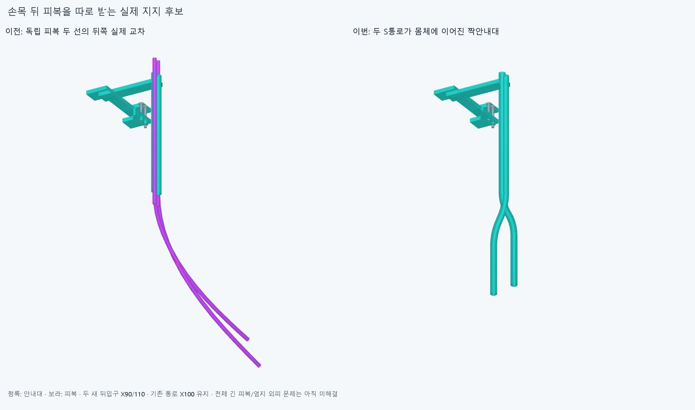
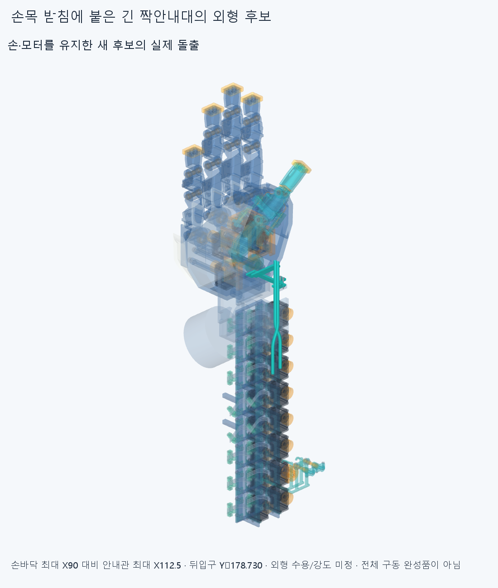

# PAIR034 실제 S자 짝안내대와 국부 피복 삽입 공간

**기존 안내대 본체1개를 두 뒤입구의 일체 S통로로 교체한 명목 후보다. 새16정적/30조립/10규정 피복 끝삽입과 그 공간외피는 겹침0이다. 모터~엄지의 긴 유연피복 전체는 아직 연결하지 않았고 엄지 외피 문제도 남아 있다.**

## 실제 실패 위치에서 필요한 지지로

[조사](reviews/survey.json)는 ELASTICA033에 저장된 실제 공통재료를 읽었다. 두 피복의 뒤쪽 교차는 X103.452696~112.334259/Y−160.892110~−137.309450/Z−23.044953~−8.216835mm, 기존 뒤입구Y−100보다37.309450~60.892110mm 뒤다. 엄지 외피 공통재료는 X59.444142~64.859472/Y23.400016~26.899734/Z19.200491~21.485292mm다. 원래 실패6native/정밀5쌍은 재실행하지 않았다. 저장 STEP 기본체적과 원래 source 기본적분 차이/정밀보조는 이전 보고 그대로이며 새 결함이 아니다.

이번에는 두 선을 따로 받는 실제 뒤 S관을 만들었다. [장면](generated/assembly_scene.json)의 new_parts5=본체1/국부피복2/국부중심줄2, retained_parts5=앞덮개1/명목M2볼트2·너트2다. 설치 하드웨어는6행으로 수가 늘지 않았으며 옛 wrist_external_feed_clip/그118mm국부참고4를 교체한다. 손397/포장385/전기48선·16외곽/팔10은 유지한다. 기존 손364본체/축·길이/모터설치·랙/전기선/끝구·죠는 바꾸지 않았고 이전 STEP/STL **4734개 해시가 불변**이다. 옛 긴 실패곡선/짧은끝피복4/시각화 공통체적을 같은 피복과 중복 설치하거나 장애물로 더하지 않는다.

## 실제 부착과 통로

두 뒤입구는 **(90,-178.729833462074,−3)/(110,-178.729833462074,2)mm, +Y축**이다. 뒤 직선40mm→서로 반대방향의 R40 원호2개(각28.955024372°)→기존X100/Y−100~−4 직선96mm로 연결한다. 앞출구는 (100,−4,−3/2)/+Y로 같다. 각 통로 중심선은 **176.428840822733mm**이며 전체 피복 절단길이가 아니다. R40/안내관OD5·보어Ø3.2/피복OD3·ID1.3/줄OD0.6mm는 공간가정이며 공급품 허용굽힘/수명 규격이 아니다. 두 S관은 Z가5mm 달라 투영상 교차해 보여도 실제 재료는 분리된다. 손/모터 설치각이나 손가락 협응을 바꾼 것이 아니다.

본체는 기존 안내대와 이어진 유효한 한 솔리드이며 옛 본체 재료를 제거한 차집합 체적은0이다. 피복→S보어/슬리브→기존 일체팔/뒤판→앞덮개/기존 M2두자리→Palm_wrist_saddle의6mm벽 Y−6/0·바깥X54모서리라는 명목 반력 경로가 있다. 나사X59/Z−55·−49와 체결스택/접촉좌석은 유지했고 기존 손/손목에는 구멍을 내지 않았다. 가상 waypoint를 설치 가이드로 세지 않는다.

안내대는 손목받침H=P@Y를 따른다. 참조 굽힘X축(0,−80,0), 편위Z축(32,−65,0)을 썼다. 손397/안내대/손바닥 포장39는H, 전완 포장346/전기64는고정, 캐리어·편위모터는P/손목받침은H다. 실제 손-팔 체결/강성 승인은 아니다.

## 새 국부 검사

[정적](reviews/static.json)은 모두 새 계산이다. 중립손목의 편손/IP−15·45·85/기존 구접근 부모25·50·75·100% 손8과 편손의 손목굽힘−20/0/20×편위−15/0/15 중 중립을 뺀8, 총16이다. 새10 대 손397/포장385/전기64/팔10과 내부45쌍을 포함해 **137005쌍/203AABB후보/겹침0·연산실패0**이다. 각도는 검사 표본이지 새 제한각이 아니다. 손자체/기존부품끼리/물체/전체 긴피복·전기선 운동/손목 연속왕복·모터 출력 전회전은 새로 검사하지 않았다.

[조립](reviews/service.json)은 본체Y−20/−10/−5/−1/0→앞덮개Y+12/+6/+3/+1/0→볼트각Y+20/+10/+5/+1/0→뒤너트각Y−20/−10/−5/−1/0이다. 6경로30유한표본, **25755쌍/56AABB후보/겹침0·실패0**이다. 국부피복/줄4참고는 아직 없고 손/모터/전기/팔은 있다. 실제 설치/누락 목록을 저장했으며 체결 전 수동유지 조건이다. 기존 성공을 승계하지 않았다. 3좌석 거리0/법선±0.05mm재료분류는 명목접촉이며 예압/하중/6자유도 강성 승인은 아니다.

## 피복 끝의 규정 삽입과 공간 포함관계

하드웨어 체결 뒤 두 피복의 **길이220mm 끝참고**를 같은 실제 S통로를 따라 밀어 넣는 기하를 만들었다. 재료좌표 원점은 새 뒤입구다. 끝좌표0/20/40/60/80/100/130/160/176.428840822733/186.428840822733mm의10표본, 각2피복/선사이까지 **17250쌍/19AABB후보/겹침0·실패0**이다. 각 순간의 피복길이220mm와 외경/내경을 유지했다. 실제 구동줄은 끼우지 않았다.

각 피복 끝참고는 중심선 재료구간[t−220,t]를 차지한다. t∈[0,186.428840822733]의 합집합은 [−220,186.428840822733]이며 실제 통로 앞뒤의 직선 연장과 S곡선에 같은 원형 환단면을 쓸어 만든 **406.428840822733mm 공간외피**에 포함된다. [외피 STEP](generated/feed_envelopes/scene.json)은 설치부품이 아니다. 두 외피 대 현재862부품/완성 하드웨어와 서로 사이의 **1725쌍/3AABB후보는0**, 20개 개별 참조의 외피밖 재료도0이다. 이 포함관계는 규정한220mm끝삽입의 전 이동 공간에 한정된 기하 근거다.

실제 S관이 국부 중심선을 안내하지만, 밖의 느슨한 꼬리는 직선으로 가정했다. 실제 굽힘강성/EI·중력·접촉/마찰/비틀림/밀어 넣는 힘/좌굴을 풀지 않았다. 650mm 전체 피복이나 실제 공급품/모터~엄지 연결·자유꼬리의 탄성평형/장력·예압/줄끼우기 승인으로 확대하지 않는다. 피복은 보어에서 축방향으로 미끄러질 수 있다. 이전 독립막대의650mm/460mm수치경계/가상슬라이딩을 새 설계로 승계하지 않았다.

모든 실제 재료 대조는 보고기준0.001mm³초과/Boolean허용오차1e−6mm/OCC풀1이다. 해시/입력 보호는 각 보고서에 있다.

## 외형과 미해결

뒤입구는 기존보다78.729833462mm 더 뒤로 가고, 최대X112.5mm로 손바닥 최대X90 대비22.5mm 밖이다. 추가 돌출/사람다운 외형은 **수용 미정**이다. 겹침0이 외형 수용을 뜻하지 않는다. 긴 외팔보/곡선 보어의 제조법·재료/강성·좌굴·공차/공급품/실제 공구·나사산/토크·예압/미끄럼·마찰/마모·수명·축방향 고정은 미검증이다. 기존 종단 죔쇠의 압착/당김/안쪽 줄끼임도 미검증이다.

다음은 실제 엄지 외피 관통 위치와 종단의 접근방향을 읽고 필요한 끝쪽 굽힘/분리지지를 실제 thumb_mcp 몸체·끝구/죠의 부착/접촉에 연결하는 것이다. 새 뒤입구까지 모터의 유연구간도 아직 없으며 전체 긴피복/두줄/길이조절·예압/부모·손목 잡기·풀기는 미완이다. 이번 국부16/30/10공간검사를 자동반복하거나 같은 독립막대/자유곡선·길이/반경 탐색으로 돌아가지 않는다. 손절삭/모터이동/OD축소/각도제한/팔꿈치 버스는 보류한다. 모든 실물인증을 다음CAD/요청3~4동작영상 조건으로 무한히 늘리지 않는다. 이전 OFFSET024면비교false/HOUSING027·GUIDED030·ELASTICA033 기본적분false와 명시 정밀보조는 그대로 보존한다.
