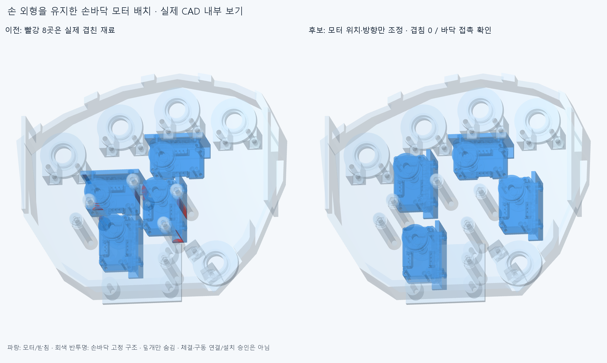

# PALM014 손바닥 모터 배치 교정

**손364부품과 관절축·길이·외형은 유지하고,모터3묶음24부품의 위치/방향만 바꿨다. 기존 고정8관통쌍을 새 배치에서 해소했다.** 모터 작동 목표각을 바꾼 것이 아니다. 실제 체결/구동 설치 완료는 아니다.

빨강은 기존8쌍의 실제 공통 체적이다. 파랑 부품 전체가 절삭 대상이라는 뜻이 아니다. 회색 반투명·덮개 숨김은 내부를 설명하기 위한 그림이며 기하 검사에는 손364부품을 모두 포함했다. [현재 실제 단면](images/current_sections.png)도 보존했다.

## 바꾼 배치

- 엄지 뿌리회전: Y−8mm. 처음 후보에서 해결한 위치를 유지했다.
- 엄지 대립: X+36mm. 기존 덮개 지지기둥을 피하는 빈 공간으로 옮겼다.
- 약지 MCP: 기존 중심(−26,69,−21)mm 주위 Z270°회전 후 Y+6mm. 모터·로터·크래들·몸체 나사·하부 나사/너트·받침·드럼8부품을 같은 강체 변환으로 옮겼다.
- 중지MCP·16원격모터·랙·48전선/16커넥터 외곽·160가이드 부품의 기존 파일/위치는 유지한다. [선택 입력](placement2.json),[새 배치](selected/generated/layout.json),[새24/기존329 참조](selected/generated/scene.json).

## 확인한 범위

새24부품 대 전체 손364부품의 편 손·엄지척·교차·25mm 고정 구 접근·복합 동작 **5끝자세**,기존329포장/가이드,서로 다른 새 모터 묶음,고정48전선/16커넥터 외곽,중립 팔10부품을 대조했다. 합계53544부품쌍 범위 중128AABB후보를 native Boolean으로 계산해 **보고 기준0.001mm³ 초과 겹침0·연산 실패0**이다. Boolean 허용오차1e−6mm. 손 자체의 예전 운동 경로를 새로 검사한 것은 아니다.

3받침의 바닥면은 현재 손바닥과 거리0이고,각5위치에서 Z±0.05mm의 재료 안/밖을 확인했다. Z를 올려 떠 있는 배치가 아니다. 이것은 **명목 바닥 접촉**이며,가로/위 방향 구속·볼트 체결·하중 전달/강도를 승인한 것은 아니다. 같은 묶음 내부 접촉은8부품의 동일 강체 변환으로 보존하며 이번 서로 다른 모듈 포장 검사와 구분한다.

첫 XY/180°후보는5끝자세마다 엄지3쌍/약지1쌍의 새 관통이 남아 **미채택**했다. [첫 결과](reviews/check.json)와 [형상](generated/scene.json)을 지우지 않았다. [최종 결과](reviews/check2.json)는 기존8쌍 재현과 새 배치를 구분한다. 이전WIRE008의 높이3/5/7mm실패를 반복하거나 손바닥을 깎지 않았다. 몇 후보 실패를 설치 불가능 증명으로 쓰지 않는다.

## 남은 큰 일

이 단계는 **명목 모터 배치 후보**다. 손바닥 받침의 실제 고정/분해·삽입/공구 접근,허브/혼·양방향 텐던 구동 연결,손바닥4모터의 전기 리드,축 방향 인장완화·연결 버스/보드 임시 종단·동적 케이블은 미완이다. 모터20개 설치/전체 결선 완료가 아니다. 16커넥터는 중공 상세가 없는 외곽이고 실제 결합·공급 케이블OD/굽힘 수명·전류/전압강하·연속 운동·실물은 미검증이다. XL330도 공간 비교 후보이며 최종 선정이 아니다.

원격 모터/랙/전선을 옮기지 않았으므로 이전48출구 공간·6대표 조립 진입 근거는 그 범위대로 보존한다. 이번5끝자세0을 손/팔 연속 경로 또는 모터/케이블이 구동되는 완성품으로 승격하지 않는다. [손만 움직이는 기존4동작](../assembly_sequence_v2/previews/four_motions.gif)은 별도다. 실제 구동/배선 통합 후 같은3~4동작 그림을 갱신한다.

정확SHA의 새 깨끗한 사본에서 핵심 검사 후 `docs/reviews/PALM014`에 대상과 실제 재현 범위를 남긴다. 같은 에이전트의 검토이며 독립 감사가 아니다.
