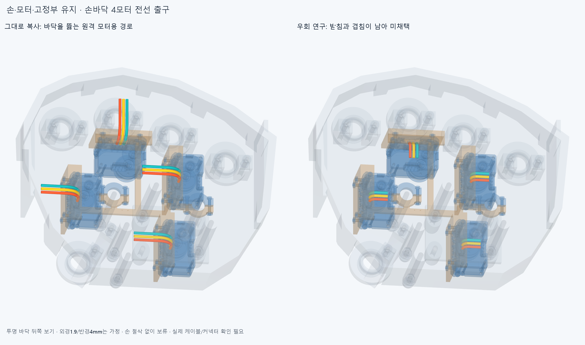

# PALMLEAD016 손바닥 전선 출구 연구,미채택

**손·모터 위치·고정부는 유지했다. 손바닥4모터의 전선12개 후보에는 현재 가정 규격에서 겹침이 남아 채택하지 않았다.** 공급 케이블/커넥터 출구 형상을 확인할 항목으로 남기고,공간을 확인한 원격 배선의 버스 설계는 진행할 수 있다.

원격 모터용 반경10mm/출구직선5mm 경로를 복사하면 바닥 쪽을 향한다. 원래 포장/고정 손 검사에서 25겹침 기록을 보존했다. 복사한 경로의 실패이며 손이나 모터 배치의 구조적 불가능 증명이 아니다. 그림은 바닥을 투명하게 한 실제 CAD 보기다.

첫 모터에서 반경6mm/직선1mm의6방향,반경4mm/직선0.5mm의6방향,추가 직선 없는 반경4mm의3방향,세 번째 선을 따로 벌린3후보를 검사했다. 각 연구는 **첫 모터 실패 범위**에서 종료했고 나머지3모터를 해결한 결과가 아니다. 일찍 꺾으면 받침을 피하지만 회전부/모터에 걸리는 경우가 있었다. [원래 연구/입력 일치](reviews/history.json). 몇 후보 실패를 배선 불가능이나 CAD 수정 필요의 증명으로 쓰지 않는다.

후속은 비교용 반경4mm/직선0.5mm/굽힘뒤8mm/평면180° 후보를 **4모터12선 전체**에 저장한 미채택 정적 연구다. 외경1.9mm도 미확정 가정이며 공급 케이블의 허용 굽힘/출구 직선부/수명 기준이 아니다. 더 작은 가정 반경으로 계속 맞추는 일은 여기서 닫는다. **이 작은 가정 외곽 겹침 때문에 손이나 받침을 절삭하지 않았다.**

실제 native검사는 현재 MOUNT015의 새11+기존349=360포장/고정부,고정 손바닥70부품,원격48선/16외곽,새66선쌍/4외곽,중립 팔10과의 정적 대조다. 전선 기준 **6162쌍 범위 중67AABB후보,보고 기준0.001mm³ 초과 겹침12쌍·연산 실패0**,Boolean허용오차1e−6mm다. [전선별 실제 겹침/체적](reviews/assessment.json),[저장16후보](generated/scene.json). 손364부품 입력 해시는 확인했지만 native수입은 고정 손바닥 부품만이다. 이미 정적 걸림이 있어 **새5끝자세/손동작 경로 검사는 하지 않았다.** 이전 성공한 손동작을 실패로 바꾸지 않는다.

기존 손/모터/받침·원격48선/16커넥터 외곽의 파일/세계좌표는 유지했다. 예전4어댑터를 현재360조합에 다시 더하지 않는다. 단일관절→canonical모터의 X−14.5mm 보정과 최종 PALM014 설치 변환을 적용했다. 전기 전선과 구동 텐던은 다르다. 선 색은 핀 순서가 아니다.

새4커넥터는 중공 하우징이 아닌 외곽 상자다. 포장/고정 손과의 별도 `plug_vs_*` 결과를 실제 중공 결합 결함 또는 결합 승인으로 바꾸지 않는다. ROBOTIS [공식 설명서](https://docs.robotis.com/ko/docs/dxl/model_reference/x_series/xl_series/xl330-m077/)의3핀 TTL GND/VDD/DATA·3.7~6V(권장5V)·EHR03/B3BEHA/SEH001TP06·21AWG를 다시 확인했다. 기존 JST 단자 최대22AWG와의 차이는 실제 공급 하네스/단자 조합으로 확인할 항목이다. [출처와 가정](references.json).

다음은 공급 완성 케이블의 실제 외경/중공 하우징/출구·허용 정적 굽힘 확인,그리고 **기존 원격48리드의 연결 버스/보드 임시 종단**이다. 그 사이 보드 없는 공간 설계를 모두 멈추지는 않는다. 손바닥 후보 미해결을 전체 배선 불가능으로 확대하지 않는다. 축방향 당김 방지·실제 혼/허브·양방향 텐던·전체20모터 설치/체결 강도·공구/지그·전류/전압강하·동적 케이블/손목 서비스 루프·실물은 미완이다. 배선이 적당히 통합되면 기존3~4동작을 새 구성으로 갱신하되 손만의 GIF를 물리 구동 영상으로 바꾸지 않는다. 정확SHA 핵심 재현은 후속 기록이며 같은 에이전트 검토다.
