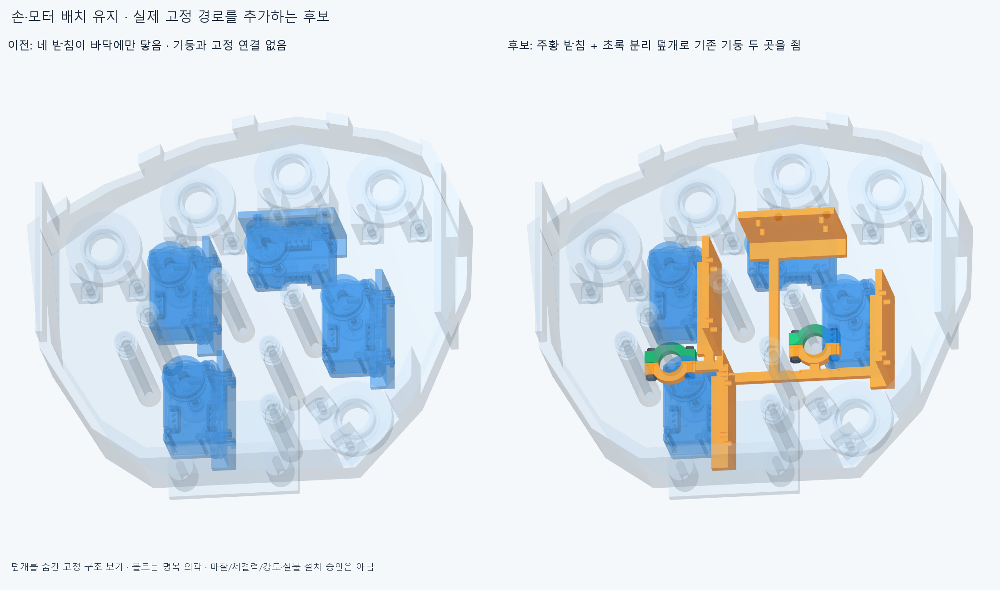

# MOUNT015 손바닥 모터 고정부 후보

**손364부품·모터 위치를 유지하고,네 모터 받침을 연결한 한 부품과 기존 두 기둥을 죄는 분리 덮개를 추가했다.** 바닥 접촉만 하던 받침에 고정 경로를 만든 명목 CAD 후보다. 실제 체결력/강도·전체 설치 승인은 아니다.

주황은 기존4어댑터를 연결한 한 받침,초록은 분리형 죔쇠 덮개2개다. M2명목 나사/너트 각4개를 포함해 새11부품으로 기존4어댑터를 대체하고 나머지349포장/가이드는 기존 파일을 참조한다. 합계360포장/고정부이며 손364부품과48전선/16커넥터 외곽은 별도다. **손에 새 구멍을 뚫거나 모터를 다시 옮기지 않았다.**

## 실제로 검사한 범위

새11부품 대 손364부품의 편 손·엄지척·교차·25mm고정구·복합 **5끝자세**,기존349포장/가이드·새55쌍·48선/16외곽·중립 팔10의24728쌍 범위 중250AABB후보를 native계산했다. **보고 기준0.001mm³ 초과 겹침0·연산 실패0**,Boolean허용오차1e−6mm다. 두 기둥의8방향에서 반경4.8±0.05mm 재료 안/밖을 확인했고 받침-바닥 거리0이다. 반경/높이와 명목 나사·공구 가정은 [선택 입력](selected3/parameters.json)에 있다.

## 채택한 조건부 조립 순서

1. 손 밖에서 미리 하부 나사를 넣은 모터/크래들 묶음을 받침에 조립한다. **중지MCP를 엄지 대립 모터보다 먼저** 넣는다. 그 뒤 하부 너트를 넣는다. vendor 내부 조립·사전 나사 삽입/공구·지그는 이 단계의 새 검사가 아니다.
2. 앞덮개와6개 덮개 머리 외곽이 아직 없는 손을 기존 **네 손가락 펴고 엄지 접기(count4)** 자세로 잡는다. 이 손 끝자세의 자체 간섭0은 FUNCTION003의 같은364형상 자료를 승계한다. 모터/받침/하부너트25부품을 **위70→0mm,5mm 간격15표본**으로 내리는 경로를 새로 검사했다. 네 드럼 참고 외곽은 이 묶음에 부착하지 않았다. 실제 혼/허브 결합은 미완이다.
3. 기둥의 분리 덮개를 북쪽10→0mm에서 넣는다. 너트3개는 X를 바깥쪽4mm/Y−1mm 비켜 내려놓은 다음 안쪽으로 이동해 맞춘다. 모터 아래 한 너트는 X+12/Y−3mm에서 옆으로 넣고3mm 밀어 실제 너트 받침면에 맞춘다. 그 뒤 북쪽에서4개 나사를 넣는다. 너트를 잡는 작업과 실제 공구/지그 전체는 미검증이다.
4. 공구는 명시한15mm스템과1mm육각 끝만 검사했다. 원래8mm전진 시작은 고정 뿌리에 걸렸고 보존했다. 선택한4mm진입의 시작은 자체 나사 머리와 실제 거리약3mm로 분리되어 있다. 손잡이·공급 공구/드라이브 적합성과 실제 조작을 검증한 것은 아니다.

원본 [선택 형상/65표본 연구](selected3/reviews/check.json)는 너트 위 삽입·긴 공구 시작 실패를 포함해 `sampled_paths_clear=false`로 보존한다. [교정 순서](reviews/final_service.json)는 최종 **82유한 표본,새 계산25/동일 결과 재사용57**에서 보고 겹침0/실패0이다. 재사용한 경로는 부품·장애물·이동이 같다. 원래65표본 전체가 통과했다고 쓰지 않는다. [조립 단계별 모든 부품/장애물/아직 없는 부품](reviews/assembly_scopes.json)을 명시했다. 연속 이동 전체의 충돌 증명은 아니다.

첫 두 연구는 새 덮개/받침 관통 및 실패 조립 근거가 나온 뒤 남은 중복 계산을 중지해 `completed=false`다. [기록](reviews/history.json)을 보존한다. 첫 조립 연구의 엄지 걸림,두 번째의 접힌 약지 걸림은 **조립 자세의 실패**이며 손 가동 불가능 증명이 아니다. 최종은 손 외형을 바꾸지 않고 네 손가락을 펴서 비켰다. 새 볼트/너트 받침면의 실제 재료 간섭은 새 고정부의 평면 자리로 고쳤다.

## 미완 범위와 다음 단계

기둥 죔쇠는 접촉과 나사/너트 공간을 가진 후보지만 **축력/마찰에 의한 위쪽 이탈 억제·기둥/출력 받침 하중·인쇄 강도/공차·풀림/마모·공급 나사 품번과 나사산·완전한 공구/지그는 미검증**이다. 임의 재료 겹침을 접촉으로 제외하지 않았다. 모터20개 실제 설치/드럼 혼·허브/양방향 텐던·손바닥4모터 전선/버스/보드·동적 케이블과 전기/실물은 미완이다. 네 드럼 외곽은 여전히 로터와0.5mm 떨어진 참고이며 힘 전달 부품이 아니다.

이미 닫은 모터 배치/손동작의 미세 여유 재탐색으로 돌아가지 않는다. 다음은 구동 연결과 손바닥 리드·모터 사이 버스/보드용 임시 종단이다. [기존 손동작4종](../assembly_sequence_v2/previews/four_motions.gif)은 손만 움직이는 CAD 자료이며 이번 고정부의 운동/동적 배선·물리 성능을 새로 승인하지 않는다. 저장 후 정확SHA 새 깨끗한 사본의 핵심 재현은 `docs/reviews/MOUNT015`에 남긴다. 같은 에이전트 검토다.
