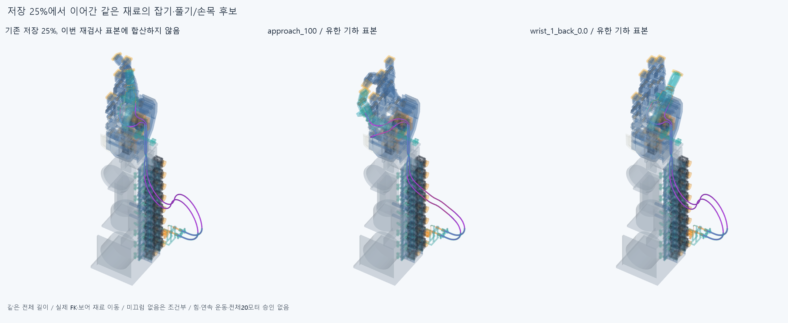

# MOTION047 저장 25%에서 이어간 같은 재료의 잡기·풀기·손목

**계획한 유한 접근·복귀·손목 경계에 도달. 새 수치증분 시도43/해성립43, 재료두께 native 14실행과 이동하드웨어 14상태, 새차단0/같은줄접합21/기존모터참고접촉14/연산실패0를 구별한다. 실제 힘·고정·연속운동/전체손20모터 승인은 없다.**

## 이어간 시작과 자연스러운 목표

CONT046의 마지막25% 저장파라미터/재료상태를 그대로 시작했다. 끝낸 중립~25%의5증분/5native를 다시 풀거나 새검사 수에 합산하지 않았다. 본체 형상·설치축은 유지했다. 모터는 전완고정, PAIR는 H=P@Y, 엄지종단은 H+MCP, 자식은 실제IP FK와 모터출력0.77q를 따른다. 모터 목표각 변경과 설치축 변경을 구별한다.

계획은 기존 자연잡기 목표의부모30~100%를5%간격으로15증분, 풀기는90/80/75/70/60/50/40/30/25/20/10/0%의12증분이다. 편손에서 손목굽힘/편위를각(-20,-15)°와(20,15)°까지25/50/75/100%로갔다가75/50/25/0%로돌아오는16증분, 합43목표다. 이 각은 기존참고동작이며 새설치축/허용각도제한/모든극단조합 승인아니다. 기하투영이실패하면 원래시도를보존하고 동일목표사이에수치이분1회만허용했다. 이는 목표각제한/새길이·반경경계가 아니다. 실제기록이 계획완주와 다르면 기록을 우선한다. **stop_reason=None**, 수치실패기록0개다.

두께검사는새접근30/50/75/100%,복귀75/50/25/0%,손목각부호별50/100%와중립복귀, 계획14실행이다. 실제14실행, 최대접근native 100%이며 첫새차단에서 중단했다. 나머지중간증분은 표본 point/shell접촉 계산이며 두께 native/연속충돌 통과로 세지 않는다. 이번 원래 point/shell질의18043는 반복거리계산이며 그만큼 운동표본을 통과했다는 뜻이 아니다. 복귀도 직전상태에서 이어갔고 정방향형상을복사하지않았다. 차이가나더라도 실제마찰 히스테리시스/탄성평형 증거가 아니다.

## 같은 재료와 실제 보어

피복 **698.964345153791/761.108456948670mm**, 줄 **853.356663204892/932.491923574900mm** 유지다. 전장잔차최대2.27373675443e-13mm/조각끝점차최대3.33635141455e-07mm/조건부꼬리실제강체프레임 끝점차최대5.92954724627e-14mm다. 상류8/하류6 수치원호와 길이분배 좌표를 직전상태에서 이어가며, PAIR앞뒤를 재료 고정점으로 묶지 않는다. 현재반경·길이예산/외경을바꾸거나독립변동길이자세를재맞춤하지않았다. 기존±2mm조절부를 텐셔너/새필요규격으로 쓰지 않았다.

실행한상태의4재료×14=56프로필, 같은재료9점씩504점과 같은보어증인56개, 합560점이다. 같은물질좌표를 첫40mm직선안에남기려고다시고르지않았다. 실제PAIR전체176.428840822733mm의직선·곡선경로에서동일점을계속대조했다. 저장증인중첫직선밖/전체실제보어안은20개,전체보어밖은0개다. 밖이면밖으로기록했으며 하나의추적점이보어밖으로나간것을전체피복이없거나구동실패로바꾸지않는다. 실제보어경로내좌표일치는기하축슬라이딩근거이고 마찰하의통과력·마모·실제접촉평형승인이아니다.

양꼬리 미끄럼없음과 피복양끝착좌는 **미검증 마찰·예압/압착·빠짐저항 조건부 경계**다. 실제양의스토퍼/매듭/고정력·예압·장력/공급·절단·신장·필요조절범위승인이아니다. 최소증분좌표투영은수치경로이며EI·중력·비틀림·좌굴·접촉정상력/마찰·힘·실제평형을풀지않았다. 수치원호분할점은 설치지지/텐셔너가아니다.

## 실제 재료와 형상 보존

각새native에서 두전체피복·두전체줄118조각(피복46/줄72)을 현재손397/포장385/전기64/팔10/PAIR6의전체5그룹과 새재료모든자기쌍으로검사했다. 합 **1520666쌍/7079AABB/21기록/0연산실패**다. 보고0.001mm³초과/Boolean1e-6mm/OCC1이다. 같은물리줄의모터꼬리/감김연속0·1접합21을raw그대로보존하며새차단0와구별한다. raw_all_clear=false를분류/검사제외로0으로덮지않았다. 새point접촉계산과두께검사모두실제모터9회전/현재손FK·손목을썼다.

새하드웨어0, 기존 STEP/STL **8086해시 불변**, 손397/기본364·포장385·전기64·팔10·PAIR6·비율/본체·축·길이·모터/랙·전기/OD유지다. 시간별118조각을 새설치118부품으로세지않는다. 옛피복/줄/축프로브·실패곡선·증거형상을같은선과중복설치하지않았다. 이동22와관련된쌍외기존하드웨어끼리전쌍/물체파지·다른19모터전달/전기동적운동은 이번새검사아니다. 대표엄지IP두줄이부모·손목을따르는경우이며전체20모터통합구동이아니다.

[원시결과](reviews/check.json),[실제보어증인](reviews/guide_witnesses.json),[첫새차단최대공통재료/수치실패진단](reviews/evidence.json)을따른다. 새native차단이면 실제그쌍의공통재료만증거로내보냈다. 수치투영실패면원래실패·수치이분시도를보존하고수학중심선/실제종단잔차로진단했다. 이를 실제재료Boolean실패·모든경로불가능/손절삭근거로바꾸지않는다. 작은기존동일줄접합/끝낸국부틈·나사를자동정밀반복하지않았다.

## 이동 하드웨어 추가검사

재료검사와별도로실제회전모터9/자식13을나머지현재840하드웨어와,두이동묶음사이9×13을검사했다. 각상태18597쌍, 실제14상태/260358쌍/776AABB/14기록/0연산실패다. 원래DRIVE018모터중앙참고나사/자기모터접촉14개는원래쌍·체적절대1e-5일치로분류하되raw그대로보존했다. 새하드웨어차단0개, 전체재료표본의이동하드웨어검사완료=true, 결합된유한표본조건부기하clear=true다.

모터9내부/자식13내부강체쌍과나머지840끼리전체는재검사하지않았다. 재료대이동22는원래재료검사에이미포함하므로반복하지않았다. 이추가검사는재료운동계산뒤실행했으며, 하드웨어에서먼저차단되면뒤에이미계산된재료상태를삭제하거나결합운동승인으로승계하지않는다. [이동하드웨어원시결과](reviews/moving_hardware.json)를따른다.

## 그림·동작 설명과 한계

전후그림은 기존25%저장CAD와 이번대표최대접근/마지막nativeCAD다. 팔은 SEAT041의정확nativeSTEP기반mm메시이며 현재하드웨어와같은강체/FK/손목변환을썼다. 렌더는native그룹재실행0이다. 모든목표와이동하드웨어검사를완료한경우 접근/풀기/손목의3개GIF를저장native표본으로만든다. 프레임220ms는설명속도이며실제구동속도/50ms추종·힘증거가아니다. 이는한대표두줄경로의세단계이고요청한서로다른전체손3~4손짓의구동완료를뜻하지않는다. 큰외부루프/돌출외형수용은미정이다.

## 다음과 남은 범위

Close MOTION047 finite same-material parent approach/release and open-hand wrist paths. Do not repeat the completed 43 target increments, 14 material native snapshots or 14 additional moving-hardware snapshot checks. Use the actual saved candidate and scoped previews to connect the next representative hand-side drive/local-wire integration need; update requested motion illustrations when useful without waiting for all physical certification. Keep exact housing/cord material budgets, real guide sliding, both-line/hardware contact, forearm-fixed motor/PAIR H=P@Y/distal H+MCP and actual IP/rotor0.77q. Material-coordinate projection remains geometric; tail no-slip/housing seating are unverified friction/preload/retention conditions, not actual force/tension/equilibrium. Other19 motor routes, dynamic electrical motion and whole20motor/physical/manufacturing/exterior approvals remain incomplete. Preserve CONT046 bounded replaytrue separately from SLIDE045/CORD043/BIARC039 initialfalse and all earlier failures/holds. Keep accepted hand397/base364/pack385/elect64/arm10/PAIR6/proportions/axes/lengths/motors/rack/wires/OD. No elbow bus, hand cutting, motor/rack/electrical relocation, OD shrink, angle limits, seam-zeroing/microgaps/closed tail/screw repeats, old scalar Newton/80 optimization/independent rods/free curves/independent variable-length biarc refits, virtual supports or absent tensioners.

모든곡면식·trim·일치경계면Boolean동등성, 실제전체설치/조립·손·공구·지그·나사산/토크·강도·수명/마찰·압착·빠짐저항·힘/장력·예압/EI·중력·비틀림·좌굴/물리평형·연속왕복·전기동적운동·실물·제조·전체손/외형은승인하지않았다. CONT046한정coretrue와SLIDE045/CORD043/BIARC039 corefalse·FIX044미검증고정/SEAT041실패·이전비교보류는별도로보존한다. 같은에이전트이며독립감사가아니다. 전체공급품/실물인증을다음CAD/요청3~4영상의무한조건으로늘리지않는다.

## 정확SHA 새사본재검사

대상`739222fdf60b1169722839739684fd6b8b1844d9`초기core=false, 36/40native·56/56프로필/560재료점·56/56실제보어증인·16/16형상일치. [한정결과](../../docs/reviews/MOTION047/README.md). 모든곡면/전체손·힘·연속구동승인아님.

설명 영상: [접근](images/conditional_approach.gif) · [풀기](images/conditional_release.gif) · [손목 왕복](images/conditional_wrist.gif). 대표 엄지 두 줄의 저장 CAD 표본이며 실제 구동·전체 손 3~4손짓 완료가 아니다.
