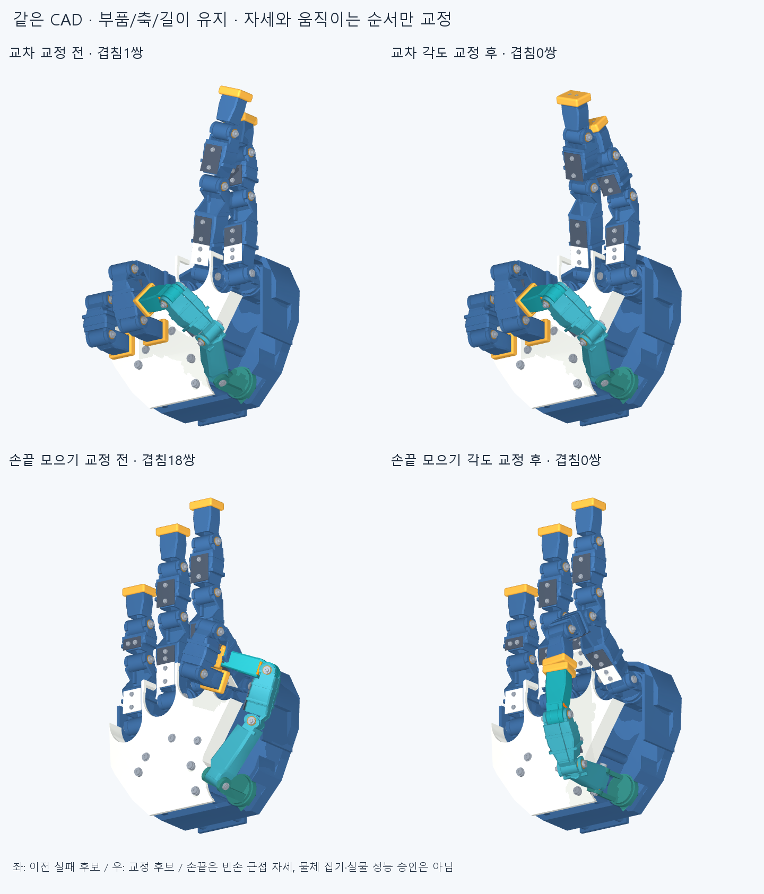

# POSTURE005 · CAD를 유지한 자세 교정

사용자 지시: 조금 부딪히는 한 후보 때문에 바로 CAD를 고치지 않는다. 사람다운 손 비율·손모양을 유지하고 자세·관절 협응·접근/풀기 순서로 먼저 해결한다.

## 이번 실제 변경

손364부품의 STEP/STL·축·길이를 그대로 유지했다. 한 손가락을 고정한 교차 대신 두 손가락의 굽힘을 나누고, 손끝 모으기의 과도한 굽힘과 검지 안쪽 벌림을 줄였다. 모터 설치 위치나 CAD 외피를 수정하지 않았다. 이 단계는 실제 모터 구동 시험이 아니다.

- 중지 앞쪽 교차: 이전 첫마디 겹침1쌍을0쌍으로 줄였다. 검지 PIP40°, 중지 MCP28°·PIP5°·벌림18°, 나머지 두 손가락/엄지는 기존 가위 자세를 유지한다. 뒤로 꺾는 PIP/DIP에 기대지 않는다. 교차점의 중심선 앞뒤 차이29.07mm, 해당 두 마디의 실제 가까운 표면 간격2.755mm를 기록했다. 기존 먼 교차 참조49.93mm에 비해 가까우며, 수치만으로 생체 자연스러움의 표준을 주장하지 않는다.
- 가위→앞뒤 분리→두 손가락 굽힘→교차→정확 역순 풀기: 전진19표본, 왕복37표본, 관절 간격 최대5°에서 보고 기준 이상 겹침0·연산 실패0이다. 같은 전진 배열의 역순이며 별도 동역학 검증이 아니다.
- 손끝 모으기는 실제 둥근 끝캡의 앞면을 목표로 바꾸고 검지 안쪽 벌림을 줄여 끝자세 겹침0, 끝캡 간격0.249mm를 얻었다. 선택한 접근/풀기33표본에서도 보고 기준 이상 겹침0·연산 실패0이다.

## 비교에서 지켜야 할 조건

오른쪽 새 목표는 빈손에서 손끝끼리 가깝게 모으는 자세다. 이전 중앙 손바닥면 랜드마크를 강제로 일치시키는 목표와 구별한다. 약0.25mm의 비접촉 근접 자세이며, 실제 접촉·힘·물체 집기/유지 성공으로 쓰지 않는다. 사람다운 모습은 수용한 외형을 보존한 CAD 그림으로 검토했고 생체 동작 전체나 사용자 승인 범위를 주장하지 않는다.

반대 교차 방향의 선택 후보들은 검지 뿌리 외피와 손바닥 앞덮개가 겹쳐 미해결이다. 이것만으로 CAD 수정의 필요가 확정된 것은 아니다. 두 손가락의 벌림/굽힘을 더 나누는 경로를 계속 찾는다. 실패 경로는 첫 실제 실패 지점에서 중단하고 그 표본을 남겼다.

이전 `object_contact_v1` 연구는5물체 목표·15끝자세와4경로를 실제 검사했으나 모든 실행 경로가 실패해 채택하지 않았다. 시험용 구15개는 손 설치 부품이 아니다. 원통·열쇠·필기·판·구 유지와 GRASP33분류는 완료되지 않았다. 작은 공칭 여유 수치를 이유로 CAD를 미세 절삭하는 작업은 하지 않았다.

## 범위와 재현

전체364부품의66066쌍을 검사한다. 보고 기준은 재료 겹침0.02mm³ 초과·Boolean 허용오차1e−6mm다. 모든 작은 겹침이나 표본 사이의 연속 충돌이 없다는 증명은 아니다. 실제 공차·강도·줄/모터·실물 성능은 미검증이다.

`generated/search.json`은 양방향 교차 각864조합의 유한 메시 가이드와16시작점 손끝 탐색이다. `generated/root_posture_map.json`은 실제 앞덮개/검지 첫마디99조합의2부품 지도이며 전체 손 검사로 세지 않는다. `generated/tip_refined.json`은 그 관측 간섭을 이용한16시작점 재탐색이다. 캡슐/보간/메시는 후보 선택용이고 최종 native 검사에서 부품쌍을 제외하지 않았다. 임의 각도 제한으로 원래 실패를 지우지 않았다.

원래 결과는 `reviews/posture_initial.json`, 재교정은 `reviews/tip_refined.json`, 묶음은 `reviews/audit.json`, 사용 후보 각도·경로는 `generated/selected_postures.json`에 있다. CAD는 [같은364부품](../motion_clearance_v2/generated/assembly_catalog.json)과 [기존 전체 STEP](../motion_clearance_v2/generated/hand.step.zip)을 참조한다. [교차 동작](images/cross_motion.gif).

커밋·푸시 뒤 정확 SHA의 새 깨끗한 clone에서 성공/실패 핵심 자세·경로점·표면 간격·동결222개를 다시 검사하고 후속 커밋에 범위를 기록한다. 같은 에이전트 재검토이며 독립 감사나 실물 승인이 아니다.
