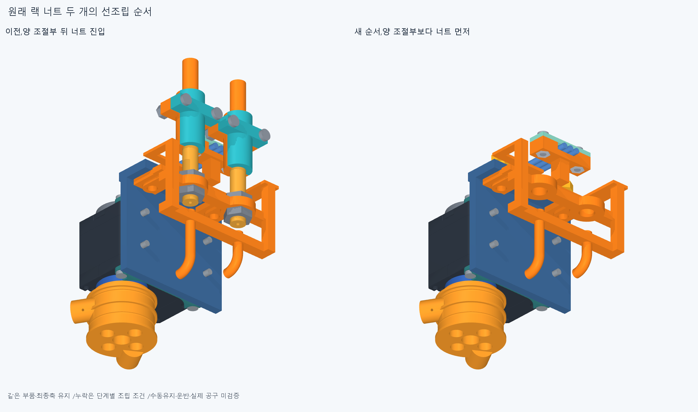
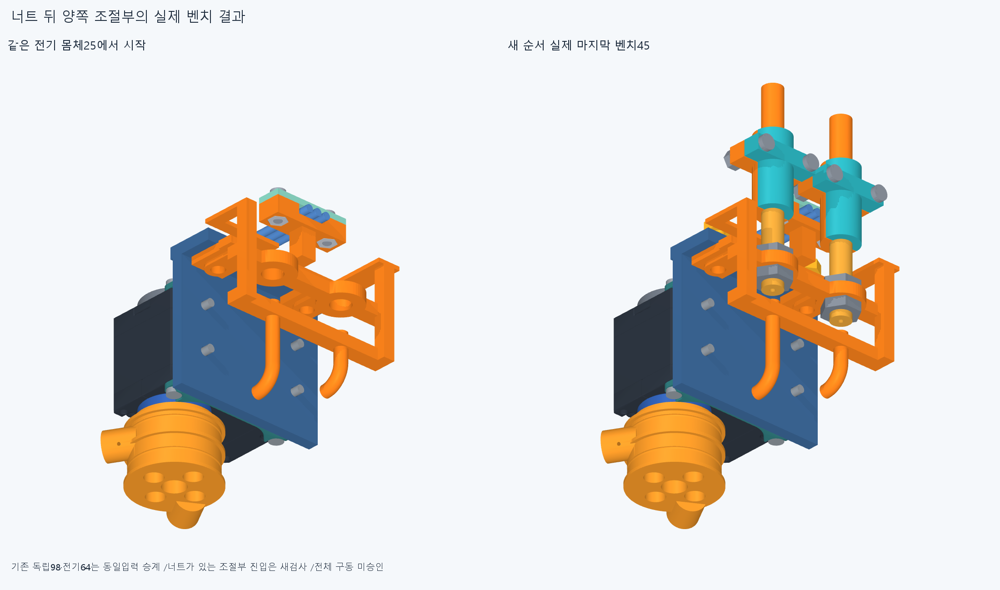

# ARM076 랙 너트 선조립 순서

현재862/기본364·손397/손바닥4·16원격·빔전기·설치축길이명령clock유지,886/방사랙외형미채택이다. ARM074받침1의명시교체별도886/특수48=원래47+새받침1,이번설치기하변경0·다른885유지다.

## 원래 부품과 독립 시작 상태

ARM075의714행부분결과는보존하고자기body43+첫racknut1의44행만명시분리한670행독립대안을검사했다. 뒤8/손/팔은장애물유지,같은부품fixed/moving중복0이다. 역분해·벤치→입구운반/중립등록은미검증조건이다.

독립motor14/port0kit42/port1kit42와전기carrier25의64표본,총162는동일입력·등록경로·moving/present집합을대조해승계/새native0이다. 추가racknut이이집합들에없음을확인했다. 이후양jamnut/kit7·body45세계진입은새검사다. 실제두너트의R1.5보어·X71/Z±13/+Y축·Y[-118,-115.6]착좌면을STEP에서읽었다. 옛실패공통은저장형상속성만읽고옛Boolean0이다.

## 실제 결과

최초너트+X옆진입은X+10에서lid_nut_2와0.9833710941156963mm³,새받침과4.157884613050564mm³로막혔다. 5native/125쌍/4AABB/2기록0오류/rawfalse를보존했다. 기존20→0의검사만으로그사이진입을승인하지않는다.

독립벤치에서실제너트보어+Y축방향전체밖진입으로바꾼대안은양port보다너트를먼저놓는다. 같은162는새native로합산하지않고너트2→각jamnut2/kit7→전체body45→M3둘→원래4M2너트묶음의도달한단계만검사했다. 손목부품이없는벤치의조건부선조립이며세계에서막힌+Y진입이통과했다고쓰지않는다. 너트/모터/죠최종설치축·위치는유지했다.

선택새101native,합계새106native/419519쌍/176AABB/4겹침기록/0연산오류다. 보고>0.001mm³/Boolean1e−6mm/OCC1. 실제벤치45행/body45완료=True,world717/대기169/완전packet8/16,특수48전체복구=False다. 실패뒤예정경로는미실행이며기록수를독립설계결함/손기능불가능으로확대하지않는다.

실제실패기록: `[{"report": "initial", "id": "preload_rack_nut_1_4", "translation_mm": [10.0, 0.0, 0.0], "record": {"lead": "thumb_ip_actuator_rack_nut_1", "part": "thumb_ip_actuator_lid_nut_2", "material_intersection_mm3": 0.9833710941156963}}, {"report": "initial", "id": "preload_rack_nut_1_4", "translation_mm": [10.0, 0.0, 0.0], "record": {"lead": "thumb_ip_actuator_rack_nut_1", "part": "arm074_branched_electrical_R5_support", "material_intersection_mm3": 4.157884613050564}}, {"report": "selected", "id": "original_four_M2_base_nuts_with_rail_events_7", "translation_mm": [29.5, 0.0, 0.0], "record": {"lead": "thumb_ip_actuator_base_nuts", "part": "thumb_ip_barrel_bottom_nut_1", "material_intersection_mm3": 0.2984741455007405}}, {"report": "selected", "id": "original_four_M2_base_nuts_with_rail_events_7", "translation_mm": [29.5, 0.0, 0.0], "record": {"lead": "thumb_ip_actuator_base_nuts", "part": "arm074_branched_electrical_R5_support", "material_intersection_mm3": 13.088827791000892}}]`

M2너트복구에도달하면새받침실제X평면·너트bbox중앙교차위치와면사이중간을추가표본으로쓴다. 얇은재료를20mm표본이건너뛰는문제를막기위한유한경로검사이며연속증명/새여유규격아니다. 실제도달면/표본만check.json에있다.

## 실제 CAD와 한정 재현

새대표공통2의수치를먼저저장한뒤STEP-STL증거2를추가했다. 설치기하export0·기존12783기하/동결222·과거manifest불변이다. 불투명9그림은고유이름/기존덮어쓰기금지이며실제표시누락과native장애물전체를구분했다.

정확SHA새깨끗한별도사본의핵심51native계획은새경로시작끝/kit7첫+마지막3/세계첫+마지막5·실패경로도달전부/도달한실제rail사건표본이다. 원래16packet408/명시1교체·원래47/886·이전714/명시44분리→670/뒤8유지·설치누락/전체밖시작/항등/162동일승계/실제너트축·포착면/도달한원래체결목록을대조한다. 새공통typed서명만epsilon1e−10/절대1e−5로비교한다. 같은에이전트재현이지독립감사·모든중간/곡면trimBoolean/픽셀·팔시각단위/연속전체공장증명이아니다. 실제재현결과는docs/reviews/ARM076이권위다.

수동유지·느슨한너트/캡티브/지그/공구·나사산/토크·강도/마찰예압·실제plugmating/하네스변형/출력12내부조립은미검증이다. 기하상최종위치가실제고정력/장력·전체모터구동을증명하지않는다.

## 다음

이번두실패의실제공통·도달한M3/M2전체스택과얇은rail교차면/포켓을먼저읽고남은전체체결순서를검토한다. 원래M2너트4개솔리드/4나사·adapter/cradle의실제포켓/축을읽고각너트를독립적으로넣는선후관계또는받침/전기완성전unit선조립→전체body46진입을성공가정없이검사한다. 원래4솔리드/최종compound복구를보존하고묶음을강체로옮긴이번실패를개별조립불가능으로확대하지않는다. 기존714/이번부분세계목록은보존하며이번자기47행만명시분리한670과다른뒤8/손/팔장애물을유지한다. 역분해·운반은별도미검증조건,막힌뒤얕은시작/부품삭제/코너절삭/모터이동0이다. 실제이번world717/대기169/완전packet8/16·전체48복구=False이며전체공장/16모터설치완료아니다. 완료새106/독립98·전기64의162승계/실제너트축·포착면·옛187/ARM07415·4·보어1/216·615PCD반복0. ARM074M3전체포함false19.195131113433646mm³/1solid·실제보어1/216IN모순/원인미확정·윗돌출5.9mm/외형미채택,ARM059옛최종3/M3+13·ARM065edgevertex/corefalse·ARM072픽셀false·옛strictfalse/모든이전실패보류유지다. 같은차집합/정밀·픽셀복구/615PCD반복0. 빔반대뽑힘·출력12내부/mating·하네스/captive/공구·토크힘강도마찰예압장력/20구동·동적전기·전체팔상완/실물제조외형미승인. 손빔절삭/모터삭제·몰래이동/각도제한/ODR축소/가짜텐셔너/LINK·옛최적화/팔꿈치버스재개0.
