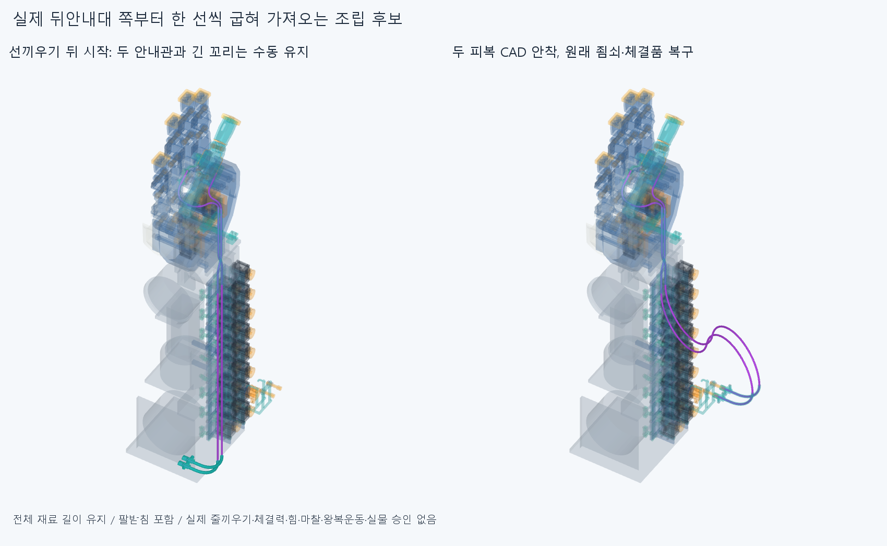

# FORM042 뒤안내대부터 한 선씩 굽혀 가져오는 조립 후보

**두 피복을 차례로 가져온 뒤 원래 모터 죔쇠를 복구하는 조건부 CAD 순서를 검사했다. 전체 순서 clear=true, 겹침기록 0, 연산실패 0. 실제 설치·힘·줄끼우기·왕복운동 승인은 아니다.**

## 실제 간섭에서 바꾼 조립 순서

SEAT041 저장 공통재료를 읽었다. 원래 팔받침 경계상자는 X[-70,70]/Y[-424,-308]/Z[-65,65]mm이고, 기존 실패 공통재료는 X[68.300400778,70.000000108]/Y[-424.000000100,-415.999999899]/Z[-54.185835189,-49.509807148]mm다. 이전 후보는 두 긴 자유 꼬리 전체의 곡률을 함께 키우며 이 모서리를 통과했다. 그 실패 21.448557507491mm³와 원래 코드·자료는 그대로 보존했고, 기존 17상태/30재검사나 곡률스케일족을 다시 실행하지 않았다. 이 받침은 팔꿈치 전기 버스를 새로 확장하는 부품이 아니라 원래의 실제 기계 장애물이다.

이번 시작은 **SEAT041의 두 실제 안내관 선끼우기 끝, 맨줄 넣기 전**이다. 양쪽 실제 아래죠/닫힌 R40안내관 2, 반대죠 2, M2너트4·볼트4의 12클램프가 분리된 조건이며 나머지850하드웨어는 모두 존재한다. 아래죠/안내관2는 이미 두 자유 피복 끝에 끼워져 수동 유지된다. 과거 선끼우기16을 이번 새표본으로 더하지 않았다. 실제 분리·창고에서 운반·작업자의 손/공구/지그는 검사하지 않았다. 팔받침을 없애거나 손·모터·랙·전기선·최종 축/설치위치를 바꾸지 않았다.

**아래 선을 먼저, 그 선 전체와 실제 안내관을 마지막 위치에 유지한 뒤 위 선을 가져온다.** 각 선은 실제 PAIR 뒤입구에 가까운 재료부터 자유 모터 끝 방향으로 차례로 굽힌다. 이미 굽힌 길이 x는 저장된 편손 상류 원호의 **기존 곡률/반경을 그대로** 따르고, 아직 굽히지 않은 나머지는 그 끝 접선의 직선이다. 첫 원호를 끝낸 뒤 둘째 원호를 같은 방식으로 잇는다. 굽힌 부분의 반경을 시간에 따라 바꾸던 SEAT041의 κλ=λκ0와 다른 구간별 굽힘 순서다. 저장된 한 중립 형상을 조립 목표로 썼으며 새 biarc 자세해/반경·길이 경계/최적화·Newton/독립막대·전체거리장 탐색은 없다.

각 선의 굽힘 완료 길이는 원래 상류 자유길이 358.886946642585/366.104990145985mm의 0/12.5/25/37.5/50/62.5/75/87.5/100%다. 기존 두 원호의 반경은 아래61.088445202442/위62.236208375414mm다. 공급품 허용굽힘 규격이나 새 지지물로 쓰지 않는다. 변형 앞부분과 뒤 직선의 접속점은 이동하는 수학 경계이며 설치 안내대/텐셔너가 아니다. 실제 모터 아래죠/닫힌 R40안내관도 자유 끝 프레임과 함께 강체 이동한다. 실제 R40안내관 자체를 구부리지 않는다.

피복은 각 순간 **698.964345153791/761.108456948670mm**를 유지했다. 전체 길이 잔차 최대 1.13686837722e-13mm, 조각 끝점 차 최대 1.11896381924e-13mm, 단위접선 차 최대 3.71064123278e-15다. 각 표본 각 선의 동일 재료좌표9점을 저장했다. PAIR 뒤입구 재료좌표450.718799714381/457.936843217780mm는 작업자가 유지하는 규정 조건이며 실제 마찰하 미끄럼·정지력 증명이 아니다. 확정 절단/공급길이나 ±2mm 필요 조절량으로 쓰지 않는다.

이것은 손으로 곡선을 따라 유지한다는 **규정 운동 기하**다. EI·중력·비틀림·정상력·마찰·압착·좌굴·장력·예압·실제 평형·히스테리시스는 풀지 않았다. 공중의 직선/원호를 실제 지지물로 설치했다고 세지 않는다. 원래 CONTACT036 목표 미수렴/LENGTH037 실패/BIARC039 독립 자세 길이 실패를 이번 조립 후보로 덮지 않았다.

## 실제 검사와 죔쇠 복구

운반 native 실행은 **18표본, 서로 다른 기하상태 17개**다. 아래 끝과 위 시작은 같은 전환 상태를 두 번 기록한 것으로, 서로 다른 18개 이동 상태라고 세지 않는다. 매 표본 두 전체 피복·실제 움직이는 안내관2를 전체 현재5고정그룹 및 이동형상 내부와 비교했다. 운반만 430823쌍/1677AABB native후보/0기록/연산실패0다. [원시 운반](reviews/check.json).

두 선 운반이 끝난 경우에만 반대죠 **+Qz14/7/2/0**, 너트 각 **−Qz10/5/0**, 볼트 각 **+Qz10/5/0**로 원래 체결품을 복구했다. 이미 설치된 부품/아직 없는 부품 목록과 두 전체 피복·실제 안내관을 검사에 포함했다. 새 복구 32표본, 최종 전체862하드웨어 대 피복 검사 1상태다. 이 경로는 SEAT041에서 실패 뒤 실행하지 않았던 작업이며 옛 국부 죔쇠 성공을 재사용하지 않았다. 최종385포장 이름을 원래 전체 목록과 비교한다. 느슨한 너트/죠는 체결까지 수동 유지 조건이며 실제 나사산·토크·공구/압착력·피복 안쪽 줄끼임/빠짐저항 승인이 아니다. [복구 기록](reviews/restoration.json).

운반·복구·최종 합 **481796쌍/1814AABB native후보/0기록/연산실패0**, 보고기준 **0.001mm³초과**, Boolean허용오차 **1e-6mm**, OCC풀 **1**이다. 원래 기본체적/원시목록을 보존하며 검사 제외·문턱 변경은 없다. 손 자체/기존 부품끼리의 새 운동, 물체접촉, 전선 동적 운동, 실제 모터 회전/힘/전체 손 구동은 검사하지 않았다.

새 하드웨어0, 최종 손397/포장385/전기48선·16외곽/팔10/PAIR6와 기본손364의 본체·비율·축·길이를 유지했다. 기존 STEP/STL **5890해시 불변**이다. 저장된 시각/시간별 CAD 조각은 같은 두 피복의 분할이며 안내대/연결구/설치부품 수가 아니다. 옛 짧은 피복/축프로브/긴 실패곡선·기존 전체줄·증거를 중복 설치하지 않았다. 현재 그림의 팔은 SEAT041에서 실제 native STEP로 만든 mm 시각메시를 사용하며 구형 m메시를 mm로 읽지 않았다.

## 판정과 남은 일

조건부 CAD 순서 clear=true. 실제 긴 피복/맨줄 설치·모터 조절부/R5통로끼우기·모터감김/고정·손 꼬리 고정·매듭/장력·예압·마찰·공급품굽힘/제조·강도·외형·실물 승인은 없다. 큰 바깥 루프의 외형 수용은 미정이다. 중립 장면의 겹침0을 실제 유지/사람다운 외형 승인으로 쓰지 않는다.

Close FORM042 sequential fixed-curvature-front assembly and actual clamp restoration. Both whole housings reach original motor shoulders in neutral CAD with original385packaging restored; not physical installation/forces. Next actual selected18mm motor adjuster/R5-to-whole-housing bare-cord threading, then motor wrap/declaredanchor and distal tail fixation sequence. Explicitly replan feed direction/start condition to avoid passing whole housing through positive motor stops. Do not inherit THREAD040 straight-free-tail cord threading as actual motor-path completion. Then same-material length/sliding/contact-aware natural parent/wrist grasp-release, not independent length-varying poses. Keep hand397/base364/pack385/elect64/arm10/PAIR6, body proportions/axes/lengths/motor/rack/wires/OD. No elbow bus, hand cuts, arbitrary radius/length boundary search, oldNewton/80optimizer/independentrod/freecurve/biarcposefamily, virtual supports/tensioners or tiny same-cord seam zeroing. Manual holding is a prescribed kinematic condition, not EI/gravity/torsion/friction/preload/force proof. Existing SEAT041 failure and BIARC039 source1/STEP2 corefalse plus all earlier comparison holds remain. Do not replay completed FORM042/SEAT041/THREAD040 checks automatically. Physical/supplier certification is not an endless prerequisite for furtherCAD/requested3-4motion previews.

BIARC039의 source1/STEP2 동일줄 인접접합 목록차이 core_initial=false/명시재현false, PAIR034 두STEP 포함관계false·3000점분류 일치보류, OFFSET024 면false·한점모순, CONTACT036 검토저장 복구와 그밖의 이전 실패/정밀보조는 재검사하거나 해소하지 않았다. 작은 동일줄 접합을0으로 맞추는 일을 다음 단계 조건으로 삼지 않는다. 형상서명은 모든 곡면식/trim/Boolean동등성 증명이 아니며 같은 에이전트의 새사본 검토는 독립감사가 아니다.
