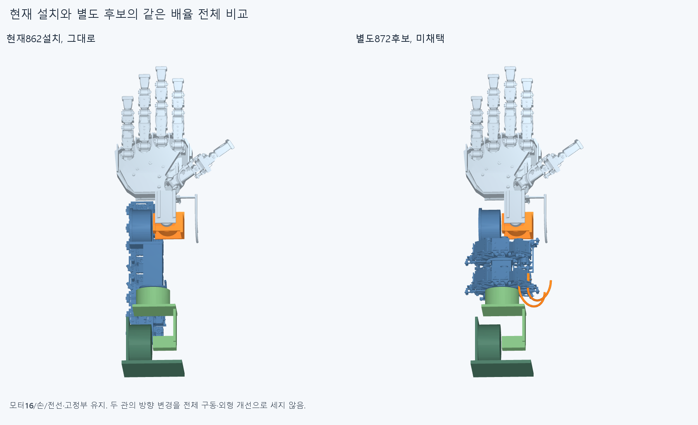
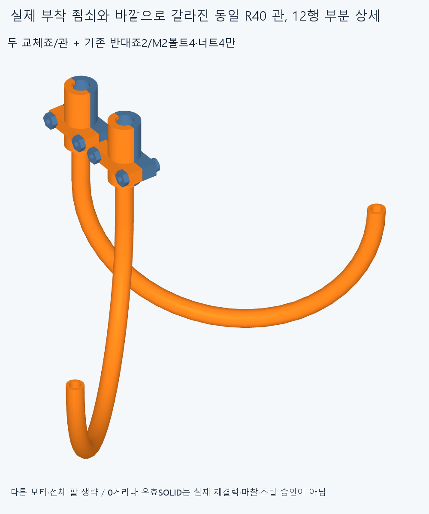
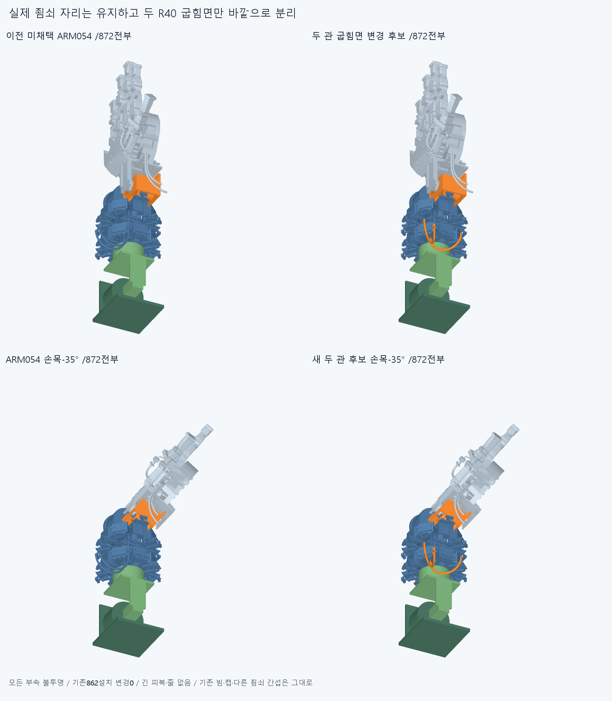
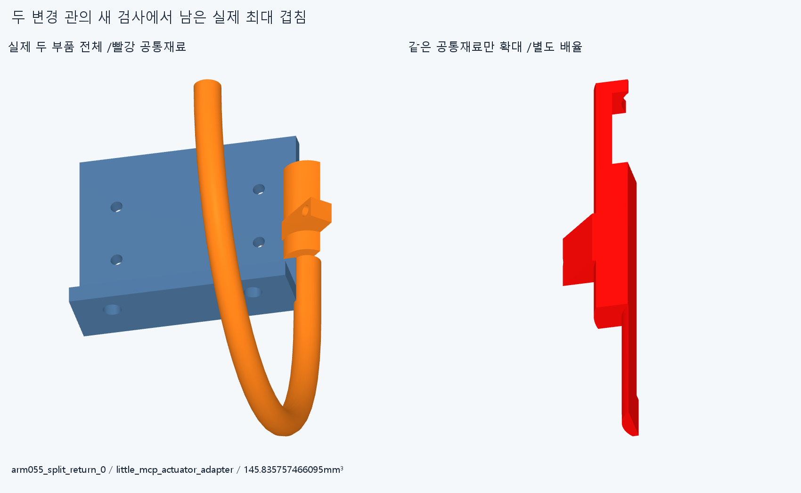

# ARM055 두 R40관 굽힘면 분리, 미채택

**관만 돌려서는 남은 죔쇠 몸체 간섭을 해결하지 못한다. 새8기록 중4기록의 공통재료가 그대로 둔 원래 죔쇠 안에 전부 포함된다. 현재862설치는 바꾸지 않았다.**

현재862/별도872를 모두 불투명 표시했다. 원래 손/16원격모터와 모든 전선·고정부를 유지한다. ARM054 배치를 채택한 것이 아니며 이번 새관2개도 미채택이다. 큰 바깥 관을 외형 개선으로 승인하지 않는다.

## 바꾼 것과 유지한 것

ARM054의 실제 두관/이웃 모터594.2539683130177mm³ 겹침을 읽고,같은 R40/180° 굽힘면을 바깥으로 갈라 놓는 한 대안을 만들었다. 중심·모터 설치/명령각·기존 M2구멍과 죔쇠 착좌 자리는 그대로다. line0 굽힘 방향은(+X+Z)/√2,line1은(+X−Z)/√2다. 반경/외경을 줄이거나 부속을 숨기지 않았다.

compact_motor_turnback_0/1 대신 새 일체 아래죠/관2개를 제안한872행이다. 기존870행은 ARM054와 같다. 원래 RETAIN026 아래죠를 그대로 보존하고 그 자리에서 새 관을 융합했으며 제거된 원래 죔쇠 재료는 두 개 모두0mm³다. 각 관 OD5/보어3.2,R40/180°,직선lead12mm/피복 어깨부터 출구154.66370614359175mm는 기존과 같다. 이 치수는 명목 공간 모델이며 공급품 굽힘·제조·수명 승인이 아니다.

피복→새 보어/일체 원래 아래죠→기존 반대죠·두M2→포착 조절부 머리→기존 종단틀/M3→ARM054 어댑터/받침·hub/collar→실제빔/rollflange가 명목 반력이다. 임의 공중지지/텐셔너가 아니다. 이 경로의 실제 예압·마찰/축 유지·강성·공구/나사산토크·조립은 검증하지 않았다.

## 새 부품만의 실제 검사

[check.json](reviews/check.json)의 새26그룹은7129쌍/74AABB/8겹침 기록/연산실패0,rawfalse다. 중립의 새2대 기존870에서8기록이고 두관 내부1쌍과 개별10·복합2 팔자세의24변경몸체 관계는0이다. 손목−35/55,편위−20/20,전완−80/−40/40/80,팔꿈치55/110,복합[55,40,−20,15]/[110,−40,20,−15]°의 유한진단이며 연속/실제구동 승인이 아니다.

앞서 ARM054의41기록 중33기록은 이번에 손대지 않은 부품끼리라 형상·변환 동일성으로 보존했다. 그 native를 다시 검사하지 않았다. 옛 두관과 관련된8기록은 교체된 형상에 자동 승계하지 않고,이번 새2개 대 전체 부품을 별도로 검사했다. 이를 전체 조립 새0/8독립결함/모든배치 불가능으로 쓰지 않는다. 기존 앞쪽 spool/빔806.9185685505195mm³·반대죠/이웃 모터554.8826726291453mm³·carrier/캡76.15110289248045mm³ 등은 미해결이다.

새 아래죠0/이웃 littleMCP 어댑터145.835757466095mm³가 최대다. 왼쪽은 실제 두 부품 전체,오른쪽은 같은 공통재료만 별도 배율 확대다. 빨강은 증거 형상이며 설치물이 아니다. 이미 끝낸26그룹을 반복하지 않고 해당 한쌍 공통만 STEP에서 별도 생성했다.

## 관 부분과 원래 죔쇠를 구분한 결과

[partition.json](reviews/partition.json)은 추가7공통쌍을 만들고 앞서 저장한 최대 공통1개를 재사용했다. 각각의 공통재료에서 실제 원래 아래죠를 빼는8native 차집합 질의를 했다. 보고0.001mm³ 초과/Boolean1e−6mm/OCC1을 유지했으며 raw8기록을 분류로 덮지 않았다.

|실제 부품 쌍|전체 공통 mm³|원래 죔쇠 밖 공통 mm³|
|---|---:|---:|
|arm055_split_return_0 / little_mcp_actuator_motor|10.994878912722157|0.0|
|arm055_split_return_0 / little_mcp_actuator_cradle|17.159779153627866|0.0|
|arm055_split_return_0 / little_mcp_actuator_body_screws|0.8422525309546647|0.0|
|arm055_split_return_0 / little_mcp_actuator_base_screws|1.267550067106988|0.0|
|arm055_split_return_0 / little_mcp_actuator_adapter|145.83575746591728|16.52897790300748|
|arm055_split_return_1 / little_mcp_actuator_motor|40.48847249253844|24.730766083791526|
|arm055_split_return_1 / little_mcp_actuator_rotor|5.372735412967827|3.7443928504789237|
|arm055_split_return_1 / arm054_eight_bank_carrier|8.122093084476782|8.122093084476782|

첫4기록은 원래 죔쇠 밖 solid가0개다. **그 죔쇠와 이웃 모터의 설치를 그대로 두는 조건에서는 관의 굽힘면만 바꿔도 이4간섭은 사라지지 않는다.** 나머지4기록은 관 쪽 공통재료가 남으므로 모두 죔쇠만의 문제라고 하지 않는다. 한 배치의 필요한 변경범위를 구별한 것이며 다른 배치·손 기능의 구조적 불가능 증명이 아니다.

## 실제 출구와 남은 전달계

두 실제 출구는(117.6685424949238,−232,87.0685424949238)/(97.6685424949238,−232,−26.068542494923797)mm,접선+Y다. 이전 ARM054보다 각 출구 X가56.5685424949238mm 바깥으로 간다. 이것은 포트 위치 차이이며 전체 실루엣 치수/최소 필요 돌출이 아니다. 긴 피복·줄은 없고 전장/손목 통과·장력/힘·동적 하네스·20토크연결을 승계하지 않는다. 중립에서 이미 막혀 새 조립진입/서비스 경로는0회다.

## 저장과 재현 범위

정확SHA 새 깨끗한 사본에서 새26그룹 전체/새2 source·STEP의 적응epsilon1e−10·절대1e−5 측정/두 실제 포트·길이·죠부착좌표·원래죠 제거0/8공통 차집합 분류를 대조한다. 이전33기록은 동일 부품·변환의 메타데이터 보존이며 native 재검사가 아니다. 현재 manifest가 기존 모든 기하12366개와 동결222해시를 보존한다. 측정서명은 모든 곡면식trim/일치경계 Boolean동등성 증명이 아니며 같은 에이전트 검토는 독립 감사가 아니다. 실제 완료/대상·차이는 CHECKPOINT.json/docs/reviews/ARM055/외부logs/arm055-finish.json을 따른다.

## 다음 기계 변경범위

관 굽힘면/반경·방향 수의 추가 탐색은 닫는다. 실제 R10스풀 접선→R5종단틀→두 조절부/포착죠와 체결품을 한 기계 묶음으로 읽고,죠/조절부 지지 위치나 묶음 설치 방향을 함께 바꿀 별도 후보를 준비한다. 조절부를 옮길 경우 기존 R5줄 통로도 다시 이어야 하며 추상 종단점만 옮겨 연결 완료로 쓰지 않는다. 실제 출력몸체 부착·반력과 조립 진입,관련 자연스러운 팔/손목 운동·전달 방향을 함께 제시한다.

기존 앞쪽 빔·손목 및 carrier/캡 간섭도 보존하며 이를 손/빔 절삭·각도제한으로 처리하지 않는다. 수용 손/16구동원/현재862를 유지하고872를 몰래 채택하지 않는다. LINK050/옛 최적화·막대·팔꿈치 버스·OD/R임의축소·허공지지/없는텐셔너를 재개하지 않는다. 모든 이전strictfalse/곡면·포함 보류와 전체 긴재료/실물·제조/외형 미승인은 유지한다.
