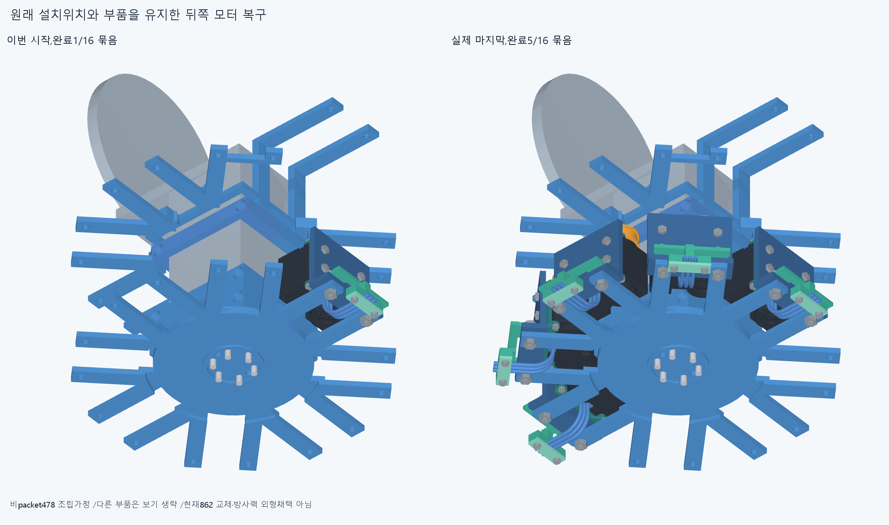
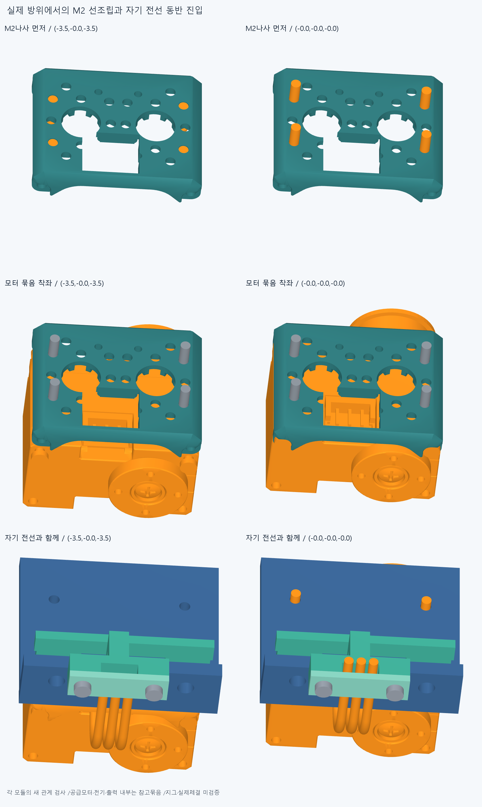
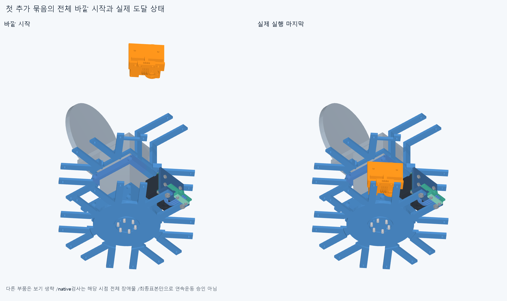
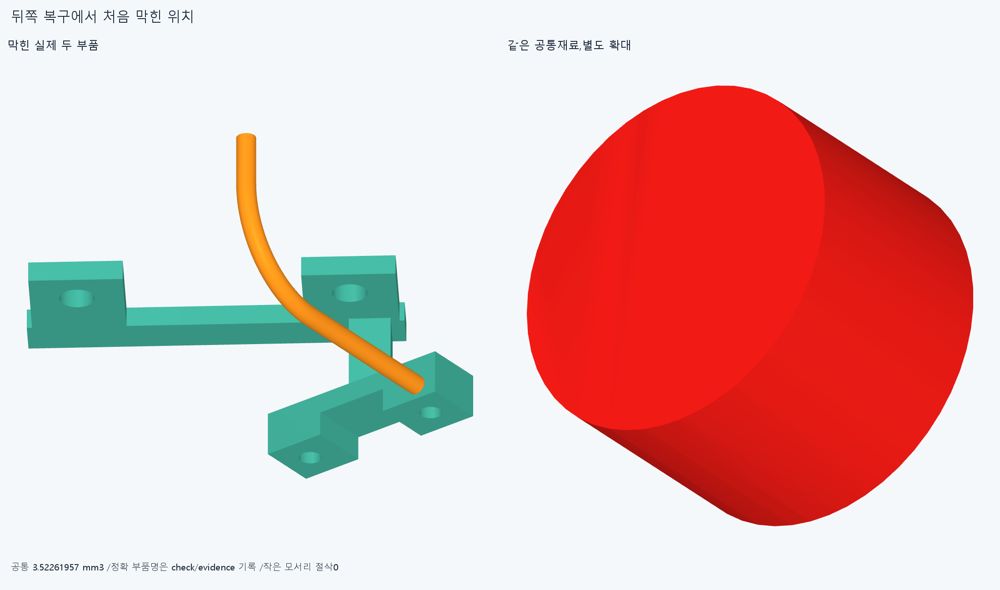

# ARM069 뒤쪽 모터 묶음의 원래 위치 복구

**형상변경 없이 뒤쪽 4묶음을 새로 복구해 총5/16,조건부598행/288대기다. 현재862 설치와 방사랙 외형은 채택하지 않았다.**

## 실제 범위와 순서

ARM068의 조건부502행을 그대로 시작 상태로 쓴다. 첫 indexMCP24행과 이미 조립됐다고 가정한 비packet478행이 포함된다. 첫 묶음/지지부 경로를 반복하지 않았다. 이번 계획은 뒤쪽 남은7묶음이며 앞쪽8묶음은 명시적으로 다음 조립 단계다. 원래16packet408/최종886의 이름·부품·위치·손364본체·손397·축길이/명령clock·전기홈/뚜껑M2/3선/plug/M3스택을 유지한다. 새 설치/하드웨어 기하변경0이다.

각 실제 ARM054 설치행렬 P에서 방사방향−P[:,2],모터출력방향P[:,0]을 썼다. 시도한 각 모듈의 실제 M2base_screws와 rack_screw_1 원통면 축을 읽어 선언 방향과 일치하는지 기록했다. 총10개 부품 축 읽기이며6탭/615면/옛PCD 재분류가 아니다.

분리벤치에서 cradle을 수동 유지하고 원래 M2base_screws4개 묶음을 −방사80/60/40/20/10/5/0의7표본으로 먼저 넣는다. 이어 motor/rotor/body_screws/spool 참고4행을 같은7표본으로 넣는다. 그6행과 자기3리드/plug4행을 함께 움직여 나머지 adapter/guide carrier9에 같은7표본으로 넣는다. 공급모터/body나사/출력·전기 내부는 참고묶음이며 실제 내부조립·플러그 체결·하네스 변형·토크연결을 새로 승인하지 않았다. 첫 모터가 통과했다는 이유로 다른 모듈의 세계진입을 승계하지 않았다.

원래 base_nuts4개 묶음 한 행만 잠시 빠진 몸체19행을 현재 장애물 전체 경계상자 밖에서 방사방향으로 넣는다. 출력방향+8을 유지한 옆진입 뒤8/4/0으로 착좌한다. 랙너트2행도 출력방향−20에서 옆진입 뒤−10/0,랙M3나사2행은 출력방향+40에서 옆진입 뒤20/10/0이다. 마지막에 원래4M2받침너트 묶음을 바깥 방사방향에서20/10/5/0까지 넣는다. 각 바깥 시작은 해당 시점 전체 장애물의 AABB 투영보다 밖이 되도록20mm 간격으로 올리고 최소160mm부터 정한다. 이는 시험 시작 위치이며 설계 최소여유 규격이 아니다. 모든 이동·현재설치·일시누락 목록과 최종 항등변환을 보존한다.

## 실제 결과

새377native/599585쌍/913AABB/1기록/연산오류0,보고>0.001mm³/Boolean1e−6mm/OCC1이다. 원래 첫packet/지지부·ARM06864/24/20/14/17의 같은 검사는 반복하지 않았다. 첫새실패 ring_pip_actuator__motor_and_own_leads_into_carrier_4: [{'lead': 'ring_pip_actuator_lead1', 'part': 'ring_pip_actuator_wire_guide_base', 'material_intersection_mm3': 3.5226195712629798}]. 뒤경로미실행/첫실패보존.

새로 완료한 모듈은 ['little_mcp_actuator', 'thumb_mcp_actuator', 'little_pip_actuator', 'little_dip_actuator']이다. 기존 첫 묶음을 포함한 완료는['index_mcp_actuator', 'little_mcp_actuator', 'thumb_mcp_actuator', 'little_pip_actuator', 'little_dip_actuator'],총5/16이다. 실제 조건부 시작502→현재598,원래부품288행이 아직 대기한다. 조건부 등록/수동유지·지그·captive실제유지/나사산토크·강도힘마찰예압은 검증하지 않았고,598행 전체 공장조립이나16모터설치·20구동 승인으로 쓰지 않는다. 영구 모터 삭제/원래 너트누락/몰래 재배치/손빔절삭0이다.

## 실제 CAD와 재현

불투명 실제CAD4그림이며 보기에서 생략한 다른 부품도 해당 native에서는 장애물이다. 새 공통Boolean1은 첫새실패의 저장 증거만이고 원래 경로 반복0이다. 공통 수치는 export/렌더 전에 common_prepared.json에 먼저 저장한다. 새 증거기하1는 설치물이 아니다. 이전기하12761/동결222/과거manifest를 보존한다.

정확SHA의 새 깨끗한 별도사본에서 핵심126native와 실제축/원래16packet408·최종886/시작502/각모듈 분할·누락·설치순서·최종 원래위치·전체장애물밖시작을 대조한다. 몸체/너트의 옆진입→축진입 마지막3,M3마지막4와 각 경로 시작끝을 포함한다. 새 공통/서명은 저장한 경우에만 대조하고 sourceSTEP 측정서명은 adaptive epsilon1e−10/절대1e−5다. 모든중간표본/곡면식trimBoolean/픽셀·팔시각단위/연속전체공장 검사는 아니며 같은에이전트로 독립감사가 아니다.

ARM068전선3실패·ARM067나사실패·ARM066두실패·ARM065common1edgevertex/corefalse·옛M3+13/R5/strictfalse·곡면포함보류는 그대로다. 빔 한방향 끝받침/반대 뽑힘 마찰예압도 미검증이다. 전체팔·상완/20토크·긴재료/동적전기·실물제조/외형 승인은 없다.

## 다음

저장한 약지PIP의 lead1/전선안내대 실제 공통과 원래 전선경로·홈·덮개/M3스택을 읽는다. 모터와 전선을 함께 이동한 단단한 참고묶음이 −방사10에서 막힌 순서이며 손 결함이나3.522모서리 절삭 근거가 아니다. adapter/안내대/덮개·체결품의 전체 벤치 순서를 검토하고 일시누락/전체바깥진입/원래부품 복구를 명시한다. 첫모듈 순서 무검증승계·전선/안내대/덮개 삭제·막힘뒤 얕은시작/설치축·명령변경0이다. 완료5묶음을 유지하고 약지PIP/약지DIP/중지PIP 각24와 앞8묶음은 아직 없는 현재598/288대기에서 이어간다.

완료한 새경로/축읽기/공통·첫묶음/지지부/앞unit/615면/PCD·작은각도반경/모서리를 반복하지 않는다. 손빔절삭/모터삭제·몰래이동/각도제한/ODR축소/가짜텐셔너/LINK·옛곡선최적화/팔꿈치 전기버스 재개0이다. 실물 인증의 완벽을 다음 CAD/영상의 무한조건으로 늘리지 않는다.
