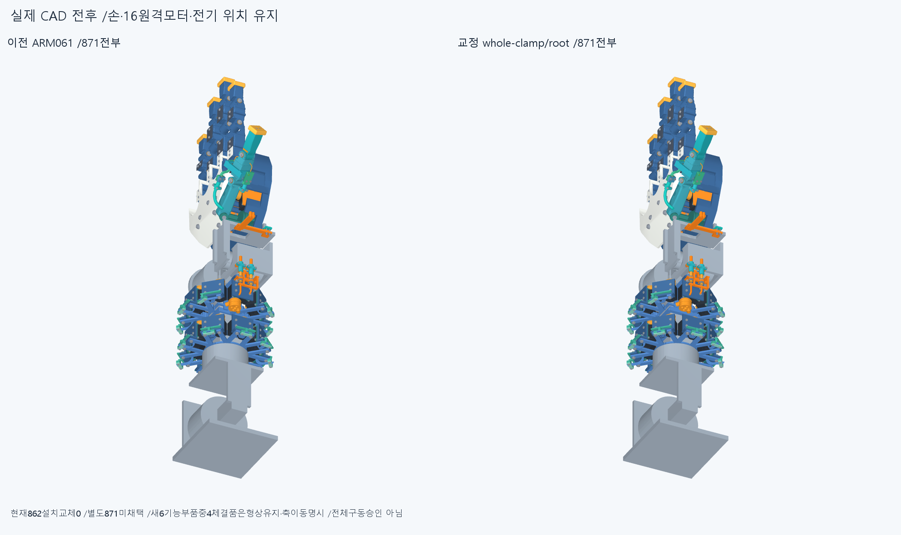
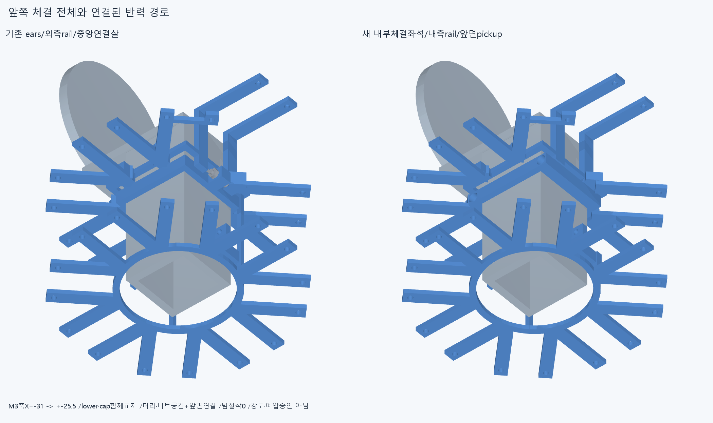
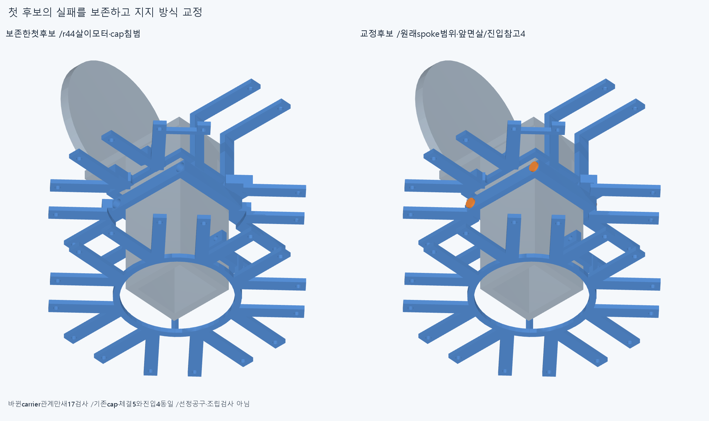
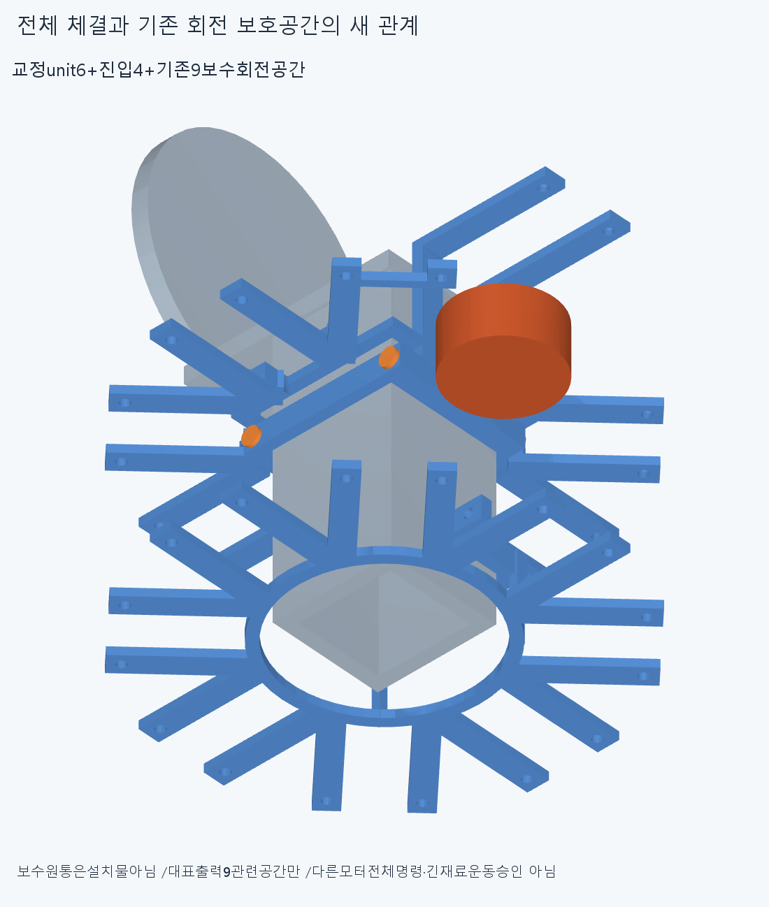
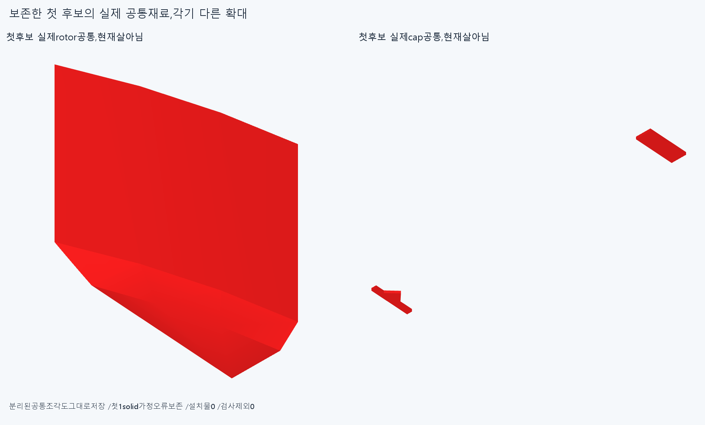

# ARM063 전체 앞 클램프와 연결된 지지 구조, 미채택

**두 나사축을X±31에서±25.5mm로 옮긴 내부 체결 좌석과 새 하중 경로를 함께 만들었다. 교정된carrier의 새17그룹은0간섭·0연산실패지만, 실제 전완 출력판·빔·stator 고정과 전체 구동은 아직 미완이다. 현재862 설치는 바꾸지 않았다.**

## 후보와 실제 변경

별도871=불변865+새carrier1·새cap1+형상은같고축을옮긴M3나사2/너트2다. lowerclamp는carrier에일체로포함된다. 손364/397, 손바닥4·전완16모터, 전기·모터설치축·길이·명령·clock을유지했다. 현재방사형랙분포는수용안이아니며이국부검사로외형을승인하지않는다.

앞clamp의Y−162.5와원래M3x12스택을유지하고두축을X−25.5/+25.5로명시적으로옮겼다. 양쪽반쪽을함께바꾸었고outerX±29/Z±25/축방향8mm, 실제빔44×42의사각내부다. Ø3.4통과보어, 아래headseatZ−4/R2.85counterbore, 위nutseatZ4/외접원지름6.35hex자리Z4..6.4와R3.175위쪽입구다. 실제shaftZ−4..8/head−6..−4/nut4..6.4를유지했다. 원래머리·너트의축방향20mm진입참고4개는축과함께옮겼다. 공급socket/bit/handle·작업자공간·제조fit/공차가아니다.

전체안쪽frontroot R42/Y−166.5..−118을새로구성했다. 원래frontspoke r34..75.4와M3구멍은복원하며middle_dip−13은기존바깥가로연결을유지한다. innerweb r28..38/Y−158.5..−152.5와axialpickup r36..38/Y−162..−152.5를사용한다. **새cap의실제앞면Y−158.5에서잇는방식이며,작은나사코너만다듬은것이아니다.** 사각frame outer60×58/inner52×50/Y−155.5..−152.5는유지한다. 엄지축살X26..30/Y−158.5..−118과위연결X26..38이기존M3받침으로이어진다.

아래바깥rail의앞쪽전길이를두안쪽rail X−13..−10/+10..13,Y−208.5..−152.5,Z−28..−24와뒤바닥bridge X±27,Y−208.5..−200.5,Z−28..−24로대체했다. 기존뒤hub/뒤clamp는유지한다. 모터패드→바깥spoke/짝tie→앞면pickup/frame→안쪽rail/뒤바닥bridge→앞새clamp·기존뒤clamp/rail/hub→cap/M3→빔의명목반력경로다. **유효한1solid나거리0은강도·예압·마찰/토크승인이아니다.**

## 첫 실패와 한정 교정

첫model.py/check.py의18그룹은41113쌍/367AABB/9기록/0연산실패다. 넓힌r44살이실제index_spread/middle_spread/ring_spread/little_spread/index_pip/index_dip rotor와각1.97012236054669mm³,새cap과17.6873746907368mm³겹쳤다. 나머지2개는돌출bolt/꽉찬nut진입참고각11.309733552923253mm³의동축공간이다.9독립물리결함으로세지않는다. 첫9회전보수공간/새unit6과진입4/보수공간은0이었으며첫16pad밖도0이었다. **첫코드·결과·6하드웨어/4진입참고를모두보존했다.**

selected_model.py는원래spoke범위를유지하고cap앞면에서축방향으로잇도록carrier만한번교정한다. cap·나사너트5와진입4는같은첫CAD를재사용한다. selected_check.json의새17그룹은6272쌍/352AABB/0기록/0연산실패다. carrier대불변865,같은cap/체결5,기존9회전보수공간/너트접근,같은진입4,12팔자세의새carrier상대몸체관계다. 다른5와진입4의변하지않은관계는첫18의같은기하결과를승계했으며반복하거나35현재통과그룹으로합산하지않았다.

12팔자세는팔꿈치55/110,roll±40/±80,손목굽힘−35/+55,편위±20,복합[55,40,-20,15]/[110,-40,20,-15]이다. 바뀐지지부관계이며전체871/862·연속팔/상완·모든16출력명령·긴재료/동적전기·20토크검사가아니다. 기존대표출력9의보수공간은같은입력으로읽었고,옛±90검사는반복하지않았다.

교정carrier의실제frontM3패드16은원래받침과선언영역의입력common16을만든뒤밖차집합16을검사해모두0이다. 뒤M3패드부위는건드리지않았으며옛32/34전체질의를다시하지않았다. carrier/beam거리0,carrier/bolts는0/0,carrier/nuts는3.0259014761991505/2.8850344007765623mm다. cap/beam0·nut/cap0은첫형상에서그대로인명목거리이며실제착좌력·마찰·예압/공구조립승인이아니다.

두nut참고/bolt의원시기록은동일하게남는다. ARM062의실제6출력탭축/blank판도그대로미해결이며재검사하지않았다. ARM059base/R5·너트접촉·failedM3+13밖19.195131113433646·같은줄/이전strictfalse와곡면포함보류도보존한다. **새carrier0을전체후보rawtrue나전체구동완료로넓히지않는다.**

## 실제 CAD 그림과 렌더 오류

5불투명그림을직접확인했다. 전체전후는각871이며구조/공통은표시한별도부분확대다. render_evidence.py는앞4그림을저장한뒤cap공통을1solid로가정한assert에서중단했다. 실제cap공통은2solid다. 원래코드/history·로그와첫4그림을보존했다. 저장된공통질의0,중단이전미저장질의수는기록되지않아모른다. recover_evidence.py는2새질의를저장해rotor1.970122360546687/1solid,cap17.68737469073088/2solids와마지막그림만완성했다. 첫4재렌더/native그룹재실행0이다. 원래미저장값을복구한것처럼쓰지않는다.

## 재현과 다음

정확SHA새깨끗한사본에서첫실패의2핵심그룹+교정17=19native,새13sourceSTEP서명(첫6+진입4+교정1+공통2),front16보존차집합/16입력common,첫공통2질의,교정5거리,설계·몸체·4체결품이동계약을대조한다. 공통의실제1/2solid개수를유지한다. 적응epsilon1e−10·절대1e−5이며모든곡면식trimBoolean증명이아니다. 첫나머지16그룹·그림/행렬/팔시각단위·픽셀은재현범위밖이다. 같은에이전트이며독립감사가아니다. 이전기하12623/동결222·과거manifest를보존한다.

다음은이끝낸frontunit/작은접합반복을닫고ARM062의교정된실제출력기준을사용한**별도roll출력판·빔고정·stator부착/clock·조립순서후보**다. 출력6M3/PCD20/pilot25·Y−230참고등록과case/output나사를구별한다. stator쪽실제나사면·축은이미저장된공식표면의case축자료에서필요한것만읽는다.615면전체/봉합·tap-pin재분류를반복하지않는다. 임의4mm메움·구멍6개판만으로토크완료라고하지않는다. 빔은깎지않고고정/회전몸체E/EF를실제체결과맞춘다. clamp/양의착좌·예압마찰·축방향포착·조립은아직구체화해야한다.

현재방사형랙분포는미채택이다. 손/16구동원·전기홈/뚜껑M2·3선/plug/M3스택유지,모터삭제/몰래이동·손빔절삭/각도제한/ODR축소/가짜텐셔너/LINK·옛곡선최적화/팔꿈치전기버스재개0이다. 지지/운동공간이일관되면고정모터→H짧은손목입구→실제손끝구의긴재료를잇는다. 공급품·실물인증완벽을다음CAD/영상무한조건으로늘리지않는다. 실제공구/조립·힘강도마찰장력예압·전체20토크/動적전기·전체팔/상완·실물제조외형승인은없다.
