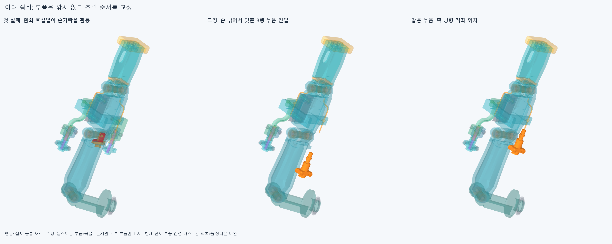

# ASSEMBLY032 남은 죔쇠와 아래 포착 끝구의 조립

**부품 형상을 바꾸지 않고 아래 죔쇠의 후삽입 걸림을 선조립 순서로 해결했다. 선택 90유한표본은 기준 이상 겹침0이며,긴 피복/전체줄·장력과 실제 압착/당김 저항은 아직 미완이다.**

## 이번에 닫은 누락과 현재 구성

RETAIN026에서 모터0/위 엄지1의 대표 조립만 확인했고,아래 교체 포착 끝구와 나머지 모터1/아래 엄지0 죔쇠의 설치는 남아 있었다. 긴 피복을 잇기 전에 이 실제 조립 누락을 확인했다. 손364입력/현재 손397행,포장385행,전기48선·16외곽,팔10과FEED031의실제 안내대6을 유지했다. 새 설치 형상0이며 기존 STEP/STL 4544파일 해시는 불변이다. 그림의 공통재료는 검사 증거이며 설치 부품이 아니다. 손/관절/모터/랙/전기선을 깎거나 옮기지 않았다.

두 연구는 독립적인 조건부 조립이다. 첫 모터1 죔쇠 연구는 나머지 끝구/죠가 이미 착좌한 상태에서 자기6행만 없는 단계다. 아래 연구는 위쪽 후보/나머지 현재 부품은 있고,아래 GUIDE021 원래 덮개·M2볼트/너트가 있는 선행 단계에서 시작한다. 새 아래 끝구/죠/받침/체결품·짧은 피복은 각 설치 전 실제로 없다. 이 두 시작 상태를 하나의 전체 공장 조립 순서로 주장하지 않는다. 손가락 끝마디/핀/다른 손 부품은 계속 있고 손/손목은 중립이다.

## 첫 순서의 실제 걸림

[원래 검사](reviews/service.json)는 새78표본/66801쌍/301AABB후보,6겹침 기록/연산실패0이다. 모터1의6부품20표본과아래 새포착끝구/받침·덮개·복구체결·짧은피복/첫죠는 통과했으나,나중에 넣는 아래 안쪽죠의방사14/7mm시작이손가락에걸렸다.6반복기록은5서로다른부품쌍이며독립6결함으로세지않는다. 최대 실제 공통체적은 136.643945468mm³,부품은 thumb_segment2_segment_shell다. 실제공통형상은[여기](generated/actual_common/scene.json)에 보존했다. 마지막 위치0과2mm에서는0이어도 그 중간 진입이 성공한 것이 아니다. 실패 뒤 아래 너트/볼트 후속은 실행하지 않았다.

## 형상 대신 실제 순서를 교정

[선조립 순서](reviews/selected_service.json)는 같은 아래 포착 끝구와24mm직선 피복끝참고에 죠2/너트2/볼트2를 손 밖 X+500mm별도 작업대에서 먼저 맞춘다. 끝구1+피복참고1+체결6=8행묶음이다. 작업대에서 짧은 피복축삽입5와죠/체결20,총25새표본을 확인했다. 작업대는 실제 변환한 해당8부품만의 별도 환경이며 손/모터를 그곳에 추가하지 않는다. 피복참고는 전체 긴 피복이 아니다.

손 안에서는 원래 아래볼트→너트→덮개제거를실제로검사한뒤,그8행묶음을기존얇은안내관축−25/−15/−5/−1/0mm에서넣는다. 그뒤 안쪽받침을3mm안쪽높이에서옆−20→0후방사로앉히고,새덮개/원래너트·볼트/새안쪽너트먼저·볼트를복구한다. 기존 가는 안내관은 그대로이며 닫힌 끝구 보어를 축 방향으로 끼운다. 모든 누락/설치/장애물 목록과최종구성복구를 저장했다. 느슨한안내관/끝구/받침·너트는 체결될때까지 수동/임시지지로유지한다는조건이다.

선택 90표본 = 새 70표본(작업대25+새손안45) + 입력/변환/장애물 같은모터1의20표본재사용이다. 85680쌍범위/358AABB후보,보고기준0.001mm³초과겹침0/연산실패0,Boolean허용오차1e−6mm/OCC풀1이다. 원래78/실패6기록을선택검사에더하거나삭제하지않는다. 실제부품은같고손가락각/설치축제한도없다. 연속 경로 전체를 증명한 것이 아니라 유한 강체 표본이다.

## 남은 범위

이번에는 저장 STEP의 조립만 검사했다. 새 형상 생성/원본-STEP 동등성이나기존8/16정적손자세를새로검사하지않았다. 기존 OFFSET024면비교false/한점거리·trim모순과HOUSING027/GUIDED030의기본적분false·정밀보조는그대로다. 같은에이전트의정확SHA검토는독립감사가아니다.

실제 지그/공구·손잡이/작업자 접근,나사산·토크·공차/강도/수명/전체 공장 순서는 미검증이다. 죔쇠의0.2mm분할간극/OD3피복 접촉만으로 압착량/정상력/마찰/인장완화·빠짐 저항/안쪽 줄끼임을 승인하지 않는다. 24mm/17mm끝참고의전체 긴 연결/실제줄끼우기/조절·예압도없다. 전체20모터설치/손전체구동완료가아니다.

다음은 실제 모터 종단→FEED031 뒤입구(100,−100,−3/2)와앞출구(100,−4,−3/2)→엄지 종단의두 유연 구간이다. 모터는전완고정,안내대와엄지종단은손목H를따르며엄지종단은부모FK도따른다. 안내대의축방향슬라이딩/전체길이와정방향·풀기의끼임/당김·두줄조절/예압을잇는다. 허공waypoint/없는지지·텐셔너나옛급한자유곡선을승계하지않고,해결된국부조립/작은틈/자세와팔꿈치버스로돌아가지않는다. 공급품/실물인증을다음CAD나요청3~4동작영상의조건으로무한히늘리지않는다.
