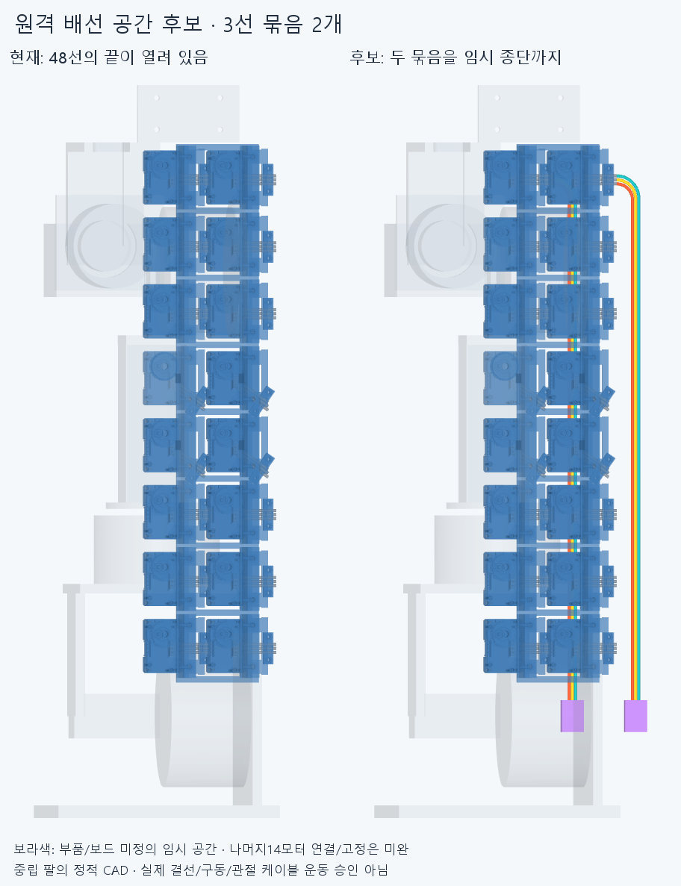

# BUS017 원격 배선의 두 주 경로

**기존48리드 중 검지 벌림·중지 벌림 모터의3선씩,총6선을 팔꿈치 쪽 임시 종단까지 연장한 공간 후보다.** 손364부품·모터·랙·받침·가이드와 기존48선은 그대로다. 나머지14원격모터의 연결 가지선과 최종 전기 버스는 미완이다.

새 CAD는 선 연장6형상과 보라색 임시 커넥터/접근 공간2개다. 임시 공간은 각14×20×6mm이며 실제 보드나 선정 부품이 아니다. 선 끝은Y−350mm의 공간 앞면에 닿고 공간은Y−370~−350mm다. 세 선의 중심선 반경10/12/14mm·외경1.9mm는 공간 가정이며 공급 케이블의 허용 굽힘/수명 수치가 아니다. 색은 핀 순서가 아니다. 선 모음 경로와 실제 전기 접속·구동 텐던을 구별한다.

## 확인한 범위

새8형상 대 현재360포장/고정부·원격48선/16커넥터 외곽·중립 팔10,새28쌍의 **3500쌍 범위 중161AABB후보**에서 보고 기준0.001mm³ 초과 겹침0·연산 실패0이다. Boolean허용오차1e−6mm다. 초기 연구는 세 native그룹 완료 뒤 손 경계상자의 선택 메타데이터 필드 오류로 중단해completed=false로 보존했다. 같은 형상·장애물/해시인 그3그룹은 [후속 결과](reviews/final.json)에 재사용했고 새28쌍·접속/경계상자/종단 검사는 새로 계산했다. [이력](reviews/history.json).

기존6선 끝과 새6선 시작점/접선은 일치하고,부품간 거리0·공통 체적0이며,각기 이어 붙인 CAD는 유효한 단일 솔리드다. 이것은 **같은 전선을 CAD에서 두 구간으로 나눈 연속성**이며 중간 납땜/새 물리 커넥터를 설계한 것이 아니다. 새선의 끝과 임시 종단 앞면 거리도6곳0이다. 실제 전기 결선 승인은 아니다.

손의 편 자세/엄지척/교차/25mm고정구/복합5끝자세는 저장된 중립 STEP 경계상자8꼭짓점을 관절 변환해 새8형상과 비교했다. 0.002mm 수치 패딩을 사용한 **14560경계상자쌍**,겹칠 후보0이며 최소 분리축 간격 약21.229102mm다. 손364부품 입력 해시는 확인했지만 손 STEP을 새로 전부 수입/Boolean계산한 것은 아니다. 새선/임시공간과 이5끝자세의 경계 분리 범위이며 손 자체 간섭·연속 손 경로·팔/손목 운동 승인이 아니다.

## 실제 부품과 남은 일

연결된 전체 중심선은 기존 리드 포함 약 **368.416~375.699mm**이며 커넥터 내부 길이/끝가공은 제외한다. ROBOTIS [공식 X3P180mm 제품](https://e-shop.robotis.co.jp/product.php?id=221)은 XL330용 JST EH 케이블의 실제 후보 출처이지만 이 긴 경로에 그대로 사용할 선정품이 아니다. 피복 외경·굽힘/전류/수명·실제 하네스 길이/단자와21AWG/22AWG 차이는 미확정이다. [출처/가정](references.json). [제조사 선택 가이드](https://emanual.robotis.com/docs/en/reference/dxl-selection-guide/)의TTL다중 연결 개념만으로16모터 전원 분배/통신을 검증했다고 쓰지 않는다.

**긴 선의 새 고정구는 아직 없다.** [고정 위치 검토점](reviews/support_todo.json)은 부품이 아니며 선을 실제로 구속/지지하지 않는다. 기존16가이드는 출구의 횡방향 억제 범위다. 긴 구간의 고정부·축방향 당김 방지·나머지14모터 연결/버스 접속·보드 종단·조립/교체·동적 케이블/손목 서비스 루프·전류/전압강하·공급품/실물은 미완이다. 중립 팔의정적 공간을 팔 운동 승인으로 승격하지 않는다. 실제 혼/허브/양방향 텐던도 미완이다.

PALMLEAD016의 손바닥12선은 여전히 미채택 연구이며 이번 설치 장애물에 더하지 않았다. 손바닥의 작은 가정 겹침 때문에 손/받침을 깎거나 그 탐색을 재개하지 않는다. 다음은 실제 포트/배선 접속 방식과 필요한 고정부를 정해 나머지 원격모터를 통합하고,배선이 적당히 잡히면 요청한3~4손동작을 새 구성으로 갱신하는 것이다. 기존 손만의4GIF를 실제 모터/유연 케이블 구동 영상으로 바꾸지 않는다. 저장 후 정확SHA 새 사본 핵심 재현은 후속 기록이며 같은 에이전트 검토다.
