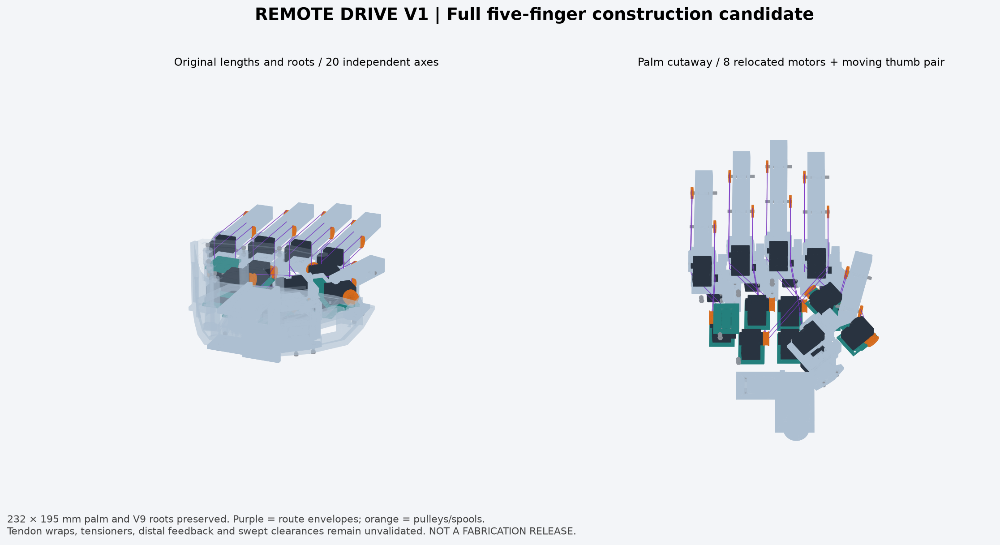

# Remote drive V1 — 20축 배치 후보

기존 손바닥 232 × 195 mm, 손가락 뿌리 좌표·마디 길이·손목 연결부를 유지하고, 원위 마디의 모터 10개를 뿌리 가까이 옮기는 **실제 솔리드 CAD 후보**입니다. 모터 명령에서 실제 관절 추종까지 50 ms를 목표, 100 ms를 상한으로 삼습니다. 성능 목표를 달성한 제작 도면은 아닙니다.



| 자료 | 내용 |
| --- | --- |
| [assembly.step.zip](assembly.step.zip) | 압축을 풀면 `assembly.step`. 이름과 색상을 가진 전체 다섯 손가락 조립 STEP |
| [assembly.glb](assembly.glb) | 가벼운 색상 포함 조립 미리보기. 제작용 도면이 아님 |
| [design.json](design.json) · [generate.py](generate.py) | 수정 가능한 파라미터와 CadQuery/OCC 생성기 |
| [simulation_contract.json](simulation_contract.json) | 20개 관절, 부모 관계, 축, 범위, CAD 기반 질량·무게중심·관성 텐서 |
| [generated/placements_mass_inertia.json](generated/placements_mass_inertia.json) | 각 부품의 배치와 질량·관성 근거 |
| [reviews/geometry.json](reviews/geometry.json) | BRep 유효성 및 중립 자세의 새 부품 교차 검사와 미해결 사항 |
| [reviews/mounting.json](reviews/mounting.json) | 손바닥 모터 8개의 실제 체결축, 나사·너트·브래킷 연결, 제한된 공구 접근 검사와 미완성 차체 연결 |

## 배치와 제어 자유도

- 비엄지 네 손가락의 벌림·MCP 모터는 기존 뿌리 구조에 남습니다. MCP 모터는 벌림 때 움직입니다.
- PIP와 DIP 모터 8개는 손바닥 고정을 목표로 배치합니다. 모터→브래킷→어댑터 체결은 모델링했으며, 어댑터→차체 지지 구조는 아직 없습니다. 동역학에서는 손바닥 고정을 가정합니다. PIP/DIP는 독립 제어를 유지하며 16축 연동은 적용하지 않습니다.
- 엄지의 CMC 두 축은 유지합니다. MCP/IP 모터 두 개는 CMC 뒤의 움직이는 받침대에 배치하므로 엄지 뿌리 관성에 포함됩니다.
- 손목 장착 부품을 원본 STEP에서 가져왔습니다. 팔·전완 모터 설계를 새로 검증한 것은 아닙니다.

기존 원본의 `thumb_spread / thumb_mcp / thumb_pip / thumb_dip`는 새 계약의 `thumb_base_sweep / thumb_opposition / thumb_mcp / thumb_ip`에 대응합니다. CAD 부품 이름에는 원본 이름이 남아 있으므로 `body` 속성을 기준으로 질량을 합산합니다.

## 실제 형상과 개념 표시의 경계

새 마디는 두께 2 mm의 속이 빈 쉘, 두 갈래 지지대와 그 안의 중앙 축받이, 금속 핀, 반경 8 mm 풀리로 생성합니다. 뿌리에는 기존 H101의 실제 체결면을 남겼습니다. 모터에는 양방향 감김용 스풀과 고정판을 배치합니다. 제조사 모터의 정확한 STEP을 사용하며 원본은 수정하지 않습니다.

보라색 두 줄은 굽힘·폄 케이블의 **경로 공간 표시**입니다. 감김, 접선, 베어링, 고정단, 장력 조절, 벌림축 보상까지 성립하는 완성 전동계가 아닙니다. 줄은 질량과 정밀 충돌 검사에서 제외합니다. 원위 관절 센서, 하네스, 엄지 모터 체결 나사와 장력 조절 부품도 아직 상세화하지 않았습니다.

CP006에서는 손바닥 모터 8개에 V9의 케이블 여유 절개가 있는 S101 브래킷 형상과 몸체용 M2 TAP8 나사 4개씩을 배치했습니다. 브래킷 밑에는 두께 2.8 mm의 새 어댑터를 놓고, 실제 브래킷 구멍에 맞춘 M2×6 나사·너트 4쌍씩으로 연결합니다. V9의 공급사 형상과 하드웨어 외피를 재사용하며 원본은 수정하지 않습니다. 이전 판의 수직 구멍만으로 모터를 고정한 것으로 보던 문제를 해소하는 단계입니다. 모터 위치와 손가락의 길이·뿌리·20축은 바꾸지 않았습니다.

새 어댑터의 중지 PIP 부분만 기존 엄지 뿌리 모터와 겹치지 않도록 절개합니다. 네 체결 구멍은 실제 원통면 검사에 포함합니다. 모터 몸체의 파일럿 구멍에 들어가는 셀프태핑 나사 외피는 모터당 약 8.906 mm³ 겹치며, 그 8쌍만 예상된 나사 체결 외피 교차로 따로 기록합니다. 나선 나사산, 체결 토크, 강도와 구매 규격의 검증을 뜻하지 않습니다.

공구 검사는 각 모듈 안에서 지름 3 mm, 길이 30 mm의 직선 드라이버 공간으로 제한합니다. 어댑터와 브래킷을 먼저 체결한 뒤 모터를 넣고, 측면 나사를 체결한 다음 스풀과 차체에 조립하는 순서에서는 8개 모듈의 해당 공간 검사를 통과했습니다. 모터가 이미 들어가면 모듈마다 베이스 나사 4개 중 2개의 드라이버 경로가 막히므로 이 공구 모형에서는 베이스를 먼저 체결해야 합니다. 손 전체가 조립된 상태의 공구·나사·너트 삽입, 손잡이 공간과 커넥터 분리는 아직 검증하지 않았습니다. **8개 어댑터 모두 차체로 이어지는 실제 지지대가 없으므로 완성된 하중 전달 경로는 0개입니다.**

CP005에서는 엄지 MCP의 기존 35° 축을 유지하면서 부모 링크의 실제 포크와 축 구멍도 같은 방향으로 돌렸습니다. 짧아진 중수골 쉘과 기울어진 포크를 아래쪽 어댑터 판으로 연결합니다. 이 판의 강성·피로와 샤프트 고정 방식은 아직 검증하지 않았습니다. 손바닥 모터의 위치·높이를 바꾸고, 엄지 모터 두 개의 고정판이 모두 아래쪽 받침대에 연결되도록 배치를 수정했습니다.

다섯 손가락 모두 기존 뿌리 체결면은 남기되, 원본 링크의 불필요한 부분을 덜어내고 새 연결부에 실제 나사 형상의 여유 공간을 냈습니다. 엄지의 새 연결부만 폭을 22→20 mm로 줄였습니다. 중지 PIP 고정판의 간섭 회피 절개에서 떨어져 나온 2.963455 mm³ 조각도 제거했습니다. 생성기는 새 제작 부품 56개가 각각 단일 솔리드가 아니면 실패로 종료합니다.

| 형상 검사와 추정치 | CP004 | CP005 | CP006 |
| --- | --- | --- | --- |
| 중립 자세의 예상하지 않은 새 부품 겹침, 0.01 mm³ 초과 | 33건 / 정밀 검사 후보 184쌍 | 0건 / 정밀 검사 후보 161쌍 | 0건 / 정밀 검사 후보 280쌍. 지정 나사 외피 8쌍은 별도 기록 |
| 엄지 MCP 부모 구멍의 축 방향 오차 | 35° | 0.0001° 미만 | 유지. 원위 10개 관절 부모·자식·핀 검사 통과 |
| 손바닥 모터→브래킷→어댑터 체결축 | 미상세 | 미상세 | 8개 모듈의 실제 원통면 축 검사 통과 |
| 어댑터→차체의 완성된 하중 전달 경로 | 0개 | 0개 | 0개: 지지 구조 미완성 |
| 손목 연결부 포함 전체 실체 외접 크기 | 244.082 × 407 × 101 mm | 250.895 × 407 × 101 mm | 동일 |
| CAD·가정 밀도 기준 전체 질량 | 1.446564 kg | 1.440938 kg | 1.472997 kg. 손바닥 고정 가정 질량만 32.059 g 증가 |

손바닥 자체는 232 × 195 mm이며 뿌리 좌표와 마디 길이를 유지합니다. 엄지 구동부가 +X 방향으로 6.813 mm 더 나와 전체 외접 폭은 증가했습니다. Y·Z 외접 범위는 같습니다. 위 결과는 케이블 경로 표시를 제외한 중립 자세의 지정 부품 검사이며, 원본 부품끼리의 접촉은 검사 범위에서 제외합니다.

**제작 승인 전 남은 항목:** 전체 동작 중 간섭, 베어링 공차·축 고정, 어댑터 강도와 실제 손바닥의 레일·앵커에 연결하는 지지 구조입니다. 모터→브래킷→어댑터의 실제 부품을 추가했지만, 어댑터→차체 연결은 8개 모두 미완성입니다. 솔리드 유효성이나 관절축 일치만으로 조립·반복 구동이 성립한다고 판단하지 않습니다. 정확한 중립 자세 결과는 [형상 검사](reviews/geometry.json)에 기록합니다.

시뮬레이션의 일정 반경 근사에서는 PIP 모터 회전이 `MCP + PIP`, DIP 모터 회전이 `MCP + PIP + DIP`에 비례합니다. 이 때문에 여러 마디가 동시에 굽으면 모터 속도가 관절 하나의 속도보다 커집니다. 1:1 반경은 시작 후보이며 목표를 충족한다는 뜻이 아닙니다. 실제 3차원 줄 경로로 검증되지 않은 벌림 계수 0 가정도 계약에 명시했습니다.

## 재생성

Python 3.12와 [고정된 CAD 패키지](requirements-cad.txt)를 사용합니다. FreeCAD GUI 없이 CadQuery/OCC로 STEP을 만듭니다. Windows에서는 저장소 작업 규칙에 따라 `pythonw.exe` 숨김 프로세스와 로그를 사용합니다.

```text
generate.py --deps <workspace-local-packages> --output <outside-checkout-output-directory>
```

`--output`을 생략하면 이 후보 폴더에 생성합니다. 원본 V9 파일은 읽기만 합니다. 생성기·설계·원본 입력을 읽기 전에 해시를 저장하고 종료 시 다시 비교하여, 도중에 입력이 바뀌면 실패로 종료합니다. 입력 해시는 `generated/source_hashes.json`, 생성기·설계 해시와 검사 결과는 `generated/build_summary.json`에 기록합니다. STEP 생성시각에 따른 바이트 차이는 물리 형상·질량·관성 재현과 구분합니다.

검토는 중립 자세에서만 수행합니다. 10개 원위 관절의 부모 구멍·자식 구멍·핀과 손바닥 모터 8개 체결부의 실제 원통면 방향·중심선을 확인합니다. 생성기 내부 검사는 저장한 STEP을 다시 여는 별도 검토와 구분합니다. 모든 연속 자세의 간섭, 줄 이탈, 전체 공구 접근, 공차와 반복 구동 검증은 남아 있습니다. 새 부품은 동일 몸체끼리도 배치 충돌 목록에 포함합니다. 원본 부품끼리의 기존 접촉과 명시한 동일 모터의 회전자 결합은 제외합니다. 새 원격 모터 브래킷과 하드웨어는 원본 부품을 재사용하더라도 검사에 포함하며, 자체 파일럿 구멍과 셀프태핑 나사 외피의 지정된 8쌍만 좁은 허용량으로 따로 기록합니다.
