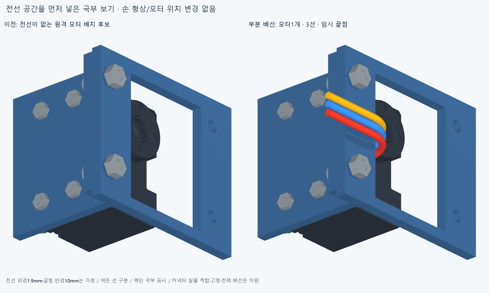

# WIRE009 · 원격 모터 전선 공간

손 형상이나 모터 위치를 바꾸지 않고 전완의 원격 모터16개에 각3선, 총48개의 고정 리드 공간을 넣었다. 보드가 없는 상태의 부분 배선 후보다. 모터 사이를 잇는 버스나 보드 연결, 케이블 고정은 아직 없다. 손바닥 고정 모터8쌍의 간섭과 전체 모터 배치 미채택 상태는 WIRE008에서 그대로 남는다.

그림은16개 중 모터1개의 국부 전후 보기다. 랙은 그림에서만 잘라 보였고 간섭 검사에는 전체225개 포장 부품을 사용했다. 선 색은 경로 구분이며 실제 핀 순서가 아니다. 오른쪽 떠 있는 세 끝점은 임시 종단이며 보드나 스트레인 릴리프가 아니다. 손364부품 STEP/STL·관절축·길이·수용 외형은 바꾸지 않았다.

## 실제로 한 검사

같은 원격 모터 위치를 유지하고 전선 외경1.9mm, 중심선 굽힘 반경10mm, 커넥터 뒤 직선5mm의 바깥쪽 출구 경로를16개에 적용했다. 이 치수는 공간 모델 가정이며 실제 공급 케이블 치수·허용 굽힘 반경·수명이나 압착 적합성의 확정값이 아니다. 직선3mm 후보는 전선3개와 랙이 각각0.429774mm³ 겹쳤다. 랙을 깎지 않고 직선 경로를5mm로 바꾼 후보를 사용했다.

전선48개와 포장225개 대조에서 재료 겹침8쌍, 전선끼리1128쌍에서0쌍이다. 편 손·최신 엄지척·중지 앞 교차·25mm 구 접근·복합 손모양의5끝자세에서 손364부품 전체와 전선48개를 대조한 겹침 수는 각각[0, 0, 0, 0, 0]이다. 중립 팔 참고10부품과는0쌍, 이 검사들의 연산 실패는0건이다. 모터별 전선 공간이 확인된 것은12/16개다. 보고 문턱은0.001mm³ 초과, Boolean 허용오차1e−6mm다. 미소 체적 문턱을 제조 공차나 실물 안전 기준으로 쓰지 않는다.

남은4모터는 중지PIP/DIP·약지PIP/DIP다. 각 모터의2/3번 경로가 랙 지지기둥이 있는 두 줄에서 겹쳐 총8쌍, 각각 약17.108639mm³다. 이4모터의 경로는 미채택이다. 저장64형상은48전선+16커넥터 외곽의 검사 후보이며 설치 부품으로 합산하지 않는다. 다음은 이 기둥을 피하는 전선 경로부터 조정한다. 손이나 랙을 절삭할 근거로 쓰지 않는다.

손가락 자세가 달라지는5끝자세와 고정 리드를 대조한 범위다. 팔/손목 회전, 관절을 건너는 연속 케이블, 서비스 루프의 당김·끼임·쓸림·조립/교체·구동 텐던과의 통합은 검사하지 않았다. 정지 리드의 빈 공간을 전체 움직이는 배선의 성공으로 승격하지 않는다. 리드가 나오는 모터16개도 실제 설치 완료가 아니다.

## 좌표 오류와 커넥터를 구별

첫 `build_check.py` 탐색은 옛 단일 관절 좌표에서 새 모터 좌표로 옮기는 X−14.5mm를 빠뜨렸다. 따라서 처음3개의 원래 경로에서 나온 모터 관통은 입력 좌표 오류다. 손 또는 모터 CAD 결함의 근거로 쓰지 않는다. `reviews/check.json`에 그대로 남기고 `corrected.py`와 `reviews/corrected.json`에서 수정했다. 옛 vendor 변환의 이동은 X+8mm, 현재 canonical 변환은 X−6.5mm이며 회전은 같다. 기존 V10 변환 코드도 이 차이를 명시한다. 전선 시작 X는−11.1에서−25.6mm로 바르게 등록했다.

단순 EHR3 외곽 상자는 현재 모터 전체 형상과 약39.270093mm³ 겹친다. 모터 형상에는 헤더도 포함되어 있고 상자는 실제 중공 하우징이 아니므로, 이 수치만으로 커넥터 실물 결합 성공이나 CAD 결함을 판정하지 않는다. 포장 부품 전체 대조의 상자 겹침은16쌍이며 원래 결과를 보존했다. 선 자체의 관통0과 커넥터 결합 미검증은 별개다. 커넥터 형상을 임의로 깎거나 겹침을 숨겨 통과시키지 않았다.

XL330-M077은 공간 비교용 모터 후보다. [현재 ROBOTIS 설명서](https://docs.robotis.com/ko/docs/dxl/model_reference/x_series/xl_series/xl330-m077/)의3핀 GND/VDD/DATA·21AWG와 [JST 단자 카탈로그](https://www.jst-mfg.com/product/pdf/eng/eEH.pdf)의30~22AWG 차이는 실제 공급 케이블/단자 품번으로 확인할 미해결 사항이다. 기존1.9mm 공간 모델을21AWG 케이블 인증으로 쓰지 않는다. 자세한 출처는 `../wiring_layout_v1/references_current.json`에 있다.

## 다음 단계와 저장 범위

해결한 손가락 동작을 다시 미세 조정하지 않는다. 다음은 남은4모터의 기둥 우회, 원격 리드 고정점·스트레인 릴리프와 모터 사이 연결 버스/보드용 임시 종단 공간, 그리고 손바닥 고정 모터의 남은 배치다. 실제 공급 커넥터/완성 케이블을 확인하며 미확정 사양은 가정으로 남긴다. 전기 전선과 구동 텐던은 다른 경로다. 전체20모터 전달계·장착·제작 강도·전원/전류·50/100ms 실물 성능은 승인하지 않았다.

코드·틀린 좌표 탐색/수정 입력·전체16모터48선 STEP/STL·결과·전후 그림을 저장한다. origin 정상 푸시 후 정확SHA의 새 깨끗한 clone에서3원본 리드 재생성과48저장 리드 재수입,225포장·1128선쌍·5손끝자세·중립 팔·커넥터 상자 대조를 재현한다. 같은 에이전트 재현 검토이며 독립 감사가 아니다. 커넥터의 미해결 겹침 재현을 설계 통과로 부르지 않는다.
