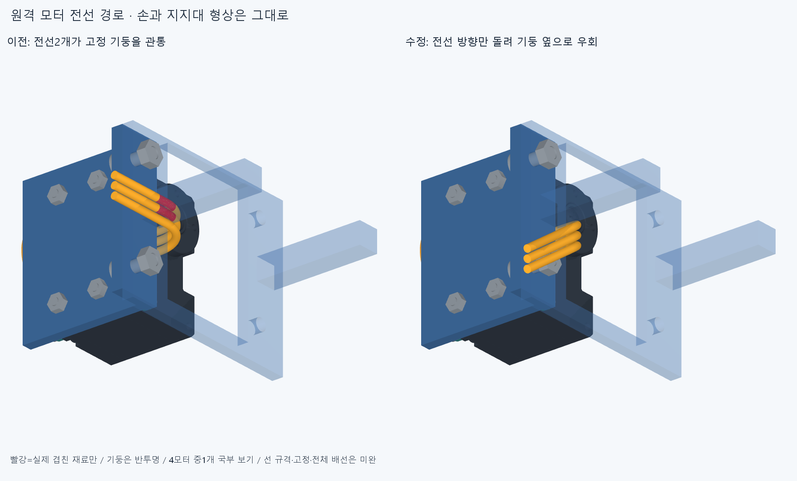

# WIRE010 · 네 모터 전선을 기둥 옆으로 우회

손·모터 위치·지지대를 바꾸지 않고, 막혀 있던 네 모터의 전선 방향만 35도 돌렸다. 중지PIP/DIP·약지PIP/DIP의3선씩12리드가 수정 대상이며, 이미 공간이 확인된 나머지12모터의36리드와16커넥터 외곽은 이전 파일을 그대로 참조한다. 전체48리드의 출구 공간이 이번 보고 기준에서 확인됐다. 연결 버스나 보드·전선 고정까지 끝난 상태는 아니다.

그림은4모터 중 중지PIP 하나의 국부 보기다. 빨강은 실제 기둥/전선 공통 재료만 표시했으며 절삭 대상이 아니다. 기둥은 위치를 보이기 위해 반투명이고 랙은 그림에서만 잘랐다. 실제 검사에는 전체 랙과225포장 부품, 손364부품을 포함했다. 선 색은 전기 핀 순서가 아니다. 손364부품 STEP/STL·관절축·길이·모터 위치·랙 원형은 보존했다.

## 수정과 검사

이전에는4모터의2/3번 리드와 기둥이 총8쌍, 각각 약17.108639mm³ 겹쳤다. 같은 커넥터 출구점과 초기 직선·접선을 유지하고 굽힘 평면만 35도 돌려 기둥 옆으로 지나가도록 했다. 길이를 줄이거나 굽힘 반경을 작게 하지 않았다. 외경1.9mm·중심선 반경10mm·출구 직선5mm는 이전 공간 모델 가정이며 실제 공급 케이블/굽힘 수명·최종 압착/단자 규격의 승인값이 아니다.

수정 후48전선×225포장=10800쌍, 전선끼리1128쌍,48전선×16커넥터 외곽=768쌍에서 보고 기준 이상의 비의도적 재료 겹침0·연산 실패0이다. 편 손·최신 엄지척·중지 앞 교차·25mm 구 접근·복합 손모양의5끝자세 각각에서48전선×손364부품을 대조했고 같은 결과다. 중립 팔10부품과도 보고 기준 이상의 겹침0이다. AABB 후 native Boolean을 적용했고 보고 문턱은0.001mm³ 초과·Boolean 허용오차1e−6mm다. 임의1mm 여유 충족이나 연속 운동·실물 공차를 뜻하지 않는다.

48전선의 시작/접근/풀기 동적 경로를 검사한 것이 아니다. 원격 모터와 손바닥이 고정된 참고 배치에서 손끝자세5개를 대조한 범위다. 팔/손목을 지나는 실제 연결 케이블, 서비스 루프·당김·끼임·마찰·피로, 조립/교체는 아직 미검증이다. 손 자체 전체쌍을 이번 회차에 재검사하거나 전체 구동 전달계를 완성한 것도 아니다.

## 남은 중요한 일

원격 출구48선은 여전히 열린 임시 끝점이다. 다음은 고정점·스트레인 릴리프, 모터 사이 연결 버스와 보드용 임시 종단 공간이다. 새 지지부를 설계할 때 기존 모터 체결부·실제 전선 방향과 조립/교체 공간을 확인한다. 보드 미정은 열린 공간을 설계할 수 없다는 뜻이 아니다.

커넥터16개는 실제 중공 하우징이 아닌 기존 외곽 상자다. 헤더를 포함한 모터 전체와의 약39.270093mm³ 상자 겹침·실물 결합 미검증은 WIRE009에서 그대로 남는다. 이번 전선 대 상자의 겹침0을 커넥터 결합 승인으로 쓰지 않는다. ROBOTIS의21AWG와 JST 해당 단자 카탈로그의 최대22AWG 불일치도 실제 공급 완성 케이블/단자 조합으로 확인해야 한다. 외부 출처는 [이전 근거](../wiring_layout_v1/references_current.json)에 보존한다. 전선과 구동 텐던은 다른 경로다.

WIRE008의 손바닥 고정 모터8쌍 간섭도 미해결이다. 현재20모터 배치 자체는 미채택이며 설치 모터20개 완성품으로 세지 않는다. 혼/스풀 체결·양방향 전달·랙 장착/강도·최종 전원/보드·50/100ms 실물 성능을 승인하지 않았다. 이미 해결한 손 자세를 다시 미세 탐색하거나 손/랙을 깎지 않는다.

## 저장과 재현

코드·회전각/입력·수정12리드 STEP/STL·나머지52형상 참조·8실패→0의 실제 결과·전후 그림을 커밋/정상 푸시한다. 정확SHA 새 깨끗한 clone에서 변경12리드를 다시 생성하고 모든 해석적 면/경계/꼭짓점/속성과 구간 내부점을 저장 STEP와 비교한다.48저장 리드와 전체225포장·16커넥터 외곽·1128전선쌍·5손끝자세의 손364부품·중립 팔10부품 및 이전8실패도 재수입해 재현한다. 같은 에이전트 검토이며 독립 감사가 아니다.

이전 WIRE009의 일치 경계면 차집합 계산 판정 불가는 보존되어 있다. 이번 source/STEP 비교는 `roundtrip_review.py`의 해석적 면/곡선·경계/꼭짓점/물성·재료 내부 분류를 사용하고, 서로 다른 실제 부품의 간섭 검사는 native Boolean을 유지한다. 일치면 Boolean의 성공이나 이전 원본 core 통과를 새로 주장하지 않는다.
