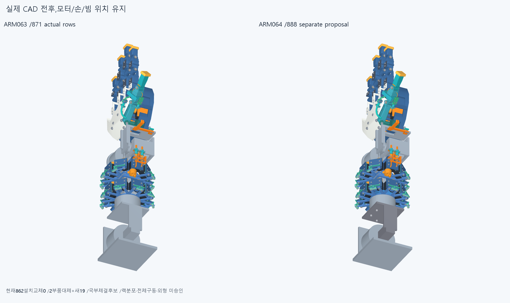
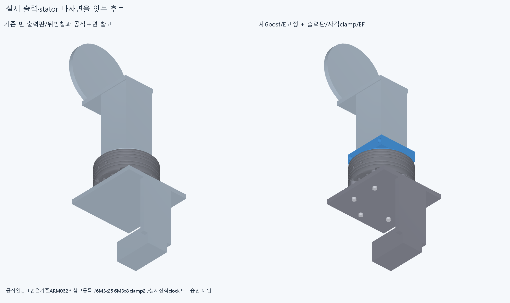
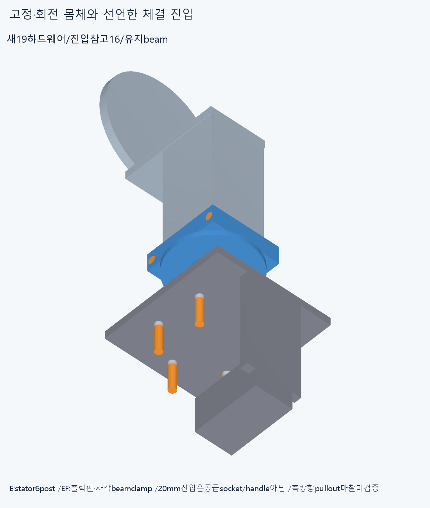
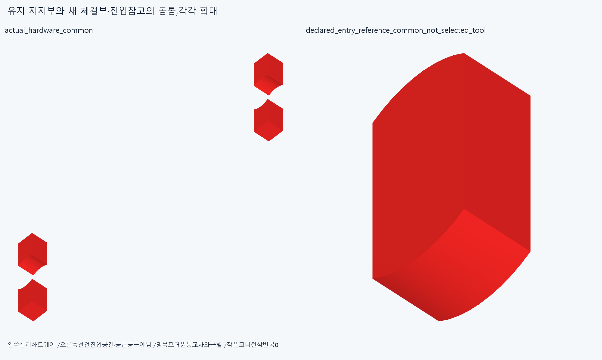

# ARM064 실제 roll 체결과 빔 고정 후보, 미채택

**실제 출력판·빔 클램프·모터 고정 몸체의 체결 경로를 만들었으나, 새 출력판/클램프가 유지한 ARM063 뒤 지지부와154.35626405814986mm³ 겹친다. 현재862 설치는 유지하며, 이888 후보는 조립·전체 구동·외형 승인이 아니다.**

## 실제 변경과 고정·회전 몸체

ARM063의871에서기존 Elbow_roll_carrier/Roll_output_flange2만별도후보로대체했다. 불변869+새19=888이며, 손364/397·손바닥4/전완16모터·빔·전기·설치축·길이·명령·clock은유지한다. 현재862설치변경0이다.

E 몸체는기존팔꿈치받침형상을유지한새statorcarrier1+M3x25참고6이다. 저장공식STEP의rearcase축6,face59..64/PCD68/sourceZ15.5를ARM062의정확등록으로읽어worldY−261에놓았다. 기존E뒤판Y−283..−277에서R4.5기둥6개/Y−277..−261을잇고Ø3.4보어를뚫었다. 6M3x25의명목22mm스택/3mm물림은도면rear깊이3.5mm와구별한다. 입구/끝공차·실제유효산·나사fit/예압은미검증이다. 기존명목case의4mm공간을임의solid로메운것이아니다. case/output나사를구별하며,공급실물clock·stator쪽식별은공식도면/표면의공학추론에기댄참고다.

EF 몸체는출력판/아래빔clamp1+위cap1+M3x8출력참고6+M3x12clamp참고2/너트2다. 출력판R32/Y−230..−226에실제6M3/PCD20의Ø3.4통과구멍과두핀Ø3.2보어를만들었다. M3x8은4mm판+명목4mm물림이며도면M3깊이6mm를실제물림규격으로보증하지않는다. pilotØ25에대한femaleØ25.2/outerØ29lip은Y−231.25..−230이다. 저장face124의R12.5원통trim은출력면보다0.5mm뒤에서시작하며lip은참고casefrontY−231.5보다0.25mm앞에서끝난다. 이fit/clock·모든trim면간섭을승인하지않는다. source615면을다시분류/봉합하거나부피Boolean하지않았다.

사각clamp는실제44×42빔을깎지않고outer58×54/Y−226..−212로감싼다. 두반쪽split0.2mm,나사축X±25.5/Y−219,원래M3x12shaftZ−4..8/head−6..−4/nut4..6.4와counterbore·hex자리를썼다. 출력판앞Y−226이빔뒤끝의한방향양의받침이다. **반대방향뽑힘은아직clamp마찰/예압가정에의존한다. 전체6자유도고정/토크승인이아니다.** 사각형상은명목roll반력을받고,실제강성·재료·축력·강도·마찰/예압은미검증이다.

명목경로는E 팔꿈치받침→6post/나사→statorrearface,EF actualoutput6M3→출력판→사각clamp/cap/M3→빔이다. 단순6구멍판만추가하고토크완료라하지않는다. 새19행모두유효1solid지만그것이체결/제작승인은아니다.

## 새 검사와 남은 막힘

새13그룹/77376쌍/186AABB/14기록/0연산실패,rawfalse다. 보고기준>0.001mm³/Boolean1e−6mm/OCC1을유지하며검사제외0이다.

중립new19대869의8기록중7은기존Ø79×43꽉찬명목모터원통과새stator기둥5235.652652766605mm³/나사6개각134.30308594096365mm³의교차다. 실제공식외부는caseØ79/Y−261..−231.5와driverØ57/Y−273..−261이므로이7기록을7실물결함이라고확정하지않는다. 기존원통을검사에서빼거나rawfalse를덮지않았다. 별도닫힌외곽참고2대새구조3의6쌍/1AABB는0이지만615열린공식표면의실제모터solid인증이아니다. 체결산침입/실제내부구멍을이꽉찬외곽참고로판정하지않았다.

나머지실제하드웨어1기록은새outputplate/lowerclamp와유지ARM063carrier154.35626405814986mm³다. 아래head의20mm선언진입공간2개도같은carrier와각32.54791198061669mm³겹친다. 실제head/nut단면의20mm연장16은선정bit/socket/handle·필요길이/실제공구충돌인증이아니다. 진입대새19의동축nut공간/돌출bolt2기록각11.309733552923259mm³도참고교차로보존한다. 내부171쌍의새19끼리는0이다.

새4팔자세는roll±40,복합[55,40,-20,15]/[110,-40,20,-15]다. 각E/EF의다른몸체관계8그룹중110E고정부에서고정시험대참고와2기록이남는다. 시험대는실제상완이아니며그2기록을실제상완충돌로확대하지않는다. 같은EF끼리인중립뒤carrier막힘은상대몸체검사에서사라진것이아니다. 전체888/862·연속팔/상완·모든16출력/긴재료·전기·20토크승인은없다.

check의첫seat_distances필드는stator끝bbox와선언caseplane의좌표차0이며native접촉면/면적질의가아니다. 두번째beam/plate거리0만nativeDSS이며예압/접촉면적승인이아니다. 원본필드/코드를보존하고이구분을assessment에명시했다.

벤치에서statorcarrier6M3→출력판6M3→빔끝착좌→cap/너트/M3의순서를선언했다. **정적통합후보가막혔으므로조립native는실행하지않았고성공표본으로세지않았다.** 빔의한방향끝받침과반대방향마찰가정도남긴다. actual공급품·공구/조립·나사산토크승인은없다.

## 실제 CAD 그림과 보존

4그림은불투명실제저장CAD다. 공식표면은기존ARM062의등록참고를그림에서재사용해1e−7mm초기datum차도보존했다. 새검사는교정정확등록을사용한다. 공통2는실제하드웨어154.35626405814986과선언진입32.54791198061669이며두독립실물결함이아니다. 그림/픽셀/팔시각단위재현이나외형수용승인은없다.

이전기하12649/동결222·과거manifest를보존한다. 옛ARM063front17/16pad/공통2·ARM0623/17+615·ARM061/옛PCD/M3/±90·작은줄접합검사는반복하지않았다. ARM059failedM3+13/R5/같은줄·이전strictfalse/곡면포함보류를해소하지않았다.

## 재현과 다음

정확SHA새깨끗한사본에서새13native/39형상서명(19hardware+16entry+2outer+2common)/공통2/설계·몸체계약을대조한다. sourceSTEP적응epsilon1e−10/절대1e−5의측정서명이지모든곡면식trimBoolean증명이아니다. 같은에이전트이며독립감사가아니다.

다음은이출력판/빔clamp와ARM063 **뒤collar/root를하나의반력·조립unit으로통합**하는별도후보다. 저장된실제공통과선언head진입막힘을읽고기존뒤collar기능을출력빔고정과공유할지판단한다. rearcap/나사·받침을몰래삭제하거나작은볼트코너만깎지않는다. 모터패드와연결된root를보존하고기능부품교체/반력·축방향포착가정을명시한다. 끝낸frontclamp/각도·반경족/615면분류를반복하지않는다.

현재방사랙/외형미채택,수용손/16구동원·전기홈/뚜껑M2/3선/plug/M3스택유지다. 손빔절삭·모터삭제/몰래이동·각도제한/ODR축소/가짜텐셔너/LINK/옛곡선최적화/팔꿈치전기버스재개0이다. 지지/운동공간일관뒤고정모터→H짧은입구→실제끝구긴재료를잇는다. 공급품/실물완벽을CAD/영상무한조건으로늘리지않는다. 실제힘강도마찰장력예압·20토크/동적전기·전체팔/상완·실물제조/외형승인은없다.
