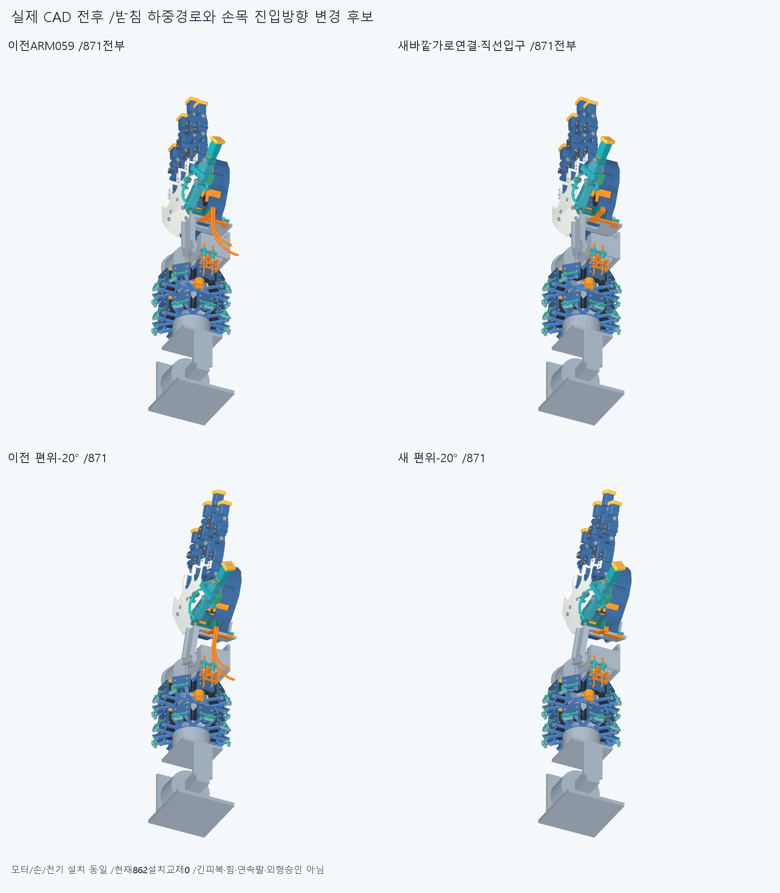
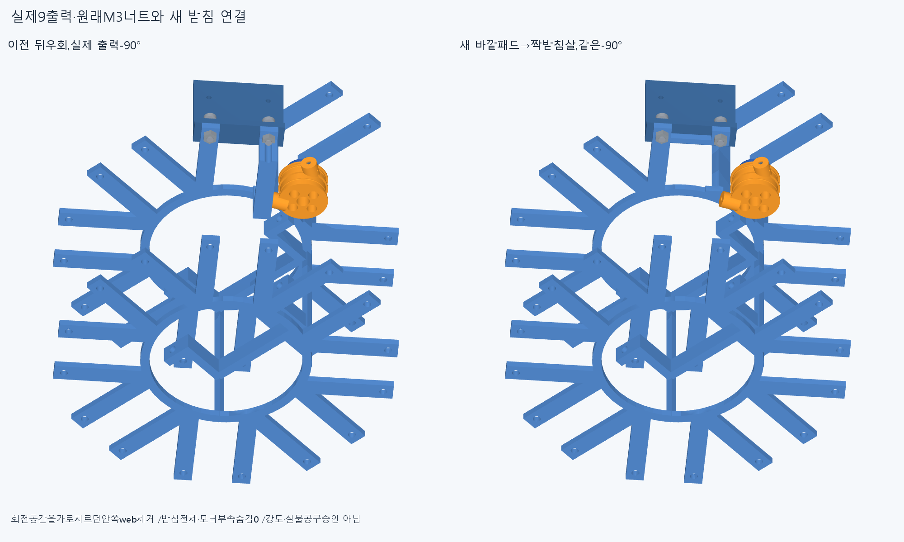
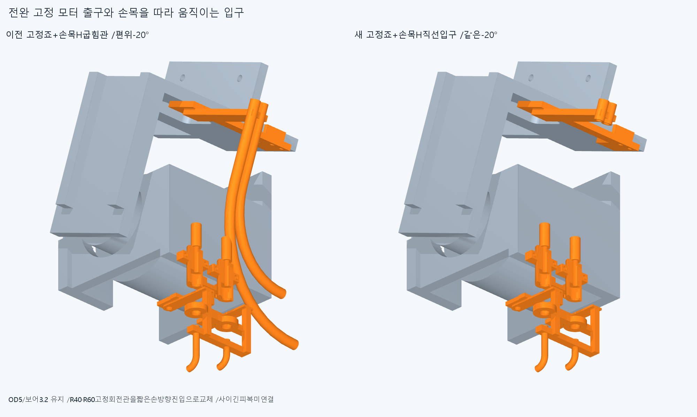
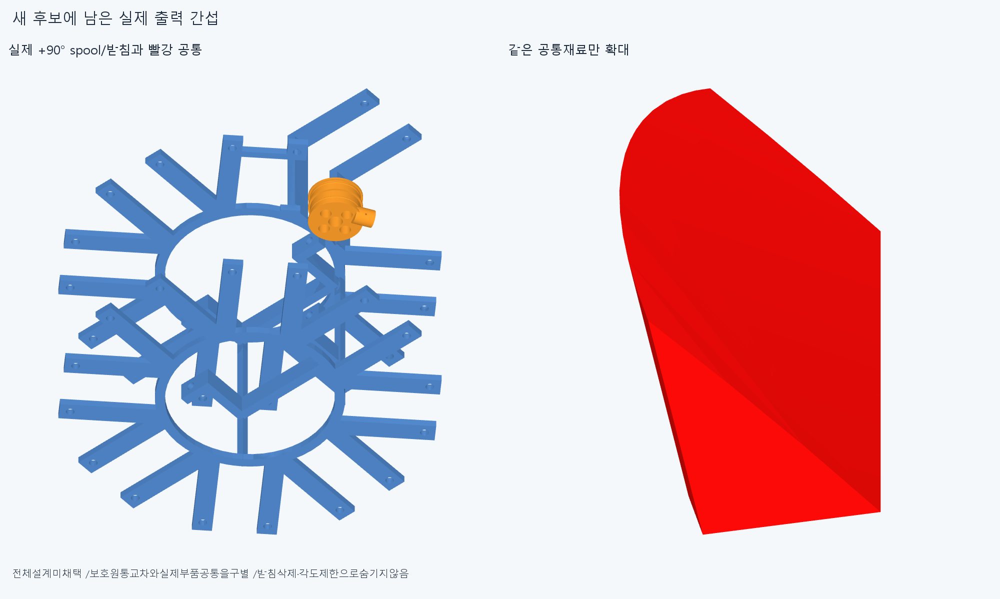
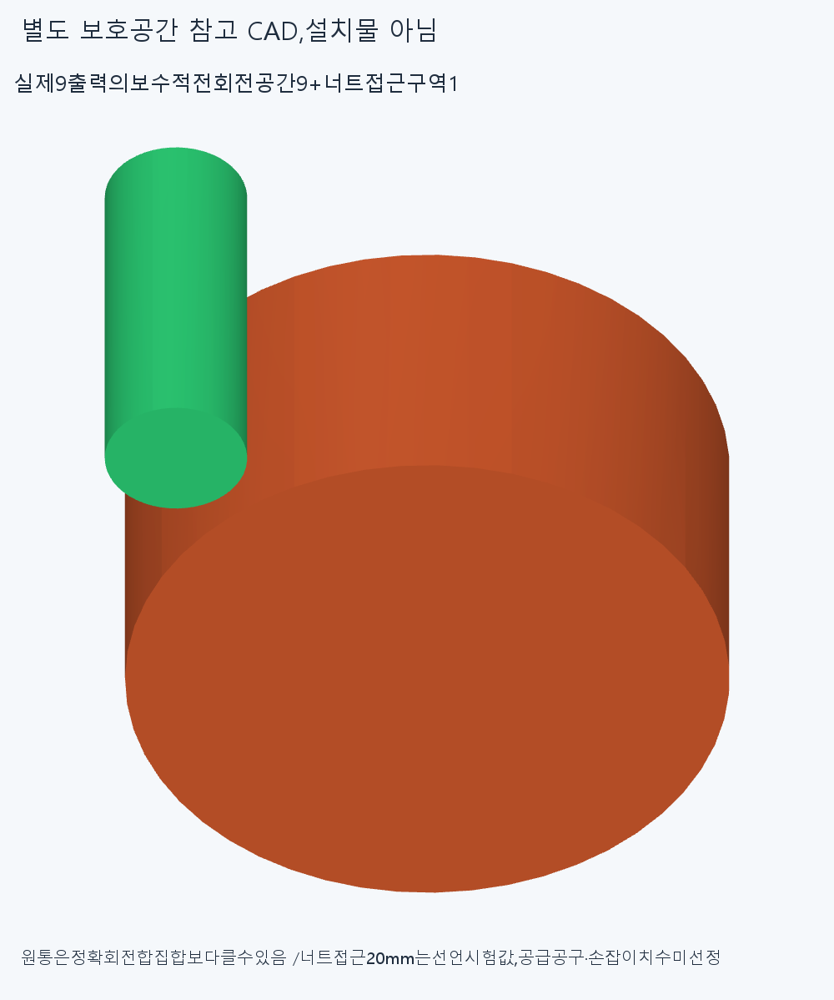

# ARM060 바깥 받침 연결과 손 방향 손목 입구,미채택

**너트와 손목 가이드의 이전 간섭은 이번 새 부품 검사에서 피했지만,드럼 +90°가 기존 중앙 허브에 걸려 전체 후보는 미채택이다. 현재862설치와 수용 손·16원격구동원은 유지한다.**

## 바꾼 실제 형상

별도871=ARM059의불변869+새carrier1+새손목guide1이다. 모터 설치/명령·출력 체결위상/전기/조절부16의위치는같다. 현재862를교체하거나현재원격랙분포를수용안으로확정하지않는다.

새받침은이웃middle_dip45°/tangent−13의원래M3바깥패드를같은모터의짝+13받침살에잇는다. 원래평면Y−162..−159의3mm재료이며가로연결의국부radial66.5..69.5/tangent−13..17이다. 원래free-span38..66.5를이연결로대체했고,ARM059처럼회전출력을가로지르는뒤쪽안쪽web를붙이지않았다. 원래M3패드→가로연결→짝받침살→허브/캐리어·빔의명목하중경로다. 실제강도·비틀림/예압·마찰승인은아니다.

손목guide는기존saddle벽/두M2자리와front(100,-4,-3)/(100,-4,2)/+Y를유지한다. 뒤입구는(100,-14,-3)/(100,-14,2)/+Y이며OD5/보어3.2/실제10mm직선이다. 모터고정출구(93.2,-93,-2.5)/(93.2,-93,17.5)/+Y는그대로다. 이전의아래쪽Z진입R40/R60고정관을없애고,두끝이손방향으로진입하는구조로바꿨다. **굽힘반경을줄이거나긴피복을잘라성공으로삼은것이아니다. 사이의유연한긴피복/줄은이번에연결하지않았다.**

실제원래M3바깥패드/전면허브원환/손목M2착좌재료의새부품밖차집합은각0이다. 세입력은각실제원래재료와선언영역의common으로만들었다. 새두부품은각유효1solid다. 변경하지않은ARM059통합base의M3pad+13밖19.195131113433646mm³실패는남겨두며이번에반복/해소하지않았다.

## 회전과 조립 접근 공간

DRIVE018의반경/축방향좌표불변근거를읽고,현재실제9출력부(혼/중앙retainer/드럼/탭4/꼬리나사2)의각전체AABB를새로읽었다. Y축(51.1,-154.4,7.5)회전은Y와축거리불변이므로각AABB의두반경좌표최대에서보수적원통9개를정했다. 실제곡면내부를포함하는상자경계이며끝자세점만검사한것이아니다. 이원통들은정확회전합집합보다클수있고설치부품이아니다.

드럼보수반경18.41888611926419mm/Y−172.5000001..−154.4,수치패딩1e−5mm다. 새carrier와드럼원통400.3913526536402·꼬리나사1원통38.7136630461223mm³의교차가남아전회전공간을확보했다고쓸수없다. **보수적공간교차2건을실제새결함2개로세지않는다.**

실제M3너트전체를포함하는원통과뒤−Y20mm접근구역을선언했다.20mm는시험가정이며필요공구길이/공급품선정값이아니다. 새두부품은이구역을침범하지않았다. 별도로실제너트의20/10/0mm세위치를나머지870부품과검사해기록0이다. 이는유한세위치와새받침의직선접근공간확보이며실제스패너/드라이버·손잡이·작업자/연속전체조립승인이아니다.

## 새 검사와 남은 실제 걸림

33native그룹14917쌍/391AABB후보/8기록/0연산실패,보고0.001mm³초과/Boolean1e−6/OCC풀1이다.8은기존carrier/cap·체결5쌍을새형상으로다시검사한5기록+실제+90출력1기록+보수적공간2기록이다. 분류/검사제외로rawfalse를덮지않는다.

중립새2대기존869에서는중지모터너트간섭이사라졌고기존cap76.1511028933974/체결4기록은남았다. 실제9출력의−90°는새두부품과겹침0이나,+90°에서드럼/carrier5.237987823941943mm³가남았다. 각도를제한하지않으며−90통과를전회전성공으로넓히지않는다.

12유한팔자세의새2부품상대몸체24관계는모두0이다. 팔꿈치55/110,전완roll±40/±80,손목굽힘−35/+55,편위±20,복합[55,40,-20,15]/[110,-40,20,-15]다. 각새부품은서로다른고정/회전몸체의현재모든하드웨어와비교했고같은강체내부관계는중립새2대869에서다뤘다. **이것은새부품만의검사이며전체871/862자체운동·연속팔/실제상완·긴재료/동적전기·20토크승인이아니다.**

남은+90공통의실제상자는[36.65218142745442,-162.00000010000056,-1.0934346061235969]..[38.0000001,-158.9999999,1.92557778958009]mm다. 이공통5.237987823941943에서원래ARM054carrier를빼면0으로새가로연결이아닌원래재료임을확인했다. 처음엄지두bridge영역가설의차집합은같은5.237987823941943으로가설이기각됐다. 원래코드/결과를보존했다. 별도후속1질의에서이저장공통의R34..38/Y−162..−159전면허브원환밖은0이었다. **실제남은위치는원래중앙허브원환이다.** 이4질의는기존33그룹/옛ARM0594질의재실행이아니다.

ARM059원시14중이번교체2부품과관련없는5기록만동일부품승계/native0,관련9는새형상에자동승계하지않았다. 통합R5/base의조절부·너트3접촉/같은줄2접합과실패M3pad+13,이전strictfalse/곡면비교·전체팔보류는그대로다. 새로운33검사로전체설계를승인하지않는다.

## 실제 CAD 전후

새설치후보2/보호공간10/실제공통1의13저장형상이다. 보호/증거11은설치부품이아니다. 모든현재모터·부속을전체불투명장면에남겼다. 첫5그림은글꼴의U+2212마이너스가불분명해history/render_attempt1에정확코드/그림/결과를보관하고ASCII마이너스로문자만바꿔다시그렸다. native/기하재실행0이다. 그림행렬/팔시각단위수치재현과픽셀동등성승인은없다.

## 저장과 다음 단계

이전기하12554파일/동결222/과거manifest를보존한다. 정확SHA새깨끗한별도사본에서33native/13sourceSTEP형상(새2+보호10+공통1)의적응epsilon1e−10·절대1e−5/3착좌질의(+3입력common)/3+1후속질의/실제몸체변환·보호공간·입구계약만재현한다. 같은에이전트이며독립감사·모든곡면식trim/Boolean동등성검사가아니다. ARM05931/20/5/4·실패M3/PCD/옛미세접합검사는반복하지않는다.

다음은중지받침살만반복우회하지않고,남은원래중앙허브의실제회전출력/빔·콜라·roll플랜지부착및16이웃하드웨어와함께연속하중경로의변경범위를정한다. 실제공통과9출력보호공간을새지지의입력으로둔다. 원환을단순잘라분리하거나모터를지워빈공간으로만들지않는다. 현재랙분포는확정안이아니며새배치가필요하면명시적으로제안하고옛세계좌표배선/조립을자동승계하지않는다.

새짧은손목입구의유한검사를마무리하고,지지/운동공간이일관되면전완고정모터→손목H입구/엄지실제끝구의긴재료를다시잇는다. 손절삭/각도제한/ODR축소/가짜텐셔너/LINK·옛최적화/팔꿈치버스재개0이다. 실제제조외형/공급공구/힘강도마찰장력예압·전체구동승인없음,공급품인증을다음CAD/영상의무한조건으로늘리지않는다.
