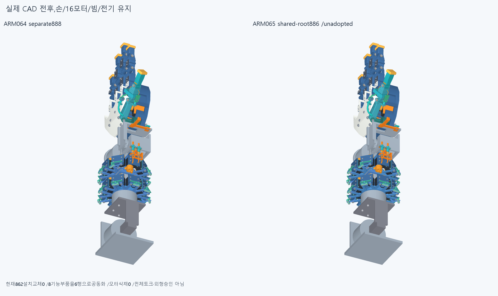
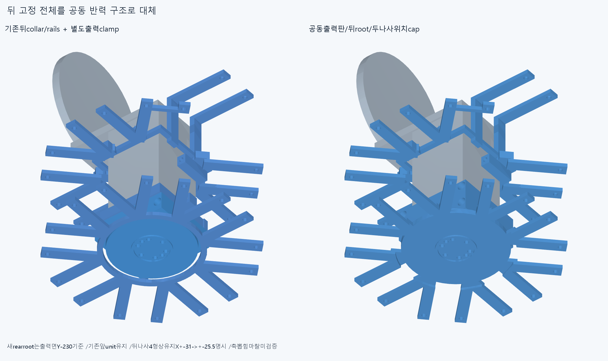
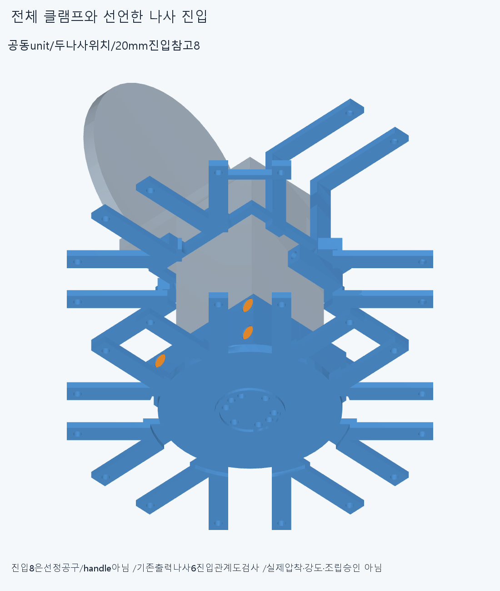
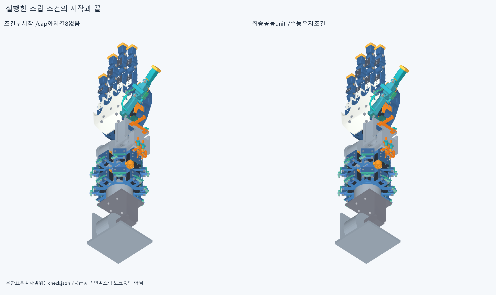
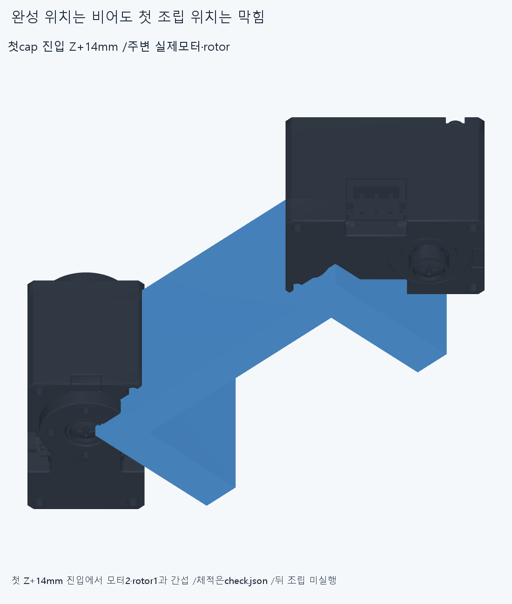
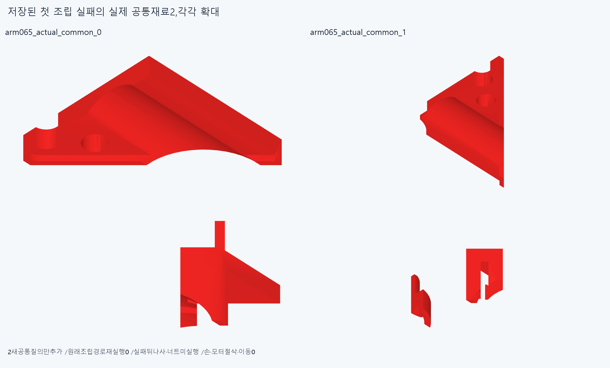

# ARM065 공동 출력·빔·뒤 랙 지지 구조, 미채택

**새 공동 구조의 중립 하드웨어와 나사 진입 막힘은 없어졌지만, 덮개를 위에서 넣는 첫 Z+14mm 조립 자세가 실제 모터/회전부3곳에 걸려 중단했다. 현재862 설치·손·16모터·빔·전기·축/길이·명령clock은 유지한다.**

## 기능 전체를 공동화한 변경

별도886=ARM064888-기존8+새6/불변880이다. 기존8은ARM063carrier1,옛뒤cap/나사너트5,ARM064outputplate/lowerclamp1과uppercap1이다. 새6은공동outputplate/beam/rackroot1·공동cap1·형상은같고X±31→±25.5만명시이동한뒤M3x12/너트4다. 뒤Y−204.5는유지한다. 기존ARM064의Y−219 clamp나사/너트4도유지해두나사위치의체결기능을모두남겼다. 모터/체결기능을몰래삭제한것이아니다.

전체뒤lowercollar/ears Y−208.5..−200.5와바깥rail전길이 X±24..27/Y−232..−200.5/Z−27..−24,안쪽rearrootR42/Y−232.01..−226을대체했다. 새후방원환R30..38/Y−230..−226과inner3mmspoke r34..44/Y−230..−227은실제출력판뒤면Y−230을기준으로잇는다. 원래바깥spoke와Y−230..−229에서겹쳐연결된다. 원래rearM3받침16은유지하고전체유효1solid다. 같은단면3mm/1solid가강도동등성증명은아니다.

하나의아래빔clamp와공동cap은outer58×54/cavity44×42/Y−226..−200.5/split0.2mm,나사위치Y−219/−204.5·X±25.5다. headseatZ−4/nut4,shaft−4..8/head−6..−4/nut4..6.4/counterbore·hex자리를유지한다. 두기능의원래cap2개를하나의cap으로잇고carrier와출력판을같은root로만들었다. 앞ARM063unit은재설계하지않았다.

16모터M3받침→유지outerspokes→새innerrearroot/공동outputring→actualoutput6M3의명목반력이다. 빔은공동사각clamp/cap/두위치4M3와유지앞clamp로받는다. ARM064actual6M3/pilot25·E statorPCD68/6post와E/EF몸체구분은유지했다. 판소재가새root밖으로빠진양0,oldcarrier의선언전체변경영역밖누락소재0이다. rear16실제입력common/밖차집합도모두0이다. 이는모든면Boolean/토크·강도승인이아니다.

**빔뒤끝Y−226은한방향양의받침이며,반대방향뽑힘은여전히미검증마찰/예압가정이다.** 양방향축포착/6자유도고정·실제강도/공급fit/토크승인은없다. 손/빔절삭·모터/전기이동0,현재방사랙/외형은미채택이다.

## 새 검사와 원시 실패

새12native24214쌍/428AABB/7기록/0연산실패다. reporting>0.001mm³/Boolean1e−6mm/OCC1,검사제외0을유지한다.

중립new6대불변880은5280쌍/342AABB0,내부15쌍/11AABB0이다. 이전ARM064의별도출력clamp/rail154.35626405814986과head진입각32.54791198061669의형상은실제로공동unit으로바뀌었으며원래실패자료를삭제·이름변경성공처리하지않았다. 새진입8대880/새6은각2개씩총4동축nut진입참고/돌출bolt기록,각11.309733552923259mm³다. 20mm단면연장은선정socket/bit/handle·필요길이/실제공구충돌확정이아니다. 분류로rawfalse를덮지않았다.

새구조2대ARM064닫힌공식외곽참고2는4쌍/1AABB0이며615열린공식표면을수리한motorSolid가아니다. 기존9보수회전공간/새구조2와유지출력나사6의진입/새구조2도0이다. 이9공간은모든16출력명령의정확회전합집합이아니다. 변경EF공동unit의roll±40/[55,40,-20,15]/[110,-40,20,-15]4자세다른몸체관계도0이다. 전체886/862·연속팔/실제상완/16출력/긴재료·동적전기·20토크승인은없다.

E stator는같은형상이므로옛명목모터원통7/110E시험대2는재검사하지않고그한계대로보존한다. 옛ARM059failedM3+13/R5/같은줄/strictfalse와곡면포함보류도미해소다. 끝낸frontunit/옛615면분류/PCD/접합·ARM06413/39/2를반복하지않았다.

## 실제 조립 첫 자세에서 중단

조건부시작에는기존빔·모든16모터/전기·output6볼트·앞clamp가있고공동cap와그8체결품만없어877행이다. cap Z+14→+7→0,너트4먼저/볼트4다음의각20/10/0을계획했다. **첫cap Z+14의1표본877쌍/5AABB에서막혀나머지는실행하지않았다.** little_mcp_actuator_motor126.40064196430593,little_pip_actuator_motor104.94920010014212,little_pip_actuator_rotor79.90828414561531mm³다. 세구간을전체구조적불가능의증명으로쓰지않는다. +7/0이나나사·너트조립27표본성공은없다.

추가2공통질의는저장된실패cap의Z+14변환을적용한실제두모터공통이다. 경로그룹재실행0,새질의2이며원시실패/그림을보존한다. 첫4그림을재사용하고2상세그림만추가했다. sourceSTEP공통solid수도그대로대조한다.

## 실제 CAD 그림

6불투명실제CAD그림을직접확인했다. 첫조립그림footer가길어잘린원본을history에보존하고같은CADpanel픽셀해시를유지한채문구만재조합했다. CAD렌더/native/공통질의반복0이다. 조건부누락그림은조립성공이아니고,별도실패그림은실제Z+14위치다. 픽셀/행렬/팔시각단위·외형수용승인은없다. 이전기하12727/동결222/과거manifest보존이다.

## 재현과 다음

정확SHA새깨끗한사본에서12native(변경중립/공간/4자세11+실제첫조립1),12sourceSTEP형상(새hardware6/entry4/common2),rear16보존/입력common,영역밖/출력판보존2와설계·몸체·4체결이동계약을대조한다. adaptiveepsilon1e−10/절대1e−5는모든곡면식trimBoolean증명이아니다. 같은에이전트이며독립감사가아니다.

다음은완성위치공동root를미세수정하지말고**모터packet이들어오기전빔/root/cap을벤치선조립한뒤원래16packet위치·부품을복구하는순서**를별도로검사한다. 일시누락/조립자세와최종복구를명시하며모터영구삭제/몰래재배치와구별한다. 얕은완성근처cap시작을전체진입근거없이성공으로쓰지않는다. 순서로안되면분할/서비스interface의별도후보를검토하고손/빔을깎지않는다.

새12/12/16/2·완료frontunit·615면/PCD/미세접합·각도/반경족반복0이다. 수용손/16구동원·전기홈/뚜껑M2/3선/plug/M3스택유지,손빔절삭/모터삭제·몰래이동/각도제한/ODR축소/가짜텐셔너/LINK/옛최적화/팔꿈치전기버스재개0이다. 지지·조립·운동공간이일관된뒤고정모터→H짧은입구→실제끝구긴재료를잇는다. 공급품/실물완벽을CAD/영상무한조건으로늘리지않는다. 실제공급공구/강도힘마찰예압장력/20토크·동적전기·전체팔/상완·실물제조외형승인은없다。
