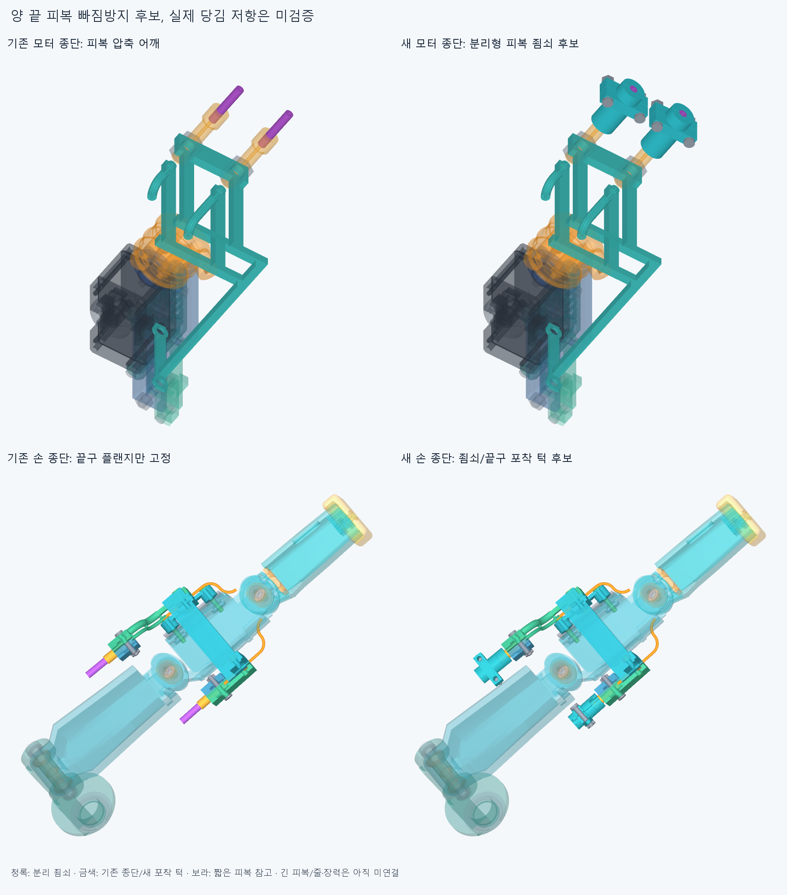
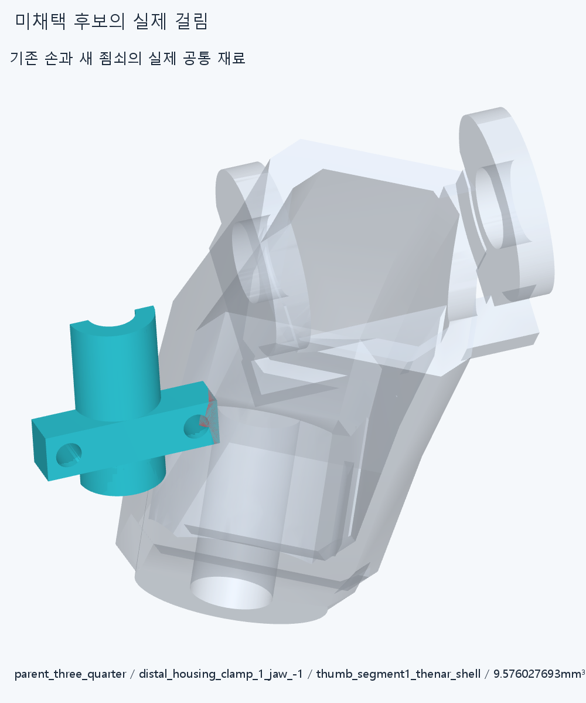

# RETAIN026 양 끝 피복 죔쇠 후보

**양 끝에 실제 분리형 죔쇠/체결품 후보를 추가했다. 위 손쪽 죔쇠를 피복 축 주위로90° 돌려 뿌리 외피 걸림을 피했으며,선택8정적자세에서 기준 이상 겹침0이다. 실제 피복 당김 저항/인장완화·전체 조립/구동 승인은 아니다.**

## 부품과 명목 힘 경로

네 종단마다 분리 죔쇠2반쪽/명목M2볼트2·너트2,합계24행을 추가했다. 손쪽 기존 끝구2개에는 노출된 입구에 일체형 포착 턱만 추가해 교체했다. 새26행=모터12+손14다. 손364본체 입력/관절축·길이/모터 설치·랙/48전기선·16외곽과 기존 가는 안내관/통로 중심선은 유지했다. 모터 쪽 기존 조절부 머리는 그대로다. 명목 손385−2기존끝구+14=397행,포장373+12=385행이며 실제20모터 설치/외형 수용이 아니다. 새 [selected scene](selected/generated/parts/scene.json)와 기존 [OFFSET024](../thumb_sheath_terminal_v2/selected/generated/candidate_scene.json),[TERMINAL022](../motor_tendon_terminal_v1/selected/generated/assembly_scene.json)를 함께 쓰되 옛끝구2개/첫실패죔쇠/시각화증거를 또 설치하지 않는다. 기존 STEP/STL4049파일 해시는 변하지 않았다.

피복→두 죔쇠 안쪽면의 마찰/압착→볼트/두 반쪽→축 방향 어깨로 포착한 모터 조절부 머리 또는 새 손쪽 끝구 턱→기존 종단/나사 지지의 명목 경로다. 단순 허공 점이 아닌 솔리드/볼트 형상이다. **피복 자체는 마찰로 잡는 후보이므로 기하 포착 턱만으로 실제 빠짐 방지를 승인하지 않는다.**

홈은 가정OD3mm 피복과 반경1.5mm에서 명목 접촉하고 두 반쪽 간극0.2mm는 조임을 위한 후보 여유다. 같은 죠가 기존 종단 외곽에도 닿으므로 이 간극만으로 실제로0.2mm닫히거나 피복에 충분한 압력이 생긴다고 보장하지 않는다. 실제 체결 후 피복 압착/변형·조임력·마찰계수/정상력·필요 인장력/미끄럼·유연 피복 안쪽 줄 끼임은 계산하지 않았다. 이 간극을 임의 충돌 여유 목표로 재최적화하지 않는다. 볼트/너트는 매끈한 명목M2외곽이고 공급품/나사산/머리·드라이브/공구·토크/프린트 공차/재료/강도/풀림/수명은 미정이다. Ø3/ID1.3/R/죠 길이도 실제 공급품 인증이 아니다.

## 첫 실패와 같은 형상의 설치 방향 교정

첫 후보의8정적자세에서6반복 기록=4서로 다른 죔쇠/뿌리 외피 쌍이 겹쳤다. 부모75%의 아래 죠/뿌리 실제 공통 체적은9.576027693mm³다. [원본 결과](reviews/check.json),[실제 공통 형상](generated/visual_evidence/scene.json).

위 손쪽 죔쇠의 설치 방위만 피복 축 주위90° 돌렸다. 손가락 목표각/모터 축·설치 위치·고정 피복 끝점/다른 부품은 유지했다. +90/−90의한정 두 대안 중+90의편손/부모75%/완성각 대조가 통과해−90은 실행하지 않았다. [probe](reviews/roll_probe.json). 그 뒤 바뀐 전체26행을8정적자세에서 다시 계산했다. 이전 첫8자세/3probe자세를 선택검사에 합산하지 않는다. 선택 범위는 새325내부쌍+26대기존손383/포장373/전기64/중립팔10/짧은피복4의8자세,**173797쌍 범위/508AABB native**,보고기준0.001mm³ 초과겹침0·연산실패0,Boolean허용오차1e−6mm/OCC풀1이다. 손 자체/물체·연속 왕복운동/모터출력 전회전·유연피복/전기선 동적 운동 검사가 아니다.

## 조건부 대표 조립

모터0/위 손쪽1 두 대표에 죔쇠 하부→상부→너트2→볼트2의 실제 방사 방향 접근을 검사했다. 각 단계 아직 없는6행과 앞서 놓은 부품을 기록했다. 다른 죔쇠/새 끝구/짧은피복4는이미 있는 조건이다. 총 **24유한표본**,두 대표 모두 완료/겹침0=False. [service](reviews/service.json). 실패하면 해당 위치의 후속 경로는 실행하지 않았다. **새 포착 턱이 있는 끝구의 기존 선조립/손으로의 삽입을 다시 검사하지 않았고,나머지 두 죔쇠/실제 지그·공구·긴피복 설치도 승인하지 않았다.** 기존 ASSEMBLY025를 새 형상의 전체 조립 성공으로 승계하지 않는다. 느슨한 반쪽/너트는 손/임시지지로 유지해야 한다.

최초 model.py라는 일반 모듈명이 DRIVE018의model과 충돌해 import 단계에서 중단했다. retention_model.py로 바꾼 뒤 기하/native검사를 실행했다. native검사 전 오류이며 CAD결함이 아니다. 원래 실패/부분 조립/검사하지 않은 범위는 그대로 보존한다.

## 손쪽 후삽입 실패를 선조립 순서로 교정

원래대표조립24표본은모터0의20표본이통과했고,손쪽위죠의첫4표본경로가뿌리에막혀후속을중지했다. [원본service](reviews/service.json)의false는보존한다. 새위끝구/받침/짧은24mm피복참고에죠·너트·볼트를손밖작업대에서먼저맞추는20표본을검사했다. 이는세계좌표X+500mm의별도작업대이며부품을실제로이동시킨동일기하대조다.

그9행묶음(죠/체결6+새끝구/안쪽받침/짧은피복3)을바깥X20→0mm에서손으로넣고위덮개/원래M2·새너트/볼트를나중에복구하는29표본을검사했다. 부모/끝마디/핀/나머지손을계속유지했고위덮개/그원래체결2·새받침체결4는각복구전까지실제로없다. [교정순서](reviews/service_order.json)의전체완료=True다. 손쪽의교체끝구는이묶음삽입범위에서함께검사했으나아래쪽교체끝구·나머지두죠/전체조립·지그/공구·줄끼우기/긴유연피복은미검증이다.

선택대표조립은기존같은모터0의20표본재사용+새상단선조립/설치49표본=**69유한표본**,기준이상겹침0/완료=True다. 원래실패한4표본이나첫8정적/3방위probe를선택표본수에더하지않는다. 짧은피복참고는죠의가정11mm그립구간중10mm까지그려져있고마지막1mm와긴연결부는아직모델링하지않았다. 실제그립길이/물성·당김/마찰승인으로쓰지않는다.

## 다음과 보류

선택 설치 방향/정적 공간은 작은 틈 재탐색 없이 닫는다. 대표 조립에 실제 실패가 남으면 같은 형상에서 선조립/진입 순서로 먼저 교정하고,교체 끝구의 나중 설치 경로를 확인한다. 그 뒤 모터→손목→엄지의 긴 피복 경로와실제지지/길이유지·구동줄끼우기·조절/예압·부모/손목의잡기와풀기를 잇는다. 허공waypoint/없는지지·텐셔너를 설치로세지않는다. 긴 피복은 아직 양 끝을 잇지 않았으며 전체손/모터·전기선/전달계 통합은 미완이다. 공급품/실물 인증을다음CAD나3~4동작영상조건으로무한히늘리지않되 실제 힘 검증을 기하 영상으로 대체하지 않는다. 팔꿈치 버스는 보류한다.

OFFSET024의core_initial=false/face_supplement=false와 한점거리/trim 모순은 그대로다. 이번 새 죔쇠/끝구의 원본/STEP 측정서명 재현을 그 기존 위덮개의 전체동등성 승인으로 확대하지 않는다. 새 깨끗한 정확SHA 재현도 같은 에이전트 검토이며 독립감사가 아니다.
