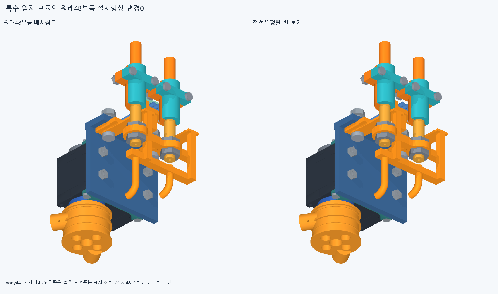
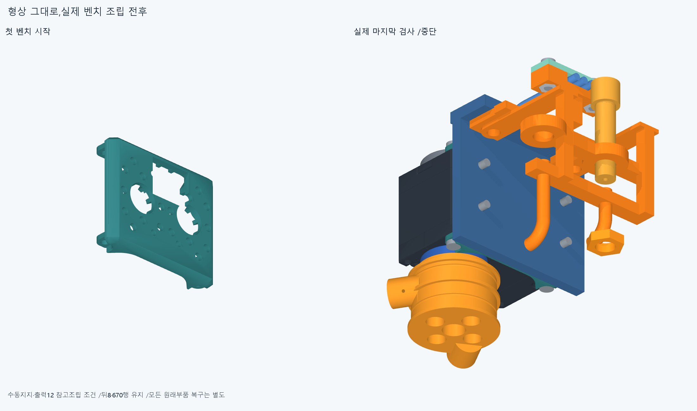
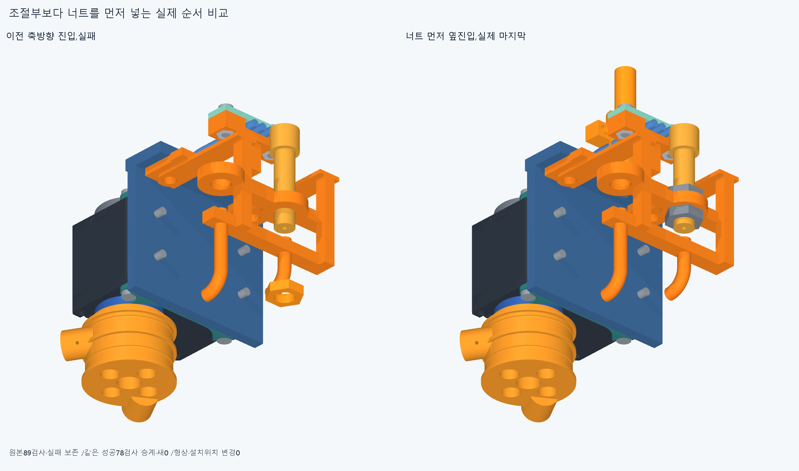
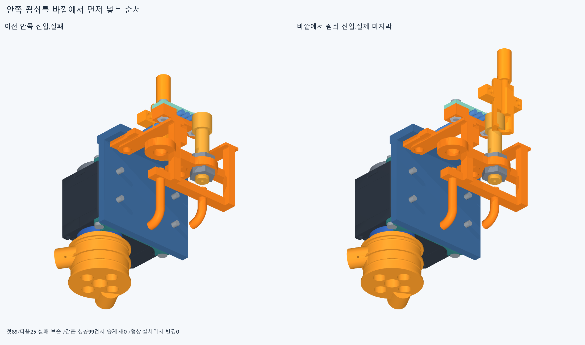
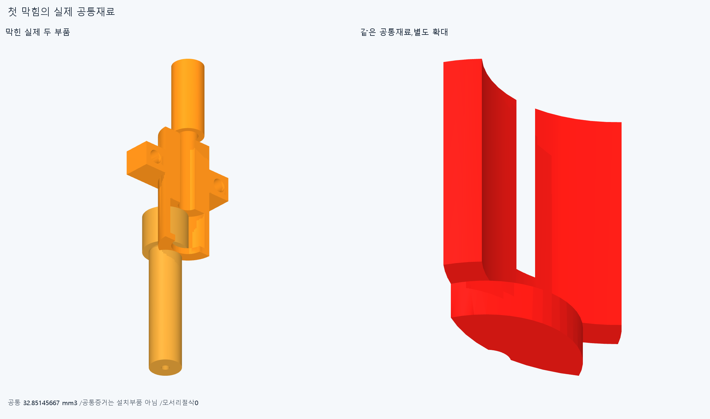

# ARM072 특수 엄지 모듈의 전체 조립 순서

**형상 변경 없이 특수48의 조립 순서를 검사했다. 너트를 먼저 놓는 순서는 통과했으나 죔쇠·조절부의 후속 조립은 막혔다. 뒤8/조건부670·216대기는 유지한다.**

## 원래48과 실제 축

현재862/기본364·손397/손바닥4·전완16원격/빔·전기·설치축길이명령clock기하변경0,886/방사랙/외형미채택이다. 조건부670은 원래뒤8과 비packet478의 선행조립·중립등록 가정이며 전체공장조립/16모터설치완료가 아니다. 특수48은body44+rack체결4,그중base_nuts4M2묶음1을 뺀body43을 목표로 했으나 세계진입은 미실행이다.

실제48의 저장STEP/최종변환을 읽고 경계48·선택8부품/43원통면축 및 adapter/base의 출력방향 평면을 저장했다. 방사+X/출력−Y/전선홈 개방+Y다. M2받침/RackM3/뚜껑M2/조절부/죠M2/tap6/일체base·adapter 축은 실제원통면이다. 설치축/길이/명령clock변경이 아니며 ARM059의기존+11.7이동·체결위상을 다시 적용하지 않았다. 일반 actuator_rotor/actuator_spool/guide_spacer 행은 없다.

원래 motor/body_screws/stockhorn/centralretainer/rearidler와 custom7출력(spool/tap6네개/tailclamp둘)의12행은 미리조립된 강체 참고조건이다. 공급모터 내부/혼·탭 체결·스풀·꼬리고정의 내부 조립은 새검사0이며 전체service승인으로 승계하지 않는다. cradle/M2나사까지unit14,자기plug를 포함한15를 별도carrier에 진입시킨다. 실제 전기홈·3리드·plug·뚜껑/M2·R5일체base·양조절부/너트/죠/원래M3스택을 모두 유지한다. 긴피복/줄은 없다.

## 실제 첫 검사와 순서 대안

첫89검사는 수동cradle→M2나사4묶음1행→참고motor/output12→adapter에 일체base 옆진입→unit14+자기plug→열린홈3전선→뚜껑너트둘 옆진입/포켓아래4→2/0→뚜껑/M2둘→첫조절부 순서다. 뚜껑너트의4mm는 공차/최소여유가 아닌 조립시험평면이다. 이 뒤 topnut0을−Y방향 전체장애물밖에서 넣다가−20mm에서 base와 **2.161810721637161mm³** 겹쳐 중단했다. 원래89/실패를 보존했다.

같은 앞78을 정확승계하고 새25검사했다. top/bottom너트를 조절부가 없는 상태에서 +X전체바깥부터 각각 원래축방향 위치로 옆진입시켜 수동유지→조절부를+Y로 두너트/원래base보어에 끼우는21검사는 통과했다. 그뒤 안쪽 straight_jaw_0을−X에서 넣다가−20mm에서 adapter **46.31456343781331**,lead1/2/3 **10.495145017368065/9.700120500514242/7.571353815938723mm³**의4기록으로 중단했다. 한 조립자세의 반복관계이며 네독립설계결함으로 세지 않는다.

같은성공99=78+21을 정확승계/새0뒤 안쪽죠를 바깥+X에서 먼저 넣는 새6검사는+5mm에서 adjuster0과 **32.85145666711312mm³**로 중단했다. 바깥반대죠는 아직없고,기존리드·adapter·조절부는 그대로 있다. 이 첫막힘 뒤+0/다른죠·체결/port1/세계body43/rackM3/base_nuts/앞7은 미실행이다. 얕은시작이나 부품삭제/코너절삭으로 성공처리하지 않았다.

총새 **120=89+25+6 native/2788쌍/76AABB/겹침6기록/연산오류0**,보고>0.001mm³/Boolean1e−6mm/OCC1,rawfalse다. 선택현재 성공99범위는 새99가 아니며 전체48복구가 아니다. 각경로의 moving/present/absent/행렬·전체장애물AABB밖시작·실제마지막을 저장했다. 바깥20간격/80또는160최소시험거리는 설계여유규격이 아니다. 체결전수동유지·강체전선/plug참고조건이며 captive/하네스변형/mating/공구/토크는 미검증이다.

## 실제 CAD와 오류 보존

불투명 실제CAD10그림/대표공통3이며 native경로 반복0,공통수치는 export/그림 전에 저장했다. 각 대표공통만 새질의했으며 다른4리드/adapter 쌍 중 최대대표1만 새공통으로 저장했다. 전체팔을 표시하지 않은 것은 native검사제외가 아니다. 미완48 배치참고는 실제48조립완료 그림이 아니다.

두번째 렌더의 파일이름 선택 오류로 첫 actual_common.png가 덮였고 index에 새공통그림이 빠졌다. 원본스크립트/첫evidence·초기이미지해시·실패status/stdout/stderr/복구시도그림을 보존했다. 선택그림은 별도이름으로 살리고 첫공통그림은 저장STEP/STL/부품mesh만으로 새렌더,새native/공통Boolean0이다. 첫복구는 장면순서가 다른 코드의 픽셀hashassert에서 실패했다. 교정후에도 초기픽셀해시일치=False이므로 첫PNG의 원래바이트복구를 주장하지 않는다. 픽셀차이 원인은 미확정이며 첫 CAD공통·수치·원래렌더코드는 유지한다. initial/final evidence와 image_recovery.json을 구별한다. 이전기하12771/동결222/과거manifest는 불변이다.

## 한정 재현과 다음

정확SHA 새깨끗한 별도사본에서 42native,대표3source/STEP기하·공통3과 원래16packet408/886/시작670·뒤8유지/특수48목록/실제프레임·48경계·선택축/원래reference12·내부미검증/같은78·99승계/누락·설치/전체바깥시작/첫실패중단·완료항등 계약을 대조한다. 각완료경로 시작끝과 세실패경로의 실제실행표본 전부이며 나머지중간/연속경로가 아니다. 기하adaptiveepsilon1e−10/절대1e−5는 모든곡면식trimBoolean/픽셀·팔시각단위 증명이 아니다. 같은에이전트이며 독립감사가 아니다. 재현이 rawfalse나 옛corefalse/strictfalse를 덮지 않는다.

저장 마지막 straight_jaw_0/adjuster_0 공통32.85145666711312와 실제 죔쇠의 포착어깨·직선관/보어·조절부를 읽고 전체 벤치 선후관계를 검토한다. 조절부와 안쪽죠를 따로 선조립한 뒤 원래R5받침/미리 둔 양너트로 넣는 전체kit 순서를 실제검사할 수 있으나 아직 성공가정하지 않는다. 필요하면 원래일체base 장착보다 kit를 먼저 두는 명시순서도 전체interface로 검토한다. 같은성공99/새120전체·공통3/축·48경계는 반복하지 않고 새관계만 검사한다. 막힌뒤+5보다 얕은시작/adjuster·죠·base·리드삭제/코너절삭0,원래48/최종항등복구 유지. 뒤8/조건부670·216대기를 유지하고 나머지port1·세계특수48·앞7은 후속이다.

ARM059 M3+13/옛R5·ARM065common1edgevertex/corefalse·ARM0704실패/ARM069lead-base/ARM068전선3/ARM067나사/ARM066두실패·옛strictfalse/곡면포함보류를 유지한다. 빔한방향끝받침/반대뽑힘마찰예압은 미검증이다. 손빔절삭/모터삭제·몰래이동/각도제한/ODR축소/가짜텐셔너/LINK·옛최적화/팔꿈치전기버스재개0. 실제공구fit/공급·출력내부/plugmating·유연하네스/captive유지/나사산토크·힘강도마찰예압장력/20구동·동적전기·전체팔상완/실물제조외형미승인이다. 지지조립운동 일관뒤 고정모터→H짧은입구→실제끝구 긴재료를 연결하고 실물완벽을 CAD영상의 무한조건으로 늘리지 않는다.
