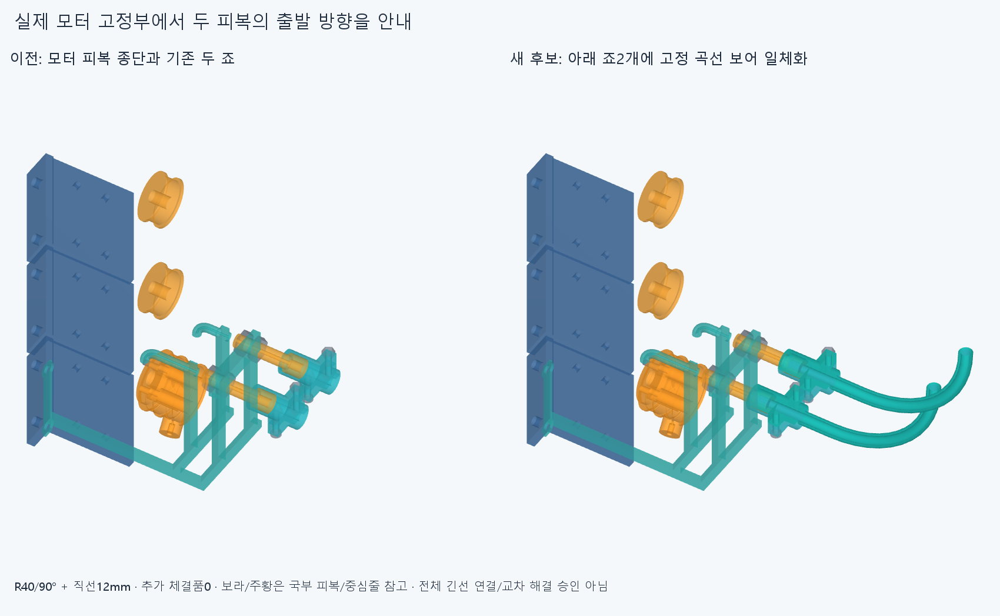
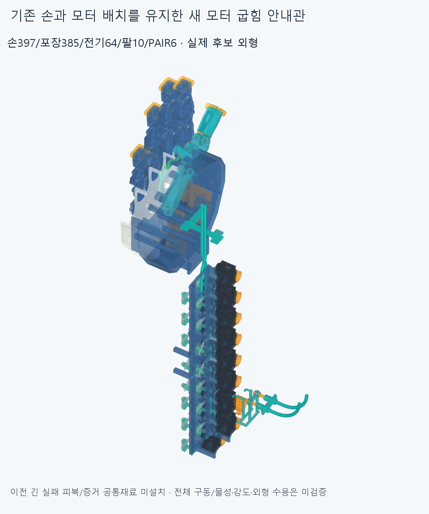

# SUPPORT038 실제 모터 죠의 출발 굽힘 안내관

**교차점에 없는 지지대를 가정하지 않고, 기존 모터 종단의 아래 죠2개를 실제 곡선 안내관과 일체화했다. 새3정적/조건부40조립/100mm끝피복16삽입 표본에서 겹침0이다. 전체 긴피복과 두선 운동은 아직 미연결·미검증이다.**

## 실제 부착부 조사와 선택

LENGTH037 양의손목 표본의 저장 공통재료를 읽었다. 기존 포장385개 전체의 경계상자 거리 하한을 계산하고, 그 하한이 현재 최단 정확거리보다 작거나 같은 부품만 native BRepExtrema로 검사하는 branch-and-bound로 최단 포장거리를 구했다. 2개 실제거리와385개 하한으로 최근접 기존부품은 motor_housing_clamp_1_jaw_-1, **106.813337942256mm**다. 설치 전 원래포장에 대한 조사이며 새후보가추가된후의최근접 거리/전체연속공간 증명이아니다. 선택구조명12개 추가거리와기존접촉4거리도 [survey](reviews/survey.json)에 저장했다. 106mm떨어진 교차점에 이미 고정물이 있다고 세지 않았다.

엄지 위입구는 원래 MCP부모FK에따라 부모25%에서10.319552217992°,완성에서76.075580863780° 회전한다. 저장실패곡선 끝의1차미분크기9.807432910405mm는같고,25%의정규방향2차미분은4.889334844889→154.045097486558mm로커져R0.624399879396mm를만든다. 실제입구접선오차는약1e−14다. 따라서 끝접선이틀어진CAD/모터설치각변경으로 보지않는다. 이규정변형실패만으로 기존 ENTRY035를다시깎거나새엄지지지를무조건추가하지않았다. 기존MCP죠/굽힘관을 유지하고 실제회전하는경계조건으로 쓴다. 같은Newton/최적화/전체거리장/과거충돌그룹은 재실행0이다.

## 새 실제 하드웨어와 명목 반력경로

기존 motor_housing_clamp_0_jaw_-1 / _1_jaw_-1 두개만 교체한다. 기존죠재료제거0/각한솔리드유효이며 같은반대죠/두M2볼트·너트/조절부머리·고정틀/M3좌석을유지한다. 새하드웨어2는교체2이고추가체결품0이다. 장면의6행은 **교체죠/안내관2+국부피복2/축중심선Ø0.6참고2**이며6개의새하드웨어가아니다. 손397/포장385/전기48선·16외곽/팔10/PAIR034하드웨어6,기본손364본체·축/길이·모터·랙·전선/끝구·엄지죠는유지했고기존STEP/STL **5168파일해시불변**이다.

축중심선참고는피복어깨까지그린Ø0.6보어축공간프로브이며실제중간구동줄이아니다. 실제모터중간줄입구는Qy0,피복어깨Qy5보다5mm앞이므로다음전체줄연결때이차이를써야한다. 이번참고를모터감김~손고정전체줄끼우기/구동연결로세지않는다.

각기존죠끝에서직선12mm→R40/90°고정곡선 보어를연결했다. Ø5/보어Ø3.2,피복OD3/ID1.3,줄Ø0.6은공간가정이며 R40은동일두관에선택한명목기하이고 공급품허용굽힘·수명/제조인증이나반경최적화결과가아니다. 실제끝구어깨는그대로이고 새바깥자유출구는 **(-1.1,-203.5,-227)/(18.9,-203.5,-227)mm,출발접선+Y**다. 나란한두고정관은X20mm간격이다. 두관밖유연구간의상대위치까지구속하는장치/텐셔너는아니다.

피복→보어벽→일체기존아래죠→기존M2/반대죠→포착조절부머리→기존종단틀/M3→원래전완모터고정부로 명목반력경로가이어진다. 허공waypoint가아니다. 실제체결예압/6자유도강성/마찰·하중/인장완화·피복빠짐/안쪽줄끼임·좌굴/제작법/재료/공차·나사산·토크/공구/마모·수명은없다. 곡선관은기존죠끝아래54.5mm까지돌출하는후보이며0겹침을외형수용·강도승인으로쓰지않는다.

고정모터어깨→새자유출구의피복경로는 **91.831853071796mm**,옛17mm직선보다74.831853071796mm길다. 이것은실제새고정통로길이이고 전체절단/공급길이·기존±2mm조절필요량이아니다. CONTACT036 원래목표/약7mm실패와 LENGTH037 별도730.856292/791.978524mm를 새구성에자동승계하지않는다. 옛국부/끝짧은피복/긴실패곡선/증거공통재료를같은선과중복설치하지않았다.

## 새 관련 정적과 조건부 조립

[check](reviews/check.json)의3새정적은편손중립손목/편손(-20,-15)/(20,15)다. 새6대나머지손397/포장383/전기64/팔10/PAIR6와새내부15쌍이다. 손과39손바닥포장은H/나머지344전완포장·새2고정죠/전기64는고정,캐리어·편위모터P/손목받침H를쓴다. 모터설치축/손목각제한변경이아니고 부모·연속손목/손자체·기존부품끼리·물체/모터전회전·동적전선/전체유연피복을검사한것이아니다.

각모터국부조립은자기죠2·너트2·볼트2가없고자기피복/줄도없는조건에서시작한다. 다른모터의완성죔쇠하드웨어와모든기존모터/종단/전기·손/팔/뒤가이드는있고다른짧은피복/줄은없다. 새아래죠 -Qz14/7/2/0→반대죠 +Qz14/7/2/0→너트각 -Qz10/5/0→볼트각 +Qz10/5/0,각20표본×2=40새유한표본이다. 실제설치/누락/장애물목록과최종포장385이름을저장했다. 느슨한죠/너트는체결전수동유지조건이고 두국부시작상태를전체공장조립으로합치지않는다. 지그/집게·공구/작업자접근·토크/물리강도는미검증이다.

## 체결 뒤 국부 피복 끝삽입

각새바깥출구에서모터어깨로실제보어를따라100mmOD3/ID1.3피복끝참고를넣는다. 끝좌표0/20/40/60/62.831853071796/74.831853071796/84.831853071796/91.831853071796mm,각8표본×2=16새유한표본이다. 길이100mm를유지하고자기줄은아직끼우지않았다. 반대편의국부피복/축중심선참고는장애물로유지한다. 보어밖꼬리는입구접선방향직선가정이며 연속삽입/실제밀어넣는힘/EI·중력·비틀림/마찰·좌굴·예압·장력/전체긴피복설치증명이아니다.

전체새검사합은 **63681쌍/140AABB native후보/겹침0·연산실패0**,보고기준0.001mm³초과/Boolean허용오차1e−6mm/OCC풀1이다. 이전국부성공을새형상에무검증승계하지않았고 조립40/삽입16을연속경로나실물성공으로부르지않는다.

첫실행은새6CAD를저장한뒤교체전385개를요구하던옛손목포장helper의개수assert로첫static/native전에중단했다. 원래코드/오류/상태와generated/parts의6미검사CAD를보존했다. 교정은39손바닥+344나머지전완포장을명시하고새2고정죠를따로검사하는것이며,검사문턱/기하모델변경0이다. generated/checked의6행이현재검사장면이고물리부품12개/정적6회로합산하지않는다. 두실행모델형상은같고첫실패를완료표본으로세지않는다.

## 다음과 기존 보류

이국부모터굽힘하드웨어의3정적/40조건부조립/16끝삽입범위는닫는다. 새실제바깥출구→PAIR034뒤입구/앞출구→기존아래/ENTRY035위종단의남은유연구간을이어야한다. 모터는전완고정,PAIR는H,두엄지종단은H+MCP FK다. 전체길이·재료축슬라이딩·실제줄끼우기/조절·예압·끼임/당김·잡기/풀기·두선간접촉은새로확인한다. 이번국부관이옛U루프교차나모든부모굽힘을해결했다는뜻이아니고새전체긴피복/전체줄도미설치다. 손/모터·랙/전선을깎거나옮기거나OD축소·각도제한/팔꿈치버스/작은틈탐색으로돌아가지않는다. 실제공급품인증을다음CAD/요청3~4동작영상조건으로무한히늘리지않는다.

LENGTH037 실패와 CONTACT036 목표미수렴/검토JSON한정복구,PAIR034두STEP포함관계false·3000점분류일치보류,OFFSET024면false/한점모순,HOUSING027/GUIDED030/ELASTICA033기본적분false·정밀보조는재검사/해소하지않았다. 같은에이전트검토는독립감사가아니며형상서명도모든곡면식·trim·일치경계면Boolean동등성승인이아니다.
