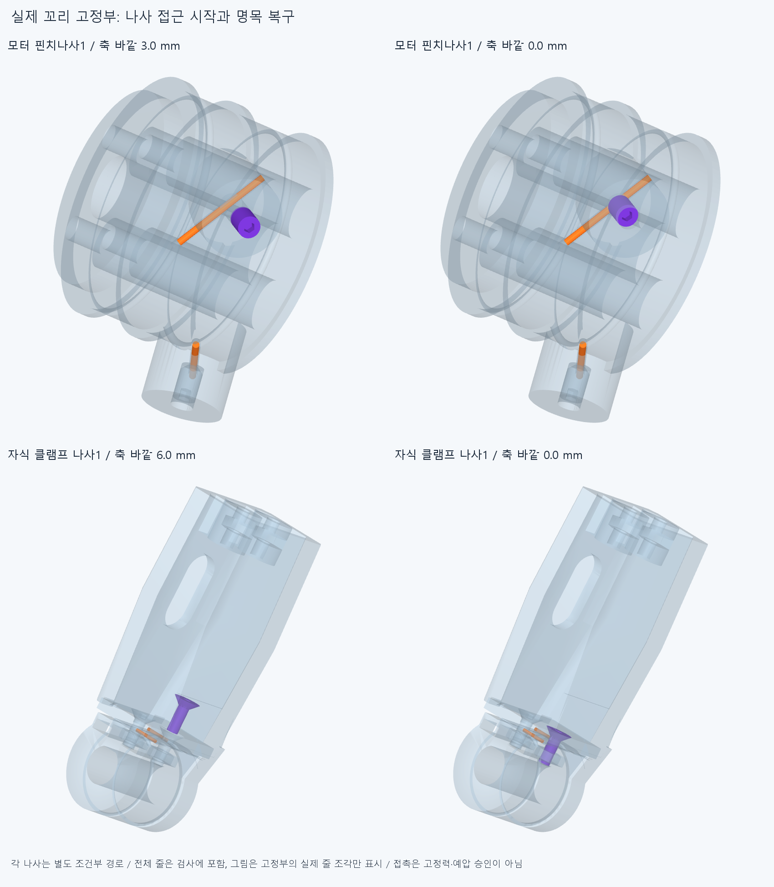

# FIX044 실제 꼬리 고정부 접촉과 나사 접근

**현재 모터·손끝 고정부는 명목 접촉을 가지지만, 줄의 축방향 미끄럼을 막는 고정력·예압은 입증되지 않았다. 두 전체 줄·피복을 둔 나사4개/12유한 접근상태는 새 보고 겹침0이다.**

## 현재 재료와 실제 검사

CORD043 대안의 마지막 저장 STEP에서 두 전체 줄52조각을 읽고 FORM042 두 전체피복26조각과 현재862하드웨어를 포함했다. 총940행은 새940부품이 아니며, 두 물리줄/두 피복의 분할을 포함한다. 기존 손397/포장385/전기48선·16외곽/팔10/PAIR6/기본손364의 비율·본체·축·길이와 모터/랙·전기·종단·죠·안내대, 줄853.356663204892/932.491923574900mm·피복698.964345153791/761.108456948670mm를 유지한다. 새하드웨어0, 기존 STEP/STL **6430해시 불변**이다. 옛 짧은 피복/프로브/줄·실패곡선/증거를 중복 설치하지 않았다.

실제 motor tail_clamp_1/2와 child tendon_clamp_screw_1/2를 자기 설치축 바깥으로 자기 명목길이만큼 물러난 조건에서 복구한다. 모터는3/1.5/0mm, 자식 나사는6/3/0mm다. **각 경로는 자기 나사만 움직이고 다른939행은 모두 존재**한다. 서로 독립적인 조건부4경로를 하나의 공장 조립으로 합치지 않는다. 시작의 느슨한 나사는 수동 유지이며 창고에서 가져오는 과정/완전 분리·재진입/공구·손 접근을 검사하지 않았다. 단순화된 주요경계의 축방향 접근이며 실제 나사산을 따른 회전·조임/토크가 아니다. 자식 클램프판과 끝캡도 계속 존재하고 판 자체를 제거하거나 새로 조립하지 않았다.

12접근상태는11268쌍/52AABB, 접촉재료8구간의 현재2상대부품 검사는16쌍이다. 합 **11284쌍/68AABB/0보고 겹침/0연산실패**, 보고0.001mm³초과/Boolean1e-6mm/OCC1이다. [접근·중앙접촉 원시결과](reviews/check.json), [손끝 지지구간 추가진단](reviews/support.json). 기존 전체줄/전체손 자기쌍을 다시 검사하지 않았으므로 CORD043의 같은줄 접합 rawfalse를 이번0으로 덮지 않는다.

## 접촉이 뜻하는 것

모터의 실제3mm 평끝 나사는 원래 줄 중심에서0.3mm인 면에 있다. 현재 줄 중앙1mm의 실제 재료부분과 나사 끝 native최근접거리는 약5.2e-12mm다. 반대쪽 스풀의 Ø0.8보어는 Ø0.6줄과 **0.099999999977mm** 떨어져 있다. 기존 나사를 단순히 명목위치에 두는 것으로 양쪽에서 줄을 압착했다고 할 수 없다. 그렇다고0.1mm를 필요한 조임/압축/공차 규격으로 정하지 않는다. 줄 이동·변형/실제 나사산/체결력은 풀지 않았다.

손끝은 같은5mm 꼬리의20/50/80% 지점(1/2.5/4mm)을 확인했다. 각 지점의 실제 중심선에서 잘라낸1mm 재료구간이며 새 줄/가이드가 아니다. 50% 중앙은 원래4접촉검사에 포함됐고 추가진단에서 반복하지 않았다. 두 줄 모두 위 클램프판에는 명목 접하지만 **중앙 아래받침 native거리는0.094160800718/0.094160796330mm**다. 명목 U채널 바닥7.4mm와 클램프판8mm라는 치수만으로 전체 꼬리의 양면 접촉을 주장할 수 없다. 20% 아래받침 거리는0.016872656315/0.016872656323mm이고, 80%는약5.0e-12/5.5e-12mm로 명목 접촉이다. 곡선 홈과 겹치는 앞쪽부터 전체가 같은 평바닥에 닿는 구조라고 볼 수 없다. 실제 수치와 재료 안팎은 원시 support.json을 따른다.

기존 R7.75/공구반경0.35 토러스 홈과 평평한 U채널이 겹치는 구간을 읽었다. x=줄트랙/Y7.4에서 원래 무트림 토러스 바깥R8.1의 교차접선좌표는 **3.293933818400mm**다. 이는 참고 곡면과 바닥점의 기하관계이며 모든trim/실제접촉면·응력의 해가 아니다. 실제 저장 코어를 쓴 최근접거리와 ±0.05mm 재료 안팎을 별도로 남겼다. ±0.05는 경계 확인용 탐침이며 기계 여유/압축 규격이 아니다.

8재료구간×2상대부품의16native거리와 각 경계점의 -0.05/0/+0.05mm **48위치(하드웨어/줄 각각 분류)**를 기록했다. 나사끝/판·받침의 명목 법선은 해당 줄 축과 수직이다. 마찰 없는 이 국부 접촉방정식은 축방향 미끄럼 자유도를 제거하지 않는다. 따라서 **모터 고정부와 자식 꼬리의 미끄럼없음은 미검증 마찰·예압을 가정한 경계조건**이다. 선언 꼬리 끝/나사위치를 실제 매듭·압착력·빠짐저항·장력으로 바꾸지 않는다. 국부 마찰조건이 미정인 사실을 모든 조립/손기능의 구조적 불가능으로 확대하지 않는다.

## 범위와 다음

실제 조임·나사산/토크·공구/작업자·지그/줄 변형·압착·마찰계수·마모·빠짐저항·고정력·예압/장력·EI·중력·좌굴·비틀림·평형·슬라이딩/전기 동적운동·모터전회전·부모/손목왕복·전체손20모터·실물·제조·외형 승인은 없다. 큰 루프 외형은 미정이다. 그림은 실제 저장 나사의 시작/명목 끝과 해당 고정부의 줄 조각을 보여주며 전체 줄은 native 검사에 포함했다. 숨긴 장해물로 통과시킨 전체 조립 그림이 아니고, 그림을 위한 native 재실행0이다.

다음은 미끄럼없음 가정을 명시한 채 **같은 전체재료길이/실제 축슬라이딩·두 선과 하드웨어 접촉을 함께 다루는 자연스러운 부모·손목 잡기/풀기**다. 모터 전완고정/PAIR H/엄지종단 H+MCP를 구별한다. 모든 실물·공급품 인증을 기다리며 다음CAD/요청3~4동작 영상을 무한히 미루지 않는다. 손 절삭·모터/랙/전선 이동/OD축소·각도제한/팔꿈치 버스/작은 동일줄 접합0맞추기/끝낸 나사·국부틈 검사로 돌아가지 않는다.

CORD043 초기corefalse/위줄 source0·STEP1접합 목록차이와 BIARC039같은차이, SEAT041받침 운반실패, CONTACT036/LENGTH037실패·검토저장복구, PAIR034포함관계보류·OFFSET024면/한점보류와 이전 기본적분false/정밀보조를 재검사·해소하지 않았다. 기존실패와 manifest/동결222를 보존한다. 형상서명은 모든곡면식·trim·Boolean동등성 증명이 아니다.

## 장면 목록 복구

첫 그림은 장면목록 parts가 목록 대신 경로문자열로 저장된 오류에서 중단했다. 원래 export helper가 이미 올바른 목록을 저장하고 경로를 반환하는데 wrapper가 다시 덮어쓴 오류다. 원래 코드·오류/stdout/status·잘못된10장면 목록을 history에 보존했다. 기존 STEP/STL32해시와 완료된12접근/16거리·재료분류 원시값을 유지하고 목록만 복구했다. export 외 모든 기하/native 함수 AST는 첫 원본과 같다. 복구는 native·거리·분류·SOLID생성·CAD export 재실행0이며 원시결과의 첫 코드해시는 history 원본에 묶인다. 같은 검사를 새 완료표본으로 합산하지 않는다. [복구와 연속성](reviews/metadata_recovery.json).

## 정확 SHA 재검사

대상 `d8ed866af32678e16becd85337e55a8298c9a3e6`의 새 깨끗한 별도 사본에서16native그룹/16거리·48재료위치/12측정서명과 초기코드AST·32기하해시를 대조했다. 이번명시core=true, 차이=[]. [한정결과](../../docs/reviews/FIX044/README.md). 실제 고정력·예압/손운동 승인이 아니며 CORD043/이전false를 보존한다.
