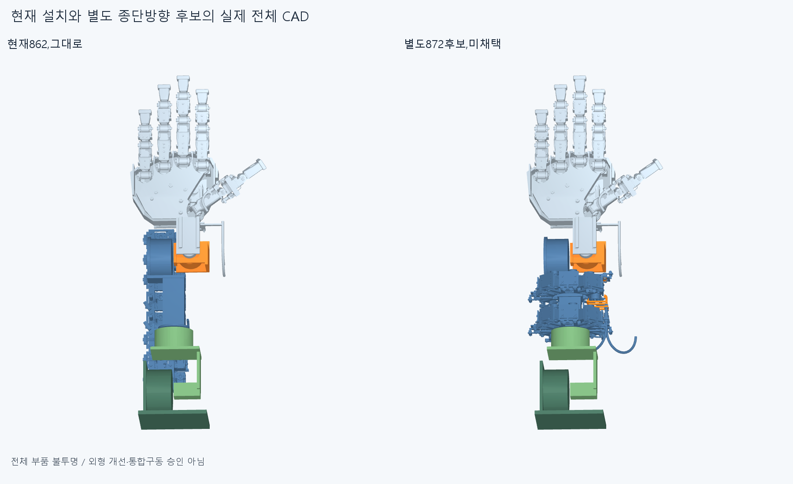
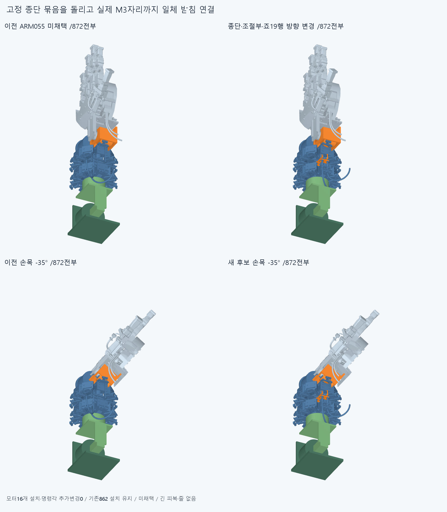
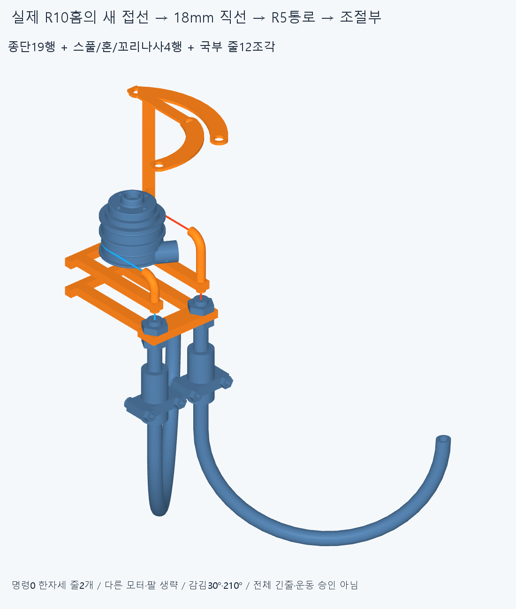
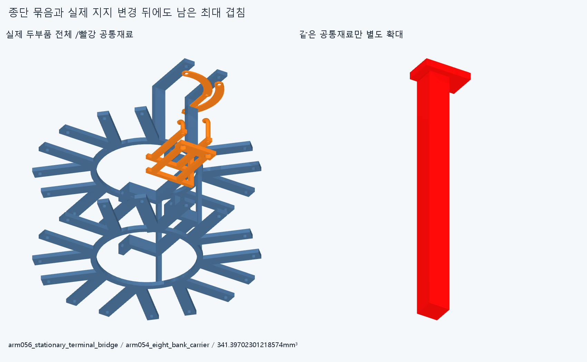

# ARM056 고정 종단 묶음 90° 변경, 미채택

**실제 줄 출구는 연결했지만, 종단 받침·관이 팔 부품을 침범하고 감김 여유도 부족해 이 안을 채택하지 않는다. 현재862설치는 그대로다.**

임시 랙을 고정한 상태에서 국부 안내관을 늘렸던 접근을 닫고 실제 부속 전체의 위치·반력을 다루는 별도 후보다. 수용 손364/현재손397·축·길이·손바닥4/전완16구동원을 유지한다. ARM054/055/이번872는 모두 미채택이며, 모든 부품을 불투명 표시했다. 큰 밖 관을 외형 개선으로 승인하지 않는다.

## 실제 바뀐 기계 묶음

모터 설치와 명령각0은 ARM054에서 추가 변경하지 않았다. 모터의 고정 종단틀·조절부2/잠금너트4·두 포착죠/반대죠·M2볼트4/너트4와 일체 R40관을 한 묶음으로 읽고, 고정 부속18행을 출력축 주위90° 돌렸다. 회전하는 스풀 자체의 위상은 바꾸지 않았다. 원래 세계+Z90°는 제안 세계+Y90°이고, 실제 모터 출력축은 -Y다. 모터 명령90°와 구별한다.

새틀1개는 회전한 원래 틀 전체를 보존하고 두90° 평면 원환 받침을 원래 M3자리까지 연결한 일체 솔리드다. 새로 잘라낸 원래 틀 재료0mm³,기존853행은 동일하다. 새1+강체이동18+기존853=872행이고 부속 삭제/숨김0이다. 새 받침 폭6/두께1mm는 원래 R3패드·1mm 체결 스택에 맞춘 명목 치수이며 강도/공급품 규격이 아니다. 회전한 옛 M3구멍은 빈 채로 남고 새 나사를 가정하지 않았다. 원래 M3볼트는 이동하지 않았다.

피복→일체 죠/반대죠·M2→포착 조절부→실제 R5종단틀→새 일체 원환 받침→원래 M3자리/볼트→엄지 어댑터→ARM054받침·빔/rollflange의 명목 반력이다. 실제 고정력·강성·마찰/예압·제조/공차·공구·나사산/토크 승인은 없다. 원래 어댑터와 새틀 거리0은 실제42.0326820878155mm³ 겹침도 있는 상태이므로 착좌 성공 근거가 아니다.

## 추상 점이 아닌 실제 스풀→조절부 줄

명령0°에서 실제 R10홈의 축 위치4/12mm,기존 꼬리 고정 위상-210/+210°를 유지했다. 새 접선각은-180/0°,감김각은30/210°다. 각 홈→18mm 실제 직선→회전한 R5통로→조절부 보어/입구까지 줄OD0.6의 두 국부 줄을12CAD조각으로 그렸다. 이것은 설치 하드웨어12개/전체 긴줄/실제 피복 끼우기가 아니다. R5반경5/줄0.6/피복OD3·ID1.3/R40관OD5·보어3.2는 명목 공간 가정이다.

line0 R10 접점(51.1,-158.4,-2.5)→R5입구(69.10000000000002,-158.4,-2.5000000000000044),line1(51.1,-166.4,17.5)→(69.10000000000002,-166.4,17.499999999999993)mm다. 새 피복어깨는(74.10000000000002,-203,-2.500000000000004)/(74.10000000000002,-203,17.499999999999993)mm다. 실제 줄 통로도 함께 회전했으며 추상 종단점만 이동한 것이 아니다.

국부 줄 길이는84.88013933370695/108.29606586960487mm,옛 국부100.58810260165592/92.58810260165592mm와 각 -15.70796326794897/+15.70796326794895mm 차이다. 이는 전체 절단·공급/장력조절 길이 또는 기존0.77 관계의 새 전체운동 승인이 아니다. 기존 꼬리/감김 접선 꺾임26.565051177078°도 그대로다.

[wrap_diagnostic.json](reviews/wrap_diagnostic.json)은 이 단일감김 가지의0<감김<360° 수식만 계산했다. line0 모터명령 가지(-330,+30)°,line1(-210,+150)°,공통(-210,+30)°이며 끝점은 제외된다. **+30°에서 line0 감김이0이 된다. 이 수학 가지의 범위를 새 모터/손가락 제한각으로 허가하지 않는다.** 다른 실제 줄 경로나 모든 동작의 불가능 증명도 아니다. 기존 위상을 그대로 둔 이번 후보는 전체 구동으로 승계하지 않고,다음 실제 종단 설계에서 두 홈의 접선과 고정 위상을 함께 판단해야 한다.

두 실제 R40관 출구는(130.66854249492383,-232,-59.06854249492379)/(17.531457505076236,-232,-39.068542494923804)mm,접선+Y다. 어깨~출구154.66370614359175mm/R40/180°/lead12는 그대로다. 출구좌표가 전체 외형/최소돌출 또는 손목 통과 승인은 아니다.

## 실제 간섭과 재현 범위

새28그룹77941쌍/186AABB/24기록/연산실패0,rawfalse다. 중립 변경19대기존853에서16기록,새틀대회전18은0,국부줄12대하드웨어872는0이다. 국부줄 내부66쌍은 같은줄의 고정꼬리/감김 접합2기록(0.00850235922313575/0.008505322027574038mm³)을 그대로 보존한다. 분류로 rawfalse를 덮지 않는다.

개별10·복합2의12비중립에서 변경하드웨어19만24몸체 관계로 검사했고 한쪽관/roll모터6반복 기록이 남았다. 중립100.71132856608403mm³,roll-40에서106.38421816393817mm³다. 팔꿈치55/110,roll-80/-40/40/80,손목flex-35/55,편위-20/20,복합[55,40,-20,15]/[110,-40,20,-15]°는 유한진단이며 연속/상완/전체 팔 승인이 아니다. 국부 줄12개는 명령0° 중립만 검사했고 이 팔운동 재료검사로 승계하지 않는다.

새틀/carrier341.39702301218574mm³,새틀/엄지어댑터42.0326820878155mm³ 등 새16중립 기록을 보존한다. 기존41기록 중 이번에 안바뀐 부품끼리12기록은 형상/변환 동일성으로 보존·native재실행0이며,종단 변경과 관련29기록은 새형상에 자동 승계하지 않았다. 앞쪽 다른 스풀/빔·손목·carrier/캡의 실패도 미해결이다.24기록을 독립24결함 또는 전체 조립 겹침 개수로 세지 않는다.

[partition.json](reviews/partition.json)은 이미 저장한 최대 공통STEP1개를 재사용해 회전한 원래 종단틀을 빼는 native차집합1개만 추가했다. 새 공통쌍 재생성0/28그룹 재실행0이다. 전체 공통341.3970230121877 중 원래 회전틀 밖10.397023012182954mm³/1solid이고,두 체적 차331.0000000000048mm³는 원래 회전틀에 속한다. **추가한 원환 받침만 다시 고쳐도 그대로 둔 옛 틀과carrier의 간섭은 남는다.** 모든 배치/손 기능 불가능이라는 뜻은 아니다.

현재 중립부터 막혀 서비스 진입 표본0이다. 조립안은 실제 M3자리 위에 종단/죠/조절부 키트를 먼저 수동 지지해 설치하고,엄지 모터/출력부,국부 줄 순서지만 아직 검사하지 않았다. 전체 조립·공구/지그·힘/장력/마찰/예압·강도·동적전기·긴피복/긴줄·20토크/실물제조외형 승인은 없다. 기존strictfalse/곡면trim·포함 보류도 해소하지 않는다.

기존 기하12372개/동결222해시를 보존한다. 정확SHA 새 깨끗한 별도사본에서28native/새틀1+국부줄12 source·STEP 측정(적응epsilon1e-10/절대1e-5),18행 강체변환/M3자리·두 R10/R5경로/감김 수식·거리1/공통 분할1만 재현한다. 서명은 모든곡면식/trim/Boolean동등성 증명이 아니고 같은 에이전트는 독립감사가 아니다. 대상SHA·실제 결과는 CHECKPOINT.json/docs/reviews/ARM056/logs/arm056-finish.json을 따른다.

## 다음

또 다른 묶음 각도·관면/반경/방향수 반복을 닫는다. 원래 M3자리와 어댑터/크래들·carrier·roll모터 재료를 기준으로 **기존 긴 종단틀을 유지하지 않는 새 R5지지 형상과 조절부/죠 지지 위치**를 정의하고,두 스풀 홈의 실제 접선/고정 위상과 조립 순서를 함께 설계한다. 추상 점만 이동하거나 옛 전체 길이/0.77/동적 배선을 승계하지 않는다. 손/빔 절삭·모터부속 삭제/숨김·각도제한·OD/R축소·가짜 지지/텐셔너·LINK050/옛 최적화·팔꿈치 전기버스는 하지 않는다. 공급품 인증을 다음 CAD/영상의 무한 조건으로 늘리지 않는다.
