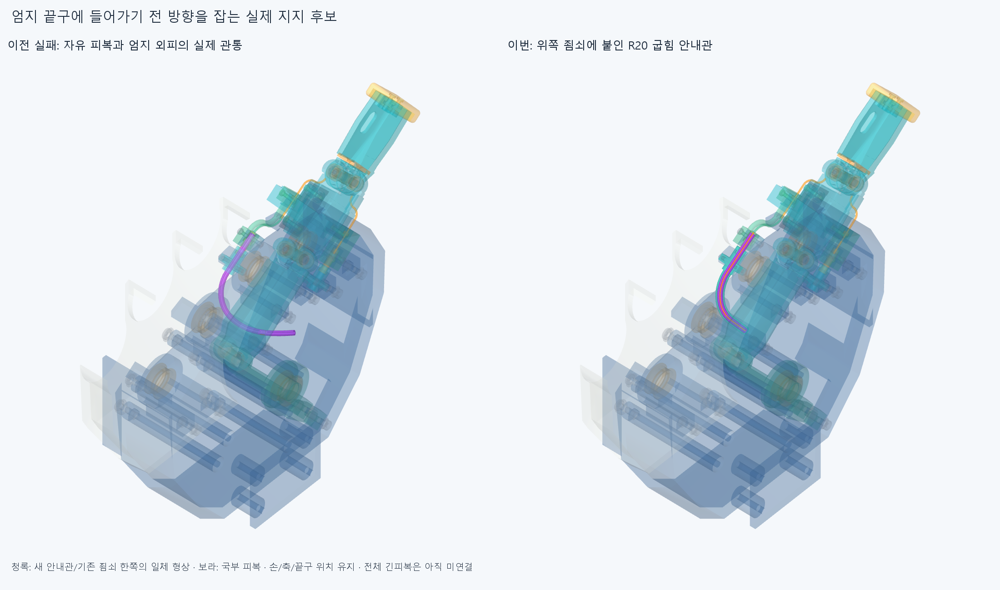
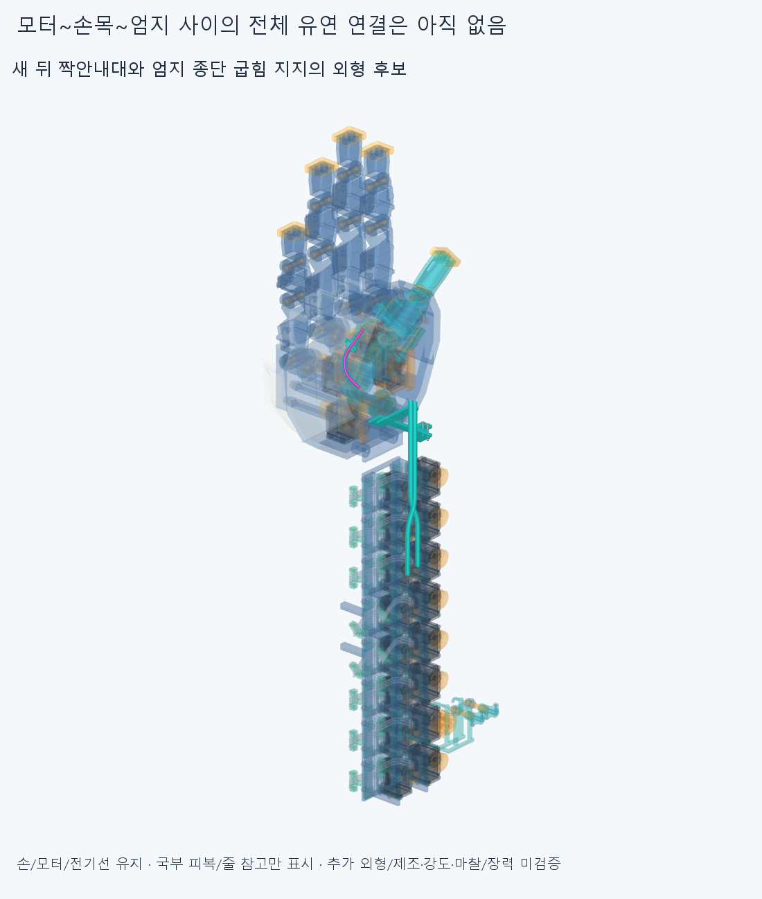

# ENTRY035 엄지 위 종단의 실제 굽힘 지지 후보

**위쪽 죔쇠 한쪽을 R20/90° 굽힘 안내관과 일체로 만들어 교체했다. 새8정적/49조건부조립/100mm피복끝참고의8삽입표본은 겹침0이다. 손/축·길이/모터·랙·전기/기존 끝구·하류안내관은 유지했고 모터~엄지의 전체 유연피복은 아직 연결하지 않았다.**

## 실패 위치와 실제 부착

[조사](reviews/survey.json)는 ELASTICA033의 실제 공통재료STEP와 현재 끝구/죠 변환을 읽었다. 기존 위 피복과 thenar외피 관통 중심은 세계좌표(62.074547695,25.142451738,20.332801079)mm, 현재 위 종단좌표(23.405950870,−28.300270171,−25.756037432)mm다. 옛 독립막대/6native/정밀5쌍은 재실행하지 않았다. 한 후보 실패가 모든 자연스러운 배치/손기능 불가능의 증명은 아니다.

기존 distal_housing_clamp_1_jaw_1 한 행을 upper_clamp_jaw_with_entry_elbow로 교체한다. [장면](generated/assembly_scene.json)의 새3행은 실제 교체죠/일체안내관1+국부피복1/중심줄1참고다. 기존 손397에서1빼고1더해 **397손쪽행**, 포장385/전기48선·16외곽/팔10/PAIR034실제하드웨어6은 그대로다. 기본 손364본체/축·길이·모터설치·랙·전기/끝구·죠의 기존 접촉·체결 형상과 하류가는안내관 중심선은 바꾸지 않았다. 이전STEP/STL **4748개 해시 불변**, 기존죠에서 제거된 재료0이다. 새형상은 유효한 한 솔리드다. 옛 위죠/짧은피복/옛전체곡선/시각화공통형상을 중복 설치하지 않는다.

안내관은 새 입구의12mm직선→R20/90°원호→기존 죔쇠 뒤끝에서 같은 기존 종단축으로 이어진다. 보어Ø3.2/안내관OD5/피복OD3·ID1.3/줄OD0.6은 유지한 공간가정이며 공급품 허용굽힘/피로·수명 인증은 아니다. 새 입구의 종단좌표는(32,−31,0)mm이고 기존 죔쇠의기준 Q를 따른다. 편손 세계좌표는 **(70.411681305,8.242641011,40.066231758)mm**, 진행접선 **(−0.504040884,0.753261047,0.422540628)** 이다. 굽힘끝은 기존 죔쇠뒤(70.861675155,43.531827805,53.425528182)mm, 기존 종단축(0.828965107,0.559241664,−0.008100183)으로 이어지며 피복 어깨는(91.585802821,57.512869410,53.223023598)mm로 같다. 손/모터 설치각 변경이 아니다.

실제 피복→곡선 보어→일체죠→기존 두명목M2/반대죠→포착끝구턱→기존 위덮개/받침/M2→thumb_mcp라는 명목 반력 경로다. 허공 waypoint나 이름뿐인 지지가 아니다. 새몸체는thumb_mcp와 부모FK를 따라 움직이며 손목을 같이 쓸 때는H가 그앞에 붙어야 한다. 이번 새검사는 **손목중립**만이다. 실제 체결예압/마찰/6자유도강성·축력·좌굴/강도/제조법/공차·공급품·나사산/공구·지그·토크/마모·수명은 미검증이다. 죔쇠의기존 홈R1.5/분할0.2mm는 실제 피복 압착/당김·빠짐저항·안쪽줄끼임 승인이 아니다.

## 새 국부 정적과 실제 조립순서

[정적](reviews/static.json)은 편손/IP−15·45·85/기존 구접근 부모25·50·75·100%의8유한자세다. 새3대 기존손396/포장385/전기64/팔10/PAIR034하드웨어6과 내부3쌍, **20667쌍/300AABB후보/겹침0·연산실패0**이다. 옛 위죠는 실제로 뺐고 두참고를397개의 손부품으로 세지 않는다. 자연스러운 기존각을 유지했으며 손자체/물체/전체피복·전기선/모터전회전/손목연속왕복 검사는 아니다.

[조립](reviews/service.json)은 모두 새계산이다. 별도 작업대X+500mm에서 포착끝구·분리받침2개를 수동유지하고 반대죠/새안내관죠를 ±종단Qz 14/7/2/0mm→너트각10/5/0→볼트각10/5/0으로 맞춘20표본이다. 피복은 아직 없다. 그8행키트를 손바깥 원래socketX방향20/10/5/1/0mm로 넣음→위덮개 원래방사14/7/3/1/0.5/0→원래M2너트/볼트 복구→새안쪽너트먼저/새볼트 순서의 손안29표본이다. 해당 위덮개/원래M2/새신발체결품7행은 복구 전 실제로 없고 자식끝마디/핀·나머지손/모터·전기/손목참고/뒤안내대는 있다. 전체 설치/누락·장애물목록/최종397손복구를 저장했다.

**새49유한조립표본=작업대20+손안29, 54549쌍/184AABB후보/겹침0·실패0**이다. 이전 RETAIN026/ASSEMBLY032/PAIR034 성공을 무검증 승계하지 않았다. 체결 전 느슨한 끝구/받침/너트는 수동유지 조건이며 실제지그/집게·공구/작업자접근·나사산/토크·공차/강도나 하나의 전체 공장조립 승인은 아니다.

## 피복 끝의 규정 삽입

완성한 손/하드웨어에서 실제 새 보어를 따라 **길이100mm** 피복 끝참고를 밀어 넣는 기하를 만들었다. 끝좌표는 새입구0/12/22/32/43.415926535898/54.415926535898/67.415926535898/68.415926535898mm의8표본이다. 각순간 길이100mm/OD3·ID1.3을 유지하며 마지막은 기존 피복 어깨에서 끝난다. **6896쌍/99AABB후보/겹침0·실패0**이다. 모터까지의 긴피복/100mm실제절단길이/느슨한꼬리 탄성평형/EI·중력·비틀림·좌굴/삽입힘·마찰·장력/연속삽입/실제구동줄끼우기 검사가 아니다. 보어밖 꼬리는 입구접선의 직선으로 가정했다.

국부 피복참고는12+π×20/2+25=68.415926536mm, 중심줄참고는끝구의기존입구까지69.415926536mm다. 실제 필요한 긴 피복/줄 절단·예압/±2mm 조절부 범위를 정한 것이 아니다. 새 피복의 국부중심줄참고가 있다는 것과 실제 끼워져 움직인다는 것을 구별한다. 모든 재료검사는 보고기준0.001mm³초과/Boolean허용오차1e−6mm/OCC풀1이다.

정적 계산 뒤 독립 feed_window 도우미를 모델 끝에 추가했다. 실행 당시 모델의 정확한 원본/해시를 [history](history/static_entry_model_initial.py.txt)에 보존했고 현재모델이 그원본전체로 시작하는지 확인했다. 기존상수/입력/기하함수/정적결과는 바꾸지 않았다. 원래정적보고서의 코드해시를 덮거나8검사를 다시 돌리지 않았다. [코드 연속성](reviews/source_continuity.json).

## 미해결과 다음

새 굽힘관/기존 뒤짝안내대의 추가 외형은 아직 수용 미정이며 겹침0만으로 사람다운 모습/실구동을 승인하지 않는다. 전체 모터→PAIR034새뒤입구의유연구간과PAIR034앞출구→새위입구/기존아래종단의유연구간은 아직 없다. 다음은 이 실제 종단축·지지를 사용해 서로간/손목/엄지에 걸리지 않는 전체 두피복·중심줄/길이·축슬라이딩/조절·예압과 부모·손목 잡기/풀기를 연결하는 것이다. 새위종단은thumb_mcp부모FK,뒤안내대H,모터전완고정을 구별하고없는지지/텐셔너를설치물로세지않는다. 같은독립막대/자유곡선·650mm/460mm수치경계/반경탐색을반복하지않는다. 손절삭/모터이동/OD축소/각도제한/팔꿈치버스·끝낸국부틈재탐색을하지않고 모든실물인증을다음CAD/요청3~4동작영상조건으로무한히늘리지않는다.

이전 PAIR034 core_initial=false/끝삽입2STEP포함관계 Boolean모순/3000점분류일치·보류, OFFSET024면false/한점모순, HOUSING027/GUIDED030/ELASTICA033기본적분false·명시정밀보조는 그대로다. 이번은 새 국부 죠/보어의 검사이며 이전형상/공간외피의 동등성을 재검사/해소하지 않았다.
