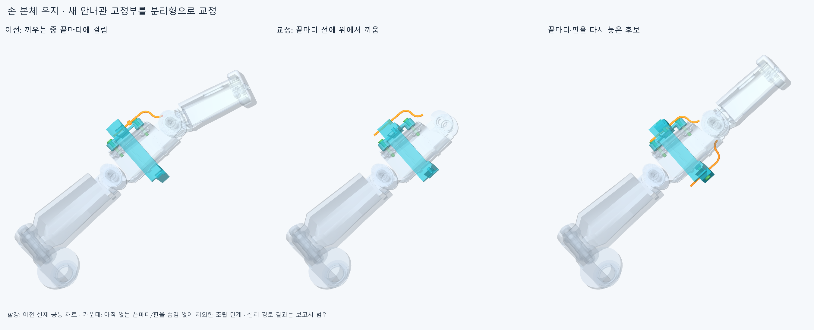
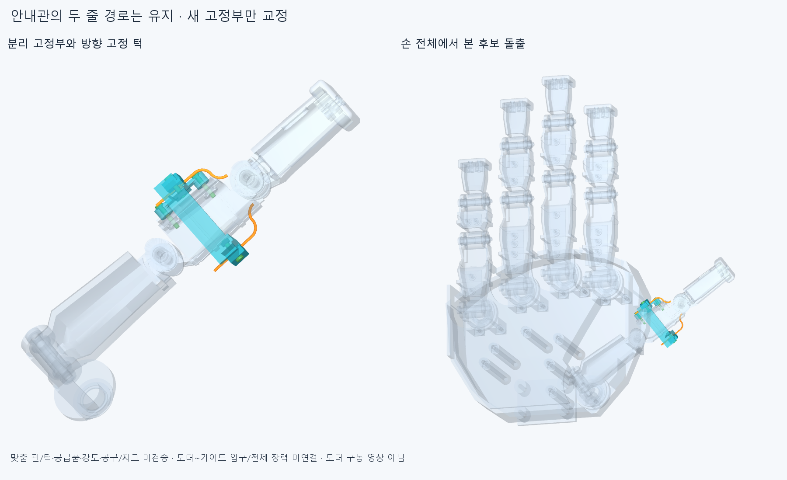

# GUIDE021 분리해서 끼우는 안내관 후보

손 본체/축/길이·모터 배치·기존 전기선은 그대로다. 이전 GUIDE020의 안내관 삽입과회전 구속을 확인하고 **새 안내관 고정부만** 방사 방향 분리형으로 바꿨다. 현재 [정적 결과](reviews/static.json)의8자세는 보고 기준0.001mm³ 초과 겹침0·연산 실패0이다. Boolean허용오차1e−6mm다. **필수 조립 88유한 표본의 통과는True,미해결 경로는없음이다.** 전체 손 구동/실물 승인이 아니다.

## 수정 근거와 구성

끝마디13부품과 관절핀/와셔/고정품7행을아직 넣지 않은 상태에서 옛 형상의삽입을 먼저 다시 계산했다. 아래 관은 직선 삽입5표본에서 통과했다. 위 관은끝마디가없어도 새 받침과약0.035151258mm³ 겹쳤고 ±1°진입 기울임 두 후보도 통과하지 못했다. 이것은그 후보의실패이며 손의구조적 불가능 증명이 아니다. [원래 재검사](reviews/probe.json).

옛 아래 관은±0.5°에서기존 슬롯과각약0.106413mm³ 겹쳤다. 위 관은0/±0.5/±2°회전 표본에서부모/고정부와 겹침0이므로 원형 플랜지만으로 굽힘 방향 고정을 주장할 수 없었다. 이 결과를근거로새 플랜지에방향 턱을 붙이고,새 받침/덮개의반원 좌석에맞췄다. 관의원래 중심선/OD1.2/ID0.8/R5와국부 줄 경로는 유지했다. 두 덮개를위/아래로 열어관을눕혀 넣고 같은 방향으로닫는 구조다. 명목M2×10/너트도그 방향으로 배치했다. 기존 손/슬롯을절삭하지 않았다.

새11행이GUIDE020의후보11행을대체한다. 기존손362+새11=373손쪽행,DRIVE018포장368/전기48선·16커넥터 외곽은 별도 유지한다. 옛 가이드11이나 교체한 원래2볼트를또 더하지 않는다. 현재 [scene](generated/parts/scene.json)이기준이다. 모터20개 실제설치/구동완료가아니다. 형상/구성/상세한 한계는[평가](reviews/assessment.json)를따른다.

## 실제 조립 순서와 빠진 부품

자식 끝마디13행과관절핀/좌우핀와셔/안쪽추력와셔/끝고정와셔·나사7행은처음에없다. 기존덮개/와셔는수동유지한다. 받침을옆에서넣고기존나사축의긴볼트2개를넣는다. 위/아래 안내관을각각 바깥쪽에서놓고분리덮개→옆에서 너트→나사순서로조립한다. **그 뒤끝마디13+안쪽추력와셔2를앞에서넣는 경로와좌우와셔·왼쪽핀·오른쪽끝와셔/나사를넣는실제경로를별도로계산했다.** 손목과나머지관절은중립이며줄은아직끼우지않은조립단계다.

원래 조립 실행은 완료한4경로20표본 뒤에중복 경계상자 계산을피하려고중지했고 completed=false로보존했다. 최종 실행은입력해시·이동행/변환·당시없는부품/설치부품·대조쌍수가같은20표본만재사용했다. 이후68표본을새로계산한원래88표본연구는너트두경로가막혀통과=false로보존했다. 너트만옆에서넣도록바꾼최종88표본은새10/동일78재사용이다. 동일형상 경계상자만캐시했으며 nativeBoolean/보고기준/허용오차는그대로다. 중지한계산중표본은완료수에넣지않았다.

각경로의이동행/그때없는손부품/이미있는새부품과실제전체장애물은[최종 조립 보고서](reviews/selected_service.json)에저장했다. **앞 경로가실패하면뒤통과도이미그부품이놓였다는조건부 결과다.** 누락부품을단순검사제외로성공처리하지않는다. 자식링크의캡/부싱/줄누름부자체의내부선조립·임시지그·전체공구/손잡이·나사산/토크/강도·연속이동은승인하지않았다.

새방향턱은0°정상위치에서겹침0,양방향±5°이탈후보에서양쪽턱이기하적으로멈추는지검사했다. **방향턱단독형상도같이대조해정지근거가턱에있음을확인한상태는True**다. 이때일부러돌린위치의겹침은구속검사용이며정상운전충돌0을주장하기위해제외한것이아니다. 정확한유격/강성/하중/마찰·6자유도고정의실물검증으로승격하지않는다.

## 남은 범위와 다음

맞춤 얇은관/일체플랜지·턱의재료/성형·공급품·강성/반복수명,기존명목1.2mm슬롯과실제관외경공차는미확정이다. 기존[GUIDE020 출처](../thumb_root_guide_v1/references.json)의판매PTFE 치수참고를R5강체 안내관/턱제조 인증으로쓰지않는다. 새받침돌출은후보이며사람다운외형수용판정은아니다. 기존와셔받침은동일하나새덮개/나사방향의실제공구/축력·지지강도는미검증이다.

모터~손목~엄지뿌리~이안내관입구의실제지지/피복경로,양쪽줄길이조절/예압·정방향/풀기는아직없다. TENDON019의전체경로실패를국부성공으로덮지않는다. 이번 명목 조립을닫고다음은모터측고정종단에서엄지뿌리를넘는실제지지/피복경로를연결한다. 손작은틈/팔꿈치버스/끝낸자세탐색으로돌아가지않는다. 전달계가적당히통합되면요청한3~4동작을실제후보구성으로갱신한다.

정확SHA 새사본재현은후속커밋으로남긴다. 같은에이전트검토이며독립감사가아니다.
