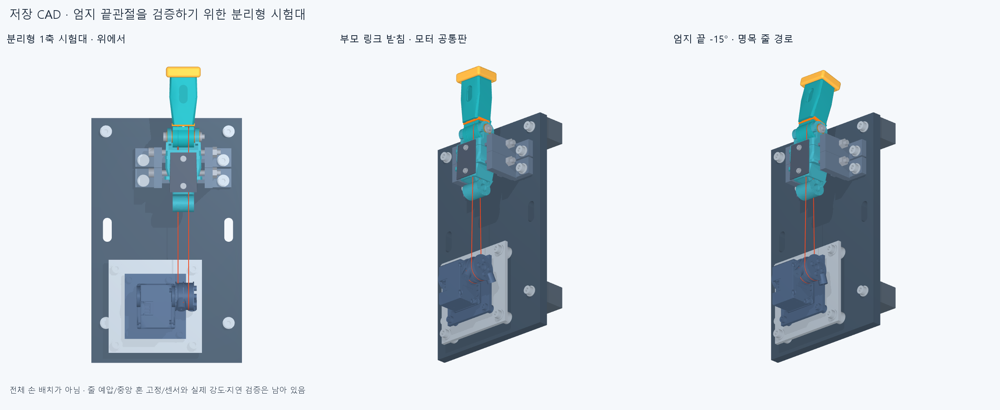

# 엄지 IP 분리형 시험대 후보

엄지 부모 링크와 끝마디를 손에서 분리해, 한 관절의 줄 구동을 살펴보기 위한 CAD 후보입니다. 부모 링크의 두 보강 구간을 좌우 분할 새들로 잡고, 별도 모터와 공통 받침판에 연결합니다. 수용한 손의 비율·관절축·최신 엄지 자세는 바꾸지 않습니다. 전체 손에 모터를 통합한 상태가 아니며, 실제 제작·구동 승인은 아직 아닙니다.

**저장 CAD 검사 완료.** 처음 막혔던 발 나사4개의 삽입 경로를 수정했고 아래 범위에서 충돌·실패·연산 오류0을 확인했습니다. 실물 조립·강도·지연을 승인한 결과는 아닙니다.

| 구성 | 현재 설계 범위 |
| --- | --- |
| 엄지 시험편 | 기존 부모·IP 몸체의32부품 중 사용하지 않는 상류 연결부 부싱2개를 제외한30부품. 원래 부품 형상 유지 |
| 모터 모듈 | 기존33부품 중 받침판1개만 새 복사본에 Ø4.5 구멍4개 추가. 나머지32부품 유지 |
| 지그 | 새들·공통판·스페이서·받침발·체결물61부품 추가. 전체124부품 |
| 구동 기하 | IP축 +X, 모터축과 평행·간격120mm. 줄 중심 반경은 관절7.7mm/모터10mm, 기하상 모터각은 IP각의0.77배 |
| 바닥 | 별도 체결한 받침발의 바닥면 Z−55mm. 테이블 고정용 슬롯은 있으나 외부 클램프와 테이블 체결은 미완성 |

상류 엄지3축과 손바닥은 시험편에 포함하지 않습니다. 부모 링크가 원래 손에서는 움직이는 부품이라는 점을 유지하며, 이 지그의 고정 조건을 전체 손의20축 운동으로 해석하지 않습니다. 기존 핀은 지지용 자유 핀이고 줄이 끝마디를 직접 당깁니다.

검사는 저장 STEP를 다시 읽어 지그·시험편·모터를 함께 대조했습니다. IP −20/−15/0/15/30/45/60/75/85°의9자세와 실제 굵기 줄,72개 선언 접촉,나사14개·너트14개·좌우 죠4개의 접근을 검사했습니다. 자세 간 최대 간격은15°이며 연속 동작 보증이 아닙니다. 죠의 옆 진입은1mm 이하 이동 표본이고, 나사·너트·공구의 축방향 접근은 선언된 보수적 포락체 검사입니다. 기존 모터의 지정 나사산 접촉8영역은 별도로 기록합니다. 충돌 부피 기준은0.0001mm³입니다.

| 결과 항목 | 상태 |
| --- | --- |
| 생성·부품 대응·입력 해시 | 124부품, 입력 해시 검사 전후 일치 |
| 자세·줄 간섭 및 연산 오류 | 9자세·줄/부품11,160건에서 기준 초과0, 연산 오류0 |
| 실제 좌면 | 72개 선언 면적 모두 통과 |
| 단계별 조립·공구 접근 | 나사14·너트14·좌우 죠4, 총32개 선언 모두 통과 |
| 변경한 발 나사의 국부 여유 | 완성 위치2.149/2.625mm, 머리 삽입 포락체1.217/0.972mm. 해당 가로 나사와의 명목 BRep 거리 |

검사에 통과하더라도 재질·가공공차·새들 조임력과 마찰·반복 강도, 금속 혼 중앙 고정나사, 줄 길이·예압 조절, 관절각 센서는 남습니다. 선택한 Wera 소켓의 외형 접근과 실제 내부 체결 깊이·나사 돌출부 수용·손잡이 공간도 구분합니다. 공급사 와셔 허용두께0.7~0.9mm 중 CAD는 최대0.9mm를 사용하며 공차 조합을 모두 검증한 것은 아닙니다.

조립 순서는 [ASSEMBLY.md](ASSEMBLY.md), 제작품·규격 체결물 목록은 [FABRICATION_SCOPE.md](FABRICATION_SCOPE.md), 원시 결과는 [저장 CAD 검사](reviews/saved_audit.json)에 있습니다. 그림은 같은 저장 메시를 렌더한 것이며 실제 동작 속도를 보여주지 않습니다. 이전 `thumb_ip_drive_v1`의 원본·manifest는 보존했습니다. 로봇 단독50ms 목표/100ms 상한의 달성 여부는 아직 미검증입니다.

## 수정 이력과 재현

첫 안은 완성 자세에 충돌이 없어도 발 나사4개를 넣을 수 없었습니다. 발 구멍을 뒤로2mm·바깥으로1mm 옮기고 받침 폭을 늘려 수정했습니다. 손의 원래 부품은 바꾸지 않았습니다. [초기 실패와 수정 기록](reviews/development/README.md)을 보존하며, 위 최소 간격을 모든 공차·공구·강도의 보증으로 확대하지 않습니다.

`build.py`는 새 출력 폴더에 생성하고 `audit.py --repo <저장소> --generated <저장 CAD 폴더> --output <새 JSON>`는 그 STEP를 다시 읽습니다. `render.py`는 저장 메시만 그립니다. 각 프로그램의 소스·입출력 해시는 보고서와 `THUMB_BENCH001_MANIFEST.json`에 연결합니다. 커밋 뒤 정확 SHA에서 수행하는 새 사본 검사는 별도 후속 기록으로 남깁니다.
