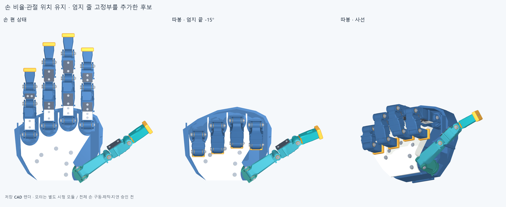
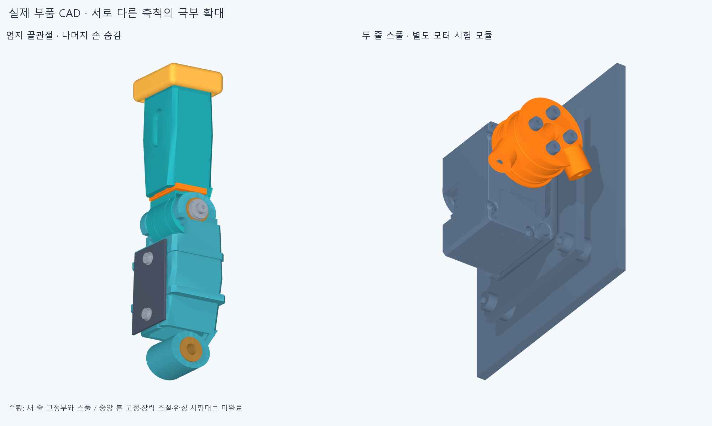

# 엄지 끝관절 줄 구동 후보

수용한 손의 비율과 최신 따봉 자세를 유지하고, **엄지 끝관절 한 곳에 양방향 줄 고정부와 별도 모터 시험 모듈을 연결하는 CAD 개발 단계**입니다. 자유 회전 핀은 지지 역할을 유지하고 줄이 움직이는 끝마디를 직접 당기도록 합니다.

전체 손 구동계나 실물 시험대가 완성된 상태는 아닙니다. 모터 모듈은 손 밖에 분리해 검토하며, 손에 통합된 모터 수는 아직0개입니다. 로봇 단독50ms 목표·100ms 상한은 유지하지만 이 CAD 검사로 속도 달성을 판정하지 않습니다.

## 이번에 바꾼 부품

기준은 `manufacturing_v2`의359부품입니다. 엄지의 중간 링크와 끝마디2개를 수정하고 고정판1개·M2×6 나사2개·M2 너트2개를 추가하여 손은364부품입니다. 나머지357부품의 STEP/STL, 손 크기·관절축·길이·자세 입력을 유지합니다. 별도 모터 모듈은33개 부품 행으로 관리하며 제조사 모터 복합체를 포함한 솔리드 수와 구분합니다.

| 부분 | 변경 이유와 구조 |
| --- | --- |
| 끝마디 | 기존 관절 눈에 폭0.8mm의 열린 줄 홈 두 개와 분리 가능한 고정판을 넣음. 닫힌 홈 출구의 줄 걸림을 제거하고 측면 부시·와셔 자리는 유지 |
| 고정판 체결 | 손끝 덮개 고정부를 피한 중앙 나사2개, 옆에서 넣는 너트, 나사 머리 진입을 위한 작은 상부 조립 창 |
| 중간 링크 | 얇은 가장자리가 남는 긴 구멍 대신 외측으로 열린 줄 슬롯. 덮개를 분리한 부품 상태로 가공·줄 배치 |
| 모터 쪽 | XL330 원본 형상, 금속 혼 HNX330-N101, 두 홈 스풀과 별도 받침. 줄과 겹치던 받침의 네 번째 체결축을8mm 이동. 중앙 혼 고정나사 확정은 남아 있음 |

두 그림은 저장한 실제 부품 메시를 렌더한 것입니다. 확대 그림의 두 모듈은 서로 다른 축척이며, 연결된 완성 시험대를 보여주는 그림이 아닙니다.

## 줄 경로와 검사 경계

고정 부모 링크 시험의 두 축 간격은120mm, 관절의 줄 중심 반경은7.7mm, 모터 스풀은10mm입니다. 따라서 이 기하 모델의 모터 회전각은 관절각의0.77배입니다. 실제 줄 공칭 지름0.6mm와 홈 공구 반경은 구분합니다. 관절 홈 공구의 큰 반경7.75mm와 작은 반경0.35mm는 명목 홈 바닥7.4mm를 만들고, 줄 중심7.7mm와 맞습니다.

최종 출구는 같은 바닥 반경7.4mm를 유지한 폭0.8mm의 열린 U홈입니다. 두 트랙의 출구를 각각0~-200°, 0~180°까지 열고, 고정부로 향하는 직선 꼬리 홈도 평탄한 바닥으로 바꿨습니다. 기존 닫힌 홈에서 발견한 줄 교차와 수정 중 CAD 연산 실패는 [개발 기록](reviews/development/README.md)에 보존합니다. 명목 줄 통과와 실제 장력 유지·마찰·마모는 별도입니다.

IP −20~85°는 **탐색 범위**입니다. 고정판을 중앙으로 옮긴 현재 안에서는85° 끝에서 한쪽 줄의 최소 감김각이 약3.90°까지 줄어듭니다. 길이식이 성립하더라도 실제 줄의 자리 유지·예압·장력·마찰과 반복 수명은 별도 시험이 필요합니다. 느슨한 줄이 안전하게 유지된다는 뜻이 아닙니다.

검사는 저장 STEP를 다시 읽어 수행합니다. 최종 자세의 겹침, 부품 삽입·공구 접근, 실물 체결 강도와 동적 성능을 각각 구분합니다. 검사 결과·범위는 [자세와 구동부 검사](reviews/saved_delta_audit.json), [국부 조립 검사](reviews/assembly_audit.json)에 기록합니다. 모든 관절 조합이나 연속 동작의 충돌 보증은 아닙니다.

자세 검사는10개 정적 자세·최신 따봉 전환48표본·IP 단독22표본으로 구성합니다. 변경한 부품과 추가 부품은 손 전체와 새로 대조하며, IP 단독 표본에서는 끝마디에 붙은 모든 부품도 다른 몸체와 검사합니다. 나머지 변경 없는 부품 쌍은 파일·좌표·각도가 일치하는 이전 결과를 승계합니다. 새 교차 검사 기준은0.0001mm³, 승계한 이전 기준은0.02mm³로 서로 다릅니다.

별도 모터와 줄의 실제 굵기 검사는 IP -20/-15/0/45/85°의5자세입니다. 모터의 움직이는8부품과 고정25부품 사이1,000쌍, 두 줄의 세 구간과 관절·모터 부품 사이1,950건을 검사합니다. 중간 최대 간격이45°이므로 연속 운동 검사는 아닙니다. 별도의421개 촘촘한 표본은 줄 길이·감김각 계산이며, 같은 수의 실제 형상 간섭 검사를 했다는 뜻이 아닙니다. 손과 외부 모터 모듈 사이의 전체 배치 간섭도 아직 포함하지 않습니다.

최종 저장본에서는 위 범위의 손·모터·줄 검사에서 보고 기준 이상 충돌0건, 계산 오류0건을 확인했습니다. 입력 파일 해시도 검사 전후 일치했습니다. 모터 중립에서 명시한 나사산 접촉8영역은 별도 예외로 기록하며, 미확정 중앙 혼 고정나사는 모델에 포함됐다고 간주하지 않습니다.

국부 조립 검사에서는 엄지32부품을 읽어 변경 관련196쌍의 명목 교차를 확인했습니다. 교차·연산 실패는0건이며, 보어·부시 받침·손끝 덮개 지지부15영역을 원본과 대조해 보존을 확인했습니다. 나사2개의 창 진입·최종 삽입과 두 공구 접근, 고정판의 양쪽 삽입은 통과했습니다. 너트는 각각 열린 쪽 한 방향으로 넣을 수 있고, 반대 방향2건은 막힙니다. 그 실패를 제외하지 않고 기록하며 부모 포크에 넣기 전에 너트를 조립합니다.

[조립 순서와 남은 제작 조건](ASSEMBLY_REVIEW.md)에서 선조립 순서를 확인할 수 있습니다. 저장 부품은 [장면 목록](generated/scene.json)의 위치와 해시로 연결하며, 변경하지 않은 파일을 새 폴더에 중복 복사하지 않습니다.

## 다음 제작 단계

- 금속 혼 중앙 고정나사의 정확한 공급품·형상·공구를 확정합니다. [공식 공급 후보 조사](source_docs/retainer/ACQUISITION.md)
- 부모 링크를 지지하는 시험대, 두 줄 예압·길이 조절과 실제 관절각 센서를 통합합니다.
- 가공재·인쇄 방향·끼워맞춤·모서리 후가공을 정하고, 클램프 미끄러짐·줄 손상·새 개구부의 강성을 시험합니다.
- 그 뒤 실제 관절각·장력·전류를 측정해 추종 지연과 오차를 확인합니다. 한 관절의 결과를 전체 손에 자동 적용하지 않습니다.

## 재현

생성기는 `build.py`, 저장 CAD의 운동·줄 검사는 `audit_saved.py`, 국부 조립 검사는 `audit_assembly.py`, 그림은 `render.py`입니다. 각 프로그램은 명시적으로 실행할 때만 작동하며 새 출력 경로를 요구합니다. 사용한 원본·코드·출력 해시와 한계는 보고서 및 `THUMB_DRIVE001_MANIFEST.json`에 묶습니다. 이전 형상과 실패 기록은 덮어쓰지 않습니다.
