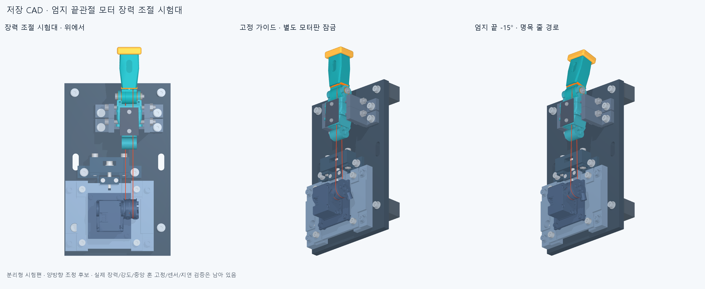
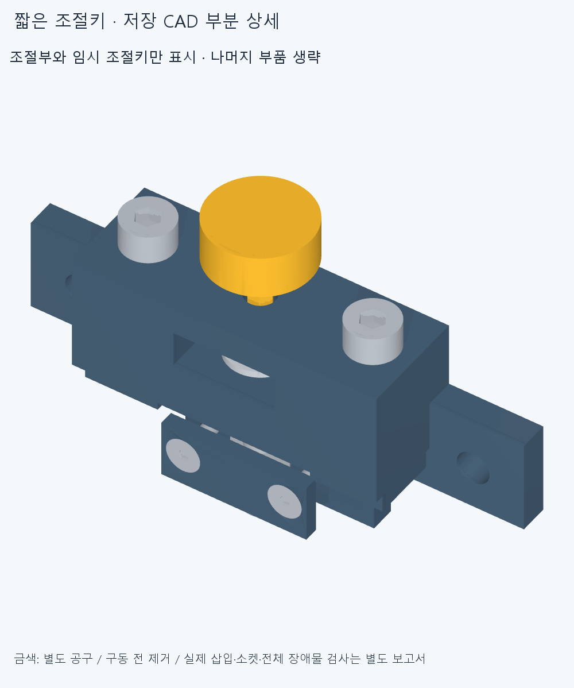

# 엄지 끝관절 시험대의 줄 장력 조절 후보

수용된 손 외형과 엄지 자세는 그대로 두고, 분리한 엄지 끝관절 시험편의 모터 받침을 조절할 수 있게 만든 후보입니다. 전체 손의 모터 배치나 구동 완료 모델은 아닙니다.

**현재 상태: 저장 CAD의 선언한 전체 검사 통과. 제작·실물 구동 승인 전입니다.** 커밋 뒤에는 별도 작업 사본에서 세 중립 위치와 조립·공구 검사를 다시 확인하며, 그 결과는 후속 기록으로 구분합니다.

모터판을 앞뒤로 2 mm씩 움직여 두 줄의 경로 길이를 함께 바꿉니다. 좌우 받침은 별도 나사로 고정하고, 모터판을 잠그는 네 나사와 분리했습니다. 양방향 조절나사에는 실제 머리 포획부와 회전 방지 너트, 이동 끝단 스톱을 넣었습니다. 조정 뒤에는 네 잠금나사를 다시 조입니다.

## 이번 후보에서 바뀐 것

- 기존 시험대 124부품 중 114부품의 형상 파일을 재사용합니다. 모터판과 공통판은 별도 사본으로 수정하고, 원형 스페이서·위쪽 와셔 8개를 제거하며 새 부품 42개를 더했습니다. 실제 조립 목록은 158부품입니다.
- 모터·스풀의 회전 관계와 손의 관절축·길이는 유지합니다. 모터 축 간격은 118/120/122 mm에서 비교합니다. 이것은 필요한 장력이나 충분한 조절 범위를 실측했다는 뜻이 아닙니다.
- 첫 저장 CAD 검사에서 왼쪽 받침이 기존 바닥 지지 나사와 와셔를 침범했습니다. 두 실제 겹침을 보존하고 받침에 지름 9.4 mm 통과 공간을 추가했습니다.
- 뒤쪽 너트에 긴 소켓이 접근할 수 없는 조절부에는 실제 육각 포켓을 넣었습니다. 반대편 나사를 돌려 체결하며, 너트는 뒤에서 5 mm 들어가는 경로를 따로 확인합니다.
- 조절 드라이버가 부모 받침에 걸리는 문제는 짧은 별도 조절키로 수정했습니다. 실제 육각 소켓·키·회전 여유를 검사하며, 키는 구동 전에 제거하는 공구입니다.
- 가이드의 내부 모서리 R0.1과 이동 너트 홈의 평바닥·Ø1.1 코너 여유·R0.05를 실제 형상에 넣었습니다. 가공 공구가 남기는 재료를 포함해 기존 접촉면 기준으로 다시 검사합니다.
- 부모 받침과 시험편을 공통판에 먼저 조립하고, 완성한 모터·조절부 47부품을 기존 71부품에 내려놓는 순서를 명시했습니다. 앞 덮개 나사는 이 모듈의 선조립 단계에서 먼저 체결합니다.

## 검사 범위와 남은 일

검사는 저장한 STEP을 다시 읽어 수행합니다. 물리 부품끼리의 겹침, 두 줄의 유한 굵기, 실제 접촉면, 나사·너트·공구 접근, 조절부 유격의 양끝, 모듈 선조립 경로를 구분합니다. 계산 중이거나 실패한 보고서는 통과 근거로 쓰지 않습니다. 표본 간격 안의 연속 운동과 전체 공차를 승인한 결과도 아닙니다.

최초 전체 검사 결과는 [원시 보고서](reviews/saved_audit.json)에 보존했습니다. 입력 파일 해시가 검사 전후 같고, 연산 오류는 0건입니다. 부품의 의도하지 않은 겹침 판정 기준은 0.0001 mm³입니다.

| 확인한 범위 | 완료 결과 |
|---|---|
| 저장 물리 부품 | 158부품·169솔리드, 형상 유효성 통과 |
| 자세·모터 위치 | 41조합, 보고 기준 이상 부품 겹침 0 |
| Ø0.6 줄과 부품 | 64,780쌍, 겹침 0 |
| 선언한 접촉면 | 306건 통과 |
| 나사·너트·공구 등 조립 경로 | 165건 통과 |
| 너트 회전 구속·접시 좌면·축 유격·스톱 | 보충 검사 10개 통과 |
| 모듈 선조립·삽입 | 4경로 통과 |
| 별도 조절키 | 모터 위치 3개 × 축 유격 양끝의 6조건 통과. 삽입 23,700쌍, 회전 외곽 942쌍, 이동 나사 942쌍 확인 |

41조합은 IP −20/−15/0/15/30/45/60/75/85°와 모터 거리 118/120/122 mm의 27조합, IP 0°에서 0.25 mm 간격으로 추가한 중간 위치 14개입니다. 커밋 뒤 핵심 재검사는 IP 0°의 세 기준 위치·줄-부품 4,740쌍과 위 접촉·조립·보충·모듈·공구 검사 전체를 대상으로 합니다. 최초 41조합 전체를 다시 실행하는 범위는 아닙니다.

위 상세 그림은 조절부 12부품과 금색 별도 공구만 표시합니다. 나머지 부품을 숨긴 설명용 그림이며, 공구의 충돌 검사는 전체 설치 부품을 포함한 별도 원시 결과로 확인합니다.

줄의 양쪽 초기 길이는 따로 맞춰야 합니다. 공통 조절나사는 두 장력을 같게 만들거나 장력을 측정하지 않습니다. 공급 치수의 범위를 적용하면 머리 포획과 이동 너트의 역방향 유격만으로 최대 약 0.98 mm가 될 수 있으므로, 실제 부품을 재고 포획 간격을 맞춰야 합니다. 나사 회전수만으로 정밀 장력을 보장하지 않습니다.

중앙 금속 혼 고정나사, 실제 줄 고정력·마찰·예압, 관절각 센서, 외부 고정대, 원래 모터/시험편의 모든 덮개·줄 삽입·정비 접근은 아직 완료되지 않았습니다. 재료·잠금력·강도와 실물 동작 검증도 남아 있습니다. **로봇 단독 50 ms 목표·100 ms 상한은 실측 전입니다.**

가공 반경과 접근 방향은 구체화했지만 실제 공구·홀더·고정구의 전 경로, 고정 캡 너트 홈 등 나머지 내부 모서리, 조절키 뿌리와 강도는 별도 검토가 남습니다. 이 파일은 가공 발주용 완성 도면이 아닙니다.

제작 범위는 [FABRICATION_SCOPE.md](FABRICATION_SCOPE.md), 조립 순서는 [ASSEMBLY.md](ASSEMBLY.md)를 참고하세요. 이전 [고정 시험대](../thumb_ip_bench_v1/README.md)의 승인 범위를 이번 후보에 자동 승계하지 않습니다.

## 이번 회차 종료 범위

2026-10-25 사용자 요청에 따라 이번 장력 조절 시험대의 검사·이미지·Git 저장과 정확한 커밋 재검사까지만 마무리합니다. 이후 형상 개선이나 다음 제작 단계는 자동으로 이어가지 않습니다. 지속 개선 goal의 종료는 이 회차의 마감을 뜻하며, 전체 손의 제작·실물 구동이 완성됐다는 뜻이 아닙니다. 위에 적은 미해결 항목은 다음 작업을 시작할 때 확인할 인계 사항으로 남깁니다.

<!-- THUMB_TENSION001 exact-SHA review -->
[정확한 커밋 핵심 재검사](EXACT_SHA_REVIEW.md) — 94a3be61226582881542ee586e913a6f61c25d22 · 세 중립 위치 및 전체 조립/공구 검사; 전체41조합 재현 아님.
