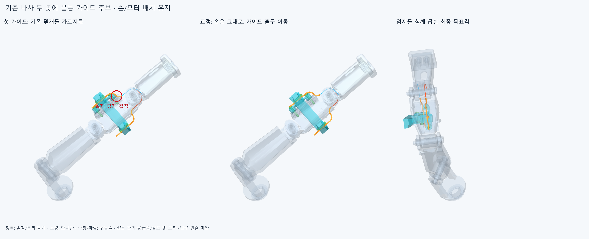
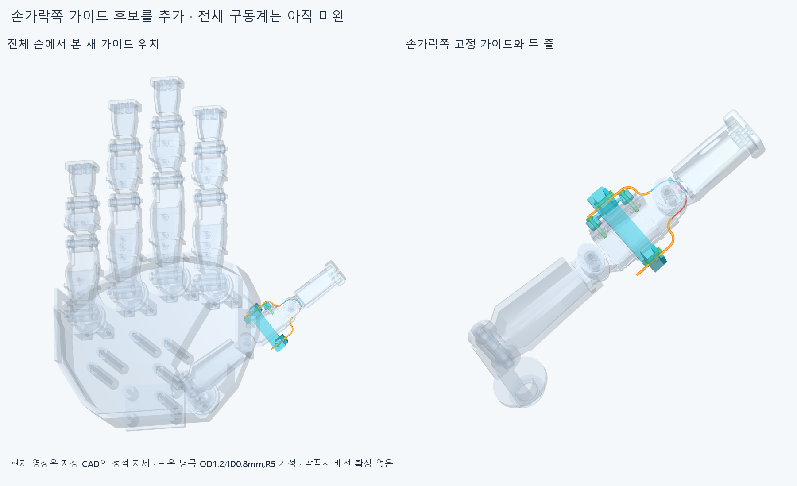
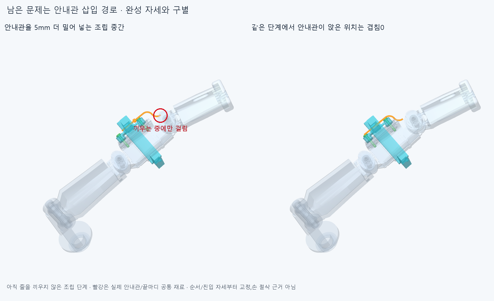

# GUIDE020 손가락쪽 고정 가이드 후보

**손 전체 구동은 아직 미완이다.** 이번에는 허공의 굽힘점을 실제로 고정할 수 있도록,기존 엄지 중간 링크의 덮개 나사2곳에 붙는 받침과 두 안내관/분리 덮개를 만들었다. **8정적 자세의 새 부품·국부 줄 공간은 통과했고,조립 미해결: flanged_liner_1_axial_insert,flanged_liner_0_axial_insert.** 모터에서 이 가이드 입구까지의 연결과 엄지 뿌리 통과·전체 장력은 아직 연결하지 않았다. 이전TENDON019의전체 경로 실패를 해결 완료로 바꾸지 않는다.

청록은 새 받침/덮개,노랑은 안내관,주황/파랑은 줄이다. 빨강은 첫 안내관과 기존 덮개의실제 공통 재료 약0.598807323mm³다. 기존 손을 절삭한 것이 아니다. 상단 굽힘을 기존 덮개 끝보다 앞에서 시작하도록 **출구를IP 로컬Y−8→−6mm**로 옮겼고,R5·관절각·모터 설치 배치는 유지했다. 새 고정부 자체의앞덮개/너트 겹침은 새 받침의실제 조립 자리를 만들어 해소했다.

## 무엇을 고정했나

손364부품 중 기존 덮개 볼트2행만 후보 구성에서 명목M2×12 두 개로 대체했다. 원본 STEP/STL은 보존한다. 기존7mm축보다5mm길게 해 받침을 끼우되 원래 나사 끝/기존 너트 위치는 유지했다. 새 받침1·플랜지 안내관2·분리 덮개2·명목M2×10/너트 각2·교체 덮개 볼트2의 **새11+기존 손362=373손쪽 행**이다. 모터/포장368행과 기존48전기선/16커넥터 외곽은 그대로이며 전체20모터 설치 완료가 아니다.

최종 [selected2/generated/parts/scene.json](selected2/generated/parts/scene.json)이 기준이다. 교체한 옛 덮개 볼트2개를 다시 더하지 않는다. 새 고정부의CAD 명목 몸체는thumb_mcp이며,관절의 자유 핀을 출력축으로 쓰지 않는다. 안내관의플랜지는 뒤받침과 분리 덮개 사이에 끼워 양쪽 축 방향 이동을 막는 명목 구조다. **원형 플랜지/보어와평면 덮개만으로 안내관의축 주위 회전까지 구속됐다고 할 수 없다.** 기존 슬롯 접촉이나클램프 마찰이 굽힘 평면을 유지하는지 아직 확인하지 않았다. 몸체 배정/일정한 가이드 중심을실제6자유도 고정 증거로 쓰지 않는다. 실제 볼트 축력·마찰/전단·플랜지/가느다란 관 강도도 미검증이다. [구속 평가](reviews/constraint_assessment.json).

받침은 기존2와셔에 거리0으로 닿는지,각4위치에서위/아래 재료 안팎을 검사했다. 각 안내관 플랜지의뒤받침/앞덮개 거리0과4방향 재료 분류도 확인했다. **명목 접촉 확인 상태는True**다. 관이 구부러진 모양을 유지하는 재료/추가 지지와 마찰·줄 손상·반복 수명은 이 접촉으로 증명하지 않는다.

## 실제 확인 범위

편 손,IP−15/45/85°,기존 구 접근 목표각의25/50/75/100%의8끝자세에서 새11부품 대 나머지 손362·포장368·기존64전기선/외곽·중립 팔10,국부 줄12조각 대 같은 장애물/새11,두 줄 사이를 native Boolean으로 확인했다. 새11의55내부쌍도 포함했다. **보고 기준0.001mm³ 초과 겹침0·연산 실패0**,Boolean허용오차1e−6mm다. 수치는 제작 공차 기준이 아니다. 손 자체 전체 운동이나 연속 경로,물체 접촉/파지력을 재검사한 것은 아니다. [최종 검사](selected2/reviews/check.json).

12줄 형상은 물리적 줄2개의국부6구간씩이며 중간 연결구12개가 아니다. 안내관 입구부터IP 트랙/기존 줄 고정부까지 연결했다. **안내관 입구 이전의 모터~손목~엄지 뿌리 연결은 없다.** 17부모 자세에서IP를0°로 두면 이몸체에 고정된국부 구간의명목 중심선 길이는같다. 실제 하중 아래의관 안 접촉선·장력은 계산하지 않았다. 이는 몸체에 고정된 가이드 후보의 국부 기구학이며 모터까지의 전체 길이 보상이나 예압 성공이 아니다. 이전자유 곡선의−21.898~+15.513mm와 가상 텐셔너18.705669mm를 새 규격으로 승계하지 않는다.

**손 본체 외형/축/길이는 그대로지만 추가 받침은 밖으로 돌출하는 후보 부품이다.** 8자세 통과만으로 사람다운 외관 수용을 주장하지 않는다. 저장 그림을 기준으로 전체 연결이 잡힐 때 지지부 돌출도 함께 판단한다. 외형을 맞추려고 손을 깎거나 근거 없이 관절각을 제한하지 않는다.

## 조립 표본과 조건

**안내관이 최종 위치에 있으면 통과하지만,끼우는 중간에는 끝마디 등에 걸린다.** 완성 위치 겹침0과 실제 조립 경로 통과를 구별한다. 현재 축 방향 삽입 한 경로의실패를손의구조적 불가능으로 단정하지 않으며,자연스러운 진입 자세/부품 선조립 순서를 먼저 확인한다.

기존 덮개 볼트2개를 제거하고 덮개/와셔를 수동 지지한 상태에서 받침을옆으로 넣고,긴 볼트로 먼저 고정하는 후보 순서다. 위쪽 안내관은IP−15°,아래쪽은IP85°로 수동 유지한 채 축 방향으로 넣는 경로를 검사했다. 줄은 아직 끼우지 않았다. 각 플랜지 덮개를옆에서 바로 넣는 원래5표본은clear=False이며 실패도 보존한다. 첫 대안은 덮개를좌석보다6mm앞에 둔 뒤 옆으로 진입하고축 방향으로 앉히는 순서였다. 뒤 너트와나사는 그 뒤의 조건부 검사다. **앞선 단계가 미해결이면 후속 통과도 그 부품들이 이미 놓였다는 조건부 결과다.**

원래 상단 덮개를6mm앞에 둔 경로도 기존 먼쪽 덮개 고정부에 걸렸다. [원래 조립 연구](selected2/reviews/service.json)는전체 필수 경로 통과가false이며 삭제하지 않았다. 상단 덮개만1.5mm앞의 통로로 바꿔9표본을 다시 계산했고,다른 경로와실제 부품/형상·손 자세·이전에 설치한 부품을 그대로 유지했다. **안내관을 끼우는 경로의실패가 남으면 별도로 미해결이며,덮개 교정으로 전체 조립을 승인하지 않는다.**

최종 필수 경로는 **63유한 표본(새9/동일 재사용54)**,실패 경로는 **['flanged_liner_1_axial_insert', 'flanged_liner_0_axial_insert']**이다. 원래 단순 덮개 경로5표본까지 포함한 원본 계산은68표본이며 상단 교정9표본은별도 추가다. [최종 조립/접촉/구속 기록](selected2/reviews/final_service.json)은 매 단계에서실제 있는 부품·없는 부품·수동 유지 자세를 열거한다. 공구/손잡이·물리 지그·조립 힘/토크·연속 충돌·전체 모듈/손 조립은 미검증이다. 국부 경로 일부가 통과해도 전체 제조/설치 가능으로 승격하지 않는다.

원래service.json은이미 놓인 부품 목록을가변 리스트로 저장해,나중에 추가된 부품이 앞선 단계의표시에도 들어가는 기록 오류가 있었다. 실제native 장애물 목록은각 함수 호출 시점에 따로 만들어졌고, [service_scopes.json](selected2/reviews/service_scopes.json)은실행 코드의호출 순서와68표본의804기존 장애물+단계별 추가 수를 모두 확인해목록만 바로잡았다. **원래native 결과를 바꾸거나68표본을 다시 계산한 것은 아니다.** 원본/첫 잘못된 단계 그림은 보존하고,최종 그림과재현에는교정 목록을 사용한다. 최초service correction의다른build_check 모듈 선택 오류는새 native검사 전 중단한 입력 오류다.

## 중요한 제작 한계와 다음

안내관은 **명목OD1.2/ID0.8mm,벽0.2mm,R5,일체형플랜지OD3×2mm**인 맞춤 형상이다. **굽힘을 유지하는 강성/플랜지 제작법·부품 선정은 아직 미정**이다. 유연한PTFE 판매 튜브가 이 굽힘을 그대로 유지한다고 주장하지 않는다. [공급사 치수 참고](https://ptfetubeshop.com/en/product/ptfe-tube-08mm-x-12mm/)에는OD1.2/ID0.8와공차±0.10mm가 기재되어 있다. 같은 공칭 지름이라고 실제공급품 적합성/굽힘 수명/장력을 승인할 수 없다.

기존 슬롯도명목 폭1.2mm라 **현재 관 외경과의 양의 조립 공차가 확보됐다고 할 수 없다.** 실제 관 규격/측정·성형·표면/모서리·강도와기존 슬롯의공차 확인은 남는다. 이 미확정을확정 CAD 결함/규정 위반으로 꾸미거나 손을 바로 깎지 않는다. [출처와 가정](references.json).

다음은 먼저 **안내관의실제 삽입 순서와축 주위 회전 구속/굽힘 지지**를 확인하는 것이다. 조립 선후관계/진입 자세와기존 슬롯 지지를 검토하되,몇 경로 실패만으로손을 깎거나 추가 축이필수라고 단정하지 않는다. 그 뒤 이종단을 기준으로모터측 고정 종단과엄지 뿌리를 넘는실제 지지/피복 경로·두 줄 길이 조절/예압을 연결한다. 재료/굽힘 지지가 미정인 가상 고정부를실제 전달계로 승인하지 않는다. 팔꿈치 전기 배선과 끝낸 손 자세/출력부 미세 탐색은 자동 재개하지 않는다.

첫 연구와중간 연구는각각 3/5자세 완료 뒤 지속되는고정 겹침을 확인해 중복 계산을 중지한completed=false 자료다. 원본 형상/코드/부분 결과를 보존하며전체 검사 통과로 쓰지 않는다. 초기 새candidate2 모듈 이름 충돌은기존 출력 assertion에서새 기하 계산 전 중단한 입력 오류다. [개발 이력](reviews/history.json). 정확SHA 핵심 재현은후속 기록이며 같은 에이전트 검토다.
