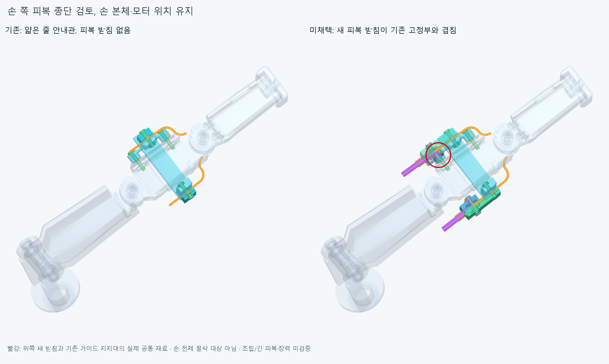

# DISTAL023 손쪽 피복 종단 연구, 미채택

**엄지IP의 손가락 쪽 피복 받침을 설계했지만 위쪽 새 부품이 기존 나사·가이드 지지대와 겹쳐 채택하지 않았다.** 손 본체364입력/축·길이,모터/랙/기존 전기선과 현재 GUIDE021·TERMINAL022 형상은 유지했다. 이 후보를 실제 설치물로 더하지 않는다.

## 만든 후보와 현재 기준

기존 GUIDE021의 분리 덮개2개를 연장 덮개2·안쪽 받침2·플랜지 피복 끝구2·명목M2x10나사/너트 각4의 **새14부품**으로 대체하는 연구다. 기존 가이드9+새14=23이며 손362에 더하면 가정상385행이다. [candidate_scene.json](generated/candidate_scene.json)은 **미채택 후보 조합**이다. 현재 활성 손은 GUIDE021의362+11=373행,포장은 TERMINAL022의366+7=373행으로 각각 그대로다. 기존 덮개2개/동결 원본 볼트/시각화 공통 형상을 또 설치물로 세지 않는다.

긴 피복 대신 외경3/내경1.3mm,각24mm의 짧은 참고2개만 넣었다. 피복이 미는 힘을 끝구의 어깨→분리 받침/덮개→기존 가이드 받침/나사로 보내려는 구조다. OD1.2 안내관 끝에 압축 반력을 직접 거는 설계를 피하려 했지만 **새 받침 자체가 기존 고정부와 겹친다.** 플랜지 포켓은 끝구의 명목 축 방향 잡음이며 피복 자체의 빠짐 방지/인장완화가 아니다. 하중 경로·실제 체결·접촉 강도·줄 장력은 승인하지 않았다.

## 실제 검사와 실패

새14내부91쌍과 새14+짧은 피복2를,기존 손362/가이드9·현재 포장373·전기48선/16커넥터 외곽·중립 팔10에 native로 대조했다. 편 손,IP−15/45/85°,기존 PINCH006 부모각25/50/75/100%의 **8정적 자세**다. 전체 **104795쌍 범위 중 677AABB후보**를 실제 계산했다. 보고 기준0.001mm³ 초과 겹침을 기록하고 Boolean허용오차1e−6mm/OCC풀1을 유지했다. [원본 결과](reviews/static.json),[집계와 다음 판단](reviews/assessment.json).

편 손부터 **고정10쌍**이 겹친다. 대표적으로 위쪽 새 안쪽 받침과 기존 paired_liner_carrier가 **79.451702456mm³**,새 덮개와 기존 덮개 고정볼트가 **3.570867353mm³**다. 빨강/원은 실제79.451702456mm³ 공통 재료의 위치다. 부품 전체/손 전체가 절삭 대상이라는 뜻이 아니다. 위쪽 짧은 피복도 기존 지지대와0.322541296mm³ 겹친다. 이는 공급 피복의 확정 치수 결함을 뜻하지 않지만 이번 가정 후보는 통과하지 않았다.

부모50/75%에서 뿌리 외피와 새 피복의 추가 겹침이 있고,100%에서는 새 끝구 **7.455766409mm³**·짧은 피복 **28.994681049mm³**의 겹침도 있다. 8자세 합계84겹침 기록은 반복 표본이며 **서로 다른 부품 쌍은12개**다. 연산 실패0이다. 새14끼리·포장373·전기64·중립 팔10의 대조에서는 기준 초과 겹침0이다. 이를 손쪽 전체 연결 성공으로 쓰지 않는다. 현재 입력의 모든 다른 두 부품 조합을 검사한 것도 아니다.

완성 위치에서 이미 막히므로 **조립 경로·공구·피복 삽입/분해·접촉 하중 검사는 실행하지 않았다.** 손 자체/물체 접촉/연속 운동·동적 전기선·모터 출력과 줄/피복 전체 연결/예압/장력은 이번 검사가 아니다. IP/부모 목표각은 바꾸지 않았다. 한 후보의 실패를 모든 가능한 손쪽 경로의 불가능 증명으로 쓰지 않는다.

## 규격과 외형 한계

OD3/ID1.3 피복,맞춤 끝구OD4/ID3.1·플랜지OD5.2x2,명목M2 나사/너트는 공간 후보다. 실제 공급품/재료·나사산/공구/토크·맞춤 공차·강도/마찰/마모·피복 고정과 허용 굽힘 수명은 미확정이다. 기존 얇은 안내관의 제조/재료 한계도 유지한다. [손 전체에서 본 후보](images/candidate_context.png)의 추가 부피는 수용 외형이나 사람다운 모양의 승인 근거가 아니다.

## 다음

현재 손/가이드/모터 종단은 유지한다. 다음은 **새 위쪽 피복 종단을 기존 나사/받침 발에서 벗어나게 하는 실제 지지부와 상류 오프셋 통로**를 별도 후보로 설계한다. 허공의 waypoint/임의 강체 배정으로 해결하지 않고 기존 안내관 하류 중심선·손 본체/관절축과 모터/랙/전기선을 보존한다. 새 지지/뿌리 움직임·조립을 확인한 뒤 긴 피복과 실제 두 줄 길이 조절/예압을 잇는다. 손/슬롯 절삭,피복 외경 임의 축소,각도 제한,닫은 작은 간격 재탐색이나 팔꿈치 버스 확장은 하지 않는다. 새 오프셋은 아직 설계/검사한 것이 아니다.

코드/입력·실패/그림을 저장하고 정확SHA의 새 깨끗한 사본에서 핵심 실패와 형상을 재현한다. 같은 에이전트 검토이며 독립 감사가 아니다. 전체20모터 설치/전체 손 구동/실물 승인·50/100ms성능 승인은 없다.
