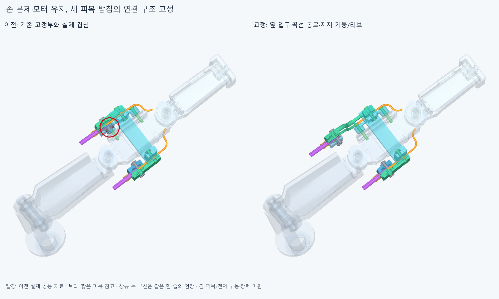

# OFFSET024 손쪽 피복 받침의 지지/통로 교정

**새 위쪽 피복 입구를 옆으로 옮기고 실제 곡선 통로·지지 리브/기둥으로 기존 가이드 체결부에 연결했다. 8정적 자세와 위 덮개 진입6표본은 겹침0이지만 전체 종단 조립·긴 피복·장력은 아직 미완이다.** 손364입력·관절축/길이·모터/랙/전기선은 유지했다.

## 무엇을 바꿨나

DISTAL023의 위쪽 끝구/받침을 기존 가이드 socket좌표에서 **X+14/U−17mm** 옮겼다. 기존 얇은 안내관의 입구에서 새 피복 끝구까지 **R7mm의 두90° 곡선 통로**를 붙였다. 하류 안내관의 중심선·플랜지/방향턱과 기존 손은 그대로다. 새 통로OD1.6/ID0.8mm와 세 기둥/곡선 리브·짧은 연결부는 위 덮개와 **하나의 유효한 솔리드**다. 허공의 waypoint나 임의 강체 배정만으로 지지를 대신하지 않았다.

피복은 맞춤 끝구의 어깨에 닿고 끝구 플랜지의 앞/뒤 면을 분리 받침/덮개가 잡는 명목 구조다. 덮개→원래 GUIDE021 받침·M2 체결부를 거치는 반력 경로 후보이며 **축력/마찰·힘/6자유도 강성 승인은 아니다.** 피복 자체가 끝구에서 반대로 빠지지 않는 실제 고정/콜릿은 아직 없다. 압축 어깨와 피복 빠짐 방지를 구별한다.

아래쪽7부품 형상은 DISTAL023 후보와 같고 이번 대조에 함께 포함했다. 전체 새14+GUIDE021 유지9+기존 손362= **385행의 정적 후보**다. [selected/generated/candidate_scene.json](selected/generated/candidate_scene.json)을 후속 조립 검사 입력으로 쓴다. 기존 GUIDE021 손373의 원본/기록은 유지하며 기존 덮개2행과 후보14를 동시에 설치물로 더하지 않는다. 현재 포장은 TERMINAL022의373행이다. 실제20모터 설치/전체 손 구동 완료가 아니다.

## 정적 검사

새14내부91쌍,짧은 OD3/ID1.3피복2와새/기존 가이드,상류 연장 줄2조각과새/기존 가이드·피복을 대조했다. 새14+짧은피복2+연장줄2를 손362/유지가이드9·포장373·전기48선/16외곽·중립팔10에 **8자세**(편 손/IP−15·45·85°,기존 PINCH006 부모각25·50·75·100%)에서 대조했다. 총 **117979쌍 범위 중490AABB후보를 native계산**, 보고기준0.001mm³ 초과 겹침0·연산실패0,Boolean허용오차1e−6mm/OCC풀1이다. [정적 결과](selected/reviews/static.json). 손 자체/물체·전체 연속/왕복 운동·동적 전기선 검사가 아니다.

첫 넓은 지지판은 기존 가이드 벽과28.983139972mm³,부모완성각의 뿌리 외피와64.072734027mm³ 겹쳤다. [실제 공통 형상/위치](reviews/locations.json)를 보고 필요한 경로를 따라가는 리브로 바꿨으며 손은 깎지 않았다. 첫 상류 통로 후보의1.881814mm³ 안내관 겹침은 새 덮개 보어를 끝까지 자르지 않은 구현 누락이었다. 원래 손/CAD 결함으로 세지 않는다. [첫 결과](reviews/static.json)와[이력](reviews/history.json)을 보존한다. DISTAL023의 고정10쌍/부모추가2쌍 실패도 삭제하지 않는다.

## 확인한 조립과 접촉 범위

기존 위 덮개/그 M2볼트·너트3행만 뺀 단계에서 새 위 덮개를 바깥쪽14/7/3/1/0.5/0mm로 접근시킨 **6유한 표본**은 겹침0·실패0이다. 기존 가는 안내관/끝마디/핀은 모두 있다. 아래쪽은 아직 원래 GUIDE021 덮개/체결품이며 새 끝구/아래 받침·새나사/너트·피복·줄은 이 단계에 없다. 새 결합부를 열린 반쪽 좌석으로 만들어 이미 있는 안내관에 방사 방향으로 내려놓는다. [실제 단계/제외 목록](selected/reviews/keeper_entry.json). 이것은 **위 덮개 한 경로**이며 나머지 새 종단 부품 설치·원래 M2 재삽입·공구/지그/전체 조립은 아직 검사하지 않았다.

양쪽 피복 어깨·플랜지 앞뒤·덮개/기존 받침·분리 받침의 **10위치 거리0/면 양쪽±0.05mm 재료 분류**가 일치했다. 전체 접촉 면적·체결 축력/하중/마찰·강도 승인이 아니다. [접촉/연결 결과](selected/reviews/contacts.json).

상류 줄2조각은 같은 위쪽 줄의 두 곡선이며 별도 줄/중간 연결구2개가 아니다. 중립에서 기존 국부12줄조각과 대조해 겹침0을 확인했고,기존 안내관 입구와 끝점 차이 약1.59e−14mm/접선 내적1이다. 곡선 길이 **21.991148575mm**는 thumb_mcp몸체에 붙은 일정 추가 길이의 명목 계산이다. 실제 마찰/관 안 접촉선·장력/모터 구동 승인이 아니며,기존 모터 조절부±2mm로 이 길이를 흡수한다는 뜻도 아니다. 길이 절단/예압은 긴 피복을 연결한 뒤 정해야 한다.

## 남은 일

후속 기준은 선택한 정적 후보이며 해결한 작은 틈과 위 덮개 진입을 재최적화하지 않는다. 먼저 **위 덮개 M2 재체결·양쪽 끝구/분리 받침/새체결품·실제 피복 삽입과 필요 선조립 순서**를 검사한다. 빠진 부품을 실제 단계로 명시하고 나중 복구 경로까지 확인한다. 그 뒤 양 끝 피복 빠짐 방지와 모터→손목→엄지 종단의 긴 피복,두 줄 길이 조절/예압·부모/손목 움직임과 풀기를 연결한다. 모터 쪽/손 쪽 두 끝은 아직 서로 이어져 있지 않다.

R7/OD1.6·벽0.4mm곡선 통로·지지 기둥/리브·끝구/명목 나사는 맞춤 CAD가정이다. 가공/출력 방식·재료/공급품·공차/나사산·공구/토크·강도/마모·굽힘 수명은 미정이다. [후보 전체 외형/부분 조립](images/service_context.png)의 추가 부피도 사람다운 외형의 수용 판정이 아니다. 팔꿈치 버스·손 절삭/외경 임의 축소·운전각 제한은 하지 않는다.

코드/입력/첫 실패·교정/실제CAD그림을 저장하고 정확SHA의 새 깨끗한 사본에서 핵심만 재현한다. 같은 에이전트 검토이며 독립 감사가 아니다. 전체 손 구동/실물·50/100ms 성능 승인은 없다.
