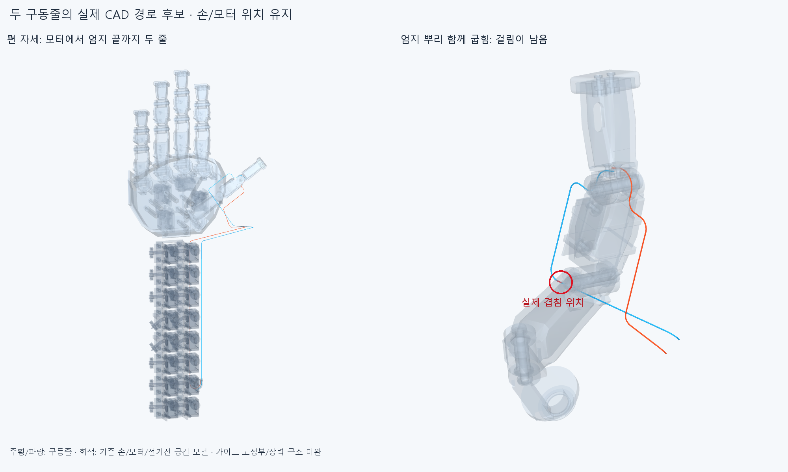
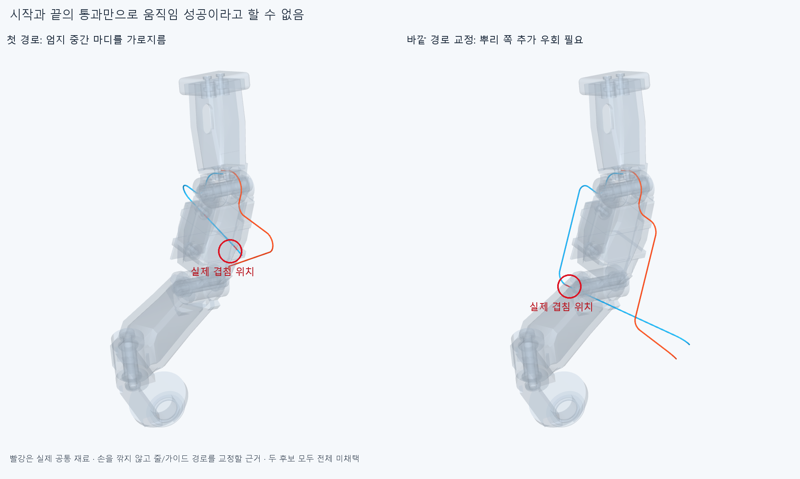
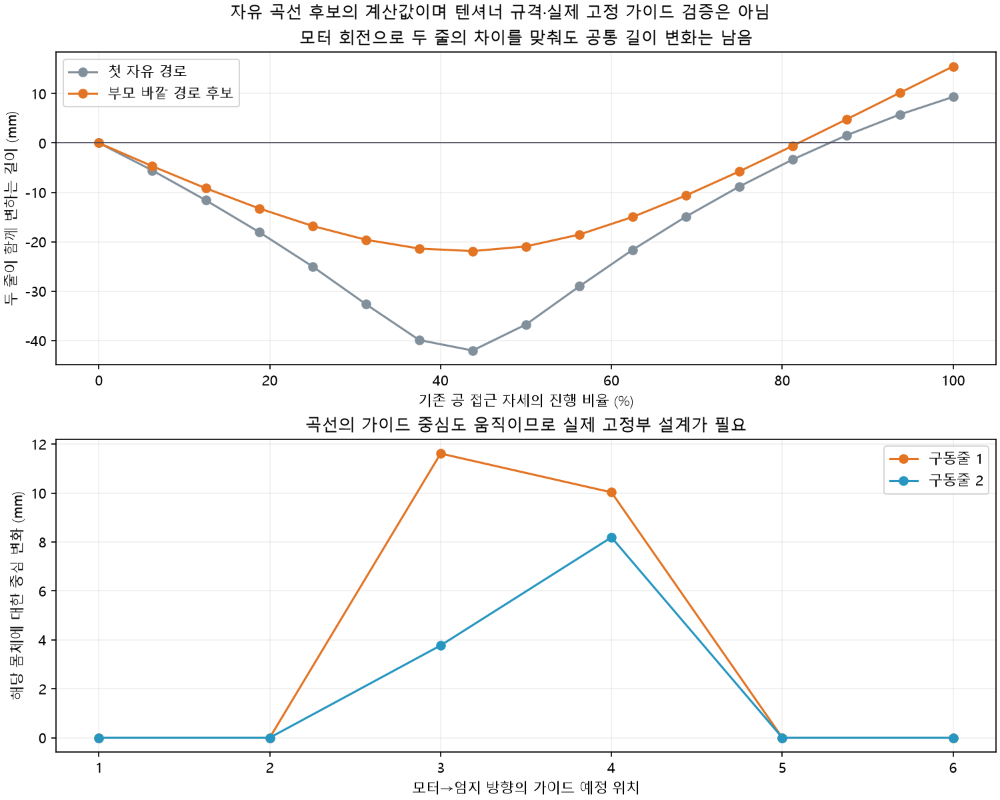

# TENDON019 엄지 IP 모터에서 손끝까지 두 구동줄 경로 연구

**현재 손은 전체 구동 미완이다.** 대표 엄지IP 모터의 두 홈/줄 고정부에서 손목을 거쳐 기존 엄지IP 줄 고정부까지 두 줄을 실제 튜브 CAD로 만들었다. 편 자세와 끝관절만45° 굽힌 자세는 명목 공간을 통과했지만,엄지 뿌리를 함께 굽힌4자세에서 줄이 뿌리 외피에 걸려 **전체 경로는 미채택**이다. 손364부품·축/길이·모터 설치 배치·받침·기존48전기선은 바꾸지 않았다.

주황/파랑은 구동줄,회색은 기존 손/모터/전기선 공간 모델이다. 빨간 공통 형상과 원은 실제 겹침 위치이며 손 전체를 절삭 대상으로 칠한 것이 아니다. 가이드 축/받침·길이 조절·예압 구조는 아직 없고,곡선의 중간 굽힘을 실제로 유지하는 구속도 미완이다. 그림을 장력 있는 완성 구동계로 해석하지 않는다.

## 현재 입력과 후보

현재 손364부품과 DRIVE018의유지358+선택10=368포장행,기존48전기선/16커넥터 외곽,중립 팔 참고10을 장애물로 썼다. 실제20모터 설치 완료가 아니다. BUS017의 팔꿈치 방향 연장선/임시 종단은 이번 필수 구성에 넣지 않았다. 전완의16원격모터는 손 구동원으로 유지한다.

모터는 현재 thumb_ip_actuator의 세계좌표 변환을 사용한다. 두 줄은 모터R10mm 홈과 줄 누름나사를 거쳐 엄지IP의기존R7.7mm 트랙/고정부로 연결했다. 과거120mm 외부 단일관절 시험대나 고정 부모의0.77각도비를 전체 손 전달비로 승계하지 않았다. 외경0.6mm·중간 굽힘 중심선R5mm는 공간 가정이며 실제 공급 줄/가이드의 수명·허용 하중 규격이 아니다. [입력과 가정](references.json).

최종 연구 후보는 [generated/calibrated_open/scene.json](generated/calibrated_open/scene.json)의34튜브 조각,각각 한 물리적 줄을17구간으로 나눈2줄이다. **물리적 중간 연결구34개가 아니다.** 모든 경계의 중심선 연결을 확인했고,비인접 같은 줄 조각240쌍×6자세에서도 보고 기준 이상 겹침/연산 실패0이다. 원래 모터 고정부 입구의접선 변화26.565051°는 유지하며 인장/마찰·마모 승인이 아니다.

## 자세와 경로를 먼저 바꾼 결과

첫 경로는 이웃 새끼 벌림 모터의 드럼과2조각이 겹쳤다. 같은 줄의 여러 조각/표본 기록을 독립 결함 수로 세지 않는다. 손목 굽힘점을 앞쪽으로 옮기고 기존IP 직선 슬롯을 따라 진입점을 조정하면 **편 자세·IP45°·IP−15°의3끝자세는 통과**했다. 첫 경로의공 접근 시작과 완성도 통과했지만 중간50%에서 엄지 중간 마디를 가로지르는5조각/부품쌍이 나왔다. [첫 검사](reviews/audit.json).

부모 바깥으로 돌아가는 경로의 첫 시도는 굽힘R5mm를 넣을 직선 길이가 부족해 기하 생성부터 실패했다. 실제 간섭 계산까지 간 결과가 아니며 후속 집계 오류까지 포함해 [follow.json](reviews/follow.json)의completed=false를 보존한다. 두번째 경로는17기하 표본 중 마지막2개에서 모터 한쪽의 감김 구간이 사라졌고,전체 native검사는 실행하지 않았다. [follow2.json](reviews/follow2.json).

**모터 출력 초기 위상을−60°로 잡고 두 줄의 초기 길이를 따로 맞추는 공학적 후보**로 감김을 유지했다. 모터 설치축/손 자세를 바꾸거나 손가락 각도를 제한한 것이 아니다. 실제 공급 줄 길이·모터 영점 보정 시험은 아니다. 이 후보의17기하/길이 표본은 유효했지만 실제 가이드 고정부가 없는 자유 곡선 연구라는 한계는 그대로다.

## 최종 명목 검사와 실제 남은 문제

[calibrated.json](reviews/calibrated.json)의6실제 손 자세는 편 손,IP45°,기존PINCH006 목표각의25/50/75/100%다. 각 자세에서 새 줄 조각 대 현재368포장/모터·기존64전기선/외곽·중립 팔10·전체 손364와 두 줄 사이를 native Boolean으로 검사했다. **편 손/IP45°는 명목 겹침0이고,나머지4자세는 엄지 뿌리 외피에 걸린다.** 50%에서 실제 공통체적0.709705737/0.435599124mm³,25%에서2.400465707mm³다. 원래 허용되지 않은 재료 관통을 접촉으로 지우지 않았다. 보고 기준0.001mm³,Boolean 허용오차1e−6mm,연산 실패0이며 제작 여유 기준이 아니다. 나머지 포장/전기선/중립 팔·두 줄 사이는6자세에서 보고 기준 이상 겹침0이다.

편 손/IP45°에서 두 줄의모터 홈/누름나사·손끝 트랙/줄 고정부까지16접촉 거리는 최대5.05e−11mm로 명목 접촉을 확인했다. **거리0은 줄이 미끄러지지 않거나 힘을 전달한다는 승인이 아니다.** 부모/손목 움직임과 줄 팽팽함·정방향/풀기의 실제 구속은 남는다. 손 자체 전체 간섭을 재검사한 것이 아니며,공 접근의기존 각도만 사용했다. 구 물체를 장애물로 새로 검사하거나 실제 잡기·지지 없이 유지하는 힘을 검증하지 않았다.

17부모 자세의길이 계산에서는 모터 회전으로 두 줄 길이 변화의차이를 맞춰도 **공통 변화 -21.898170~+15.513168mm**가 남는다. 이는 이번 자유 곡선 후보의 진단값이며 다른 가능한 모든 경로에도 같은 보정이 필요하다는 증명이 아니다. 가상의2:1보정기 이동량 약18.705669mm는 실제 텐셔너 선정 규격이 아니다.

실제 가이드를 설치했다고 주장할 수 있는지도 확인했다. 같은 몸체에 고정될 예정인 굽힘 중심이 자세에 따라 **최대11.612929mm** 움직인다. 따라서 현재R5곡선은 설치된 고정축 풀리의 운동이 아니며,충돌0인 자세라도 전체 구동 성공으로 세지 않는다. [접촉·줄 자체 간섭·중심선·가이드 구속 근거](reviews/interfaces.json). 손목은 중립이며 손목 운동에 따른 보상/연속 충돌·장력/강성/마찰/이탈·실제 공급 줄/커넥터·조립/강도/물리 구동은 미검증이다.

## 다음 단계

이 자유 곡선 탐색은 닫고 **엄지 뿌리 쪽 실제 가이드 축/지지부와 줄 통로를 현재 CAD에 설계**한다. 고정 몸체/회전 몸체의 구속과 가능한 길이 조절·예압을 명시한 뒤 같은 자연스러운 부모 자세에서 두 줄을 다시 검사한다. 손이나 받침을 먼저 깎거나 끝관절 각도를 제한하지 않는다. 실패몇번을 손의 구조적 불가능으로 단정하지 않는다. 기존 출력부의 미세 치수 탐색이나 팔꿈치 전기 버스 확장도 자동 재개하지 않는다.

코드는route_model.py/첫audit.py,부모 경로follow_parent.py/follow_parent2.py,초기 위상calibrated.py/최종calibrated_audit.py,접촉/구속evidence_interfaces.py다. 중간 실패와 구체적 범위는 [history.json](reviews/history.json)에 보존한다. 출력 그림의첫 실행은 렌더 API누락으로 이미지 생성 전 중단했으며 최종render2가 완료 근거다. 정확SHA 새 깨끗한 clone의핵심 재현은 후속 문서에 남긴다. 같은 에이전트 검토이며 독립 감사가 아니다. **실패 재현의passed와 손 설계 통과를 구별한다.**
