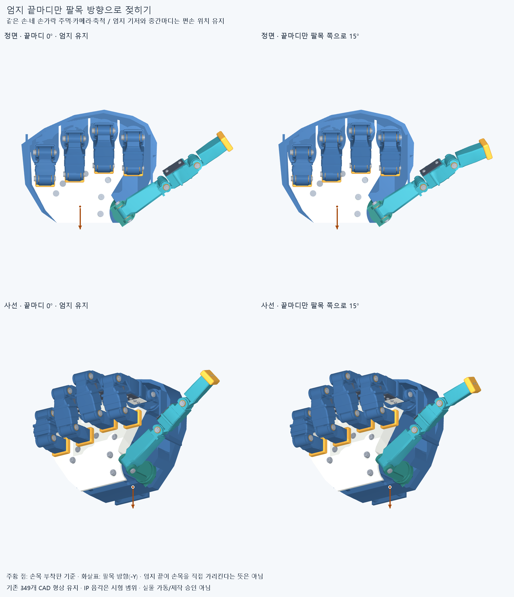
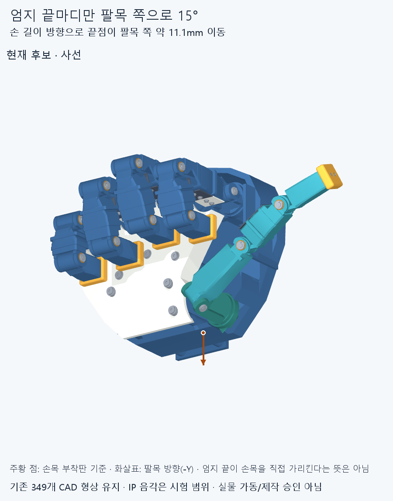
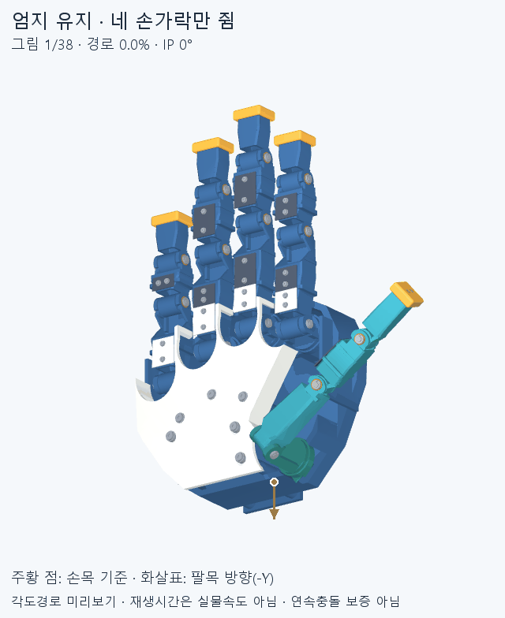

# 팔목 방향으로 끝마디를 젖힌 엄지척 후보

엄지는 손을 쫙 폈을 때의 뿌리·대립·가운데 관절 위치를 유지합니다. 네 손가락을 원래 작성된 주먹 경로로 먼저 접은 뒤, 엄지 끝마디(IP)만 역방향으로 15° 젖힙니다. 사용자가 요청한 “엄지를 빼고 말아쥔 다음 끝부분만 팔목 쪽으로 살짝”을 확인하는 후보입니다.







GIF는 각도 순서를 보여주는 미리보기입니다. 재생시간은 실제 모터 속도나 지연이 아닙니다.

## 바꾼 것

| 항목 | 이번 후보 |
| --- | --- |
| 형상 | `gesture_hand_v3`에 저장된349개 부품 그대로 사용. 길이·관절축·부품 형상 변경 없음 |
| 엄지 목표각 | 뿌리 벌림·대립·MCP·IP 순서로 `[0,0,0,-15]°` |
| 네 손가락 | 수용한 원래 주먹각과33개 작성 경로점 유지. 이전 GESTURE002의 검지 수정은 적용하지 않음 |
| 움직임 순서 | 엄지 고정 상태에서 네 손가락을 접고, 그 뒤 IP만0→-15° |
| 가동 범위 | 기존 IP `[0,85]°`를 이 후보에서만 `[-20,85]°`로 확장. 기본 설계 파일과 기존 자세는 보존 |

끝마디를 젖히면 엄지 끝은 손의 길이 방향으로 팔목 쪽 **11.136mm** 이동하고, 손목 부착판 기준점과의 직선거리는 **1.423mm** 줄어듭니다. 기준점은 저장 CAD의 부착판 바닥면 중앙이며 해부학적인 손목 회전 중심이 아닙니다. 끝마디가 손목을 직접 가리키거나 엄지가 사진처럼 수직으로 선다는 뜻은 아닙니다.

## 검사 범위와 남은 일

**완료 결과:** 경로48표본과 세 끝자세(총51개 관측, 중복을 제외한43자세)에서 보고 기준 이상 겹침0건·연산 실패0건입니다. 349개 부품은 유효한 단일 솔리드이며 저장 조립 STEP과 개별 부품의 일치 및 실행 전후 입력 해시를 확인했습니다. 경로의 실제 최대 관절각 간격은5°입니다.

결과는 [전체 경로 보고서](reports/motion_audit.json)에 기록합니다. 각 관절 변화가 최대5° 이하가 되도록 작성 경로를 나눠, 같은 몸체에 속한 부품끼리도 포함한349개 저장 STEP 부품을 검사합니다. 보고 기준은 겹친 체적0.02mm³ 초과입니다. 이는 유격의 최솟값이나 제작 공차의 합격 기준이 아닙니다.

현재 범위는 **펴기→네 손가락 접기→엄지 끝 젖히기 한 정방향 경로와 세 끝자세**입니다. 이 경로의 엄지 역방향 검사는0~-15°이며, 후보에 선언한-20°까지 전부 검사했다는 뜻은 아닙니다. 역방향, 표본 사이의 연속 충돌, 다른 손짓 전체, 줄·모터·배선과 실제 하중은 포함하지 않습니다. 음각까지의 실물 구동, 줄 당김/복귀 방식, 물리적 정지턱, 조립 공차와100ms 목표는 후속 검증이 필요합니다.

## 재현

저장소의 기존 CAD 검증 환경(CadQuery/OCP, NumPy, MuJoCo/Pillow)을 사용합니다. 출력은 새 경로를 지정합니다.

```text
python cad/thumb_wrist_v1/audit.py --repo <저장소> --output <새 보고서.json> --mode full
python cad/thumb_wrist_v1/render.py --repo <저장소> --output <새 그림 폴더>
```

Windows에서는 숨김 실행기와 콘솔을 만들지 않는 하위 프로세스를 사용합니다. `representative` 모드는 같은 전체 표본을 계산하되 일부 기존 표본만 다시 검사하는 커밋 후 핵심 재검사용입니다. 전체 검사를 다시 했다는 뜻이 아닙니다.

`profile.json`은 후보값, `wrist_profile.py`는 범위·자세·방향 계산, `audit.py`는 저장 솔리드 검사, `render.py`는 같은 각도에서 실제 저장 메시를 그립니다. `manifest.json`은 후보와 읽은 원본 파일의 바이트 해시를 묶습니다.

커밋 후 핵심 재검사 기록은 [검토 자료](../../docs/reviews/)의 `THUMB_WRIST_<대상 SHA>` 폴더에 별도 저장합니다. 원래48개 경로 표본의 각도 재구성과 대표 자세의 실제 CAD 재검사를 구분하며, 전체 경로를 두 번 검사했다고 표현하지 않습니다.
