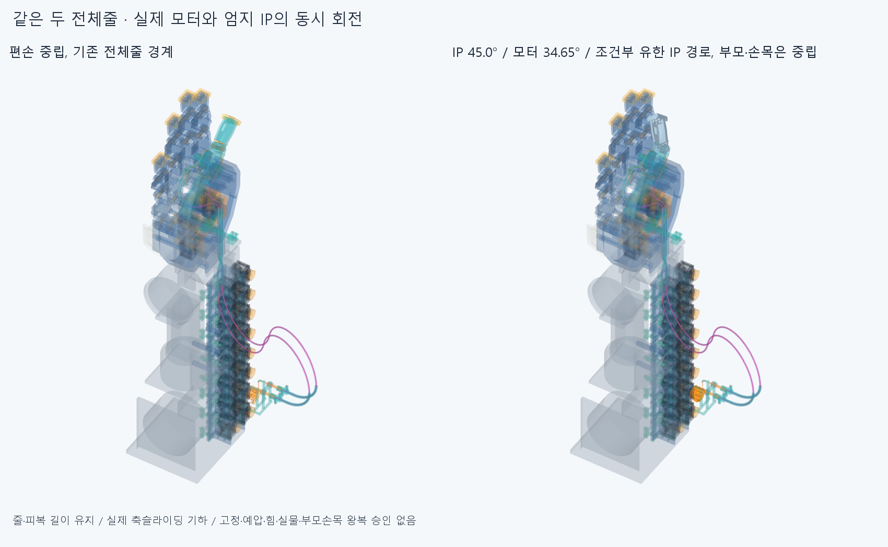

# SLIDE045 두 전체 줄의 실제 축슬라이딩과 모터/IP 동시 회전

**부모·손목을 중립에 둔 엄지 IP 굽힘/풀기의 새 조건부 검사다. 새 다른부품 간섭 없이 유한표본 진행. raw 전체native=false, 같은줄 접합기록6/원래모터참고접촉3/새차단0를 구별한다. 물리구동·고정력/장력/연속운동 승인이 아니다.**

## 먼저 풀어낸 실제 범위

부모·손목 왕복으로 가기 전에, 현재 전체피복 경로를 바꾸지 않는 한 관절의 실제 구동 관계를 먼저 연결했다. 손목/부모·나머지19관절은 중립, IP0/15/30/45/30/15/0°와 실제 모터 출력0/11.55/23.1/34.65/23.1/11.55/0°다. 설치각·설치축 변경이 아니다.45°는 이번 굽힘 목표이며 새각도제한/전체허용범위가 아니다. 기존 옛독립자세길이/biarc·Newton·최적화/거리장 탐색은 재실행하지 않았다.

모터9부품(스톡혼·중앙나사/새스풀·TAP4/핀치2)은 현재 모터 축을 따른다. 자식13부품(끝코어/끝캡·체결/부싱·꼬리클램프)은 현재thumb_ip FK를 따른다. 나머지840하드웨어와 두 전체피복26조각은 이번 중립 경계에서 그대로다. 두 전체줄52조각을 모터 고정부 꼬리→R10감김→현재선택18mm접선/R5·조절부→전체피복/PAIR→엄지실제통로·라이너→R7.7감김/자식꼬리까지 동시에 놓았다.22이동하드웨어/52줄 조각의 시간별74행을 새설치74부품으로 세지 않는다. 새하드웨어0, 기존 STEP/STL **6462해시 불변**이며 손397/기본364·포장385·전기64·팔10·PAIR6/외형·축·길이·모터/랙·전선을 유지했다. 옛짧은피복/프로브/전체줄·실패곡선을 중복 설치하지 않았다.

피복은698.964345153791/761.108456948670mm, 줄은853.356663204892/932.491923574900mm다. 이번에는 저장중립 피복 자유구간도 **기하상 정지한다고 규정**했다. 실제 종단/PAIR·ENTRY 외의 곡선점에 새지지/텐셔너를 설치하지 않았고, 그 정지형상을 실제 장력·EI·마찰하 평형으로 풀지 않았다. 따라서 부모·손목이 움직여 피복 형태까지 바뀌는 응답으로 승계하지 않는다.

## 같은 재료와 실제 보어 슬라이딩

모터감김 길이변화는 각선의부호를side=-1/+1로 쓸 때10·side·θ, 자식감김은-7.7·side·q다. **θ=0.77q**에서 두 변화가 상쇄된다. 모터고정부 꼬리는 모터회전에 강체이동하고 자식꼬리는 자식회전에 강체이동한다. 실제 고정부와의 미끄럼없음은 FIX044의 **미검증 마찰·예압 조건부 경계**이며 나사·끝점만으로 고정력/매듭을 입증하지 않는다. 정적±2mm조절을 동적 텐셔너로 쓰지 않았다.

14길이프로필(7시간상태×2선)의 전장잔차최대 **1.13686837722e-13mm**, 조각접합끝점차최대4.02164403065e-14mm, 선언고정꼬리의 실제강체프레임 끝점차최대7.88342782459e-14mm다. 같은 재료좌표9개씩126점을 저장했다. 실제 PAIR뒤40mm직선 보어의 중간에 있던 같은재료점1개씩도14개 추가, 합 **140재료점**이다. 그 재료점의 현재 직선보어 내 위치는20mm에서 반대방향으로 ±7.7q(rad)만큼 움직인다. q45°의6.047565858160mm를 실제보어 안에서 추적했고 가이드 앞뒤를 재료고정점으로 묶지 않았다. 이값은 이번 IP운동의 기하슬라이딩이며 부모/손목 보상량·조절/공급·절단·예압 규격이 아니다.

복귀의30/15/0°는 같은각 정방향과 동일한 메모리없는 규정기하다. 실제마찰/히스테리시스·동적응답/연속왕복을 풀었다고 세지 않는다. 중립0°는 CORD043저장52조각의 끝점과 대조한 경계이며 새중립native를 반복하거나 과거접합false를0으로 덮지 않았다.

## 새 native 검사와 그림

실제 새 nonzero 기하상태 **3개**만 실행했다. 각상태 두 전체줄 대 현재5하드웨어그룹/두전체피복/자기쌍,22이동하드웨어 대840고정·두전체피복과 모터9대자식13을 검사했다. 합 **200013쌍/1052AABB/9기록/0연산실패**, 보고0.001mm³초과/Boolean1e-6mm/OCC1이다. [최종 분류와 원시결과](reviews/verified_check.json). 실제 함께 변하는 줄/하드웨어의 새상태 검사이며 DRIVE018국부전회전이나 옛손자세만을 전체줄 구동검사로 승계하지 않았다.

각각 강체인 모터9 내부/자식13 내부는 상대형상이 불변이므로 기존명목나사/스톡참고접촉을 새로0이라고 재분류하지 않고 재계산하지 않았다. 두강체 사이와 변하는 전체줄 접촉은 새로 검사했다. 같은물리줄의 모터꼬리/감김 연속0·1접합은 raw기록을 남기고 다른부품/다른줄·비국부자기교차와 구별한다. 이 분류는 검사제외/전체native0/실제 부드러운굽힘·고정력 승인이 아니다. 원래26.565051177078°접선꺾임을 미세수정하지 않았다.

새차단이 있으면 그 상태에서 중단해 나머지 native를 실행하지 않았다. [최초 중단상태의 최대 실제차단 공통재료](reviews/evidence.json)만 증거로 저장하며 작은기존동일줄접합은 자동정밀반복하지 않았다. 그림은 실제 저장모터/IP/전체줄 CAD이며 팔표시는 SEAT041 nativeSTEP기반mm메시다. GIF가 있으면4서로다른저장기하를7프레임에 재사용한 설명용220ms/프레임이며 실물속도/힘·장력하 모터구동 증거가 아니다. 요청한 전체손3~4동작을 완료했다고 세지 않는다.

첫 실행은 inheritedhandloader가 body메타데이터를 버리는 조건을 자식13개수assert가 잡아 **새프로필/native/STEP전에 중단**했다. 원래 코드·오류/stdout/status를history에 보존했다. 현재assembly_catalog의 실제thumb_ip소속13이름을 읽어 변환대상을 묶은 것뿐이며 형상·축·목표각/판정문턱 변경은 없다. 실패를 완료표본으로 합산하지 않았다.

## 남은 일

이번은 한 엄지 IP의 조건부 전체줄 운동이다. 부모·손목잡기/풀기의 같은재료길이/피복형태변형·실제축슬라이딩·두선/하드웨어접촉은 아직 남는다. 물체파지/손전체20모터·실제꼬리고정·나사산/공구·손·지그·토크·압착·마찰·EI·중력·비틀림·좌굴·정상력·예압·장력/평형·연속움직임·전기동적운동/실물·제조·외형 승인은 없다. 큰외부루프 외형도 미정이다. 모든실물/공급품인증을 다음CAD/요청3~4영상 조건으로 무한히 늘리지 않는다.

Close SLIDE045 finite actualmotor/IP coupled wholecord sliding stage. Parent/wrist remained neutral and housing shape was prescribed stationary, not an elastic equilibrium. Actualrotor9/child13 and two complete cords moved together at IP15/30/45 with motor0.77q;same full material lengths and actualPAIR40mmstraight-axis materialwitness were retained. Returnangles reuse forwardgeometry,notphysicalhysteresis/continuousmotion. Next connect natural coordinated parent/wrist grasp-release to samewholemateriallength/actualaxis sliding and bothline/hardwarecontact with motorforearmfixed/PAIR H/distal H+MCP. Do not promote fixedhousingIP result to movingparent/wrist or all20motors. Tailno-slip remains conditional/unmeasured frictionpreload from FIX044;notphysicalfixation/forceapproval. Keep hand397/base364/pack385/elect64/arm10/PAIR6/proportions/axes/lengths/motor/rack/wires/OD. No elbowbus/microgap/samecordseamzeroing/anglelimits/oldNewton/80optimization/independentrod/freecurves/independentvariablelengthbiarcfamily/virtualsupports/tensioner or closedfastener/contact repeats. Preserve rawsamecordseamrecords and CORD043/BIARC039 corefalse/all priorfailures/holds. Do not make allsupplier/physicalcert endless prerequisites for furtherCAD/requested3-4motionpreviews.

CORD043/BIARC039 source0·STEP1추가같은줄접합/corefalse, SEAT041받침운반실패, FIX044미검증고정·접촉지지분포와 CONTACT036/LENGTH037실패·검토복구, PAIR034포함관계·OFFSET024면/한점보류·이전기본적분false/정밀보조를 재검사·해소하지 않았다. 기존manifest/동결222를 보존했다. 모든곡면식·trim·Boolean동등성 증명이나 독립감사가 아니다.

## 기존 모터 참고접촉 분류

첫15°native는 중앙참고나사/자기모터34.846496626236mm³를 미분류 차단으로 기록하고 중단했다. reviews/check.json은 원래 조건부false 그대로 보존했다. 기존DRIVE018 assessment.json의 원래3솔리드/자기모터 접촉과 같은쌍·기본체적 절대1e-5를 확인해 원래모터참고접촉으로 분류했다. verified_check.json은 같은15°10native그룹을 재실행 없이 승계하고30/45°만 새로 검사한다. 새3상태는 첫1실행 재사용+새2이며 첫15°를 두번합산하지 않는다. 각각 참고접촉의raw값을 남기며 검사제외/0겹침·실제모터내부설계승인으로 바꾸지 않았다. 작은 동일줄접합과 별도로 기록한다.

후속 첫분류실행은30°의5하드웨어+피복6외부native뒤 집계모듈이름충돌 AttributeError로중단했다. 첫selected_check.json은completedfalse/15°승계부분으로그대로보존하고 원래실행코드·오류/stdout/status를history에남겼다.30°첫6그룹원시값은미저장이며0실행/완료표본으로세지않는다. 명시파일로집계모듈을불러오는수정과그룹별즉시저장만추가한verified_check.json에서필요한6그룹을다시실행했다. CAD기하·각도·기준변경없음, 첫미저장값을새값으로복사/승계하지않음.
