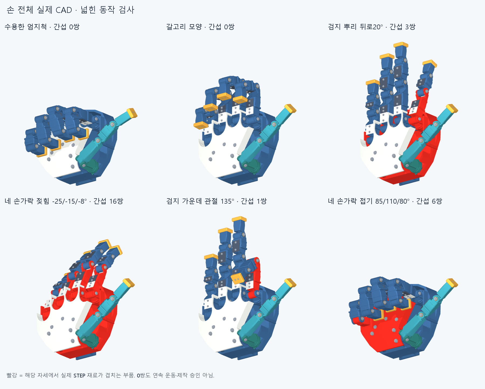
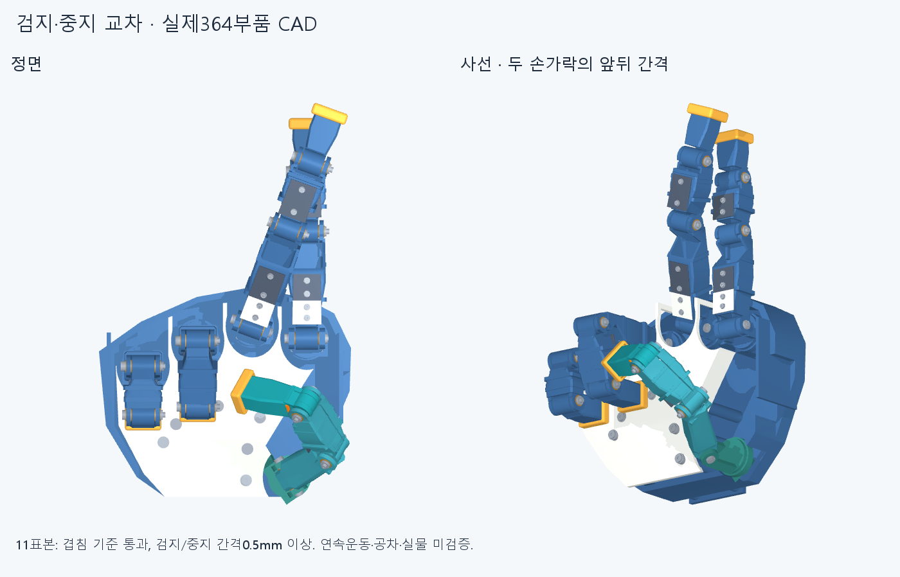
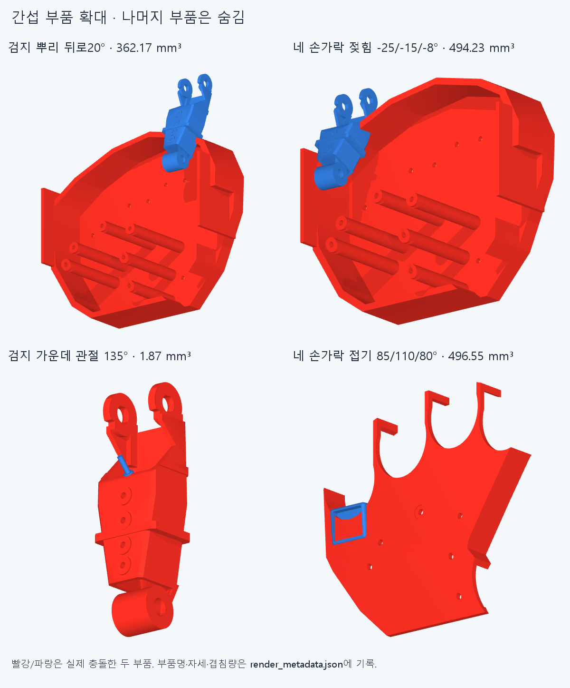

# 손 전체 운동 재검토 — MOTION001

**현재 CAD는 사람다운 운동에 여유를 더한 요구를 충족하지 못한다.** 대표 손짓의 완성 자세는 나오지만, 뿌리 관절을 조금 뒤로 젖히거나 다른 손짓으로 이동하는 동안 실제 부품이 겹친다. 이 회차는 문제를 확인하는 검사·진단이며, 수정한 손 CAD를 출고하는 회차가 아니다.

기준은 `manufacturing_v2`의 저장 STEP **359부품**이다. 수용한 외형·길이·20관절축과 최신 엄지척을 보존했다. 형상 파일을 수정하거나 필요한 각도를 잘라내지 않았다. 엄지 단품 시험대의 국부 통과 결과를 전체 손으로 승계하지 않았다.

이어 최신 손 전체 구동 후보 `thumb_ip_drive_v1`의 **364부품**에도72자세와108중간 자세를 적용했다.357부품의 STEP/STL·몸체·좌표계가 같음을 확인한 뒤, 수정2부품과 추가5부품 중 하나라도 포함하는 **2520부품 쌍**을 새로 검사했다. 나머지는 동일한 부품 쌍·동일한 상대 자세의 결과만 승계했다. 최신364부품에서도 **25/72자세와12/36전환 조합의 간섭이 남는다.** [최신 손 검사](reviews/latest_hand.json). 별도 외부 모터 시험대와 그 줄 경로는 손에 설치된 부품으로 간주하지 않았다.

빨간색은 해당 자세에서 실제 STEP 재료가 겹친 부품이다. 그림의 0쌍은 그 자세의 공칭 겹침 검사 결과이며, 연속 운동·공차·구동 승인이 아니다.

위 그림은359부품 제조 기준을 표시한다. 뿌리 젖힘·새끼 벌림 등 주요 간섭은 최신364부품에도 그대로 존재함을 별도 확인했다.

## 추가 요청: 검지·중지 교차 🤞

**비슷한 교차 자세와 접근 경로는 현재 형상에서 찾았다. 사진처럼 밀착해 감기는 동작을 완성했다는 뜻은 아니다.** 최신364부품 전체를 사용했고, 손가락을 같은 평면에서 서로 밀어 넣는 대신 먼저 앞뒤로 분리한 뒤 옆으로 움직였다.

선택한 후보는 검지 `[0,0,0,0]°`, 중지 `[20,30,−20,−10]°`다. 배열 순서는 벌림/MCP/PIP/DIP이며, 약지·새끼·엄지는 기존 가위 자세의 접힌 각도를 유지한다. 가위 자세 → 중지를 앞으로 굽히면서 위 마디를 펴기 → 검지를 곧게 두고 중지를 옆으로 교차하는 두 구간을 최대5° 간격의 **11표본**으로 검사했다. 완성 자세와11표본에서 보고 기준 이상 겹침0·연산 실패0이다. [자세·경로 검사](reviews/crossed_fingers.json)

중지 PIP −20°와 DIP −10°는 **기존 선언 범위(각각0°부터) 밖**이며, 이번에 넓힌 탐색 범위 안이다. 따라서 이 자세를 현재 제어 설정에서 바로 구동 가능하다고 부르지 않는다. 역방향 회전의 구동·줄 경로·공차·연속 경로는 남아 있다. 교차점의 두 중심선 앞뒤 차이는 약49.9mm다. 이 값은 표면 간격이 아니며, 실제 손처럼 두 손가락이 밀착한 상태도 아니다.

검지를−3° 기울였던 이전 후보는 보고 기준 이상의 겹침0이었으나, 정확한 표면 거리 검사에서 첫마디끼리 **0mm**로 나와0.5mm 여유 목표를 충족하지 못했다. 이 후보는 여유 불합격으로 남겼다. 겹침 부피 기준 통과를 제작 여유 확보와 동일시하지 않는다. [간격0mm 기록](reviews/cross_clearance_compact.json)

검지를0°로 조정한 최종 후보는 **11표본 모두에서 검지·중지 사이0.5mm 이상 공칭 간격**을 확인했다. 각 표본의5041부품 쌍 전체가 대상이며, 형상을 감싸는 상자의 거리 하한으로0.5mm보다 멀다고 확인되는 쌍만 제외하고 나머지는 정확한 STEP 표면 거리로 판정했다. 보고한0.5mm는 확보한 하한이며 실제 최소값을0.5mm로 측정했다는 뜻이 아니다. 다른 손가락·손바닥과의 간격, 표본 사이의 연속 경로, 제작 공차는 이 여유 판정에 포함하지 않는다. [여유 검사](reviews/cross_clearance.json)

초기 검지 중심의 교차 후보4개에서는 검지 뿌리와 손바닥 덮개, 또는 두 첫마디가 충돌했다. 이후 중지를 앞으로 빼는 방식으로 충돌 없는 후보를 찾았다. 위 마디를 젖히지 않는 `[검지0,0,0,0 / 중지20,30,0,0]°` 후보도11표본에서 겹침0이지만 중심선 앞뒤 차이가 약65.8mm로 더 크다. [초기 실패 기록](reviews/crossed_initial.json) · [더 벌어진 후보](reviews/crossed_separated.json)

## 확인된 문제

|동작|실제 확인|수정 방향|
|네 손가락 뿌리 뒤로 젖힘|일반 범위인 −20°에서도 각각3쌍 간섭. 손바닥 프레임과의 첫 검출 구간은 약 −5.47…−6.03° 부근, 회전 받침과는 약 −6.16° 부근|뿌리마디 밑부분, 받침과 손바닥 전방 프레임을 함께 검토. 부싱·지지면을 무작정 깎지 말고 단면/고정 여유를 보존하는 형태로 수정|
|새끼손가락 벌림|네 손가락을 `[22,6,−8,−22]°`로 벌리는 자세에서 새끼 첫마디와 손바닥 프레임이 **3.792mm³** 겹침|새끼 쪽 프레임 모서리와 첫마디 이동 공간 확보|
|가운데 관절 깊은 접기|검지 약133.44°, 중지134.75°, 약지134.53° 부근부터 외장 고정나사와 앞마디/외장이 간섭|나사 머리 돌출·위치·체결 방식을 조정하고 나사 물림/공구 접근을 다시 확인|
|엄지 MCP 깊은 접기|단독 굽힘에서 약75.53° 부근부터 두꺼운 엄지 첫마디와 다음 외장이 겹침. 선언85°보다 먼저 막힘|엄지 뿌리마디 말단과 다음 외장의 관절 주변 여유 수정. 최신 엄지척 자체는 유지|
|네 손가락 동일 굽힘 조합|MCP/PIP/DIP=`85/110/80°`에서 새끼 끝이 손바닥 덮개 안으로 침범|이 각도 조합을 그대로 적용할 수 없음. 손가락별 길이·접촉 종료 자세와 경로를 함께 조정|
|손짓 전환|보→바위 단순 보간75%에서 검지 끝과 엄지 외장 나사가2.176mm³ 겹침. 보→중지 자세75%에서도 엄지와 검지가 겹침|끝자세만 확인하지 말고 엄지/검지의 순서와 공간을 함께 수정·검사|

위 시작각은 충돌한 **특정 부품 쌍**의 1° 간격 탐색 후 약0.03125° 폭으로 좁힌 최초 검출 구간이다. 이전 구간 전체의 연속 무간섭을 보증하는 기계적 한계각이 아니다. 겹침 보고 기준은 **0.02mm³**, Boolean 공차는 **1e−6mm**다.

확대 그림에서는 간섭한 두 부품만 보인다. 빨강·파랑은 서로 다른 부품이며, 전체 손의 나머지 부품은 설명을 위해 숨겼다.

## 검사 범위와 해석

- `reviews/discovery.json`: **72자세**. 기존9손짓,20축의 양 끝40자세,기능 자세9개,일반적인 젖힘12개,협조 벌림2개. **25자세에서467개의 겹침 관측**이 나왔다. 같은 부품 쌍이 여러 자세에서 반복되므로467개를 서로 다른 설계 결함 수로 읽지 않는다.
- 기존9손짓은 전부 해당 끝자세에서 보고 기준 이상 겹침0·연산 오류0. 갈고리·뿌리만90° 굽힌 탁자 자세·평주먹도 해당 끝자세는 겹침0이다.
- 다른 손가락을 움직이지 않고 한 손가락을 옆으로27° 밀어 넣는 스트레스 사례도 포함했다. 그때의 손가락 간 충돌을 전부 사람이 반드시 해야 하는 자세의 설계 결함으로 분류하지 않는다.
- 약지 −27° 스트레스 자세의 추력 와셔/새끼 부싱 한 쌍은 Boolean 부피 연산 실패로 **미확정**이다. 0으로 간주해 통과시키지 않았다.
- `reviews/diagnostic.json`:23개의 양성 부품 쌍에서 각도를 좁혀 확인했다. 단일 관절을 움직인 결과이며 전체 관절 조합의 무간섭 범위가 아니다.
- 전환 검사는9손짓의 모든36개 무순서 쌍에서 단순 각도 보간25/50/75%의108중간 자세를 확인한다. 양 끝은72자세 검사에 포함된다. 같은 경로의 역순은 동일한 강체 기하이므로 중복 집계하지 않는다. 실제 줄의 방향별 마찰/유격은 다루지 않는다. **단순 보간 충돌은 그 전환이 어떤 경로로도 불가능하다는 뜻이 아니다.** 기존 작성 경로를 대체하거나 반증하지도 않는다.

전환 검사는 완료되었으며 **36개 조합 중12개에서 중간 자세 간섭**, 총113개의 겹침 관측, 연산 실패0건이다. [저장 보고서](reviews/transitions.json)에 경로·보간 비율·부품 쌍을 기록했다. 연속 경로 전체 또는 임의20축 조합을 검사했다고 주장하지 않는다. 유한한 자세에서 확실한 간섭이 발견되었으므로 현 상태를 전체 가동 가능으로 승인할 수 없다는 결론이다.

## 형상 수정 전에 정한 기준

[REQUIREMENTS.md](REQUIREMENTS.md)에 필요한 기능, 탐색 각도, 참고 연구와 **5° / 비접촉 외장0.5mm**의 설계 여유 목표를 기록했다. 여유 목표는 확보된 수치가 아니다. 다음 수정은 뿌리 지지부/프레임 → 새끼 벌림 공간 → 깊은 굽힘의 외장/나사 → 엄지와 검지의 전환 순서로 검토한다.

손 비율·손가락 길이·엄지척을 유지하는 국부 수정을 먼저 검토한다. 다만 지지면을 잘라내 간섭만 없애는 수정은 채택하지 않는다. 하중을 전달할 단면과 실제 조립·체결을 함께 재검사해야 한다. 이번에는 검사·진단과 우선순위를 고정했고 **제조 형상 수정은 하지 않았다.**

이 검사는359부품의 공칭 위치를 사용한다. 이전 제작 검사에서 사용한 핀/와셔 자유도 포락체 대신 실제 부품을 직접 읽었다. 따라서 이번의 무겹침 자세가 자유 핀 회전, 축방향 이동, 내측 와셔 유격, 제작 공차를 추가로 승인하는 것은 아니다. 전체 조립 뒤 막힌 핀/공구 접근, 조립 순서, 모터·줄·배선 통합, 강도와 실제100ms 성능도 남는다.

## 재현 및 자료

- `catalog.py`: 시험 범위·자세 정의. 원본 범위를 덮어쓰지 않고 별도 검사 범위로 사용.
- `audit.py`: 저장 STEP의 해시·유효성·부피 대조 후 전체 부품 쌍의 공칭 간섭 검사.
- `diagnose.py`: 양성 부품 쌍의 단일축 검출 구간 탐색.
- `transitions.py`:36전환의 중간 자세 탐색. 경로 계획/동역학이 아님.
- `render.py`: 동일한 저장 STL과 관절 좌표로 만든 그림. AI 생성 이미지가 아님.
- `witness.py`: 주요 양성 간섭부의 유효한 STEP 교집합과 원래 연산 실패의 재시도 기록. 교집합 파일은 **제조 부품이 아니다.**
- `recheck.py`: 커밋 SHA에서 꺼낸 깨끗한 사본의 핵심 재검사. 성공은 알려진 충돌/무겹침 결과의 재현을 뜻하며 손 전체의 통과가 아님.
- `latest_hand.py`:364부품 후보의 변경7부품 관련 쌍 전체를 다시 검사하고 불변 부품 쌍의 결과와 합성. 실제 전체 조립 후보를 구분해 기록.
- `crossed_fingers.py`, `crossed_refine.py`, `crossed_compact.py`, `crossed_margin.py`: 검지·중지 교차 탐색과 여유 부족에 따른 수정 단계, 각 입력 보존. `render_crossed.py`는 동일한 최신364부품으로 두 시점의 그림을 만든다.
- `cross_clearance.py`: 이전 후보에서 실제 최소 공칭 거리를 계산해0mm 접촉/여유 실패를 발견. `cross_clearance_goal.py`: 새 후보의 검지·중지 간0.5mm 목표를 각 표본의 모든 부품 쌍에서 확인. 다른 손가락·공차·연속 경로의 여유를 승인하는 자료는 아니다.

각 실행은 새 출력 경로를 요구한다. 기존 입력/결과/manifest를 덮어쓰지 않는다. CAD Python 환경과 D: 임시 폴더, 스레드1을 사용하고 `pythonw`/숨김 실행기로 실행했다. 커밋 이후 핵심 재검사 기록은 별도 후속 파일로 남기며, 같은 에이전트의 재검사를 독립 감사라고 부르지 않는다.
