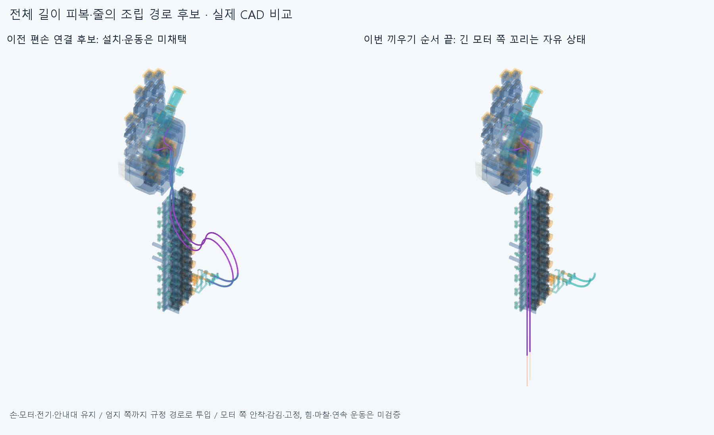

# THREAD040 전체 길이 피복·줄의 조건부 끼우기

**모터 쪽을 고정하기 전에 뒤 안내대부터 피복 두 개를 엄지까지 넣고, 자유로운 모터 쪽 끝에서 줄 두 개를 넣는 조립 경로를 검사했다. 전체 재료 길이를 유지한56표본과4개 고정경로 이동공간은 겹침/연산실패0이다. 모터 쪽 긴 꼬리는 아직 자유 상태이고 전체 설치·운동·장력 승인이 아니다.**

## 현재 구성과 순서

손397/포장385/전기48선·16외곽/팔10/PAIR034하드웨어6을 모두 둔다. SUPPORT038의모터아래죠/고정굽힘관2와ENTRY035위죠/입구도유지한다. 기본손364의본체·축·길이/모터·랙/전기·끝구/죠·안내대형상변경0,새하드웨어0,이전STEP/STL **5350개해시불변**이다. 실제모터20축/전체손배선·전달계를완성한것이아니다. 옛짧은피복/보어축프로브/실패긴곡선/BIARC039전체줄/증거형상은새재료와중복설치하지않는다.

중립손목/편손을고정한다. 모든기존하드웨어는명목CAD착좌상태로존재하고삭제부품0,처음에는두피복과두줄이없다. 죠/체결품의실제조임·탄성압착/마찰은모델에없고피복의최종체결은아직승인하지않는다. 긴꼬리·기존편손하류곡선과보어밖줄감김은작업자가수동유지하는기하조건이다. 수학적원호접속점에없는가이드/텐셔너를설치한것이아니다.

1. **아래 피복 전체**를PAIR뒤입구(90,-178.729833462,-3)mm/+Y에서넣는다. 뒤에남은길이는-Y직선이며PAIR실제S보어→기존편손하류곡선→아래끝구피복어깨까지간다. 10표본이다. 다음단계에서는이피복전체를마지막위치에둔다.
2. **위 피복 전체**를(110,-178.729833462,2)mm/+Y에서같은순서로넣되실제ENTRY035의12mm직선/R20굽힘과위끝구까지통과한다. 12표본,아래피복전체가장애물에포함된다.
3. **아래 맨줄 전체**의끝을자유로운피복뒤끝에서넣어전체피복·기존라이너/손쪽통로를지나R7.7감김/자식고정꼬리의선언끝까지배치한다. 15표본,두피복전체가있다. 라이너밖감김/꼬리는작업자가따라배치하는규정경로이며공중곡선을보어로보거나실제매듭/고정력성공이라하지않는다.
4. **위 맨줄 전체**를넣어위종단뒤의기존R7오프셋두개를역방향으로거쳐라이너·감김·고정꼬리의선언끝까지배치한다. 19표본,두피복과아래줄전체가있다.

모터쪽피복끝을먼저양의어깨정지부에고정한뒤그정지부를뚫고긴재료를통과시키는가정은쓰지않았다. 이번순서끝의모터쪽피복과줄은자유끝이므로SUPPORT038모터안내관삽입/조절부·R5통로/모터감김·꼬리고정이완료된것이아니다. 기존100/220mm국부삽입결과를이번긴꼬리검사로대체인용하지않았고56표본모두새로계산했다.

## 같은 재료 길이와 자유 꼬리

BIARC039의저장편손기하에서선언한피복전체길이 **698.964345153791/761.108456948670mm**와모델줄전체길이 **853.356663204892/932.491923574900mm**를이번별도조립후보의재료길이로명시했다. 원래독립7자세족의운동실패/CONTACT036목표미수렴·LENGTH037실패를덮거나성공으로이름만바꾼것이아니다. 확정절단/공급길이·실제매듭/신장/예압·기존±2mm조절필요범위가아니다.

고정된경로의호길이좌표에서선단t와재료길이L을사용해각순간재료구간을 **[t-L,t]**로잘랐다. 처음뒤꼬리는입구접선의직선이며실제보어/저장편손하류곡선/현재라이너·감김을따른다. 새원호/길이목표·R경계/최적화·Newton·독립막대/거리장탐색은없다.56표본길이잔차최대 **5.11590769747e-12mm**,조각끝점차최대 **5.68434188608e-14mm**,같은재료좌표9개씩총504점의위치를저장했다. 이는명시한규정끼우기경로의재료좌표이며실제탄성평형/장력하의슬라이딩·히스테리시스검사가아니다.

엄지끝에피복이도착해도PAIR뒤에는아래 **450.718799714381mm**,위 **457.936843217780mm**의피복꼬리가직선으로남는다. 각각기존편손상류자유길이+모터고정통로91.831853071796mm에해당하는재료이며모터안내관에이미들어갔다고세지않는다. 이직선꼬리를실제모터쪽으로돌려안착시키는일정길이변형은이번에풀지않았다. 줄의자유끝은해당피복뒤끝보다아래 **95.588102601652mm**,위 **87.588102601660mm** 더뒤에남는다. 이값은이번자유끝조립후보만의값이며필요텐셔너/보상기/조절량규격이아니다.

## 실제 재료와 전체 이동공간

[56유한표본](reviews/check.json)은매순간현재전체5장애물그룹,앞단계에서넣어둔모든재료,새움직이는재료의자기조각쌍을검사했다. **379069쌍/1793AABB native후보/겹침0·연산실패0**이다. 두물리피복/두줄을CAD조각으로분할한것이며조각수가새안내대/중간연결구수라는뜻이아니다. 시작/끝8상태의실제STEP/STL을저장하고중간48상태는규정기하·길이·재료점/원시native결과를저장했다.

[4이동공간](reviews/envelopes.json)은각과정의고정경로에서t∈[0,T]일때재료구간의합집합이정확히 **[-L,T]**라는구간관계를사용한다. 같은원형/환형단면을같은직선·원호에놓은전체점유영역을새CAD로만들었다. 각순간의피복/줄전체보다긴영역이지만설치부품/추가재료가아니다. 각공간대현재전체5그룹/해당과정의앞서설치한재료/공간자기조각쌍 **46150쌍/257AABB native후보/겹침0·연산실패0**이다. 두이동을동시에했다고가정하지않고앞서끝난재료는마지막위치에둔다.

이근거는명시한고정경로의끼우기중점유기하에한정한다. STEP차집합으로모든순간포함관계를다시판정하거나과거PAIR034두STEP포함관계false를해소한것이아니다. 원형단면·호길이구간의합집합관계와새전체점유CAD의native검사를구별한다. 보어밖긴꼬리가자유상태에서스스로직선/저장곡선을유지한다는뜻이아니며실제수동접근/공구·지그/실제재료굽힘/중력·비틀림/압착·좌굴/마찰·밀어넣는힘/예압·장력/실제줄끼우기나연속부모·손목왕복승인은없다.

모든native의보고기준은 **0.001mm³초과**,Boolean허용오차 **1e-6mm**,OCC풀 **1**이다. 공급품허용굽힘/수명·제작법/공차/나사산·토크/강도·외형수용은미검증이다. 각도제한/피복외경축소/손·모터·랙·전기선의이동이나절삭은없다. 그림왼쪽은미채택BIARC039전체편손연결,오른쪽은이번순서끝의자유모터꼬리상태다. 양쪽모두실제CAD이며오른쪽을완성모터연결로해석하지않는다.

## 다음 단계와 남은 비교

이번56표본/4공간/끝낸국부삽입은닫는다. 다음은자유모터피복꼬리를같은재료길이로실제SUPPORT038바깥출구에접근시키고정지어깨까지넣는순서와,맨줄꼬리를실제조절부/R5통로에끼운뒤모터감김·고정을하는순서다. 곡선제어점을설치지지로세거나없는텐셔너를더하지않는다. 그뒤전체재료길이·축슬라이딩·두선/하드웨어접촉을함께만족하는자연스러운부모·손목잡기/풀기를연결한다. 전체실물/공급품인증을다음CAD/요청3~4동작영상의끝없는전제조건으로늘리지않는다.

BIARC039원래source내부1/새STEP2동일줄인접접합목록차이의core_initial=false/명시재현false,CONTACT036원래실패·검토복구/LENGTH037실패,PAIR034두STEP포함관계false·3000점분류일치보류,OFFSET024면false·한점모순/HOUSING027·GUIDED030·ELASTICA033기본적분false·정밀보조는재검사/해소하지않았다. 작은동일줄접합을0으로맞추거나새손결함으로바꾸지않고다음기계작업을무한히막지않는다. 같은에이전트의정확SHA새사본검토는독립감사가아니고측정서명은모든곡면식·trim·Boolean동등성증명이아니다.

## 정확 SHA 새사본 재검사

대상`e5607e7abdfe78dd066a6762ac82b4a2f7ff5bcb`의새깨끗한clone에서84native/16대표꼬리·종단서명/56재료상태504점과4구간값을대조했다. **core=true,차이=[]**,의존6702/동결222/OCC1이다. [실제한정범위와미재검사](../../docs/reviews/THREAD040/README.md). 최종4재료는총52CAD조각이며저장8상태56/4점유공간52을설치108부품으로세지않는다. 같은에이전트검토이며실물/모터쪽안착/전체운동·장력·외형승인이아니다.
