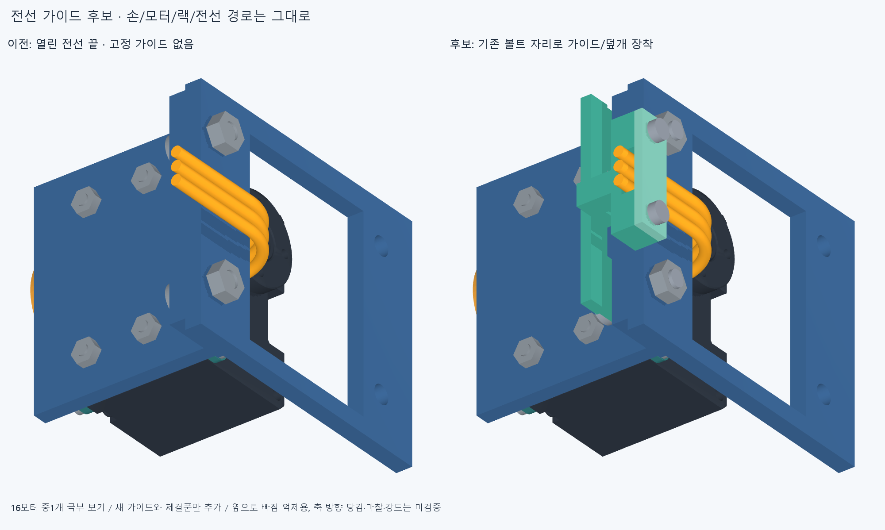
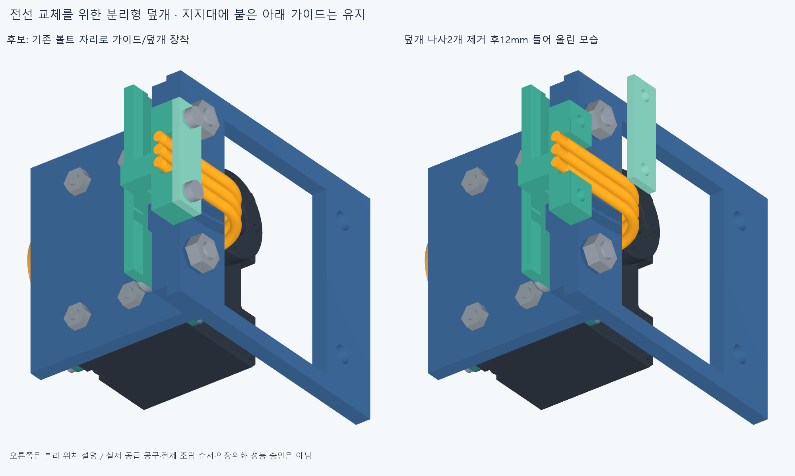

# WIRE011 · 받침에 체결하는 분리형 전선 가이드

기존 볼트 자리를 사용하는 가이드16개로 전선48개의 위치를 잡는 후보를 만들었다. 손364부품·관절축·길이·모터 위치·랙과48전선 경로는 바꾸지 않았다. **옆으로 빠지는 것을 막는 가이드이며, 축 방향 당김을 막는 스트레인 릴리프는 아직 미검증이다.** 전선을 꽉 압착했다고 쓰지 않는다.

초록은 새 가이드와 덮개다. 그림은16개 중 모터1개의 국부 보기이며, 랙은 그림에서만 잘랐다. 실제 검사에서는 전체 랙·포장 부품을 썼다. 기존 모터 체결면 아래에서 연결된 받침으로 가이드를 지지하고 기존 두 M3 축을 사용한다. 단순 떠 있는 결속구나 끝점을 고정 완료로 세지 않았다.

## 실제 구성과 받침

모터마다 연결된 가이드 하부1개·분리형 덮개1개·M2 나사/너트2쌍을 추가했다. 기존32개 M3×8 외곽 대신 M3×12 외곽과1mm 스페이서32개를 별도 후보로 모델링했다. 새 부품160개와 기존193개 참조로 포장 후보353개이며, 전선48개/커넥터 외곽16개와 손364부품은 별도다. 이전225부품 후보나 모터 설치 수에 새 가이드를 모터로 더하지 않는다.

M3 머리는 기존 일반 외곽을 승계한 것이며 실제 공급 나사 품번·머리/드라이브·나사산·토크/축력 검증이 아니다. 스페이서는 별도1mm 링 후보, M2×6/너트는 비나선 외곽이다. M3 축 끝은 Z−70mm, 기존 너트는 Z−73~−70.6mm로 명목상0.6mm 돌출한다. 이 값을 실제 완전산/체결 강도 승인으로 쓰지 않는다.

가이드 발의 윗면은 기존 어댑터 아랫면 Z−79mm에 닿는다.16개 모두 BRep 거리0을 확인했고 각 두 볼트 주변의12위치에서, 그 면 아래는 가이드 재료·바로 위는 어댑터 재료인지 원본 솔리드의 안팎 분류로 확인했다. 전선48개도 명목 외경1.9mm의 바닥점이 홈 바닥 Z−69.75mm에 닿는 거리0을 확인했다. 단순 경계상자 접촉만을 지지 근거로 쓰지 않았다. 그루브 폭7.5mm·높이2.4mm와 덮개가 횡방향 이탈을 억제하지만 축 방향 미끄럼·마찰·당김 하중·피로·절연체 마모·인쇄 강도/공차는 미검증이다.

## 간섭과 실제 조립 순서

새160부품 대 기존193부품30880쌍, 새 부품끼리12720쌍, 새 부품 대48전선7680쌍/16커넥터 외곽2560쌍에서 보고 기준 이상 재료 겹침0·연산 실패0이다.5손끝자세 각각 손364부품 전체와 새 부품을 대조했고 중립 팔 참고10부품과도 같은 결과다. AABB 후 native Boolean, 보고 문턱0.001mm³ 초과·허용오차1e−6mm다. 기존 부품끼리의 미해결 손바닥8쌍은 이 검사에 포함해 없어진 것으로 세지 않았다.

조립 순서가 필요하다. 좌우 모터를 모두 채운 뒤 가이드16개를 왼쪽에서 한꺼번에 넣는 시도는5표본 합계84겹침 기록으로 막혔다. 좌측 모터를 뺀 뒤 우측 가이드를 X−20mm부터 수평 이동하는 시도도6쌍 기록으로 랙에 걸렸다. 기존 모터 하부 M2 나사/너트가 설치된 상태에서 M3를 축 방향으로 넣는 시도도128쌍의 표본 겹침 기록으로 막혔다. 서로 다른 위치에서 같은 부품이 반복된 기록이며 그 수만큼 독립 결함이 있다는 뜻이 아니다. 원본 `service.json`의 required_sampled_paths_clear는 false로 보존한다. 최종 위치가 맞는다는 이유로 조립 가능하다고 승계하지 않는다.

대안은 우측 가이드를 X−15/Y+8mm 옮긴 위치에서20mm 아래로 두고 올린 뒤, Y를0으로 옮기고 X를0으로 넣는 세 구간이다. 첫 Y+10mm 대안은 첫 줄 가이드가 랙 가로대와25.037009mm³ 겹쳐 따로 보존했다. Y+8mm 진입은 좌측 모터가 없는 조건에서 각 구간5표본, 합계15행에서 보고 기준 이상 겹침0을 확인했다. 좌측 가이드의 원래5표본 삽입은 통과했다. M3는 모터/크래들의 하부 M2 나사·너트를 아직 달지 않은 단계에 먼저 넣어5표본을 확인했다. 나중에 M2 나사/너트를 각각 ±X8mm에서 넣는5표본씩은 **새 가이드/체결품과의 대조만** 통과했다. 원래 모터 내부/자체 체결·공구 경로까지 통과한 것이 아니다. 모듈과 부품을 잡을 조립 지그도 아직 모델링/검증하지 않았다. 이 조건부 순서는 전체 모터 설치/조립 승인과 구별한다. `assembly_order.json`과 `assembly_order_v2.json`에 실패와 후속을 나누어 남긴다.

하부 M2 체결품이 없는 조건의 M3 삽입은 Z−12/−9/−6/−3/0mm, 덮개 나사 분리는 Z0/2/4/6/8mm, 나사 제거 후16덮개의 들기는 Z0/3/6/9/12mm에서 확인했다. 덮개 두 경로는 최종 고정 가이드·전선·포장 부품·중립 팔 대조에서 보고 기준 이상 겹침0이다. 원본 서비스30행과 대안 순서30행은 별도다. 이산 표본이고 실제 공구/손가락 접근·선 교체의 유연 변형·연속 충돌·하중·전체 분해 순서 승인과 구별한다. 하부 가이드 교체에는 모터 하부 체결품 분해와 위 조립 순서가 필요하며, 덮개만 열어 전선을 다루는 작업과 다르다.

## 남은 범위와 다음

전선 외경1.9mm·반경10mm·직선5mm는 기존 기하 모델의 가정이다. 실제 공급 케이블/단자와 굽힘 수명은 미확정이며 선 색은 핀 순서가 아니다. 커넥터16개는 중공 하우징이 아닌 외곽 상자이고 모터 전체/헤더와 약39.270093mm³ 겹치는 이전 미해결 결합을 보존한다. ROBOTIS21AWG/JST 단자 최대22AWG 차이를 이 모델로 인증하지 않는다. 출처는 [기존 제조사 자료](../wiring_layout_v1/references_current.json)에 보존했다.

다음은 조건부 순서에 필요한 모터 하부 체결/모듈 설치 경로와 조립 지지 계획, 실제 공급 케이블/커넥터 근거·축 방향 당김 방지·연결 버스/보드용 임시 종단 공간이다. 가이드의 작은 틈 최적화로 돌아가지 않는다. WIRE008의 손바닥 고정 모터8쌍은 여전히 미해결이고 전체20모터 배치/장착·혼/스풀·구동 텐던·팔/손목 연속 케이블·보드·전원/전류·50/100ms 실물 성능은 미완이다. 현재 전선 끝은 연결되지 않은 공간 후보다.

코드·입력/구성·160새 부품 STEP/STL·기존 참조·검사·실패 조립 순서·조건부 대안 순서·전후 그림을 커밋/정상 푸시한다. 정확SHA의 새 깨끗한 clone에서 새160형상을 재생성/재수입해 해석적 면/경계/꼭짓점/속성을 대조하고 주요 재료·받침·전선 접촉·5손끝자세·중립 팔과 원본/대안의 핵심 서비스 표본을 재현한다. 원본/대안60행 전부와 그림 렌더를 다시 수행한다고 쓰지 않는다. 같은 에이전트 검토이며 독립 감사가 아니다. 이전 WIRE009의 일치 경계면 Boolean 판정 불가는 보존하고 이를 손 CAD 결함이나 전체 core 통과로 바꾸지 않는다.
