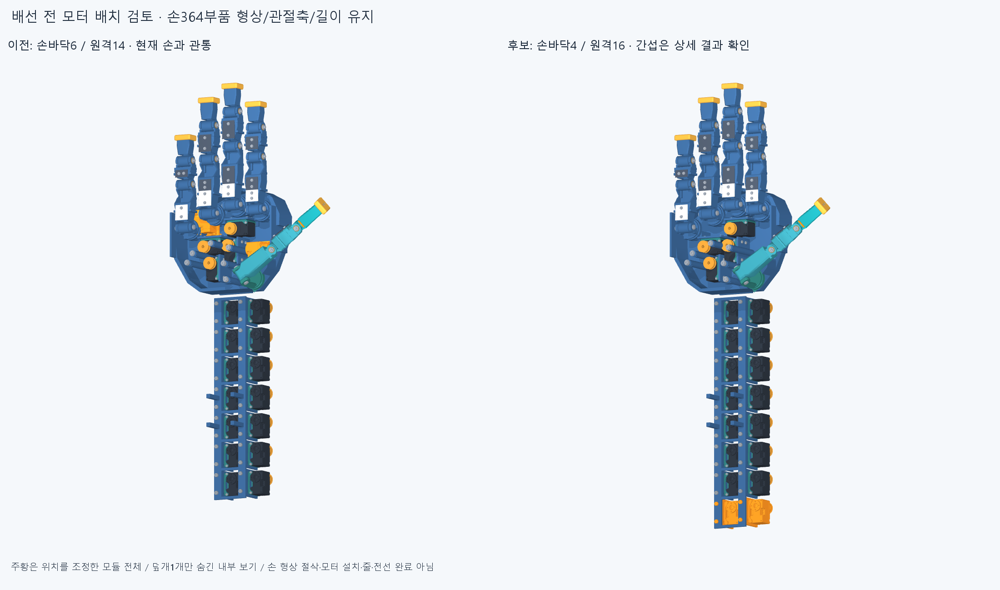

# WIRE008 · 배선 전 실제 모터 배치 확인

최신 손 동작을 미세 조정하는 반복은 닫고, 모터·커넥터·배선 준비로 넘어왔다. 현재 손364부품에는20모터가 통합되어 있지 않다. 과거20모터 배치를 그대로 설치 완료로 간주하지 않고 현재 STEP와 다시 대조했다. 손364부품의 형상·축·길이는 바꾸지 않았다.

덮개1개만 숨긴 내부 보기다. 실제 검사에는 손364부품 전체를 포함했다. 주황은 위치를 조정한 두 모듈 전체이며 실제 겹침 체적이나 손 절삭 부위를 뜻하지 않는다. 현재 오른쪽 후보도 간섭이 남아 채택하지 않았다.

## 실제로 확인한 차단 항목

이전 손바닥6/원격14 배치의217개 포장 부품을 현재 손364부품과 편 손에서 검사해39쌍의 재료 겹침을 확인했다. 가장 큰 예는 새끼 MCP 모터와 약지 고정 뿌리의 약1145mm³ 겹침이다. 현재 외형에 이전 배치의 승인이나 수치를 승계하지 않는다.

검지/새끼 MCP 모터 모듈2개를 전완 끝의 추가 한 줄로 옮긴 손바닥4/원격16 후보를225포장 부품으로 저장했다. 해당 랙은42mm 길어졌다. 편 손·최신 엄지척·중지 앞 교차·25mm 구 접근·추가 복합 손모양의5끝자세에서 각각8쌍의 겹침, 연산 실패0이다. 같은 고정8쌍이 반복되며40개의 서로 다른 설계 결함으로 세지 않는다.10개 중립 팔 참고 부품과의 겹침은0이다. 실제 팔 회전/손목 운동·장착·연속 경로·체결 강도 승인으로 쓰지 않는다.

남은8쌍은 엄지 뿌리 회전/대립과 약지 MCP의 모터·프레임/스풀 대 손바닥/새끼 고정 뿌리다. 양쪽이 손바닥에 고정된 부품이므로 손가락 목표각 변경으로 사라지는 문제가 아니다. 손 외형을 깎기보다 모터 모듈 위치·방향·지지부를 먼저 수정할 대상이다. `reviews/overlap_locations.json`과 시험용 공통 체적 STEP/STL8개에 실제 겹침 중심·경계·체적을 저장했다. 이8개는 설치 부품이 아니다.

후속 탐색에서 엄지2모듈을 위로3/5/7mm, 약지 모듈을 같은 높이와 X+4/Y−8mm로 옮긴3후보도 각각 손과12쌍·서로 다른 모듈/랙 사이8쌍의 겹침이 남았다. 전부 채택하지 않았다. 이3실패를4/16 배치나 모터 통합의 불가능 증명으로 쓰지 않는다. 다른 모터 위치/방향과 실제 공통 체적을 이용한 공간 탐색이 다음 단계다. 지지부 접촉을 잃는 단순 높이 이동도 실제 장착 완료가 아니다.

## 보드가 없어도 진행할 배선과 남은 규격

모터 후보 XL330-M077의3핀 TTL은1:GND/2:VDD/3:DATA이며 입력은3.7~6.0V, 제조사 권장은5.0V다. 최종 모터 선정은 아니며 실제 결선/전원 인가는 하지 않았다. [현재 ROBOTIS 설명서](https://docs.robotis.com/ko/docs/dxl/model_reference/x_series/xl_series/xl330-m077/).

제조사 설명서는 EHR-03/B3B-EH-A/SEH-001T-P0.6와21AWG를 적지만, 해당 [JST 카탈로그](https://www.jst-mfg.com/product/pdf/eng/eEH.pdf)의 단자는30~22AWG·피복 외경1.0~1.9mm 범위다. 이를 임의로 동일하다고 결론내거나 이전22AWG 공간 모델을 공급 케이블 인증으로 쓰지 않는다. 실제 케이블 품번/압착 조합은 미확정이다. 과거 단순 EHR3 외곽 상자는 모터 커버와0.64mm³ 겹쳤으며 실제 중공 하우징·결합 깊이 대조 전에는 물리적 간섭인지 단순 외곽 때문인지 확정하지 않는다.

보드 종단은 임시 공간으로 두고, 배치가 확인된 모터부터 커넥터 출구·고정·리드/관절 여유와 케이블 통로를 설계할 수 있다. 전기 배선과 구동 텐던은 별개다. 아직 이 후보에는 새 전선이나 완성20축 전달계가 없고, 전류 용량·전압강하·발열·파지력·50/100ms 실물 성능도 미검증이다. 고정 모터 배치를 해결하거나 확인된 원격 모터의 리드부터 부분 설계하며, 이 실패 때문에 이미 해결한 손가락 자세를 반복 최적화하지 않는다.

## 실제 검사와 저장 범위

한 손 자세에서 손364×포장225=81900쌍을 대상으로 AABB 뒤 native Boolean 공통 체적을 확인했다. 보고 기준은0.02mm³ 초과, Boolean 허용오차1e−6mm다. 손 자체66066쌍을 이 단계에서 다시 검사한 것은 아니며 이전 자세 검사와 구별한다. 모듈 내부의 혼/스풀·나사·전달/끼워맞춤은 이번 포장 검사 범위가 아니다. 실패한3높이 후보에서는 서로 다른 모듈/랙의 간섭도 검사했고, 모듈 내부는 제외한 범위를 명시했다.

`build_screen.py`와 `refine.py`·입력/출처·저장 STEP/STL·실패 결과·전후 그림을 남긴다. 초기 메타데이터 직렬화 오류로 중단된 출력은 외부 작업 자료의 WIRE008_attempt1에 보존했고 완료 근거로 세지 않았다. 완료/입력 해시 통과 보고서만 채택한다. 이전 동결 파일·manifest는 변경하지 않았다.

커밋·origin 정상 푸시 후 정확 SHA의 새 깨끗한 clone에서 이전 편 손의 실패, 새 후보의 편 손/복합 자세 실패와 중립 팔 대조를 재현하고 후속 커밋으로 기록한다. 높이3후보 전부 재실행·그림 재렌더·전체 동작/실물 승인과는 구별한다. 같은 에이전트 검토이며 독립 감사가 아니다.
