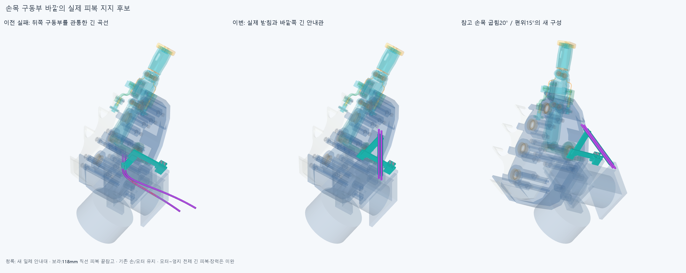

# FEED031 손목 바깥쪽 뒤 진입 안내대

**실제 손목 구동부를 피해 뒤에서 들어오는 두 안내관을 일체 받침에 연결했다. 새 후보의 손8/손목8참고 자세·조립30표본과 직선 끝참고 삽입 범위는 겹침0이다. 긴 모터~엄지 피복/줄·장력과 손 전체 구동은 아직 미완이다.**

## 실제 재료에서 정한 방향

GUIDED030의 실패 곡선을 다시 최적화하지 않았다. 실제 AK_wrist_flex/AK_wrist_deviation/Wrist_box_carrier/Palm_wrist_saddle STEP의 재료와 경계를 먼저 읽었다. 옛 X26축을 뒤로 늘린 Ø5검사외곽은 AK_wrist_deviation255.520642785/손목받침549.766793846mm³에 걸린다. 이 수치는 설치 피복이 아닌 **안내관 외곽 공간용 원기둥**의 값이며,편 손/부모완성의 일부 손4/팔4부품 대조다. 새 X100축은 그 한정 대조에서0이며,이후 실제 중공 안내대 전체를 현재 부품 모두와 별도로 검사했다. [survey](reviews/survey.json).

손목 캐리어는 실제 X0~70/Y−97~−33/Z−55.2~15mm,편위 모터는X5.5~58.5/Y−91.5~−38.5/Z−49.2~−4mm다. 두 실제 솔리드가 기존 편위축(32,−65,0),+Z의R60/Z−60~50mm원기둥 안에 있음을 차집합 재료0으로 확인했다. 새 두 안내관 중심은X100으로 축까지 최소68mm이고 외반경2.5mm다. 안내관 부분과 이 보수적 공간의native겹침도0이다. 회전의 축까지 거리/축방향좌표 불변을 이용한 **두 손목 참고부품 대 두 안내관 부분만의 상대 편위각 공간 근거**다. 원기둥은 설치 부품/규정 여유가 아니며 전체 받침/손/다른 부품/연속 손목 운동 승인이 아니다.

## 실제로 붙는 새 부품

generated/assembly_scene.json의새5(일체받침1+피복2/중심줄2참고)+기존5(앞덮개/M2볼트2·너트2)=10행이다. 하드웨어는6개이며10개 새 지지가 아니다. OUTLET029의wrist_inboard_guide_clip과옛4국부참고를 대신하며 같은 앞덮개/나사/너트5는 유지한다. 기존 손397/포장385/전기48선·16외곽/팔10과 이전STEP/STL 4530파일 해시는 불변이다. 실제20모터 설치/전체 구동 완료가 아니다.

새 두 중공 안내관은X100/Z−3·2/+Y,중심선Y−100~−4mm,각96mm다. Ø5/보어Ø3.2,피복OD3/ID1.3,줄OD0.6mm는 공간 가정이다. 실제 슬리브→X54~102일체 연결팔→뒤판/앞덮개/기존 두 명목M2→손목받침 벽의 반력 경로가 있다. 유효한 한솔리드이며 허공의 지지점이 아니다. 기존 벽의Y−6/0면·바깥X54모서리,나사X59/Z−55·−49와체결스택을 유지하고 손/손목에 구멍을 뚫지 않았다. 피복은 보어 안에서 축방향으로 미끄러질 수 있다.

신규 외곽은 손바닥 명목최대X90보다 오른쪽12.5mm까지 나오고 안내관이 뒤로96mm이어진 후보다. 사람다운 전체 외관 수용/재료·가공/인쇄/공차·강성/좌굴/내벽 마찰·마모/수명·실제 공급품·예압/미끄럼·6자유도 고정/하중/실제 공구·나사산/토크 승인은 아니다. 3좌석 거리0과±0.05mm재료 안밖은 명목 접촉 근거다.

## 새 후보의 검사 범위

[최종16자세](reviews/final.json)는 편 손/IP−15·45·85/기존 구접근 부모25·50·75·100%의 **손8(손목중립)**과,편 손에서 굽힘−20/0/20°×편위−15/0/15°조합 중 중립을 뺀 **손목8참고 자세**다. 새 안내대/국부참고10 대 손397/포장385/전기64/팔10과 내부45쌍,137005쌍/187AABB후보에서 보고기준0.001mm³초과 겹침0/연산실패0이다. Boolean허용오차1e−6mm/OCC풀1을 유지했다. 이 유한 표본은 새 관절 제한이나 전체 범위·연속 운동 승인이 아니다. 기존 손 자체/다른 기존 부품끼리/물체·모터출력회전/긴 유연피복·전기선 동적운동/힘은 새로 검사하지 않았다.

손목 참고 좌표계는 기존 팔 설계의 굽힘X축(0,−80,0)과편위Z축(32,−65,0)을 사용한H=P@Y다. 손397/손목안내대와손바닥 모터4·받침의39포장행은H를 따르고,전완346포장행/64전기외곽은 고정했다. 캐리어/편위모터는P,손목받침은H다. 이는 저장된 참고 관절의 공간 배정이며 현재 손-팔 실체결/강성의 승인이나 물리 동작이 아니다.

원래check.json의 후반 손목8은39손바닥 포장행까지 세계좌표에 고정한 범위 오류가 있어 승인 근거로 쓰지 않는다. 손목중립에서 같은 새 형상/입력/자세의앞8손검사만 검증해 승계하고,correct_wrist_scope.py에서 **손목8만 새로 계산**했다. 최종16=같은손8재사용+새손목8이며 원래잘못된8을합쳐24통과라하지않는다. raw보고서와 원래 코드를 보존했고 CAD/각도/기준은 바꾸지 않았다.

## 조립과 직선 끝부분의 삽입

[조립30표본](reviews/service.json)은 기존 성공을 무검증 승계하지 않고 새로 계산했다. 25755쌍/56AABB후보/겹침0·실패0이다. 피복/줄참고4는 아직 없고 현재 손/모터/전기/팔은 있다. 뒤안내대Y−20→0,앞덮개Y+12→0,볼트각Y+20→0,뒤너트각Y−20→0,각5표본이다. 실제 누락/설치 목록을 저장했고 체결전 수동 유지가 조건이다. 물리 지그·공구/손잡이/토크·강도는 미검증이다.

두 피복 끝참고는 각118mm(Y−110~8)의 직선이다. 이 직선을 뒤에서Y−128→0mm로 넣을 때 전 이동을 포함하는 같은 단면의 **정확한 축방향 압출 외피Y−238~8**을 만들었다. 양 끝 위치가 그 외피에 포함되고 외피와 현재 모든 부품/완성 안내대의native겹침0을 확인했다. 따라서 이 **직선118mm끝참고만의128mm삽입 스트로크** 범위를 나타낸다. 118mm는 실제 절단길이가 아니며,나머지 긴 유연피복의 뒤쪽 공간/굽힘·실제 전체 끼우기/구동줄 끼우기·마찰/당김·예압/반대방향 빠짐방지 승인은 아니다. 중간 구간을 없는 부품으로 설치 완료 처리하지 않는다.

## 남은 연결

새 장면은 바깥쪽 뒤 진입을 위한 실제 지지 후보다. 모터 종단→새 뒤입구(100,−100,−3/2)와새 앞출구(100,−4,−3/2)→실제 엄지 종단의 두 유연 구간은 아직 연결하지 않았다. GUIDED030의614/583mm/급한굽힘/가상미끄럼량,OUTLET029의옛X26/S경로를 새 축에 승계하지 않는다. 실제 종단 접근방향·지지/조립과 정방향/풀기의 전체길이/줄 조절·예압/끼임·당김을 이어간다. 손/모터/랙·전기선을 먼저 깎거나 옮기기,외경 임의 축소/각도 제한/팔꿈치 버스 확장으로 돌아가지 않는다.

정확SHA새깨끗한clone에서33native핵심대조·7원본/STEP측정서명·3좌석/두손목부품포함관계·삽입포함관계를 재검사한다. 나머지12자세/중간18조립/그림/힘·실물이나 전체곡면식/trim/Boolean동등성 증명이 아니다. 같은 에이전트 검토이며 독립 감사가 아니다. 이전OFFSET024/GUIDED030/HOUSING027의 원래false와정밀보조·보류를 재검사/덮어쓰지 않는다.
