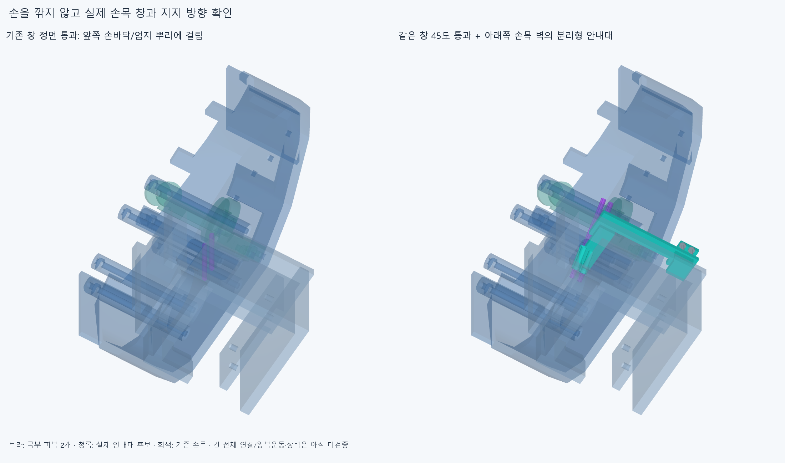
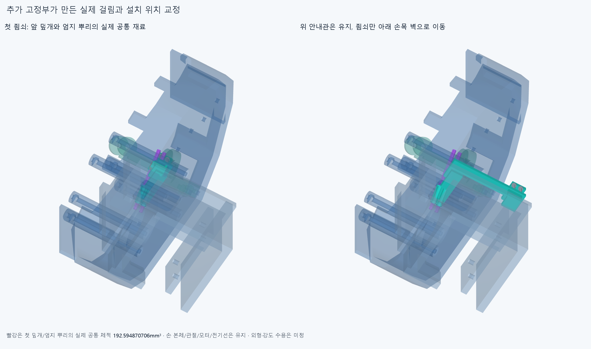
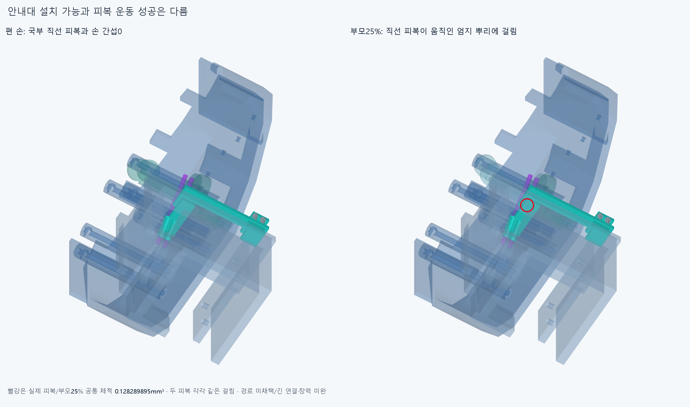

# WRIST028 기존 손목 창과 분리형 피복 안내대

**실제 손목 벽을 잡는 안내대6부품은 8정적 자세/30조립 표본에서 기준 이상 겹침0이다. 그러나 국부 직선 피복은 엄지 뿌리 움직임에 걸려 미채택이다. 긴 모터~엄지 연결과 구동 운동도 미완이다.**

## 기존 창을 정면으로 쓰면 막히는 이유

원래 Palm_wrist_saddle의 창은 X20~40/Y−6~0/Z−28~6mm,모서리R3이다. 실제 STEP의 재료 표본과 CAD를 읽었다. 정면 OD3공간 원기둥2개(X26/34,Z−11,Y−18~18mm)는 손목 창은 통과하지만 현재 손바닥 외피와 엄지 고정부에 3기록(32.059091982/23.472036737/95.877836065mm³)이 걸렸다. 창이 보인다는 이유로 앞쪽 손부품까지 통과한다고 하지 않는다. 원기둥은 검사 외곽이며 설치 피복이 아니다. [survey](reviews/survey.json).

이후 같은 창을 X=37+Y,Z−3/2mm의 두 방향으로 45도 통과한다. 관절/모터 설치각 변경이 아니다. 피복 OD3/ID1.3와 줄OD0.6mm는 그대로인 공간 가정이다. 각 국부 직선은 Y−18~18mm,길이50.911688245mm이며 전체 모터~손가락 피복 길이나 절단길이가 아니다. 피복2/중심줄2만 그렸다. 새로운 중간 커넥터4개가 아니다.

## 실제 부착과 실패 보존

새 하드웨어6행은 일체 안내대/뒤 죔쇠1,분리 앞덮개1,명목M2x16볼트2/너트2다. 원래 손목 벽의 바깥 X54모서리와 Y−6/0면을 잡는다. 두 볼트는 기존 벽 바깥 X59,Z−55/−49mm를 지나며 원래 재료를 뚫지 않는다. 안내관/연결팔/뒤 세로판은 유효한 한 솔리드이고 실제 손목 죔쇠로 이어진다. 구멍은 Ø3.2,안내관 외경Ø5mm다. 허공 waypoint를 설치 가이드로 세지 않는다.

첫 앞덮개는 엄지 뿌리 가동부와192.594870706mm³ 겹쳤다. 아래로48mm옮긴 두번째도 현재 손바닥과0.615993337mm³ 겹쳤다. 두 연구는 각각 편 손 첫 검사에서 멈췄으며 나머지7자세/조립 성공으로 세지 않는다. 최종은 앞덮개 Z−58~−46mm로 현재 손바닥 최저점−44.0003364523mm보다 아래에 두고 뒤 일체판으로 같은 안내관에 연결했다. 손 본체나 손목을 깎지 않았다. [첫 실패](reviews/check.json),[두번째 실패](selected/reviews/check.json),[이력](reviews/history.json).

GUIDE/RETAIN026 현재 손397,포장385,전기48선/16외곽,중립 팔·손목 참조10을 유지했다. 기존 STEP/STL 4282파일 해시는 불변이다. 새10CAD행은 하드웨어6+국부 피복2+국부 줄2이며,이전 HOUSING027의 실패한 긴 곡선이나 옛4짧은 끝참고를 중복 설치하지 않았다. 손목 지지 참조 자체의 전체 체결/구동 승인은 아니다. 새 돌출/외형과 재료·강도 수용은 미정이다.

## 검사와 조립 범위

[국부 경로5정적](selected2/reviews/check.json)은 편 손/IP−15·45·85°에서는0이지만 기존 구 접근 부모25%에서 두 피복이 thumb_root_spread_carrier와 각0.1282898952mm³ 겹쳤다. 새10 대 손397/포장385/전기64/중립 팔10,새45내부쌍을 포함한 42845쌍/99AABB후보 범위,겹침2기록/연산실패0이다. 이후 피복의 부모50·75·100%는 실행하지 않았다. 경로는 미채택이며 한 자세의 작은 관통을 손 절삭이나 각도 제한으로 숨기지 않는다.

[안내대8정적](selected2/reviews/hardware_follow.json)은 첫5의 새10대조에 이미 포함된6하드웨어의0결과를 승계하고,나머지 부모50·75·100%에서6하드웨어만 15408쌍/13AABB후보로 추가계산한 범위다. 그6하드웨어의8자세 겹침0/실패0이며 막힌 피복까지8자세 통과한 것이 아니다. Boolean허용오차1e−6mm/보고기준0.001mm³/OCC풀1을 유지했다. 손 자체·물체·연속왕복/모터출력 전각도·동적전기선/긴 피복·장력은 검사하지 않았다.

[조립30표본](selected2/reviews/service.json)은 줄/긴 피복을 아직 끼우지 않고,뒤 안내대를 Y−20→0mm로 넣음→앞덮개 Y+12→0→볼트 각Y+20→0→뒤 너트 각Y−20→0순서다. 각5표본,총30을 모두 새로 계산했다. 25755쌍/43AABB후보/겹침0/실패0이다. 기존 손/모터/전기부품은 계속 있다. 앞 부품/체결품은 실제 해당 단계부터 장애물에 더했다. 아직 없는 것은 새 국부 피복/줄4참고뿐이다. 죔쇠가 체결될 때까지 수동 유지한다는 조건이며 실제 지그/공구/손잡이·나사산/토크/공차/공급품 검사는 아니다. 긴 피복의 끼우기/끝종단 체결도 아니다.

뒤/앞/바깥모서리3좌석의 거리0과±0.05mm 재료 안밖을 확인했다. 실제 안내관의 두 줄 각각 양쪽 법선0.2mm변위는 기하정지4건을 만들었다. 중심의 반경차0.1mm에서 더 움직이면 보어가 막는다는 국부 근거다. 허용마찰/굽힘/수명 규격이나 실제 정하중·마모/피복 압착/줄 끼임·축방향 고정/장력 승인이 아니다. 피복이 안내대 안에서 축방향으로 미끄러질 수 있고,손목 벽의 위아래 미끄럼은 죔쇠 예압/마찰에 의존한다. 6자유도 강성/힘 전달 완료로 세지 않는다.

## 남은 연결

안내대의 실제 부착몸체는 Palm_wrist_saddle이며 현재 중립 손목의 세계좌표만 검사했다. 손가락 FK8정적은 손목운동이 아니다. 부모/손목 잡기·풀기에 따른 긴 피복 형상/일정길이·끼임/당김·내벽 접촉/예압과 전체 모터~엄지 연결은 없다. 두 물리적 긴 피복의 양끝은 아직 서로 연결되지 않았다. 기존542mm/가상 보정기18.705669mm를 이 안내대의 규격으로 승계하지 않는다.

다음은 이 실제 안내관의 입출구를 써서 모터종단~손목안내대~엄지종단을 연결하고,현재 종단의 조립/길이 조절·예압과 부모/손목 풀기를 확인한다. 곡선 계수는 설치 지지가 아니며 모든 물성/실물 인증을 다음 CAD나 요청3~4동작 영상의 조건으로 무한히 늘리지 않는다. 팔꿈치 전기버스는 보류다.

다음 연결은 부모25%에서 막힌 직선 출구가 실제 안내관 끝 이후 어디에서 걸리는지 확인해 유지 가능한 굽힘/지지를 설계해야 한다. 기존 손가락 각도/형상을 바꾸거나 현재 직선 연장을 통과로 세지 않는다.

정확SHA 깨끗한 새 사본에서 새10원본/STEP적응 적분·유형별 측정서명,선택 핵심 정적/조립·부모25%와 원래 실패/좌석을 재현한다. 같은 에이전트 검토이며 독립 감사가 아니다. 측정서명은 모든 곡면식/trim/Boolean동등성 증명이 아니다. OFFSET024의 면 비교 보류와 HOUSING027의 원래corefalse/한쌍 적분보조true는 재검사/해소하지 않는다.
