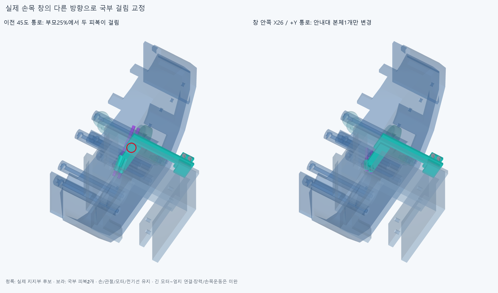

# OUTLET029 손목 창 안쪽 안내관으로 국부 경로 교정

**안내대 본체1개만 바꿔 국부 피복까지 8정적 자세/30조립 표본의 기준 이상 겹침0을 확인했다. 손·관절축·모터·전기선은 유지했다. 모터~엄지의 긴 피복/전체 구동은 아직 미완이다.**

## 실제 걸림에서 판단

WRIST028 저장 공통형상을 읽었으며 원래 교차연산을 반복하지 않았다. 중심(41.868121153,2.933835558,−3)mm는 안내관 중심선 끝에서 축방향11.173670746mm앞이다. 외경을 줄이지 않고 R20/±45° 단일 굽힘 두 후보를 비교했으나 부모25%에서 각각4/10구간 기록으로 실패했다. 총20820쌍/116AABB후보/14겹침기록/연산실패0이다. 나머지7자세씩은 실행하지 않았다. [두 원형 후보](reviews/probe.json).

실제 손바닥/엄지 회전부/손목 두 부품의 단면에서 두 기둥을 확인했다. Z−3/8mm,부모25/100%의 [부분 단면](images/material_sections.png)은 실제 native재료 교선이며 전체 손의 빈 공간 승인이 아니다. 그 단면을 바탕으로 R20의 +45/−90° S자 한 후보를 실제 엄지 종단의 피복어깨와 줄 입구까지 연결했다. 부모25%에서 회전부2쌍(각2.897675138mm³)과 엄지 첫외피의 피복25.862850169/줄1.273666639mm³,총4기록이 남아 미채택했다. 17430쌍/171AABB/실패0이다. 자유곡선/반경 탐색은 여기서 닫았다. [S 후보](selected/reviews/check.json).

R20/OD3·ID1.3/줄0.6mm는 공간가정이며 공급품 허용굽힘/수명 규격이 아니다. 원형 계수나 S곡선은 설치 가이드가 아니다. S끝을 실제 종단에 맞춘 것은 모터쪽 연결/지지/예압·전체길이 유지 승인이 아니다. 몇 실패를 손이나 모든 배치의 불가능 증명으로 쓰지 않는다.

## 실제 안내대만 교정

마지막은 같은 손목 창의 안쪽 X26mm에서 +Y방향으로 통과한다. 이전45도 통로를 억지로 유지하지 않고 **손목 안내대 본체1개만 교체**했다. 국부 피복2/중심줄2도 그 축으로 바꿨다. 명목Ø3.2보어/Ø5안내관,피복OD3/ID1.3·줄0.6mm는 유지한다. 두 중심Z−3/2,안내관Y−14~−4,피복참고Y−18~18mm다. 각36mm의 국부 참고이며 전체/절단길이가 아니다. 기존50.911688mm나542mm를 같은 설치 길이로 승계하지 않는다.

inboard/generated/assembly_scene.json의새5행(본체1+국부참고4)+기존하드웨어5=10행을 쓴다. 옛wrist_oblique_guide_clip과4옛국부참고를 또 더하지 않는다. 기존 앞덮개/M2볼트2·너트2/손목벽 접촉면·체결좌표와 기존 손397/포장385/전기64/중립팔10을 유지했다. 이전 STEP/STL 4356파일 해시는 불변이다. 추가/외형 수용이나 실제20모터 설치 승인은 아니다.

## 검사 범위

[8정적](inboard/reviews/final.json)은 편 손/IP−15·45·85/기존 구접근 부모25·50·75·100%의 새5+유지5 대 손397/포장385/전기64/중립팔10과 내부45쌍이다. 68525쌍/116AABB후보에서 보고기준0.001mm³초과 겹침0/연산실패0,Boolean허용오차1e−6mm/OCC풀1이다. 손 자체·물체·전기선 동적운동/전체 손목왕복·장력검사는 아니다.

실제 thumb_root_spread_carrier를 기존 회전축 중심의 R18,Z−20~40mm원기둥이 포함함을 차집합 재료0으로 확인했다. 새5와 그 회전공간도0이다. 원기둥은 보수적인 수학적 포락체이며 설치 부품/요구 여유 규격이 아니다. 해당 회전부의 축방향 좌표/축까지 거리 불변을 사용한 **그 부품의 전 뿌리회전각 공간 근거**다. 다른 손부품/전체 관절/긴 피복 연속 운동으로 넓히지 않는다.

[조립30표본](inboard/reviews/service.json)은 새로 계산했다. 25755쌍/41AABB후보/겹침0/실패0이다. 국부 피복/줄4참고는 아직 없고 기존 손/모터/전기부품은 있다. 뒤 안내대Y−20→0,앞덮개Y+12→0,볼트각Y+20→0,뒤 너트각Y−20→0,각5표본이다. 새 본체에 옛 조립 성공을 무검증 승계하지 않았다. 각 단계 설치목록과 나중 부품 부재를 저장했다.

3좌석 거리0/±0.05mm 재료 안밖,두 피복의 ±X0.2mm기하정지4개도 확인했다. 실제 수동 지지/지그·공구/손잡이·공급 나사/나사산/토크·예압/마찰·축방향/벽 위아래 미끄럼/강성·강도·수명/인쇄공차는 미검증이다. 접촉과 실제 고정하중 승인을 구분한다.

원래 inboard/reviews/check.json은8native자세를 모두 끝낸 뒤 catalog의hand키를 잘못 읽어 completed=false로 남았다. history의 실행코드/오류를 보존했다. finalize_inboard.py는8ID/각도/입력해시/설치장면을 검증해 집계만 완료하고 별도 뿌리회전 공간을 새 계산했다. **8정적 native재실행0/기존결과 수정0**이다.

## 남은 실제 연결

현재 채택은 실제 안내대/국부 통로의 명목 후보 범위다. 긴 모터종단→이 안내대→엄지종단은 아직 연결되지 않았고,S자 실제 종단 연결은 실패 자료다. 축방향 미끄럼이 가능한 안내대에 가상의 고정 길이점/장력보정기를 만들지 않는다. 다음은 새 입출구와 실제 양끝을 이어 전체 길이·부모/손목 잡기/풀기·끼임/당김/줄 끼우기와 길이조절/예압을 확인한다. 끝낸 국부8정적/30조립·작은틈을 반복하거나 손 절삭/각도제한/팔꿈치버스로 돌아가지 않는다. 실물 인증을 다음 CAD/요청3~4동작 영상 조건으로 무한히 늘리지 않되 영상과 실제 힘 검증을 구분한다.

정확SHA새깨끗한clone에서44native핵심 대조,새5와실패대표3의8원본/STEP측정서명·3좌석/회전부 포함관계를 재현한다. 같은 에이전트 검토이며 독립 감사가 아니다. 모든49형상/곡면식·trim/Boolean동등성 증명이 아니며 이전OFFSET024/HOUSING027의 비교 보류는 재검사/해소하지 않는다.
