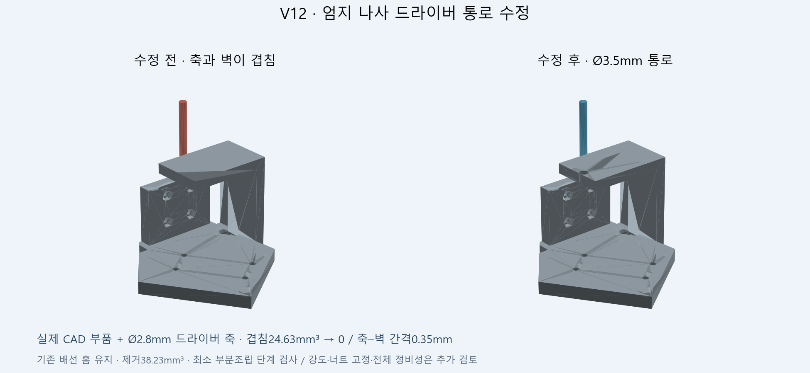

# CP001 — V9 기준 보존, V12 감사 대응 후보

2026-10-24 KST (2026-10-23 UTC). 이 체크포인트는 현재 설계와 남은 문제를 재검토 가능한 상태로 기록합니다. **제작·구동 승인 아님.** 커밋 후 검토는 별도 보고서로 추가합니다.

## 실제 형상 수정

- V10: 엄지 중수골에 고정 출선을 위한 채널 후보.
- V11: 새끼손가락 출력 부품 두 곳에 넓은 일체형 배선 받침. 140 mm 자유구간의 세 가닥 기하 루프 후보. 전선의 실제 탄성 형상은 아닙니다.
- V12: 엄지 PIP 첫 번째 체결 나사에 접근하는 Ø3.5 mm 공구 통로. 기존 V10 부품에서 38.231 mm³만 제거하고 축·체결 위치는 유지했습니다. 최소 부분조립에서 Ø2.8 mm 축과 벽의 겹침 24.630 mm³를 없앴고, 축–벽 간격은 0.35 mm입니다. 전체 조립 중 모든 공구 자세를 검사한 결과는 아닙니다.

V12 손 조립 파일은 252개 객체, 976개 솔리드입니다. V9 감사 기준본의 손+팔 전체 CAD와는 별도 파일입니다.

## 독립 감사 지적에 대한 현재 답변

| 지적 | 이번 처리 | 아직 남은 것 |
| --- | --- | --- |
| 팔 토크 부족 | 기존 부족 결과를 유지하고 감속·중력 보상·큰 모터 대안을 조건부 계산 | 설계 선택, 실제 플랜지/질량/관성·열·속도·예산 반영 |
| M077 속도에 0.7 A 제한 미반영 | 그 속도를 성능 보장으로 사용하지 않음. 입력 전류와 상전류를 구분하도록 수정 | 실물 1관절 응답과 토크–속도/열 모델 |
| 동시 벌림 오차에서 충돌 | 받은 감사 코드의 6개 시험을 재실행해 같은 결과 확인. 별도 연속 오차 상자 검사 추가 | 전체 관절 한계와 결합 오차 여유, 필요 시 CAD 개선 |
| 엄지 약지·소지 도달성 | 감사의 거친 탐색 결과를 미확정으로 표시 | 충돌 포함 정밀 IK/접촉 탐색. 불가능 확정 아님 |
| 엄지 공구 접근 | 최소 부분조립에서 실제 BRep로 막힘 제거 확인 | 전체 공구 접근·나사 삽입/조임·너트 유지 |
| 두 번째 포트 배선 | 고정 출선/새끼 한 구간 후보를 보존 | 전원 분배·분기·전류·신호·고정·모든 관절 루프 |
| 열린 너트 포켓 | 미해결로 유지 | 분해성을 유지하는 리테이너/조립 지그 설계 |
| 구조 해석 하중 부족 | 각가속도·구심가속도 포함 하중 예시 추가 | 반작용·FDM 이방성·체결/접촉·피로 포함 해석/실측 |
| 팔 검사 범위 밖 접촉 | 알려진 두 쌍을 1° 간격으로 다시 검사하고 제한된 구간의 연속 경계 계산 | 모든 축이 동시에 움직이는 전체 팔 공간 검사 |

## 오차 검사에서 확인한 것

받은 독립 감사 코드를 그대로 재실행한 결과, 네 손가락 벌림 ±3° 조합 81개 중 Backbend는 26개, Splay는 18개에서 접촉했습니다. 이는 받은 코드를 재현한 것이며 새로운 독립 감사라고 부르지 않습니다.

추가 연속 경계 검사는 다른 모든 관절을 정확히 고정했을 때만 적용합니다. Open의 벌림 ±1°와 Close의 ±3°는 조건부 경계를 통과했으나 Open ±3°는 통과하지 못했습니다. Backbend는 ±0.5°에서도 목표 여유를 못 맞추고 ±0.25°는 분할 예산 안에서 결론을 못 냈습니다. ±0.1° 통과를 실물에서 쓸 수 있는 여유로 보지 않습니다. 초기 라이브 추적 개발에서는 Backbend를 제외하는 안을 기록했지만, 그것만으로 다른 동작이 안전해지지는 않습니다.

검사 대상은 CAD 삼각 메시입니다. 표면별 0.05 mm 이내 근사라는 가정에서 메시 1.1 mm를 CAD 1 mm로 해석하며, 실제 출력 공차·서보 오차·휨은 포함하지 않습니다. 분할 상자의 정수형 반올림 오류를 중간에 찾아 고쳤고, 잘못된 결과는 rejected 파일로만 보존했습니다.

## 구동 계산의 해석

V9 형상에서 정지 중력 토크는 팔꿈치 약 9.77 N·m로, AK70-10의 정격 8.3 N·m를 넘습니다. 손목 굽힘과 편위도 현 모터 정격을 넘습니다. 90°/0.6 s 최소저크 예시의 관성 상한을 더하면 팔꿈치 약 20.88 N·m입니다. 중력과 관성 최대가 같은 자세에서 생긴다는 뜻은 아닙니다.

외부 감속 후보는 가정 효율에서 정지 토크를 줄이지만, 24 V 기준 팔꿈치·편위의 1.5배 속도 여유를 충족하지 않습니다. 따라서 이 후보를 그대로 채택하지 않았습니다. 큰 팔꿈치 모터나 스프링도 후보일 뿐이며, 질량/부품/동작 범위를 반영한 재설계가 필요합니다.

XL330 PWM Slope(62)의 1.977 mV/ms/raw와 기본 140은 공식 문서에 있습니다. 5 V에서 약 18 ms라는 값은 0→전체 전압 변화 예시이며, 모든 명령에 더하는 고정 지연이 아닙니다. Present Current는 입력 전원 측 전류이므로 0.7 A를 일정한 상전류 토크 상한으로 바꾸는 계산은 실측으로 보정해야 합니다.

근거: [XL330 공식 문서](https://docs.robotis.com/ko/docs/dxl/model_reference/x_series/xl_series/xl330-m077/), [AK70-10](https://www.cubemars.com/product/ak70-10-kv100-robotic-actuator.html), [AK60-6 V3](https://www.cubemars.com/product/ak60-6-v3-0-kv80-robotic-actuator.html), [AK10-9 V3](https://www.cubemars.com/product/ak10-9-v3-0-kv60-robotic-actuator.html). 확인일 2026-10-23.

## 다음 체크포인트 조건

1. 이 커밋의 깨끗한 사본에서 해시·좌표·곡선·엄지 실제 CAD를 다시 검사하고 대상 SHA와 결과를 기록합니다.
2. 이후 팔 구동의 속도 여유와 예산을 함께 비교해 구조 후보를 좁힙니다.
3. 오차 여유가 부족한 벌림 부위와 너트 유지/전체 배선을 실제 형상 기준으로 개선합니다.

실물 제작 가능성을 판정하려면 아직 위 미해결 항목을 통과해야 합니다.
