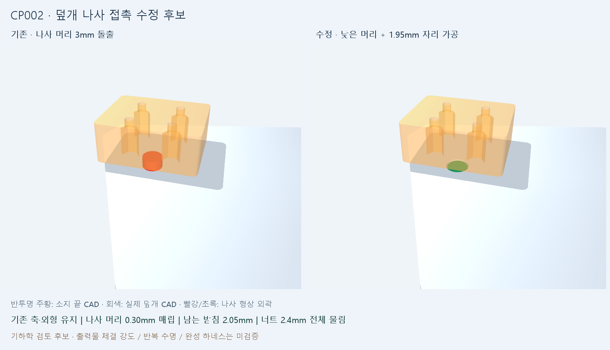

# CP002 — 덮개 나사 접촉 해소, 부분 벌림 제한

## 변경

- V12 손 조립에서 덮개와 덮개 나사 두 객체를 교체한 V13 후보입니다. 축·손가락 길이·모터 수는 유지했습니다. V9 동결 증거는 그대로입니다.
- 덮개 나사 5개를 ISO 7380-1 M3×8 낮은 머리 외곽으로 바꾸고 Ø6.3mm 자리 1.95mm를 가공했습니다. 공급사 치수는 cad/assembly_fixes_v13/sources/cover_screw.json에 있습니다.
- 공칭 머리는 표면보다 0.30mm 안쪽, 받침 고리 두께 2.05mm, 너트 전체 물림 2.4mm, 나사 끝 돌출 1.45mm입니다. 나사 머리는 보수적인 원통 외곽이며 실제 소켓/둥근 머리는 생략했습니다.
- safe_joint_limits.json과 오프라인 범위 검사 코드를 추가했습니다. 사용자용 진행 흐름은 PROGRESS.md에 세 줄로 기록합니다.

## 다시 계산한 결과

| 검사 | 결과 | 범위 |
| --- | --- | --- |
| 동결 V9 해시 | 222개 일치 | 원본 증거 보존 |
| t=.99 기존 소지 끝–나사 실제 STEP | 11.927699mm³ 겹침 재현 | 감사의 깊은 주먹 자세 |
| 수정 후 같은 자세 | 나사 2.660595mm / 덮개 1.742868mm, 겹침 0 | 실제 STEP 재계산 |
| 저장 자세 6개 | 수정 부위 최소 4.142638mm | 덮개/나사와 기존 움직이는 손 부품 390쌍 |
| Open→저장 Close | 401표본 최소 4.486190mm | 같은 390쌍 |
| 깊은 주먹 t∈[0,.99] | 연속 메시 거리 하한 1.187667mm | 같은 390쌍, 명시한 경로만 |
| 깊은 주먹 t=1 | 덮개–소지 끝 0.664887mm, 목표 미달 | 메시 검사 및 별도 실제 STEP 검사 |
| 출력 형상 | 유효 솔리드 1개 / 닫힌 단일 메시 | 새 덮개 |
| 변경 외 객체 | 나머지 250개 저장 BRep/배치 동일 | 허용된 직렬화 끝자리 오차 이내 |
| 부분 벌림 제한 | 15건 통과 | 미검증 형상·오차·변경된 증거는 거부 |

깊은 주먹 경로는 네 손가락 [벌림,MCP,PIP,DIP]=[0,90t,100t,80t]°이며 엄지는 Open 고정입니다. t는 시간 아닌 경로 매개변수입니다. 받은 e2_range.py는 주석에는 엄지 Close라고 쓰지만 실제 코드는 Open이므로 실행 코드를 재현했습니다. 저장 Close=60/45/30°와 구분합니다. 깊은 주먹 전체의 401표본 중 2개가 메시 1.1mm 기준 미달입니다. 전체 경로 통과가 아닙니다.

연속 하한은 각 부품 점의 속도를 Σ|관절 변화율|×반경으로 상계하고, 가장 가까운 표본까지 매개변수 거리 0.00125를 곱해 표본 최소 거리에서 뺀 값입니다. 최대 속도 상한 444.159887mm/t와 거리 출력 반올림 0.000001mm를 반영했습니다. 수치는 cover_motion.json에 있습니다. 메시에서 실제 CAD로 해석하려면 각 표면의 테셀레이션 오차 가정도 필요합니다. 출력 공차·서보 오차·휨을 포함하지 않습니다.

## 제한 코드의 의미

V9의 연속 벌림 오차 상자(Open ±1°, Close ±3°, Splay ±0.5°)에 네 명령 편차와 오차 구간이 동시에 들어가는지만 검사합니다. 엄지·다른 굽힘 관절·팔은 근거 자세에 고정하고, 해당 관절의 비영 오차는 거부합니다. Backbend, V13 등 다른 형상, 증거 해시 변경, 근거 없이 넓힌 범위, NaN/누락 입력을 거부합니다.

**전체 관절 한계가 완성된 것이 아닙니다.** V13이나 실물 구동에 적용할 수 없고, 받아들인 두 자세 사이 이동도 승인하지 않습니다. 모든 반환의 physical_actuation_approved와 continuous_path_approved는 false입니다.

## 남은 일

1. 최대 주먹 끝 0.665mm 여유 및 동시 벌림 오차 개선.
2. 열린 너트 포켓의 낙하 방지. 이번에는 수정하지 않았습니다.
3. 추가 V10/V11 전선·가이드를 포함한 전체 배선/분기/수명 검토. 이번 390쌍에는 추가 전선·가이드가 빠져 있습니다.
4. 팔 구동 재선정/감속/중력 보상 결정, 대표 손가락 실제 부하·속도·전류·온도 실측.
5. 새 받침부 FDM 체결 강도·크리프·공구 접근, 반작용/가속을 넣은 구조 검토.

## 재현과 커밋 후 검토

- 분석 Python: verify_audit_evidence.py --full, tools/check_checkpoint.py --output OUT/quick.json, tools/test_offline_pose_guard.py
- 움직임: cad/assembly_fixes_v13/check_cover_motion.py --output OUT/motion.json
- FreeCAD Python: tools/review_cover_checkpoint.py --root CLEAN_CHECKOUT --output OUT/geometry.json
- 같은 SHA의 깨끗한 clone에서 위 검사를 다시 실행하고 docs/reviews에 대상 SHA·결과·한계를 기록합니다. 같은 에이전트의 재검토이며 독립 감사가 아닙니다.
- FreeCAD는 pythonw.exe와 windowsHide:true로 실행합니다. GUI/FreeCADCmd 창을 띄우지 않습니다.

현재는 제작·실물 구동 승인 전 후보입니다.
