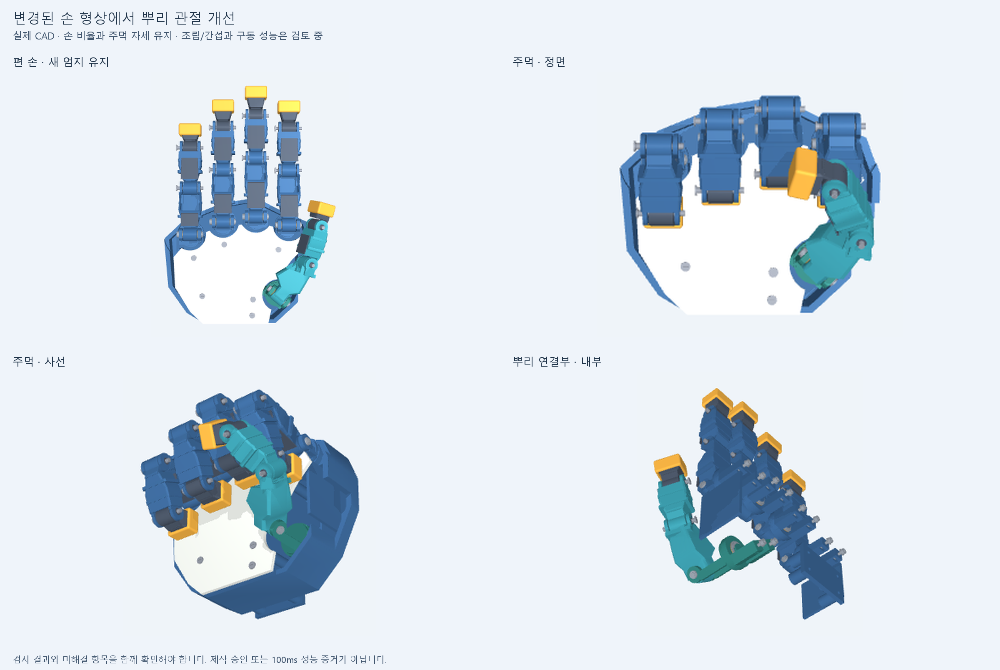

# DRIVE002 — 변경된 엄지·주먹 CAD에서 제작과 구동 검토 재개

사용자가 변경한 `webcam_articulation_v1`에서 이어간 회차다. 손바닥180×150mm, 중지154mm와 현재 엄지·마디 형태를 유지했다. 엄지 굽힘축 높이21mm, 바깥축 `Rz(25°) @ Ry(-65°)`, 뿌리 벌림−Z와 깊은 주먹 자세를 새 모델의 기준으로 삼았다. 원본 CAD와 작업 중인 웹캠 앱은 수정하지 않았다.

## 실제 수정

기존 뿌리30부품을100부품으로 대체해 전체190부품을 만들었다. 떨어져 있던 뿌리 링·포크를 일체형 회전 부품으로 연결하고 지지살까지 합친 뒤 핀 구멍을 관통 절삭했다. 고정 받침을 회전하는 눈 아래로 내리고 분할 플랜지 부싱, 핀 머리·와셔·홈·유지링을 추가했다. 두 받침 다리는 손바닥 바닥에 닿으며 관통 볼트와 옆에서 넣는 너트를 갖는다.

손바닥에는 받침 자리와10개 체결 구멍, 손가락 입구의 간섭 제거 절삭을 적용했다. 왼쪽 측벽 끝을11mm 줄이고 한 덮개 기둥·나사 위치를 Y104→94mm로 옮겼다. 엄지 첫 마디에는 실제 축을 따르는 구멍과 슬리브 여유를 다시 절삭했다. 손 비율을 줄여 문제를 피하지 않았다.

이는 공칭 설계다. 나사산·실제 구매품·클립 탄성·핀 회전 방지·끼워맞춤·강도·피로·전체 조립 접근을 승인한 도면은 아니다.

## 형상 검사

| 검사 | 이번 결과 |
| --- | --- |
| 개별 STEP·STL·조립 STEP 대응 | 190개 모두 유효한 단일 솔리드, 입력 해시 유지 |
| 편 손→주먹 경로 | 13표본 모두 겹침0, Boolean 실패0 |
| 검지만−22° 벌리는 반례 | 다른 강체 간 겹침21쌍 유지 |
| 뿌리 핀 통로·원통축·일체형 연결·좌면·바닥 체결 | 선언한 형상 검사 통과 |
| 너트10개 삽입 | 독립 검사에서 각19개 위치 통과; 전체 조립·정비 접근 승인은 아님 |
| 이전20모터 배치와 새 손 | 편 손·주먹 각각38쌍 겹침: 검지 MCP 모듈11쌍, 소지 MCP 모듈27쌍 |

겹침은0.02mm³ 초과 교집합을 보고한다. 같은 강체의 모든 부품 쌍도 포함하며 중립 계산을 재사용한다. 표본 검사로 연속 경로·전 가동 범위를 보장하지 않는다. 원본 WEBCAM003 기록의 편 손47쌍·주먹44쌍과 비교를 보존했지만 원본을 이번에 다시 계산한 것은 아니고 부품 분할도 달라졌다. 초기 수정본과 입구 절삭 전 실패 결과는 `generated/history`에 남겼다.

손 CAD의 가정 질량은724.304g, 움직이는 부품은306.076g이다. 실제 BRep 체적·무게중심·전체 관성 텐서와 가정 밀도를 사용했다. 모터·줄·배선·미완성 체결부는 빠져 있어 완성품 질량이 아니다.

## 새 형상의 제한된 추종 계산

20축과 부품별 강체 소속을 새로 연결하고28개 자세의 축·위치를 고정된 webcam 참조와 대조했다. 실제 형상/관성13개 검사와 규약5개 검사가 통과했다. MuJoCo에 입력한 관성을 다시 구성한 최대 차이는4.73×10⁻¹⁷kg·m²였다.

모터·제어·마찰·케이블 값은 이전 DRIVE001의 미보정 가정을 그대로 사용했다.20개 모두 케이블 구동이며 `A=I`로 상위 관절 때문에 추가되는 줄 길이를 완전히 제거한 **아직 CAD에 구현하지 않은 비교 조건**이다. 따라서 다음 숫자는 실제 배치와 전달계를 완성한 손의 성능이 아니다. 카메라·인식은 포함하지 않는다.

| 시험·시간간격 | 유효 사건 최대 시차 | 누락/선행 | 같은 시각 최대 각도 오차 | 유지 판정 실패 |
| --- | --- | --- | --- | --- |
| 5° 왕복·125µs | 78.286ms | 누락5·선행0 | 4.278° | 56/80 |
| 5° 왕복·62.5µs | 78.086ms | 누락5·선행0 | 4.289° | 56/80 |
| 새 주먹·125µs | 26.885ms | 누락0·선행2 | 21.063° | 23/40 |
| 새 주먹·62.5µs | 26.914ms | 누락0·선행2 | 21.130° | 23/40 |

5° 시험의 누락5개는 구간 시작 때 이미 임계값을 지난4개와 구간 내 미도달1개다. 주먹은0.6초 닫기→0.3초 유지→0.6초 역순 열기→0.3초 유지이며 사람이 실제로 움직인 속도 자료는 아니다. 선행은10ms 초과 이른 통과다. 작은 동작의 유지 오차 띠는 진폭10% 등 임시 규약이며 최종 사용자 정확도 요구가 아니다.

시간간격을 반으로 줄였을 때 주먹은 사전 선언한 수렴 조건을 통과했다(최대 차이0.090944°, 사건 시차 차이0.203ms). 작은 동작은0.021403° 차이로 기준0.02°를 넘었다. 기준을 완화하지 않고 **수렴 실패**로 남겼다. 사건·유지 분류는 두 간격에서 같았다. 주먹의1° 수렴 기준도0.1° 정착 정밀도를 보증하지 않는다.

**네 사례 모두100ms 사건 예산 통과 판정은 false다.** 유효 사건의 시차만 떼어 전체 손의50/100ms 달성으로 표현하지 않는다. 충돌 힘·실제 줄 경로·완성된 전달계 질량·외부 하중·팔 운동이 빠진 진단이다. 전체속도 원시 NPZ는 D: 작업 폴더에, 모든 사건·유지 판정과2ms 표시용 궤적은 저장소에 보존했다.

## 다음 개선과 남은 차단 항목

1. 검지 MCP·소지 MCP 모터를 손목·전완으로 옮기는 손바닥4개+원격16개 배치부터 비교한다.20축은 유지한다. 랙 증설, 팔과의 충돌, 고정·공구 접근과 줄 경로를 함께 확인하기 전에는 채택하지 않는다.
2. 실제 줄 경로·풀리·예압 조절과 축간 길이 변화를 만들어 `A=I` 가정을 대체한다. 작은 동작의 수치 수렴과 정지/반전 오차를 분리해 검토한다.
3. 자유 벌림 충돌, 기존 국소 얇은 외피, 원위 핀·부싱 유지, 장식판·손끝 캡·덮개 체결을 고친다. 바닥 절삭 후 강성·강도와 전체 하중 전달도 남아 있다.

제작 승인과 실물100ms 성능은 미완료다. 기존 자동 반복 예약은 이번 조회에서 존재하지 않는 것으로 확인됐으며, 이 회차의 실행을 예약 재개로 표시하지 않는다.

## 재현 자료

- [CAD·검사 설명](../cad/articulation_drive_v2/README.md), [STEP](../cad/articulation_drive_v2/generated/hand.step)
- [전체 형상 검사](../cad/articulation_drive_v2/generated/assembly_review.json), [기존 모터 배치 대조](../cad/articulation_drive_v2/generated/packaging_screen.json)
- [새 모델·시험 규약](../sim/articulation_drive_v2/README.md), [4건 결과](../sim/articulation_drive_v2/results/drive002/summary.json)
- [입력 manifest](DRIVE002.manifest.json). 고정 V9 증거222개는 보존한다.

커밋·푸시 뒤 해당 SHA의 새 작업 사본에서 CAD·질량/관성·핵심3자세·모델 입력과 검사를 다시 실행한다. 그 후속 결과는 `CHECKPOINT.json`과 `docs/reviews`에 대상 SHA를 명시해 별도로 남긴다. 전체 동역학4건과 주먹13표본을 커밋 후 재실행했다고 주장하지 않는다.
