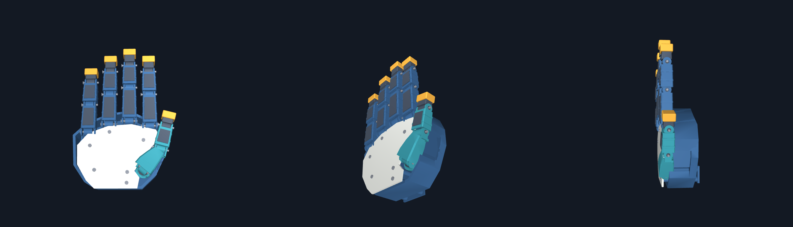
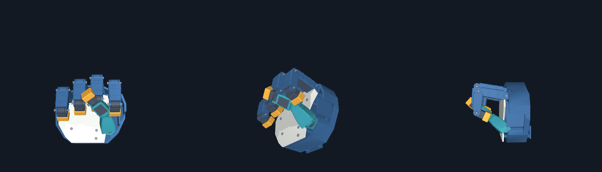

# WEBCAM001 — 실제 CAD 웹캠 추종 재구성

2026-10-24. `sim_3rd/hand_follow`를 카메라 수신, MediaPipe 추적, 손가락 변환,
엄지 위치 추종, 보정, 필터, CAD 표시, 진단 기록으로 나눴다.
기준 외형은 `cad/form_candidate_v1`의 실제120개 STL이다.

## 확인된 원인과 수정

- 기존 투영 방식에서 뿌리 굽힘이90도를 넘으면 벌림이180도 뒤집히고
  가운데·끝마디가 음수가 됐다. 합성 입력95/90/65도가 기존85/−90/−65도로
  변환되는 경우를 재현했고, 새 계산은95/90/65도를 유지한다.
- 실제 웹캠에서는 엄지의 비틀림을 CAD 고정축에 투영한 각도가 거의0으로
  축소됐다. 사람과 CAD의 비율도 달라 단순 관절각 복사로 주먹을 감싸지 못했다.
  CAD 축·길이를 사용하는 제한된 위치 역기구학과 관측된 엄지의 교차 위치,
  접힌 손가락 외측 높이 보정을 추가했다. CAD 범위와 모양 자체는 바꾸지 않았다.
- 한 끝마디의 깊이 추정이 편 손과 주먹에서 거의 같으면 전체 보정이 실패했다.
  유효한 관절은 보정하고 그 끝마디만 가운데마디 비율로 추정한다.
  추정 관절은 화면·JSON에 표시하고 개인 보정 파일에도 기록한다.
- 보정 통계는 최근1.4초의 중앙값·중앙 절대편차, 이득 상한4배를 사용한다.
  손이 사라지면 마지막 자세를 유지하며 재검출 시 필터·엄지 초기값을 재설정한다.
- 카메라 최신 프레임만 처리하고 단일 손 추적과 글자 캐시를 사용한다.

## 검사

Python3.12.14, requirements의 고정 버전으로 `python -m unittest discover -s tests -v`:
**23건 통과**. 원본 CAD120부품의 중립 위치,20관절 이름과 독립성, 엄지 계산과
실제 MuJoCo 끝점 일치, 좌우손·카메라 회전 불변성,90도 전후 깊은 굽힘,
공식 MediaPipe 사진에서 추출한 관절점, 보정·가린 끝마디·추적 소실·필터를 검사했다.

USB2.0 PC CAMERA에서 실제 영상 수신과 손 검출을 확인했다. 현재 장치의
손을 보여 준 구간의 카메라 수신은약30fps이며 전체 표시 처리율은 부하에 따라약15–20fps였다.
어두운 무검출 구간에서는 카메라 수신 자체가약8fps까지 내려갔다.
이 수치는 모터 추종 지연이나 실물 손의 성능이 아니다.
사용자 동작의 수치 로그를 로컬에서 재생해 보정을 복구했으며 카메라 이미지는 저장하지 않았다.
개인 관절점·개인 보정값·런타임 로그는 Git에 포함하지 않는다.

아래는 카메라 입력 없이 CAD 명령 자체를 확인하는 합성 자세다.

## 남은 한계

엄지는 사람의 회전축을 모두 갖지 않아 정확한 자세 일치는 보장되지 않는다.
엄지 끝 목표 오차25mm 초과는 UI에 표시한다. 외측 높이 보정은 두께 근사이며
실제 메시 간섭·접촉·모터·줄·실물 성능 검증이 아니다.
끝마디 추정을 사용하는 관절은 독립 동작을 복원하지 못한다.
가려진 관절의 깊이 오차와 화면 떨림은 남는다.
이 변경의 최종 실시간 품질은 사용자 확인과 구분하며, 앞선 중간판에 대해서는
사용자가 여전히 엄지가 옆/안쪽에 남는다고 보고했다. 해당 보고 뒤 보정 실패를 수정했다.

코드 체크포인트 커밋 뒤 같은 SHA의 별도 깨끗한 사본에서 핵심 검사를 재실행하고
후속 검토 기록을 남긴다. 같은 에이전트의 재검토이며 독립 감사가 아니다.
