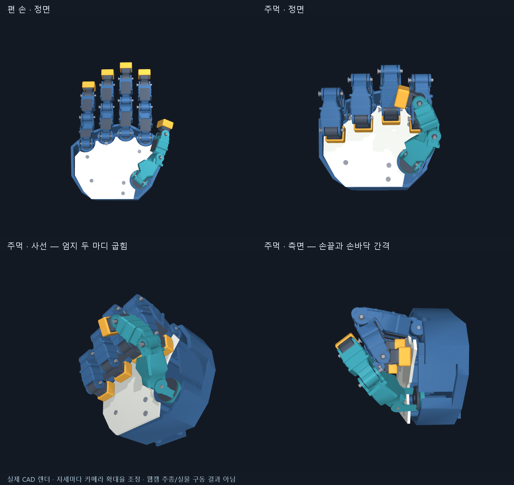

# WEBCAM002 — 엄지 축과 실제 주먹 형상 수정

사용자가 지적한 문제는 인식 흔들림뿐 아니라 CAD 관절 자체였다. 이전 코드는
각도 적용과 끝점 이동을 검사했지만, 손끝이 손바닥에 가까워지는지와 외피 간섭을
검증하지 않아 실제로 닫히지 않는 모델을 그대로 보여 줬다.

원본 외형 CAD는 보존하고 `cad/webcam_articulation_v1`에 별도 후보를 만들었다.
웹캠 앱은 이 후보의 관절 범위·주먹 목표·프레임을 읽는다.

## 수정

- 엄지 뿌리에 직각인 좌우/굽힘2축을 유지하고 굽힘 받침을21mm 높였다.
- 두 바깥 마디의 굽힘축을65도 틀고 실제 포크 구멍·부싱·핀·메시와 모델 축을 일치시켰다.
- 좁은 근위 목, 마디 접힘 홈, 손바닥 덮개 뿌리 홈을 추가했다. 원본 손바닥 비율과 링크 길이는 유지했다.
- 네 손가락의 주먹 목표를 손바닥 앞면에서2mm 떨어진 손끝 위치로 계산했다. 엄지 두 바깥 마디도34.46/51.76도로 실제 굽힌다.
- 기준 왕복은 엄지를 옆으로 벌려 들어 올리고, 네 손가락을 접은 뒤 엄지를 감는다. 단순 동시 보간과 엄지를 낮게 둔 닫힘은 중간 자세에서 간섭해 기준 경로에서 제외했다.
- T 테스트 자세, V 보정 목표, 가려진 DIP의 추정 비율을 해당 CAD에서 읽는다. 기존 보정을 보존하고 새 후보 전용 프로필을 사용한다.
- 카메라 없는 개별 관절 확인 창과 실제 CAD 비교 이미지 생성기를 추가했다.

## 검사 결과

- 출력120부품은 각각 유효한 연결 솔리드1개다. STEP를 재수입한 뒤 부품별 체적과 공간 경계를 scene과 대조했다.
- 실제 엄지 포크의 양쪽 원통 구멍축은 목표 방향과 일치했다. 최대 축 위치 오차는 약4.3e-12mm다.
- 선언된 기준 경로의13자세에서 검사 대상 구조물의0.02mm³ 초과 교차는0건이었다.
- 주먹에서 네 손끝 캡과 손바닥 앞 덮개의 BRep 최소거리는 각각2mm였다.
- 코드34검사가 통과했다. 새/기존 CAD의 중립 STL 위치,20축 연결, 엄지 FK와 실제 모델 좌표, 두 뿌리축 직각, 양의 바깥 굽힘 방향, 새 주먹과 보정 비율 저장/복원을 포함한다.
- 새 기본 CAD로 앱을 카메라 없는 합성 입력3초 실행해91프레임 처리 후 오류 없이 종료했다. 사용자 실시간 추종의 품질 판정은 아니다.

원시 기하 결과: `cad/webcam_articulation_v1/generated/motion_review.json`.
코드 검사: [34검사](../docs/reviews/webcam002/tests.txt).

## 범위와 남은 일

간섭 검사는 주요 외피·손끝·뿌리 포크·손바닥 앞 덮개의 다른 강체 사이를 대상으로 한다.
부싱·핀·나사·장식판 체결부, 같은 강체 내부 접합, 뒤쪽 손바닥·모터는 제외한다.
샘플13자세 검사는 연속 경로 전체나 모든 자유 관절 조합의 무간섭 증명이 아니다.
실시간 앱은 충돌 물리로 자세를 강제하지 않는다. 실제 웹캠 동작의 남은 인식·위치 추종
오차는 이 형상 확인 이후 따로 확인해야 한다. 실물 제작·구동·성능 검증은 하지 않았다.

사용자 요청에 따라 프로그램을 다시 띄우기 전에 편 손·주먹 이미지를 먼저 제공한다.
코드 체크포인트를 푸시한 뒤 해당 SHA의 별도 깨끗한 사본에서 코드 검사와 STEP 기하
검사를 재실행하고 후속 검토 기록을 남긴다. 같은 에이전트의 재검토이며 독립 감사가 아니다.
