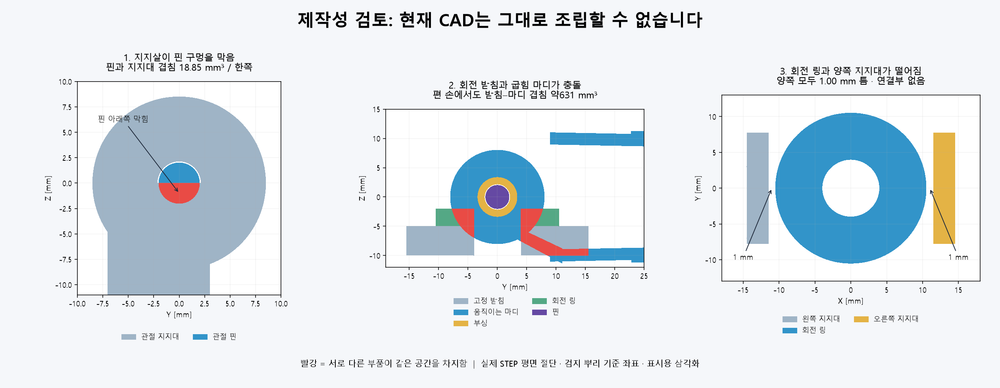

# WEBCAM003 — 실제 제작·조립 가능성 검토

2026-10-25. 사용자 요청: 웹캠에서 보이는 주먹 모양뿐 아니라 실제 제작 가능한 CAD인지 깊게 확인한다.

**판정: `webcam_articulation_v1`은 현재 파일 그대로 제작·조립할 수 없다.**
기준 형상은 `87f6bf17865fb441c407e0651c26f1f19c203a8c`이며 이번 검토는 CAD를 변경하지 않았다.
기존13자세 검사에서 빠졌던 핀·부싱·회전 받침·링·같은 강체 내 접합까지 포함했다.

## 직접 확인한 제작 차단 항목

| 항목 | 측정·코드 근거 | 의미 |
| --- | --- | --- |
| 뿌리 핀 구멍 막힘 | 다섯 손가락 양쪽10곳, 각각18.8495559mm³ 교차. 반지름2mm 핀의 아래 반원×3mm인6π와 일치 | 구멍을 낸 지지대에 지지살을 합친 뒤 최종 구멍을 다시 뚫지 않아 핀이 들어가지 않음 |
| 고정부와 운동부 간섭 | 편 손47쌍(서로 다른 강체29쌍), 주먹44쌍(26쌍). 네 손가락 고정 받침–마디 약629~631mm³ | 주먹 외형만으로 실제 회전 가능성을 판단할 수 없음 |
| 연결 누락 | 네 손가락 링–양쪽 지지대 각각1mm 틈. 중지/엄지 고정 받침–손바닥 최소거리0.431/2.524mm | 시뮬레이터의 같은 강체 묶음이 실제 연결을 대신함 |
| 체결·끼워맞춤 미완 | 핀Ø4, 부싱 내경4.4/외경6.7, 구멍6.8. 핀 반대쪽 유지부와 부싱 고정 정의 없음. 덮개 나사6개는 머리만 존재 | 구매품·공차·조립 순서·빠짐 방지를 정해야 함 |
| 장식·손끝 체결 누락 | 장식판9개와 캡5개에 실제 고정 구조 없음 | 출력 부품을 놓는 것만으로 조립되지 않음 |
| 접힘 홈의 얇은 끝 | 외피 국소 법선 두께 약0.083mm인 표본 확인. 전체24부품의 표본 결과는 아래 JSON에 보존 | 명목 외피2mm와 유효 솔리드 판정은 절삭 후 최소 두께를 보장하지 않음 |
| 모터/전달계 미통합 | 현재 모터0개. 별도 구동 입력은 엄지 높이/축 방향과 PIP122~133도 주먹을 반영하지 않음 | 기존20모터 배치나 동역학 성능을 이 형상에 옮겨 쓸 수 없음 |
| 자유 가동 범위 충돌 | 허용 범위 내 검지 벌림−22도에서 검지–중지 가운데 마디1447.58mm³ 교차 | 개별 관절 범위만으로 전체 충돌을 막지 못함 |

120개 STEP 부품은 모두 유효한 단일 솔리드다. 이 사실과 조립 가능 여부는 다르다.
손끝 캡 STL5개는 각각 퇴화 삼각형8개를 포함한다. 그 삼각형만 진단상 제거하면 열린 경계와 비다양체 모서리는0이 된다. 원본 STL은 수정하지 않았고, 이를 실제 STEP 구멍으로 해석하지 않는다.

## 재현 자료

- [사용자용 전체 보고서](../cad/webcam_articulation_v1/generated/manufacturing_audit/manufacturability_review.html)
- [판정·입력 해시·수정 우선순위](../cad/webcam_articulation_v1/generated/manufacturing_audit/readiness.json)
- [모든 부품 쌍 검사](../cad/webcam_articulation_v1/generated/manufacturing_audit/assembly.json), [연결·체결·구동 대조](../cad/webcam_articulation_v1/generated/manufacturing_audit/interfaces.json)
- [24부품 국소 두께 표본](../cad/webcam_articulation_v1/generated/manufacturing_audit/walls.json), [STL 진단](../cad/webcam_articulation_v1/generated/manufacturing_audit/mesh_cleanup.json)
- 실행 순서와 한계는 [후보 README](../cad/webcam_articulation_v1/README.md)에 기록했다.

체적 중복 집계의 문턱은0.02mm³이며 임의 부품 쌍 제외는 없다. 같은 강체 내부 중복은 일체 제작/별도 조립 의도를 결정해야 하고, 서로 움직이는 부품의 중복은 운동을 막는다.
벽 두께는24부품의5,583개 유효 위치에 대한 국소 법선 측정이며 전역 최소를 보장하지 않는다. 판2mm·슬리브1.15mm의 해석값으로 측정 방법을 확인했다.

## 수정 순서와 미확정 조건

1. 뿌리2축 관절 하나에 실제 축·부싱·와셔·유지부·손바닥 체결·구동 연결까지 설계한다. 합친 형상에 최종 관통 구멍을 내고 조립 순서를 증명한다.
2. 움직이는 부품의 간섭과 끊어진 연결을 제거하고, 재료/공정/구매품을 정해 끼워맞춤·축방향 유격·공구 접근을 검토한다.
3. 한 관절 시험편의 조립·유격·처짐·반복 운동 기준을 정한 뒤 나머지 손가락에 확장한다.
4. 새 엄지 축과 가동 범위를 실제 전달계·하중·관성에 연결하고 연속 운동·강도·피로·구동 성능을 평가한다.

공정, 재료, 손끝 힘, 충격/반복 수명, 허용 처짐/유격은 아직 확정되지 않았다. 힘 전달 경로가 끊긴 조립을 임의로 고정해 강도 합격 수치를 만들지 않았다. 팔과 별도 구동 CAD 전체, 모든20축 조합/연속 운동, 실물·웹캠 추종 품질은 이번 판정 범위 밖이다.
검사 코드·결과·단면·미해결 항목을 먼저 커밋/푸시한 뒤, 해당 SHA의 별도 깨끗한 사본에서 핵심 검사를 재실행하고 후속 기록을 남긴다. 같은 에이전트의 재검토이며 독립 감사가 아니다.
