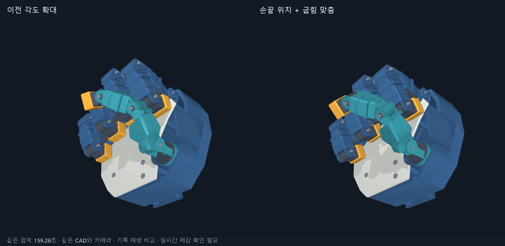
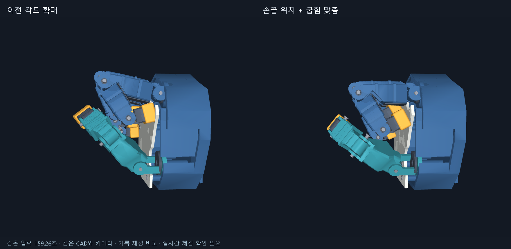

# WEBCAM004 — 웹캠 손끝 위치·굽힘 맞춤

2026-10-25. 어색한 주먹 추종을 CAD 제작 개선과 분리해서 진행한다. 현재 `webcam_articulation_v1`의 부품, 길이, 축, 관절 범위는 변경하지 않았다. 제작 차단 항목은 WEBCAM003과 별도 제작 작업의 범위다.

## 실제 수정

- 기본 추종을 관절별 배율에서 네 손가락 각각의 손끝 위치와 굽힘을 함께 맞추는 방식으로 변경했다. 편 손/주먹의 정규화한 손끝 위치를 보정하며, 닫힌 위치는 CAD에 정의한 주먹 끝점에 맞춘다. 중간 자세는 관측값에 계속 반응한다.
- 손가락 벌림을 위치 계산 좌표에 반영하고, 손끝–뿌리 거리의 감소와 뿌리 굽힘을 함께 사용한다. 곧은 손가락을 뿌리에서만 접거나 뿌리를 편 갈고리 자세가 닫힌 주먹 보정으로 넘어가지 않도록 했다.
- 검지 끝마디처럼 편 손에서42.54도, 배율3.47로 잡혔던 관측은 각도를 확대하지 않고 손끝 위치를 더 따른다. 해당 마디는 추정 중으로 표시한다. 관절 한계 도달도 별도로 기록한다.
- 엄지 계산에 해석 미분을 사용하고 중복 계산을 줄였다. 화면 고정 요소를 재사용하며 기본 렌더 해상도를660×570으로 낮추고 그림자를 생략했다. `--full-quality`로 이전 품질을 사용할 수 있다.
- 개인 위치 보정 파일을 별도로 사용하고 CAD 길이/뿌리/범위/주먹 목표의 서명이 달라지면 다시 보정한다. 이전 각도 방식은 `--retarget angles`로 비교할 수 있다.

## 검사와 결과

코드46검사와 합성 입력76프레임의 앱 실행을 통과했다. 합성 검사에는 개별 손가락·끝마디 동작, 벌림/뿌리만 접기/갈고리 구분, 좌우 손·카메라 회전, 보정 저장과 형상 변경, 끝마디 관측 오차, 손끝 점 높이 하한, 해석 미분 대조가 포함된다.

사용자의 이전 숫자 기록을 같은 시각으로 두 방식에 재생했다. 총789프레임 중 네 손가락의 닫힘 진행도 모두0.90초과인198프레임을 선택했고, 간격0.25초 미만의 인접166쌍을 비교했다.

| 지표 | 이전 | 수정 후 |
|---|---:|---:|
| 검지 끝마디 인접 변화량95백분위 | 13.94° | 3.07° |
| 목표 손끝과 맞춘 손끝의 거리, 중앙값/90백분위 | 비교 정의 다름 | 3.79 / 7.29mm |

인접 변화량은 실제 움직임과 범위 한계 도달을 포함한다. 정지 떨림 감소율이나 실제 손 관절 정확도라는 뜻은 아니다. 수정 후 닫힌 구간에서 뿌리의 범위 끝 도달 비율은 검지95%, 중지100%, 약지87%, 소지58%다. 약지/소지 끝마디도 각각89%/96%이므로 모든 마디의 미세 변화를 충실히 재현한다고 주장하지 않는다. 엄지의 인접 변화량은 일부 축에서 증가했으며 전체20축이 모두 개선된 것은 아니다.

별도 미리보기 비교는 이전/수정/수정/이전 순서로 각40표본을 측정했다. 카메라 영상은 검은 합성 화면이고 CAD 자세는 동일하다. 카메라·인식·창 표시를 제외한 렌더+화면 합성의 중앙값은 결과 JSON에 남겼다. 실행 시 다른 계산 부하가 있었으며 실시간 fps나 모터 지연 성능으로 환산하지 않는다.

## 근거와 재현

- `sim_3rd/hand_follow/evaluate_tracking.py`: 완료된 C/V 이벤트와 최대10Hz의 숫자 기록에서 개인 보정을 재구성한다. 원래 전체 프레임으로 얻은 보정과 완전히 같지는 않다. 기록된 CAD 해시가 현재 CAD와 일치하는지 확인한다.
- `docs/reviews/WEBCAM004/summary.json`: 입력·코드 해시, 구간 선정, 관절별 결과와 한계.
- `sim_3rd/hand_follow/benchmark_preview.py`: 과거 `ui.py`를 입력받는 미리보기 비교. 기준 파일은 `31ba43fd4ab6393945a612b46c7b279de11a5267:sim_3rd/hand_follow/hand_follow/ui.py`다.
- `docs/reviews/WEBCAM004/preview_benchmark.json`, `synthetic_smoke.json`, `tests.txt`: 집계 근거. 원시 관절점과 개인 보정 파일은 커밋하지 않는다.

개인 기록의 로컬 입력은 `D:/Codex-work/robot-hand-workspace/work/hand_follow_sessions/20261025_001321_16932`다. 외부 사용자는 자신의 완료된 C/V 세션으로 검사할 수 있고, 같은 숫자 재현에는 동일한 개인 입력이 필요하다. 이전 각도 비교도 현재 코드의 동일한 엄지 목적함수/필터를 사용하므로 옛 실행 파일 전체의 속도 비교가 아니다.

## 남은 범위

현재 CAD 비율과 두꺼운 외피에서 오는 어색함, 관절 한계 도달, 가려진 마디의 추정 오차가 남는다. 손끝 점의 손바닥 높이 하한은 전체 외피 충돌/접촉 검사나 제작 가능 판정이 아니다. 실시간 창을 열고 기록 중이며 자연스러움은 사용자 피드백을 별도로 확인한다. 코드·이미지·집계 근거를 커밋/푸시한 뒤 그 SHA의 새 사본에서 핵심 검사를 다시 수행하고 후속 기록을 남긴다.
