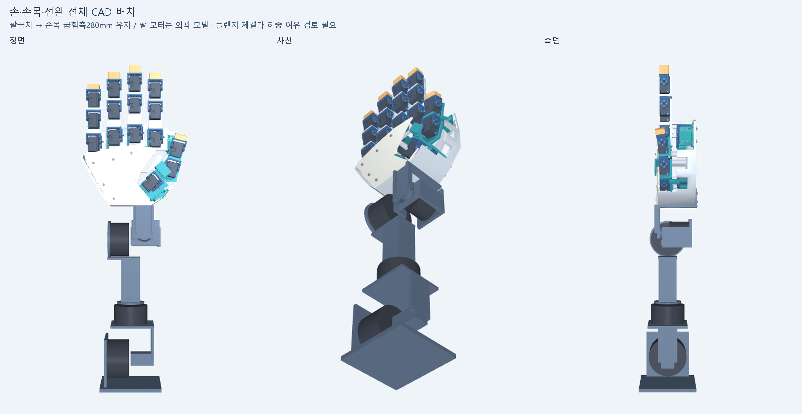

# 원형을 유지하는 저관성 손의 외형 기준

2026-10-24 사용자 교정: **비율과 형태를 원래 저장소처럼 유지해야 한다. 절대 크기를 키우라는 요청이 아니다.** 현재 remote 후보의 막대 같은 손가락과 돌출된 엄지 배치는 원하는 외형으로 채택하지 않는다. 속도 목표는 로봇 단독50ms 목표·선언 범위100ms 상한으로 유지한다.

이어 사용자는 마디 디테일뿐 아니라 **손바닥이 너무 크고 손가락이 짧게 보이는 전체 비율**을 지적했다. 손가락을 더 줄이는 대신 손바닥 폭·길이, 뿌리 간격과 엄지 시작점을 함께 바꾸는 것이 우선이다. 원형·현재 후보의 비교 그림을 반복하는 것으로는 이 요청을 충족하지 않는다. 첨부된 원형의 손·손목·전완 구성과 파란 구조부·어두운 마디·청록색 엄지·밝은 손바닥·노란 손끝도 시각 기준으로 삼는다.

현재 외형 기준은 [비율 변경 외형 CAD](../cad/form_candidate_v1/README.md)다. 손바닥180×150mm와 중지154mm를 출발점으로 실제 새 중공 형상을 만들었다. 사용자가 이 형상에서 개선을 재개하도록 지시하여, 내부 구동 후보는 별도 [form_drive_v1](../cad/form_drive_v1/README.md)에 연결한다. 원본 외형 파일에는 모터가 없으며, 새 배치 후보도 완성 구동 조립이나100ms 통과 결과로 취급하지 않는다.

첫 새 그림 이후 사용자는 전체 비율이 나아졌다고 평가하고 엄지를 더 사람답게 다듬도록 요청했다. 이에 네 손가락 비율을 유지하며 엄지의 넓은 중수부가 손바닥과 이어지고 바깥 두 마디가 검지를 향하도록 수정한다. 이 외형 피드백을 구동·제작 승인으로 해석하지 않는다.

## 기준 형상

기준은 보존 브랜치 `archive/direct-drive-v13`의 `accd6c8d8d9791828233e9461ef1b1e8dccc8b0b` README에 나온 V9 손·전완 이미지와 해당 V9 CAD다. V13의 체결·배선 수정과 V9 대표 외형은 구분한다. 이번 비교는 V13 전체 조립을 재구성한 것이 아니다.

- 입력: [V9 design](../cad/modular_roots_v9/design.json), [scene](../cad/modular_roots_v9/scene.json), `collision_meshes.npz`, [기구학 좌표](../cad/modular_roots_v9/kinematics_numpy.py).
- 현재 수정 대상: [새 형상 구동 CAD](../cad/form_drive_v1/). 이전 [remote CAD](../cad/remote_drive_v1/)의 CP006·미완성 CP007은 보존한다.
- 이전 세 칸 축소 미리보기의 '기존'은 최초 저장소의 원형이 아니라 CP006의 축소 전 형상이었다. 따라서 그 비교만으로 원형이 유지된다고 판단할 수 없다.

## 달라진 부분과 되살릴 요소

| 요소 | 원래 형상 | 현재 remote 후보 | 다음 형상의 조건 |
|---|---|---|---|
| 손가락 마디 | 모터·힌지와 연결부가 나뉘어 각 마디의 덩어리와 경계가 보임 | 15개 경량 링크가22×18mm 직선 중공 형상으로 대체됨 | 마디별 볼륨·분절·관절 노출 비례를 복원하고 내부는 비우거나 보강대로 구성 |
| 손끝 | 별도 Tip 부품, 폭27mm·두께22mm 및 모서리 라운드 | 직선 링크와 비슷한 평평한 끝단 | 끝마디와 끝단 윤곽이 구분되는 형태를 먼저 설계 |
| 엄지 | 손바닥 옆 윤곽에 이어지는 중수골 구조와 순차 관절 배치 | 움직이는 가로대와 외부 모터2개가 엄지 주변 윤곽을 넓힘 | 원형의 엄지 뿌리·각도·연결선 유지, 모터는 기존 윤곽 안쪽 또는 별도 근위 공간에 배치 가능성을 검토 |
| 손바닥과 네 손가락 | 전체 윤곽과 마디가 함께 하나의 손 모양을 형성 | 손바닥 치수는 같아도 좁은 막대형 링크 때문에 상대 인상이 달라짐 | 손바닥 대비 손가락 폭·길이·두께 비례를 함께 비교 |
| 전체 크기 | 참고 치수이며 절대 크기 고정 요구가 아님 | 손가락만0.9배 축소하는 연구안 | 원형의 비례를 먼저 정하고, 필요한 경우 전체 크기와 내부 부품 배치를 함께 조정 |

기존 모터를 움직이는 마디에 그대로 다시 달아 외형만 되돌리는 것을 기본 해결책으로 삼지 않는다. 모터가 차지하던 마디 윤곽을 얇은 외피·중공 구조·기능적 관절 하우징으로 재구성하는 방안을 우선 검토한다. 추가 구조의 무게·강성·관절 여유는 CAD로 산출해야 하며, 단순 장식 덮개가 성능에 영향이 없다고 가정하지 않는다.

## 비교 및 진행 순서

1. 원형과 현재 후보를 같은 관절 자세·카메라·색 기준으로 비교한다. 절대 크기를 비교하는 화면과 크기를 정규화한 비율 비교를 구분하며, 보기 좋게 만들기 위한 개별 자동 확대는 하지 않는다.
2. 길이0.9배나 엄지0.8배를 먼저 고정하지 않고 원래 실루엣, 마디별 비율, 끝단, 엄지 연결 형태를 반영한 새 외형 후보를 만든다. 현재 외부 모터와 가로대 배치를 그대로 확정하지 않는다.
3. 외형 후보 안에서 모터·전달계·구멍·베어링·벽 두께를 배치하고 조립성을 확인한다. 원형의 손바닥·손목 연결은 참고 기준으로 사용하되 크기 확대만으로 문제를 덮지 않는다.
4. 새 형상에서 질량·관성·줄 경로를 다시 계산한 뒤 같은 추종 시험을 수행한다. 외형 수용과 속도 검증은 별개다. 이전의49ms를 새 외형의 성능으로 옮겨 쓰지 않는다.

막대형 후보를 기준으로 한 CP007 후속 개선은 계속 보류한다. 미완성 자료와 외부 축소 계산은 연구 기록으로 보존하며 덮어쓰거나 삭제하지 않는다. 2026-10-24 사용자 재개 요청에 따라 자동 반복은 새 외형의 모터 배치·전달 구조·추종 모델을 대상으로 다시 활성화했다.
